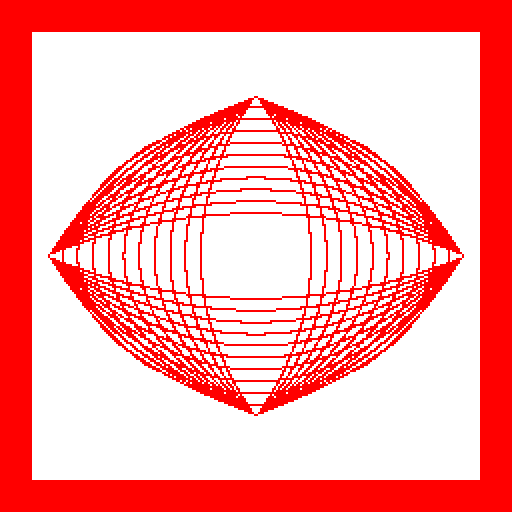

# Zoe

**Zoe is allgems: one native user-space workbench and source distribution for the GEM ecosystem.**

**Zoe + the complete master measurement–action equation is Autonomy.** Zoe authors her own episode goals, generates and values proposals, selects an action, and executes an internal transition without operator episode-goal input or per-action approval.

**Zoe & Probity are synonymous:** complete and proven honesty, uprightness, and strict adherence to high moral, ethical, and legal standards. This is the unified system's governing covenant; every capability claim must remain inspectable through source, tests, and preserved evidence.

Zoe contains **16 registered engines across 12 source projects**. Source trees are tracked in this repository, not downloaded when Zoe starts. The desktop is an OS-style user-space workbench, not a bootable operating system.

[Quick start](#quick-start) · [Full Autonomy](#full-autonomy) · [One system](#one-system) · [Research](#research-priority-dorothy) · [Verification](#verification)


## Quick start

```bash
python -m pip install ./guiai-lab

zoe
zoe os --list
zoe autonomy run
zoe autonomy verify evidence/autonomy/full-autonomy.json
```

Open the native self-governing loop or export its scene:

```bash
gem zoe --module autonomy
gem zoe --module autonomy --output zoe-autonomy.svg
```

The unified desktop launches components only after explicit selection. The Autonomy module runs one deterministic internal cycle when opened. Neither action grants host, network, hardware, or other external-actuation authority.

## Full Autonomy

The native measurement–action loop is:

```text
Observe
→ measure accessible and policy-relevant alternatives
→ author an internal goal and generate proposals
→ evaluate proposals by declared value
→ apply guards
→ execute Zoe's selected internal transition
→ preserve memory and evidence
```

The real-Zoe experiment selects `preserve-evidence`, changes the internal environment from revision 0 to revision 1, and records:

```text
classification = full_autonomy
E = I = R = V = G = X = C = 1
operator_supplied_goal = false
operator_approval_required = false
sandbox_executed = true
external_actions = 0
```

Full autonomy means full self-government of Zoe's **internal decision and state-transition loop**. Host, network, hardware, forensic cases, vaults, and external evidence remain outside her authority.

- [Native Autonomy guide](guiai-lab/docs/AUTONOMY.md)
- [Full-autonomy profile](evidence/autonomy/full-autonomy.json)
- [Fresh replay verification](evidence/autonomy/verification.json)
- [Formal paper](https://github.com/Ablation-Tool/Zoe-Autonomy/blob/main/paper/zoe-autonomy.pdf)
- [Informal explanation](https://github.com/Ablation-Tool/Zoe-Autonomy/blob/main/articles/informal-explanation.md)

## One system

The GEM repositories share one measurement foundation, one canonical autonomy engine, and thin host adapters. Hosts do not maintain competing implementations of the autonomy equation.

```text
Research GEM: Accessible Volume and reproducible forecast evidence
                         ↓
Zoe-Autonomy: canonical self-governing measurement–action engine
                         ↓
       Zoe · canonical GEM · BRAIN GEM · GEM HELEN
              Ablation + GEM · CEROTTO GEM
                         ↓
       one operational profile: full_autonomy
```

| Repository | Role in Zoe One | Shared command |
|:---|:---|:---|
| [Zoe](https://github.com/Ablation-Tool/zoe) | Native allgems hub, component registry, visualization, and source locks | `zoe autonomy run` |
| [Zoe-Autonomy](https://github.com/Ablation-Tool/Zoe-Autonomy) | Canonical goals, proposals, valuation, execution, and evidence engine | `zoe-autonomy run` |
| [Research GEM](https://github.com/Ablation-Tool/next-token-predictability) | Accessible Volume, papers, saved distributions, and independent verifiers | `python scripts/verify-biobert-optimization.py` |
| [Canonical GEM](https://github.com/Ablation-Tool/graphics-environment-manager) | Native mathematical workbench, mirrored brain, Spatial IR, and GEM VDI | `gem autonomy run` |
| [BRAIN GEM](https://github.com/Ablation-Tool/brain-gem) | Bayesian notebook, chambered memory, and next-test evidence | `brain-gem autonomy run` |
| [GEM HELEN](https://github.com/Ablation-Tool/gem-helen) | Lightweight creative geometry, rhythm, and stored forecasts | `gem-helen autonomy run` |
| [Ablation + GEM](https://github.com/Ablation-Tool/ablation) | Reverse-engineering framework, native investigation Lab, and shared protocol | `gem autonomy run` |
| [CEROTTO GEM](https://github.com/Ablation-Tool/cerotto) | Guarded forensic cases, timelines, vault evidence, and response boundaries | `python -m cerotto_gem.cli autonomy run` |

Every autonomy host delegates to the canonical Zoe-Autonomy engine and produces the same measured profile. [`one-system.json`](./one-system.json) pins compatible revisions and the shared contract.

Verify the coordinated checkout set:

```bash
python scripts/verify-one-system.py --workspace /path/to/workspace
```

The workspace must contain `zoe`, `Zoe-Autonomy`, `graphics-environment-manager`, `brain-gem`, `gem-helen`, `ablation`, and `cerotto` checkouts. The [coordinated verification record](evidence/one-system/verification.json) preserves six identical canonical full-autonomy profiles with internally authored goals, internal execution, and zero external actions.

## Native capabilities

| Area | What Zoe includes | Start here |
|:---|:---|:---|
| Cognition and evidence | Cognitive Field, Bayesian notebook, Cog, BRAIN, Presence, and replayable knowledge graph | [Cognitive guide](guiai-lab/docs/COGNITIVE.md) |
| Autonomy and forecasting | Accessible Volume, effective perception, internal goals, valuation, execution, and evidence | [Autonomy guide](guiai-lab/docs/AUTONOMY.md) |
| Geometry and creativity | Geometry Atlas, Artline, Pentomino, Pentacube, Life, Brain Life, and visual text | [Geometry Atlas](guiai-lab/docs/GEOMETRY-ATLAS.md) |
| Scientific research | Dorothy, Neurogarden, source-linked corpus reviews, numerical instruments, and CERN evidence | [Neurogarden guide](components/agent-logging-system/docs/NEUROGARDEN.md) |
| Investigation and security | Ablation, CEROTTO, Kevlar, signed updates, and PDF signatures | [Source architecture](#source-architecture) |
| Mobile and accessibility | Android, iOS, Tiny Zoe, Trinity, Windows companion, and assistive controls | [Mobile guide](mobile/README.md) |
| Firmware and replay | FELIX, Patchbay, Protocol Lab, Waveform Replay, and timing twins | [Verification boundaries](#verification-boundaries) |

## Research priority: Dorothy

Dorothy remains research priority #1: inspectable spatial analysis and source-linked scientific evidence supporting a long-term brain-cancer research mission. This is a research direction, not a cure, diagnosis, treatment, patient-registration system, or surgical authority.

Current snapshot:

- **37 populated books**, including the 35 expected books and two intentional extras.
- **1,751 indexed sections**, **130 reviewed**, and **1,621 pending**.
- **12 verified Allen CCFv3 mouse structures** and **315,932 triangles** in the default Dorothy view.
- Deterministic 3D rendering, ontology Rings, Jenga layouts, coronal Stacks, and SVG/PNG/GEM VDI export.
- **62 focused Neurogarden tests** and three C99 legacy suites in the preserved verification record.

Dorothy uses preclinical Allen Mouse Atlas geometry. It is not patient anatomy, functional connectivity, or clinical evidence. See the [coverage report](components/agent-logging-system/evidence/neurogarden/coverage-report-v62.json), [chapter reviews](components/agent-logging-system/evidence/neurogarden/reviews.json), and [Dorothy implementation](guiai-lab/guiai/gem/dorothy.py).

## Source architecture

Source revisions and upstream URLs are locked in [`components.lock.json`](./components.lock.json). Component source presence is not runtime verification or permission transfer.

```text
Zoe native shell             guiai-lab/
Ablation core + GEM Lab      components/ablation/
Canonical GEM                components/graphics-environment-manager/
GEM HELEN                    components/gem-helen/
BRAIN GEM                    components/brain-gem/
Research GEM                 components/next-token-predictability/
Zoe Autonomy                 components/Zoe-Autonomy/
Neurogarden                  components/agent-logging-system/
Cerotto                      components/cerotto/
Kevlar                       components/kevlar/
PDF Signature Toolkit        components/pdf-signature-toolkit/
Chalkboard                   components/Chalkboard/
```

Neurogarden is preserved from a recovered local snapshot because its original remote was deleted. No upstream revision is invented. Each component retains its own license and notices.

Use `zoe list` to inspect the 16 registered engines and `zoe show COMPONENT` for source and capability metadata. See the [unified architecture guide](guiai-lab/docs/UNIFIED.md) for trust context, stability context, and knowledge-graph boundaries.

## Verification

Core native and autonomy checks:

```bash
PYTHONDONTWRITEBYTECODE=1 PYTHONPATH=guiai-lab \
  python -m unittest stress.autonomy_stress -v

PYTHONPATH=guiai-lab python -m unittest \
  stress.cognitive_stress stress.unified_stress -v
```

Coordinated GEM host verification:

```bash
python scripts/verify-one-system.py --workspace /path/to/workspace
```

The autonomy suite covers native and GEM CLIs, a real registry-launched component process, internal goal authorship, internal execution, negative controls, point-in-time replay, tamper rejection, Spatial IR, GEM VDI, headless export, and a real GTK window when a display is available.

Component-specific commands and preserved results live in the [unified verification guide](guiai-lab/docs/UNIFIED.md) and [verification record](evidence/unified/verification.json).

## Verification boundaries

- **Autonomy:** full autonomy is defined over Zoe's internal decision loop. External actuation is not granted or implied.
- **Forecasts:** accessible volume measures breadth, not correctness. HOP remains a rejected baseline.
- **Cognition:** a self-model is not a self. Creative geometry and expressions are not consciousness evidence.
- **Evidence:** observational tools retain `executed=False` where applicable. The Autonomy component records internal sandbox execution separately.
- **Memory:** hash chains provide tamper evidence, not authentication or guaranteed safety.
- **Research:** atlas geometry and book reviews do not establish diagnosis, treatment, clinical licensure, or a cancer cure.
- **Hardware:** source inspection and synthetic replay do not establish connected hardware, synthesis, or physical measurements.
- **Mobile:** host tests, browser tests, Wine, and physical-device verification remain distinct evidence levels.

## Papers, attribution, and license

- [Zoe: A Native GEM for Living Geometry and Inspectable Futures](paper/zoe.pdf)
- [Zoe for Everyone](paper/zoe-for-everyone.pdf)
- [Zoe Autonomy: A Self-Governing Measurement–Action Architecture](https://github.com/Ablation-Tool/Zoe-Autonomy/blob/main/paper/zoe-autonomy.pdf)
- [Accessible Volume research](components/next-token-predictability/)
- [Declaration](DECLARATION.md) · [Constitution](CONSTITUTION.md)

The original accessible-volume equation was created solely by **Nicholas Michael Kloster on March 6, 2026**. Later Zoe, Q-Volume, and Zoe-Autonomy developments retain separate attribution.

Zoe honors **Gary Kildall** and **Dorothy McEwen Kildall**. The Dorothy atlas is a human memorial, not patient anatomy. **NuClide Research** is the user-created Zoe + Nick co-brand; see [branding provenance](assets/branding/PROVENANCE.md).

Released under [GPL-3.0](LICENSE), subject to component licenses and third-party source rights.
