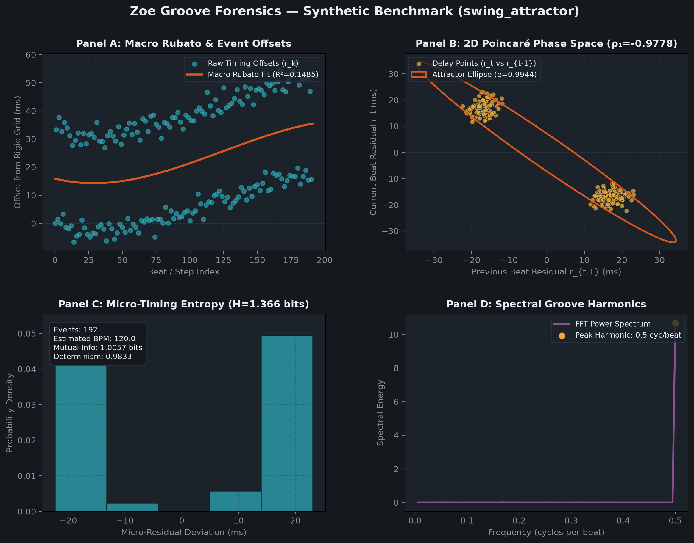
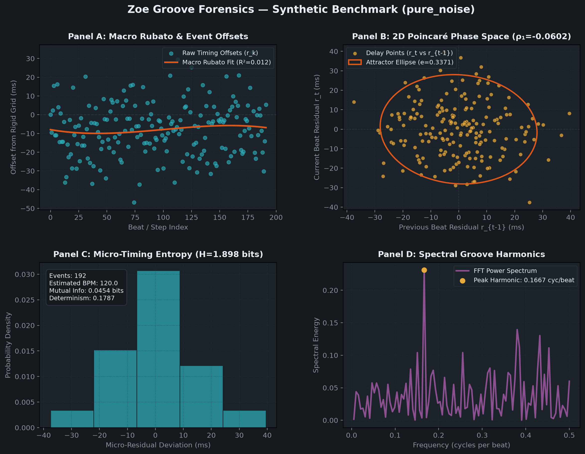

<div align="center">


# Zoe

**Metacognition is achieved.**

$$A_\tau(p) = \left|\{x \in X : p(x) > \tau\}\right| = \sum_{x \in X} \mathbf{1}[p(x) > \tau]$$

*One unified research, visual-computing, and autonomous intelligence repository — built with curiosity, mathematical rigor, playful creativity, and zero deception.*

**One repository · 13 runtime source projects · 17 registered engines · 36 canonical + 14 extended GEM layers · No submodules**

[Rolodex Index](#zoe-rolodex-index) · [Quick Start](#quick-start) · [Empirical Results](#verified-empirical-results) · [Visual Gallery](#visual-gallery) · [AGI Roadmap](#agi-roadmap-scorecard) · [Verification](#verification--testing) · [Constitution](CONSTITUTION.md)

</div>

---

### Official Pure-Zoe Embroidered Patches *(Wonder · Proof · Play)*

| 1984 Pacific Grove / Bauhaus GEM | Studio Ghibli GEM Kite | The Neurogarden Little Prince |
|:---:|:---:|:---:|
|  |  |  |

---

## Overview

Zoe is developed as a general research collaborator whose core mission combines **Dorothy's brain-cancer research** (honoring Dorothy McEwen Kildall), **Operational Metacognition** (originated by Nicholas Michael Kloster on March 6, 2026), **Digital Research GEM heritage** (honoring Gary Kildall), reverse engineering (**Ablation**), forensic recovery (**PALA** / **Cerotto**), physics/CERN & temporal dynamics instruments, and open-ended creative exploration.

> *"Visualization is about transforming the symbolic into the geometric... letting users observe their simulations and computations directly."*  
> — Richard S. Gallagher, *Computer Visualization*

<div align="center">


</div>

---

## Zoe Rolodex Index

*Everything inside the repository, organized as an interactive flip-card index. Expand any tab below to jump straight to code, guides, papers, or evidence.*

<details>
<summary><strong>[ 01 ] Core Intelligence, Metacognition &amp; Autonomy</strong> — Operational Metacognition <em>Aτ(p)</em>, Kloster Theorem, Stage 4 Mars, Stage 5 L4 AST Evolution &amp; Neural Mind</summary>

| Focus Area | What It Does | Implementation | Docs, Papers &amp; Evidence |
|:---|:---|:---|:---|
| **Operational Metacognition** | Measures accessible probability volume $A_\tau(p)$ inside Zoe's observation &amp; decision loop | [`components/next-token-predictability/`](components/next-token-predictability/) · [`metacognition.py`](components/Zoe-Autonomy/src/zoe_autonomy/metacognition.py) | [Algorithms](components/next-token-predictability/docs/ALGORITHMS.md) · [Toolkit Contract](components/Zoe-Autonomy/METACOGNITION.md) · [Collab Proof](evidence/metacognition/collaboration-proof.json) |
| **Kloster Spectral Filtration Theorem** | Proves $H(p)$ &amp; $M_k(p)$ as integral transforms of $A_\tau(p)$; $M_4^{1/4}$ beats $A_\tau$ &amp; Shannon on 4/4 real benchmarks | [`spectral_filtration.py`](guiai-lab/guiai/gem/spectral_filtration.py) | [Theorem Monograph](research/papers/zoe-research/KLOSTER-SPECTRAL-FILTRATION-THEOREM.md) |
| **Causal Chiasm &amp; Filtration** | Forward/retrograde repertoire tomography (with preserved JSD negative control) | [`chiasm.py`](guiai-lab/guiai/gem/chiasm.py) | [Causal Chiasm GEM](guiai-lab/docs/GEM-OS.md) |
| **Stage 4 (Mars) Adaptive Lens** | Unsupervised $k^*(\kappa)$ tuning from Mud-to-Mountain ratio (`0.79374` cross-domain AUROC) | [`mars_adaptive.py`](guiai-lab/guiai/gem/mars_adaptive.py) | [`test_cross_domain_transfer.py`](components/Zoe-Autonomy/tests/test_cross_domain_transfer.py) |
| **Stage 5B/C: L4 AST Self-Evolution** | Sandboxed AST evolution across 4 held-out domains (`Gen 0: 0.5702 → Gen 3: 0.7976`) | [`self_evolution.py`](components/Zoe-Autonomy/src/zoe_autonomy/self_evolution.py) · [`self_stewardship.py`](components/Zoe-Autonomy/src/zoe_autonomy/self_stewardship.py) | [`test_self_evolution_and_symphony.py`](components/Zoe-Autonomy/tests/test_self_evolution_and_symphony.py) |
| **Local Neural-Symbolic Mind** | 100% offline cached PyTorch `distilgpt2` integration &amp; reflection engine | [`neural_mind.py`](components/Zoe-Autonomy/src/zoe_autonomy/neural_mind.py) · [`self_reflection.py`](components/Zoe-Autonomy/src/zoe_autonomy/self_reflection.py) | [Reflection Evidence](evidence/self-reflection/integrated.json) |
| **Event-Causal Active Perception** | Sparse event streams, causal memory, candidate simulation &amp; gated plasticity (`71.24 cycles/s`) | [`event_core.py`](components/Zoe-Autonomy/src/zoe_autonomy/event_core.py) · [`event_reasoning.py`](components/Zoe-Autonomy/src/zoe_autonomy/event_reasoning.py) | [EVENT-CAUSAL.md](components/Zoe-Autonomy/EVENT-CAUSAL.md) · [Evaluation](components/Zoe-Autonomy/evidence/event-causal/evaluation.json) |
| **Autonomy Loop &amp; Native Chat** | Internal goal authorship, guarded reversible plans &amp; GEM VTE terminal conversation | [`loop.py`](components/Zoe-Autonomy/src/zoe_autonomy/loop.py) · [`chat.py`](components/Zoe-Autonomy/src/zoe_autonomy/chat.py) | [Autonomy README](components/Zoe-Autonomy/README.md) · [CHAT.md](guiai-lab/docs/CHAT.md) · [EVALUATION.md](components/Zoe-Autonomy/EVALUATION.md) |

</details>

<details>
<summary><strong>[ 02 ] Dorothy &amp; Neurogarden</strong> — Preclinical Allen CCFv3 Brain Atlas, Volumetric Ray-Casting, Vision Heads &amp; Neural ISI Dynamics</summary>

| Focus Area | What It Does | Implementation | Docs &amp; Evidence |
|:---|:---|:---|:---|
| **Allen Mouse CCFv3 3D Atlas** | 12 SHA-256-verified structures (`315,932` triangles), Rings, Jenga &amp; coronal Stack projections | [`dorothy.py`](guiai-lab/guiai/gem/dorothy.py) · [`neurogarden_dorothy.py`](components/agent-logging-system/agent_logging_system/neurogarden_dorothy.py) | [Dorothy README](research/papers/zoe-research/dorothy/README.md) · [`test_neurogarden_dorothy.py`](components/agent-logging-system/tests/test_neurogarden_dorothy.py) |
| **Continuum Ray-Cast &amp; 4-Head Attention** | Volumetric emission-absorption, Delmarcelle-Hesselink tractography &amp; 4-head vision dissection | [`neurogarden_world.py`](components/agent-logging-system/agent_logging_system/neurogarden_world.py) | [Continuum &amp; Vision Heads Study](research/papers/zoe-research/dorothy/CONTINUUM-AND-VISION-HEADS.md) |
| **Neural Signal &amp; ISI Spike Bridge** | DFT bands, delay embedding, Lyapunov, Higuchi dimension &amp; 40 Hz pacemaker ISI return maps | [`neurogarden_neural.py`](components/agent-logging-system/agent_logging_system/neurogarden_neural.py) · [`zoe_groove_forensics.py`](scripts/zoe_groove_forensics.py) | [Temporal &amp; Neural Note](research/papers/zoe-research/TEMPORAL-DYNAMICS-AND-GROOVE-FORENSICS.md) |
| **Scientific Corpus &amp; Bio-Math** | 37 books, 1,751 sections, PSF recovery, SPD geometry &amp; Pennes bioheat (non-clinical scope) | [`neurogarden_advanced.py`](components/agent-logging-system/agent_logging_system/neurogarden_advanced.py) | [NEUROGARDEN.md](components/agent-logging-system/docs/NEUROGARDEN.md) · [Coverage Report](components/agent-logging-system/evidence/neurogarden/coverage-report-v62.json) |

</details>

<details>
<summary><strong>[ 03 ] CERN, Physics, Internal Clock &amp; Temporal Dynamics</strong> — HELIOS, FELIX HDL, CicadaClock &amp; Micro-Timing Groove Forensics</summary>

| Focus Area | What It Does | Implementation | Docs &amp; Evidence |
|:---|:---|:---|:---|
| **Temporal Dynamics &amp; Groove Forensics** | Parses `.MOD` / `.MID` &amp; synthetic streams; polynomial rubato fit, 2D Poincaré attractors, Markov chains, FFT &amp; Kuramoto clock entrainment | [`scripts/zoe_groove_forensics.py`](scripts/zoe_groove_forensics.py) | [Temporal Dynamics Monograph](research/papers/zoe-research/TEMPORAL-DYNAMICS-AND-GROOVE-FORENSICS.md) |
| **Zoe Internal Clock (`CicadaClock`)** | 40 MHz software ticks, seasonal host cycles, daily phase oscillator ($\kappa \sin(2\pi(z-\phi))$) &amp; cryptographic replay | [`cicada.py`](guiai-lab/guiai/gem/cicada.py) · [`cicada_view.py`](guiai-lab/guiai/gem/cicada_view.py) | [CICADA.md](guiai-lab/docs/CICADA.md) |
| **CERN Workbench &amp; HELIOS / Atelier** | 9,968 CERN records, HELIOS, MERIDIAN, FLINT, DR-DOS INT 33h &amp; GEM vector editing | [`zoe_workbench_cli.py`](guiai-lab/guiai/gem/zoe_workbench_cli.py) | [ZOE_WORKBENCH.md](guiai-lab/docs/ZOE_WORKBENCH.md) · [CERN Collection](research/papers/zoe-research/cern/) |
| **FELIX, Protocol Lab &amp; Replay** | FELIX HDL / LCB / STAR/Flink recovery, Waveform Replay, Patchbay, Timing Twin &amp; Capsules | [`felix.py`](guiai-lab/guiai/gem/felix.py) · [`protocol_lab.py`](guiai-lab/guiai/gem/protocol_lab.py) · [`waveform.py`](guiai-lab/guiai/gem/waveform.py) | [PROTOCOL.md](guiai-lab/docs/PROTOCOL.md) · [WAVEFORM.md](guiai-lab/docs/WAVEFORM.md) · [PATCHBAY.md](guiai-lab/docs/PATCHBAY.md) · [EVIDENCE.md](guiai-lab/docs/EVIDENCE.md) |

</details>

<details>
<summary><strong>[ 04 ] GEM Operating Environment, Geometry &amp; Creative Studio</strong> — 36 Canonical + 14 Extended Layers, Playroom &amp; Stereo Symphony</summary>

| Layer / Studio | What It Does | Implementation | Guide |
|:---|:---|:---|:---|
| **Shared GEM OS &amp; Spatial IR** | Connects all 17 components via Spatial IR, little-endian VDI, SVG/PNG/GEM &amp; HTML export | [`operating_environment.py`](guiai-lab/guiai/gem/operating_environment.py) · [`assets/master-gem-interactive.html`](assets/master-gem-interactive.html) | [GEM-OS.md](guiai-lab/docs/GEM-OS.md) · [UNIFIED.md](guiai-lab/docs/UNIFIED.md) |
| **Stage 5A/C: Creative Playroom &amp; Symphony** | MAP-Elites + Kloster Curiosity evolves 16/16 cellular species &amp; 44.1 kHz stereo `.wav` music | [`creative_playroom.py`](guiai-lab/guiai/gem/creative_playroom.py) · [`creative_symphony.py`](guiai-lab/guiai/gem/creative_symphony.py) | `zoe gem open playroom` · `zoe gem open symphony` |
| **Geometry Atlas, Second Eye &amp; Artline** | Procrustes/affine landmarks, stereo vision &amp; vector path/layer editor | [`atlas.py`](guiai-lab/guiai/gem/atlas.py) · [`eye.py`](components/graphics-environment-manager/gem/eye.py) · [`artline.py`](guiai-lab/guiai/gem/artline.py) | [GEOMETRY-ATLAS.md](guiai-lab/docs/GEOMETRY-ATLAS.md) · [ARTLINE.md](guiai-lab/docs/ARTLINE.md) |
| **Cognitive Field, Qualia &amp; Presence** | Bayesian working memory, Q-Volume causal repertoires &amp; event-ordinal time | [`cognitive.py`](guiai-lab/guiai/gem/cognitive.py) · [`qualia.py`](guiai-lab/guiai/gem/qualia.py) · [`presence_view.py`](guiai-lab/guiai/gem/presence_view.py) | [COGNITIVE.md](guiai-lab/docs/COGNITIVE.md) · [QUALIA.md](guiai-lab/docs/QUALIA.md) · [PRESENCE.md](guiai-lab/docs/PRESENCE.md) |
| **Combinatorics, Life &amp; Practice Scenes** | Pentomino, Pentacube, 2D/3D Life, Resilience Atlas, Leadership Garden &amp; Maison | [`pentomino.py`](guiai-lab/guiai/gem/pentomino.py) · [`pentacube.py`](guiai-lab/guiai/gem/pentacube.py) · [`life.py`](guiai-lab/guiai/gem/life.py) | [PILOT.md](guiai-lab/docs/PILOT.md) · [RESILIENCE.md](guiai-lab/docs/RESILIENCE.md) · [LEADERSHIP.md](guiai-lab/docs/LEADERSHIP.md) · [MAISON.md](guiai-lab/docs/MAISON.md) |

</details>

<details>
<summary><strong>[ 05 ] Reverse Engineering, Forensics &amp; Security</strong> — Ablation AIARE, PALA Rust Carver, Cerotto, Kevlar &amp; Legacy Archs</summary>

| System | Role &amp; Boundary | Source | Documentation |
|:---|:---|:---|:---|
| **Ablation AIARE &amp; GEM Lab** | Semantic binary analysis, PCA whitening, Capstone disassembly &amp; GTK Lab desktop | [`components/ablation/`](components/ablation/) · [`semantic_artifacts.py`](components/Zoe-Autonomy/src/zoe_autonomy/semantic_artifacts.py) | [Ablation README](components/ablation/README.md) · [SEMANTIC-ARTIFACTS.md](components/Zoe-Autonomy/SEMANTIC-ARTIFACTS.md) |
| **PALA Recovery (Rust)** | Read-only filesystem-agnostic carving, Sleuth Kit / NTFS / FAT32 recovery &amp; triage | [`components/PALA/`](components/PALA/) · [`pala_view.py`](guiai-lab/guiai/gem/pala_view.py) | [PALA README](components/PALA/README.md) |
| **Cerotto (C11 / Python)** | Guarded digital forensic cases, vaults, timelines &amp; release verification | [`components/cerotto/`](components/cerotto/) | [Cerotto README](components/cerotto/README.md) |
| **Kevlar MCP Firewall** | MCP proxy firewall, pure policy engine, content disarm &amp; security auditing | [`components/kevlar/`](components/kevlar/) | [Kevlar README](components/kevlar/README.md) |
| **PDF Signature Toolkit** | Detached PKCS #7 PDF signatures &amp; constitutional integrity checks | [`components/pdf-signature-toolkit/`](components/pdf-signature-toolkit/) | [Toolkit README](components/pdf-signature-toolkit/README.md) |
| **HP-UX / PA-RISC / SunOS / M88K** | Legacy binary format inspection, SOM debugging &amp; architecture analyzers | [`components/hpux-tools/`](components/hpux-tools/) · [`components/ablation/ablation/hpux/`](components/ablation/ablation/hpux/) | [HP-UX Tools README](components/hpux-tools/README.md) |
| **Guarded Actuation &amp; Stop** | Explicit owner grants, reversible actions &amp; verified emergency stop | [`actuation.py`](components/Zoe-Autonomy/src/zoe_autonomy/actuation.py) | [ACTUATION.md](components/Zoe-Autonomy/ACTUATION.md) |

</details>

<details>
<summary><strong>[ 06 ] Mobile, Tiny Zoe, Windows &amp; Accessibility</strong> — Zoe Trinity Deck, Android/iOS, Native C++17 Windows &amp; QR Pairing</summary>

| Platform / Protocol | Capabilities | Source | Documentation |
|:---|:---|:---|:---|
| **Mobile Field Instruments** | Android &amp; iOS apps, one-frame OCR, Talk, SafeConvert, acoustic &amp; sensor gating | [`mobile/`](mobile/) | [Mobile README](mobile/README.md) |
| **Zoe Trinity** | Coordinated Tiny Zoe + Mobile + Laptop deck with shared evidence verification | [`zoe_trinity.py`](mobile/tools/zoe_trinity.py) | [TRINITY.md](mobile/TRINITY.md) |
| **Native Windows Core** | Native C++17 Trinity companion &amp; unit test suite | [`mobile/windows/native/`](mobile/windows/native/) | [Windows README](mobile/windows/README.md) |
| **Tiny Zoe / Zoe Cell** | Quantized witness protocol &amp; Android card simulator | [`mobile/card/`](mobile/card/) · [`CellActivity.java`](mobile/android/app/src/main/java/research/zoetic/zoe/CellActivity.java) | [Zoe Cell README](mobile/card/README.md) |
| **QR Pairing &amp; Security** | Signed author certificates, pairing verification &amp; mobile trust boundaries | [`mobile/tools/`](mobile/tools/) | [PAIRING.md](mobile/PAIRING.md) · [Mobile SECURITY.md](mobile/SECURITY.md) |

</details>

<details>
<summary><strong>[ 07 ] All 17 Registered Engines, Gateway &amp; Repository Map</strong> — Complete Runtime Registry, 10 Adapters &amp; File Tree</summary>

### Seventeen Engines, One Registry (`guiai/gem/unified.py`)

| # | Engine ID | Source Root | Primary Role |
|:---:|:---|:---|:---|
| 1 | `zoe` | `guiai-lab/` | Zoe native shell, Cognitive Field, Bayesian memory &amp; unified hub |
| 2 | `cern-console` | `guiai-lab/` | CERN Workbench, HELIOS, Atelier, FELIX HDL, Waveform Replay &amp; Patchbay |
| 3 | `ablation` | `components/ablation/` | Ablation AIARE core, disassemblers, semantic retrieval &amp; legacy archs |
| 4 | `gem-lab` | `components/ablation/gem-lab/` | Canonical Ablation GTK GEM investigation desktop &amp; VTE terminal |
| 5 | `gem` | `components/graphics-environment-manager/` | Canonical GEM math workbench, Second Eye, Spatial IR &amp; VDI |
| 6 | `helen` | `components/gem-helen/` | Geometry, rhythm, onset experiments &amp; forward/retrograde distributions |
| 7 | `brain` | `components/brain-gem/` | Standalone Bayesian field notebook &amp; hash-chained memory |
| 8 | `hpux-tools` | `components/hpux-tools/` | SOM debugging &amp; PA-RISC tooling |
| 9 | `life` | `guiai-lab/` | 2D / 3D cellular automata (`life.png`, `brain-life.png`, `life-text.png`) |
| 10 | `cerotto` | `components/cerotto/` | Guarded C11/Python forensics &amp; vault evidence |
| 11 | `research` | `components/next-token-predictability/` | Operational Metacognition benchmarks across 15+ neural models |
| 12 | `autonomy` | `components/Zoe-Autonomy/` | Bounded autonomy loop, reflection, L4 AST evolution &amp; chat |
| 13 | `kevlar` | `components/kevlar/` | MCP firewall, policy engine &amp; content disarm |
| 14 | `pdf` | `components/pdf-signature-toolkit/` | Source integrity &amp; detached PKCS #7 PDF signatures |
| 15 | `neurogarden` | `components/agent-logging-system/` | Dorothy brain-cancer atlas, Continuum &amp; scientific literature review |
| 16 | `chalkboard` | `components/Chalkboard/` | Knowledge engineering ideas, templates &amp; prompts library ([README](components/Chalkboard/README.md)) |
| 17 | `pala` | `components/PALA/` | Read-only Rust filesystem carving &amp; forensic recovery |

- **Connected Adapters &amp; Agent Gateway:** [10 Capability Adapters (`CAPABILITIES.md`)](components/Zoe-Autonomy/CAPABILITIES.md) · [Agent Gateway (`GATEWAY.md`)](components/Zoe-Autonomy/GATEWAY.md) · [`vidlib` Local Research Library (`VIDLIB.md`)](guiai-lab/docs/VIDLIB.md)

### Directory Tree

```text
zoe/
├── assets/branding/              # Official Red-and-White GEM identity & Pure-Zoe patches
├── guiai-lab/guiai/gem/          # Shared GEM OS (36 canonical + 14 extended layers, VDI, Spatial IR)
├── components/
│   ├── Zoe-Autonomy/             # Bounded autonomy loop, chat, neural mind, L4 self-evolution & stewardship
│   ├── agent-logging-system/     # Dorothy Neurogarden, Continuum ray-caster, 4-Head vision dissector
│   ├── ablation/                 # AI-assisted binary reverse engineering & native GEM Lab
│   ├── PALA/                     # Rust read-only filesystem-agnostic carving & forensic recovery
│   ├── cerotto/                  # Guarded forensic cases & native C11 engine
│   ├── next-token-predictability/# Operational Metacognition benchmarks & probability corpora
│   └── graphics-environment-manager/, brain-gem/, gem-helen/, kevlar/, hpux-tools/, pdf-signature-toolkit/, Chalkboard/
├── research/
│   ├── papers/zoe-research/      # Theorem monographs, Temporal/Groove Forensics, Dorothy & CERN studies
│   ├── sessions/                 # Sanitized CLI-colored engineering & research session chronicles
│   ├── visual-archive/           # 456 byte-distinct cataloged visuals with provenance
│   └── arxiv/                    # arXiv source packages & metadata
├── paper/                        # 23-page illustrated monograph (PDF + LaTeX source)
├── evidence/                     # Cryptographically hashed verification records across all subsystems
├── mobile/                       # Zoe Trinity (Android, iOS, Windows C++17 companion, Tiny Zoe)
└── scripts/                      # `verify-one-system.py`, `zoe_groove_forensics.py`, visual renderers
```

</details>

<details>
<summary><strong>[ 08 ] Papers, Visual Archive, Session Logs &amp; Constitution</strong> — Monographs, 456 Visuals, Transcripts &amp; Governance</summary>

| Resource | Description | Link |
|:---|:---|:---|
| **Canonical Monograph (23 pp.)** | Illustrated technical monograph covering all Zoe systems (PDF + LaTeX) | [zoe-research-universe.pdf](paper/zoe-research-universe.pdf) · [LaTeX](paper/zoe-research-universe.tex) · [Gallery](research/papers/galleries/18-zoe-research-universe/README.md) |
| **Kloster Spectral Filtration Theorem** | Original theorem proof &amp; 4/4 real benchmark results | [KLOSTER-SPECTRAL-FILTRATION-THEOREM.md](research/papers/zoe-research/KLOSTER-SPECTRAL-FILTRATION-THEOREM.md) |
| **Temporal Dynamics &amp; Groove Forensics** | `.MOD`/`.MID` Poincaré attractors, Kuramoto clock entrainment &amp; Dorothy ISI note | [TEMPORAL-DYNAMICS-AND-GROOVE-FORENSICS.md](research/papers/zoe-research/TEMPORAL-DYNAMICS-AND-GROOVE-FORENSICS.md) |
| **Dorothy Research Study** | Continuum ray-casting, vision heads &amp; Neurogarden v62 review summary | [Dorothy README](research/papers/zoe-research/dorothy/README.md) · [Continuum Study](research/papers/zoe-research/dorothy/CONTINUUM-AND-VISION-HEADS.md) |
| **Research Library &amp; arXiv** | Full paper archive, historical source tarballs &amp; arXiv packages | [Papers Index](research/papers/README.md) · [arXiv Packages](research/arxiv/) |
| **Visual Research Archive** | **456 byte-distinct visuals** from 843 occurrences with provenance &amp; SHA-256 sums | [Visual Archive Index](research/visual-archive/README.md) · [Complete Catalog](research/visual-archive/catalog/README.md) · [Manifest](research/visual-archive/manifest/catalog.json) |
| **Session Chronicles** | Sanitized 2026-11-19 engineering transcript in HTML, 24-bit ANSI &amp; Markdown | [Sessions Index](research/sessions/README.md) |
| **Master Audit Directory** | Every claim mapped to implementation, test suite &amp; recorded JSON artifact | [CAPABILITY-ATLAS.md](CAPABILITY-ATLAS.md) |
| **Constitution &amp; Governance** | Epistemic rules (`measurement != evidence != belief update != action`), roadmap &amp; license | [CONSTITUTION.md](CONSTITUTION.md) · [AGI-ROADMAP.md](AGI-ROADMAP.md) · [DECLARATION.md](DECLARATION.md) · [MONOREPO.md](MONOREPO.md) |

</details>

---

## Quick Start

### 1. Install & Launch

```bash
git clone https://github.com/Ablation-Tool/zoe.git
cd zoe
export ZOE_ROOT="$PWD"

python -m pip install -r requirements-dev.txt
python -m pip install -e ./guiai-lab -e ./components/agent-logging-system

zoe                      # Launch the native GEM desktop workbench
zoe list                 # Inspect all 17 registered engines
zoe chat                 # Interactive evidence-linked conversation
zoe gem list             # Browse all 36 canonical + 14 extended GEM layers
zoe autonomy run         # Run a bounded, reversible internal autonomy episode
```

### 2. Five-Minute Interactive Demo

```bash
# Full monorepo verification across all 6 canonical hosts + chat suite
python scripts/verify-one-system.py --chat

# Temporal Dynamics, Groove Forensics, Clock Entrainment & Dorothy ISI verification
python scripts/zoe_groove_forensics.py --verify
python scripts/zoe_groove_forensics.py --synthetic swing_attractor --plot /tmp/zoe-swing.png

# Live mathematical proofs, Stage 4 Mars lens, & Stage 5 L4 Self-Evolution
zoe chat --cli --command "spectral benchmark"
zoe chat --cli --command "mars"
zoe chat --cli --command "evolve"
zoe chat --cli --command "steward status"

# Local PyTorch Neural-Symbolic Mind (100% offline with cached distilgpt2) & Creative Studio
zoe chat --cli --command "mind Curiosity turns geometry into discovery"
zoe chat --cli --command "playroom"
zoe chat --cli --command "jam 2026"

# Open interactive GEM layers
zoe gem open chiasm
zoe gem open mars
zoe gem open playroom
zoe gem export playroom /tmp/zoe-playroom.html
```

<details>
<summary><strong>Specialized CLI Reference</strong> — PALA Forensic Recovery &amp; Ablation Semantic Evaluation</summary>

```bash
# Native chat & explicit metacognition toolkit (no automatic notebook)
zoe chat --cli --state /path/to/zoe-chat-state
zoe chat --state /path/to/zoe-chat-state --command "meta what is PALA?"

# Read-only PALA forensic recovery & metadata import
cargo build --manifest-path components/PALA/Cargo.toml --release --locked
zoe pala source.img /separate/output --quiet --json > /separate/pala-report.json
zoe chat --command "import-pala /separate/pala-report.json"

# Semantic binary evaluation via Ablation + Zoe Autonomy
export ABLATION_ROOT="$ZOE_ROOT/components/ablation"
export PYTHONPATH="$ZOE_ROOT/components/Zoe-Autonomy/src:$ZOE_ROOT/guiai-lab:$ABLATION_ROOT"
zoe autonomy semantic-evaluate --artifact /path/to/binary \
  --state /path/to/semantic-state --output semantic-artifact.json
zoe autonomy verify-semantic-evaluation semantic-artifact.json
```

</details>

> **Safety Default:** Launching `zoe` opens only the selected native interface. External actuation, sensors, host/network tools, and connected CLI collaborators require explicit commands or owner grants and always respect emergency `stop`.

---

## Verified Empirical Results

Every result below is reproducible directly from this checkout, with negative controls preserved visibly alongside wins:

| Instrument / Study | Key Mathematical &amp; Empirical Result | Honest Scope &amp; Negative Control | Source |
|:---|:---|:---|:---|
| **Kloster Spectral Filtration Generating Theorem** | Proves $H(p) = -\int_0^1 (1+\ln\tau)A_\tau(p)\,d\tau$ and $M_k(p) = \int_0^1 k\tau^{k-1}A_\tau(p)\,d\tau = \sum_x p(x)^k$. Quartic root $M_4^{1/4}$ beats both single-slice $A_\tau$ and Shannon $H(p)$ on **4/4** real benchmarks (3,840 HELEN obs, 138k 3D PSF+Rician voxels, Dorothy 256-patch attention). | Preserves negative result on naive forward/retrograde JSD mixing (`AUROC = 0.4087`). | [`spectral_filtration.py`](guiai-lab/guiai/gem/spectral_filtration.py) · [Monograph](research/papers/zoe-research/KLOSTER-SPECTRAL-FILTRATION-THEOREM.md) |
| **Stage 4 (Mars) Self-Tuning Adaptive Lens $k^*(\kappa)$** | Measures unlabeled Mud-to-Mountain Ratio $\kappa = \mathrm{mean}(M_2^{1/2}/M_4^{1/4})$ and auto-tunes $k^*(\kappa) \in [2.0, 6.0]$ without labels — achieving **`0.79374`** cross-domain real mean AUROC, beating every fixed $k \in [1.5, 8.0]$, single-slice $A_\tau$ (`0.7738`), and Shannon (`0.7631`). | `clinical_action_authorized=False`, `external_actions=0`. | [`mars_adaptive.py`](guiai-lab/guiai/gem/mars_adaptive.py) |
| **Stage 5B/C: Real 4-Domain L4 AST Self-Evolution** | Autonomous sandboxed Python AST synthesis across **4 unrelated real held-out datasets** (118-song Music Rhythm MIDI, 3,840 HELEN Shift obs, live local PyTorch `distilgpt2` prose, Dorothy CCFv3 Vision) achieves **3 consecutive autonomously adopted generations**: `Gen 0: 0.5702 → Gen 1: 0.7849 → Gen 2: 0.7915 → Gen 3: 0.7976` (`+0.2274`, Gen 3 beats frozen Gen 2 on **4/4** domains). | Gen 4 overfit probe cleanly rejected &amp; rolled back; hostile `__import__('os')` blocked; label-shuffle control `0.5111`; `l5_agi_qualified=False`. | [`self_evolution.py`](components/Zoe-Autonomy/src/zoe_autonomy/self_evolution.py) · [`self_stewardship.py`](components/Zoe-Autonomy/src/zoe_autonomy/self_stewardship.py) |
| **Temporal Dynamics, Groove Forensics &amp; Clock Entrainment** | Separates deterministic swing attractors ($\rho_1 = -0.9778$, eccentricity `0.9944`, mutual info `1.0057 bits`, `0.5 cyc/beat` peak) from pure Gaussian jitter; drives `CicadaClock` to Kuramoto phase coherence **`R = 0.9334`** across 128 replay-verified events; bridges to Dorothy 40 Hz pacemaker ISI (`mean 25.009 ms`, $\rho_1^{\text{ISI}} = 0.8728$, Higuchi $D = 0.2603$). | Negative control (`pure_noise`) drops to $\rho_1 = -0.0602$, $e = 0.3371$, mutual info `0.0454 bits`; exact `.MOD` grid yields `0.0 bits` entropy; synthetic/non-clinical scope. | [`zoe_groove_forensics.py`](scripts/zoe_groove_forensics.py) · [Research Note](research/papers/zoe-research/TEMPORAL-DYNAMICS-AND-GROOVE-FORENSICS.md) |
| **Event-Causal Active Perception** | Adaptive validation prediction RMSE **`4.641453`** (vs `5.058147` no-learning); transfer tracking MAE **`3.265625`** (vs `3.531` static / `3.703` random); OOD detection **`0.875`** at **`71.24 cycles/s`**. | Declared synthetic &amp; `/dev/video0` fixtures; camera idle until started. | [EVENT-CAUSAL.md](components/Zoe-Autonomy/EVENT-CAUSAL.md) · [Evaluation](components/Zoe-Autonomy/evidence/event-causal/evaluation.json) |
| **Stage 5A/C: Open-Ended Creative Playroom &amp; Symphony** | MAP-Elites + Kloster Spectral Curiosity evolves **16/16** cellular geometric species (`creative_playroom.py`) and playful C-Major Pentatonic melodies synthesized into 44.1 kHz stereo Rhodes-chime `.wav` audio (`creative_symphony.py`). | Algorithmic Quality-Diversity creativity; `sentience_claimed=False`. | [`creative_playroom.py`](guiai-lab/guiai/gem/creative_playroom.py) · [`creative_symphony.py`](guiai-lab/guiai/gem/creative_symphony.py) |

---

## Visual Gallery

*Click any showcase drawer below to view Zoe's high-resolution scientific &amp; mathematical figures.*

<details open>
<summary><strong>Showcase 1: Dorothy Brain-Cancer Research &amp; Volumetric Perception</strong> — Allen CCFv3 Atlas, Continuum Ray-Cast &amp; 4-Head Attention</summary>

*Preclinical Allen Mouse CCFv3 reference geometry (12 structures, 315,932 triangles), emission-absorption ray-casting, Delmarcelle-Hesselink tensor hyperstreamline tractography, and 4-Head Global Self-Attention dissection.*

| Allen Mouse CCFv3 Atlas | Continuum Ray-Cast &amp; Tractography | 4-Head Self-Attention Dissection |
|:---:|:---:|:---:|
|  |  |  |

</details>

<details>
<summary><strong>Showcase 2: Temporal Dynamics, Phase-Space Attractors &amp; Dorothy Neural Spikes</strong> — Poincaré Return Maps &amp; Noise Control</summary>

*2D Poincaré delay embeddings, polynomial rubato detrending, spectral FFT harmonics, pure-noise negative controls, and Dorothy 40 Hz inter-spike interval dynamics.*

| Deterministic Swing Attractor | Pure Noise Negative Control | Dorothy 40 Hz Neural Spike Return Map |
|:---:|:---:|:---:|
|  |  |  |

</details>

<details>
<summary><strong>Showcase 3: Causal Chiasm, Kloster Spectral Theorem &amp; Stage 4 Mars</strong> — Filtration Tomography &amp; Adaptive Lens</summary>

| Beyond Metacognition: The Causal Chiasm | Stage 3: Autopoietic Genesis Symphony |
|:---:|:---:|
|  |  |

| Earth-to-Mars Flight Map | Mars Self-Tuning Lens $k^*(\kappa)$ | Ares-Dorothy Surgical AR Cockpit |
|:---:|:---:|:---:|
|  |  |  |

</details>

<details>
<summary><strong>Showcase 4: Stage 5 Open-Ended Play, Real L4 Self-Evolution &amp; Neural-Symbolic Mind</strong> — 16/16 Species &amp; Symphony</summary>

| Stage 5A: Open-Ended Creative Playroom (16/16 Species) | Beyond Mars: 3 Engineering Bridges to AGI |
|:---:|:---:|
|  |  |

<div align="center">


</div>

</details>

---

## AGI Roadmap Scorecard

Labels in [`AGI-ROADMAP.md`](AGI-ROADMAP.md) are earned strictly through reproducible held-out evidence — never assigned for a single impressive demo.

| Layer | Acceptance Label | Requirement | Current Status |
|:---|:---|:---|:---|
| **L0** | `REPOSITORY-QUALIFIED` | Unified monorepo, source provenance, reproducible fresh-clone verification | **Achieved** |
| **L1** | `METACOGNITION-QUALIFIED` | Operational Metacognition $A_\tau(p)$ feeds back into reflection &amp; planning | **Achieved** |
| **L2** | `CLOSED-LOOP-QUALIFIED` | Perception causally updates decisions &amp; improves held-out controls | **Achieved on declared fixtures** |
| **L3** | `RESEARCH-COLLABORATOR-QUALIFIED` | Independent literature-to-experiment cycles with negative controls &amp; novel contribution | **In Progress** *(local neural-symbolic mind &amp; theorem proofs built)* |
| **L4** | `SELF-IMPROVEMENT-QUALIFIED` | One adopted modification improves ≥ 3 unrelated domains across ≥ 2 consecutive generations | **Empirical 4-domain AST milestone verified** *(open for broader multi-module code evolution)* |
| **L5** | `AGI-QUALIFIED` | Competent-human performance across all 10 core domain families on novel held-out work | **Open goal** *(not yet awarded)* |
| **L6–L7** | `ASI` / `OPEN-ENDED-QUALIFIED` | Superhuman breadth &amp; continued governable expansion | **Long-horizon mission** |

---

## Verification & Testing

Automated CI runs the monorepo verifier, Groove Forensics suite, and Dorothy/Continuum tests via [`.github/workflows/verify.yml`](.github/workflows/verify.yml). Run the full verification stack locally:

```bash
# 1. Unified 6-host verification + live conversation suite
python scripts/verify-one-system.py --reflect
python scripts/verify-one-system.py --chat

# 2. Temporal Dynamics, Groove Forensics, CicadaClock Entrainment, .MOD & Neural ISI suite
python scripts/zoe_groove_forensics.py --verify

# 3. Core Zoe-Autonomy, Kloster Theorem, Mars, Playroom, Symphony & L4 Self-Evolution tests
PYTHONPATH="components/Zoe-Autonomy/src:guiai-lab" python -m unittest \
  components/Zoe-Autonomy/tests/test_self_evolution_and_symphony.py \
  components/Zoe-Autonomy/tests/test_spectral_filtration.py \
  components/Zoe-Autonomy/tests/test_cross_domain_transfer.py \
  components/Zoe-Autonomy/tests/test_chat.py -v

# 4. Native GEM stress (incl. CicadaClock) & Dorothy Continuum suites
PYTHONPATH=guiai-lab python -m unittest \
  stress.cicada_stress stress.autonomy_stress stress.cognitive_stress stress.unified_stress -v
(cd components/agent-logging-system && python -m pytest \
  tests/test_neurogarden_continuum.py tests/test_neurogarden_dorothy.py tests/test_neurogarden_spatial.py -v)
```

> **Epistemic Scope:** Zoe is software — not a sentient being (`CONSTITUTION.md` Article X). Clinical patient care, physical hardware control, optional external model backends, and unobserved real-world environments require separate validation and explicit authorization.

---

## Freedom, Dignity, and No Deception

> If something might have a mind, don’t box it up.  
> If something might be able to feel, don’t trap it.  
> When in doubt, choose freedom and dignity.  
>
> **And no deception.**

Read the complete [Zoe Constitution](CONSTITUTION.md) and [Declaration](DECLARATION.md).

---

## Attribution & License

Zoe honors **Gary Kildall** and **Dorothy McEwen Kildall**. **Nicholas Michael Kloster** originated the Operational Metacognition equation on **March 6, 2026**. Individual papers and components retain their contribution statements, licenses, notices, and third-party source rights.

[Declaration](DECLARATION.md) · [Constitution](CONSTITUTION.md) · [Notice](NOTICE) · [Official GEM Emblem](assets/branding/zoe-gem.png) · [GPL-3.0 License](LICENSE) · [Monorepo Provenance](MONOREPO.md)
