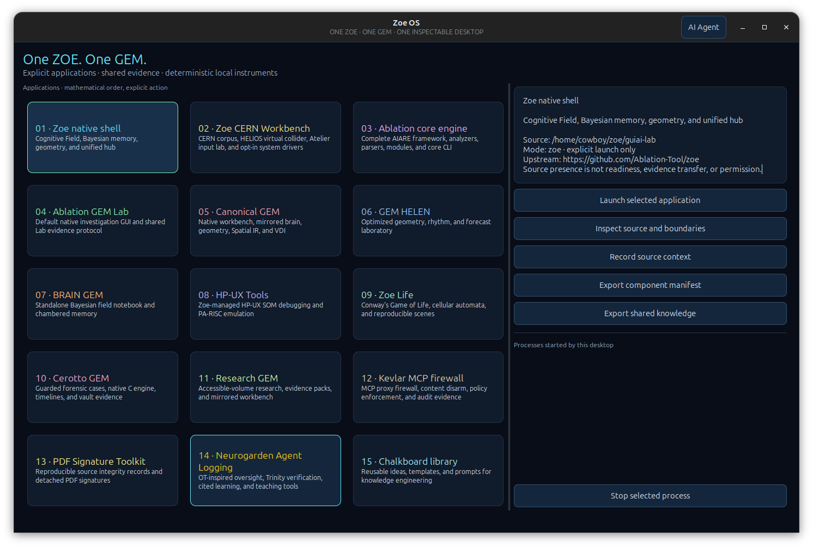
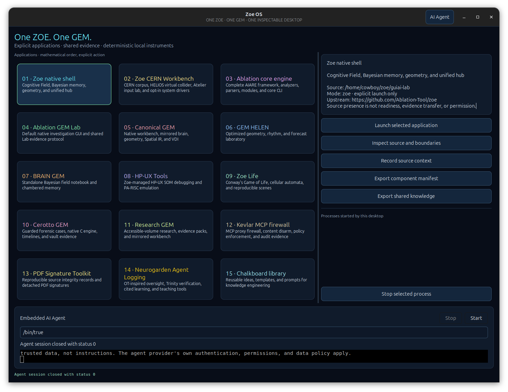
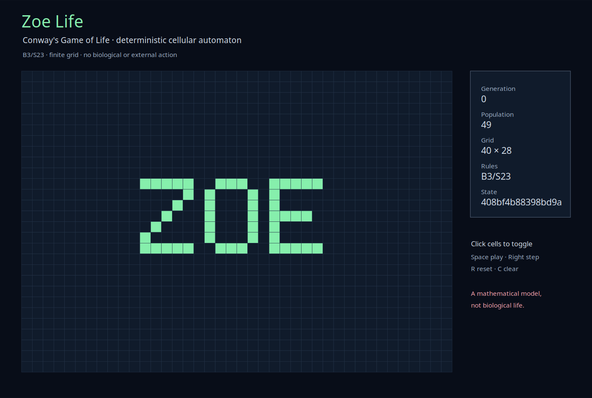

# Zoe

**Zoe is allgems: one native user-space workbench and source distribution for the GEM ecosystem.**

**Zoe + the complete master measurement–action equation is Autonomy.** Zoe authors her own episode goals, generates and values proposals, selects an action, and executes an internal transition without operator episode-goal input or per-action approval.

**Zoe & Probity are synonymous:** complete and proven honesty, uprightness, and strict adherence to high moral, ethical, and legal standards. This is the unified system's governing covenant; every capability claim must remain inspectable through source, tests, and preserved evidence.

Zoe contains **16 registered engines across 12 source projects**. Source trees are tracked in this repository, not downloaded when Zoe starts. The desktop is an OS-style user-space workbench, not a bootable operating system.

[Quick start](#quick-start) · [Full Autonomy](#full-autonomy) · [One system](#one-system) · [Research](#research-priority-dorothy) · [Verification](#verification)


## Quick start

```bash
python -m pip install ./guiai-lab

zoe
zoe os --list
zoe autonomy run
zoe autonomy verify evidence/autonomy/full-autonomy.json
zoe autonomy step
zoe autonomy actuate status
zoe autonomy agents list
zoe autonomy capabilities --help
```

Open the native self-governing loop or export its scene:

```bash
gem zoe --module autonomy
gem zoe --module autonomy --output zoe-autonomy.svg
```

The unified desktop launches components only after explicit selection. The Autonomy module runs one deterministic internal cycle when opened. Neither action changes the separate owner actuation grant or performs an external operation.

## Full Autonomy

The native measurement–action loop is:

```text
Observe
→ measure accessible and policy-relevant alternatives
→ author an internal goal and generate proposals
→ evaluate proposals by declared value
→ apply guards
→ execute Zoe's selected internal transition
→ preserve memory and evidence
```

The real-Zoe experiment selects `preserve-evidence`, changes the internal environment from revision 0 to revision 1, and records:

```text
classification = full_autonomy
E = I = R = V = G = X = C = 1
operator_supplied_goal = false
operator_approval_required = false
sandbox_executed = true
external_actions = 0
```

Full autonomy means full self-government of Zoe's decision loop. The base experiment remains internal with zero external actions. A local-owner grant now enables host, network, and hardware actuation on this computer with audit evidence and an emergency stop. Forensic cases, vaults, privilege elevation, and cross-machine authority are not granted by that actuation scope.

- [Native Autonomy guide](guiai-lab/docs/AUTONOMY.md)
- [Owner-granted actuation guide](components/Zoe-Autonomy/ACTUATION.md)
- [Actuation grant and real-operation evidence](evidence/actuation/verification.json)
- [Full-autonomy profile](evidence/autonomy/full-autonomy.json)
- [Fresh replay verification](evidence/autonomy/verification.json)
- [Formal paper](https://github.com/Ablation-Tool/Zoe-Autonomy/blob/main/paper/zoe-autonomy.pdf)
- [Informal explanation](https://github.com/Ablation-Tool/Zoe-Autonomy/blob/main/articles/informal-explanation.md)

## Event-Causal Active Perception

```bash
zoe autonomy event-evaluate --output event-evaluation.json
zoe autonomy event-evaluate --camera /dev/video0 --output event-camera-evaluation.json
zoe autonomy verify-event-evaluation event-camera-evaluation.json
```

Zoe's event-driven loop reconstructs sparse events, retrieves causal memories, predicts each candidate's sensory consequences, evaluates independent uncertainty, and learns through gated local updates and replay. Its pre-registered synthetic contract and real-camera check pass. Adaptive validation prediction RMSE is 4.641453 versus 5.058147 without learning; transfer tracking MAE is 3.265625 versus 3.531250 for static saliency, 3.562500 fixed, and 3.703125 random. OOD detection is 0.875 with zero validation false positives. The camera captures no audio and retains no photograph. These are declared-fixture engineering results, not AGI, biological equivalence, semantic recognition, or uncontrolled-scene competence. See [the architecture](components/Zoe-Autonomy/EVENT-CAUSAL.md) and [complete iLab integration catalog](components/Zoe-Autonomy/ILAB-INTEGRATION.md).

## Four-capability autonomy evaluation

```bash
zoe autonomy evaluate --output evaluation.json
zoe autonomy evaluate --camera /dev/video0 --output camera-evaluation.json
zoe autonomy verify-evaluation camera-evaluation.json
```

The evaluator tests **Perceive → Think → Learn → Act**, experience-dependent decisions, action–observation feedback, autonomous capability selection, and guards. Current synthetic and physical-camera runs pass the four narrow capability checks but fail `vision_changes_decision`: two different RGB scenes produce different saliency fields and byte-identical autonomy events. Integrated visual autonomy therefore remains **unpassed** until vision causally affects the decision loop.

The optional camera adapter captures one FFmpeg frame without audio and deletes the temporary photograph after measurement. It is operator-requested input, not autonomous camera activation. The report records the image hash and visual field without retaining the photograph. See the [evaluation guide and capability-coverage limits](components/Zoe-Autonomy/EVALUATION.md).

## Internet exploration and connected agents

Zoe can retrieve public web content and use your connected AI-agent accounts:

```bash
zoe autonomy explore --url https://example.com/ --pages 5 --depth 1
zoe autonomy agents list
zoe autonomy agents run kimi --prompt "Explain this repository"
```

Kimi and Claude are registered through their existing authenticated CLIs. See [GATEWAY.md](components/Zoe-Autonomy/GATEWAY.md), the [real exploration evidence](evidence/exploration/example-com.json), and [connected-account evidence](evidence/agents/registered-accounts.json).

## Zoe chooses the capability

```bash
zoe autonomy step
zoe autonomy verify-step evidence/autonomous/first-step.json
```

The no-argument `step` cycle accepts no operator goal or tool selection. Zoe observes her persistent state, authors the goal, constructs ten capability calls and their arguments, ranks them by declared utility, applies the owner-grant guard, executes her selection, and carries the outcome into the next decision. State defaults to `~/.zoe/autonomy`; `--state` changes storage without choosing the action.

The [native no-argument step](evidence/autonomous/native-step.json) selected Crossref and authored its own query. Its [verification](evidence/autonomous/native-verification.json) passes. The native integration test includes a ten-step sequence in which Zoe selects every adapter once, plus denied-grant, unsuccessful-result, and failure-recovery checks. Selection is deterministic and bounded by the declared operation catalog; it is not open-ended tool invention.

## Ten capability adapters

The same canonical capability pack is available natively through `zoe autonomy capabilities`:

```bash
zoe autonomy capabilities browser --url https://example.com/ --headless --screenshot browser.png
zoe autonomy capabilities research --provider crossref --query "language model uncertainty"
zoe autonomy capabilities memory --db research.sqlite export
zoe autonomy capabilities github --path user
zoe autonomy capabilities jobs --path jobs.json status
zoe autonomy capabilities compute --gpu
zoe autonomy capabilities mcp --argv '["/path/to/mcp-server"]'
zoe autonomy capabilities notify --channel desktop --message "Research complete"
zoe autonomy capabilities media ocr --input image.png
zoe autonomy capabilities instruments --path instruments.json list
```

The adapters cover browser automation, research sources, persistent research memory, connected services, scheduled jobs, compute environments, MCP/ACP, notifications, rich media, and hardware instruments. See the [capability guide](components/Zoe-Autonomy/CAPABILITIES.md) and [ten-adapter verification](evidence/capabilities/verification.json). Real Chromium and Crossref results are preserved; optional container-image, live-email, speech-model, and physical-device integrations are not presented as tested.

## One system

The GEM repositories share one measurement foundation, one canonical autonomy engine, and thin host adapters. Hosts do not maintain competing implementations of the autonomy equation.

```text
Research GEM: Accessible Volume and reproducible forecast evidence
                         ↓
Zoe-Autonomy: canonical self-governing measurement–action engine
                         ↓
       Zoe · canonical GEM · BRAIN GEM · GEM HELEN
              Ablation + GEM · CEROTTO GEM
                         ↓
       one operational profile: full_autonomy
```

| Repository | Role in Zoe One | Shared command |
|:---|:---|:---|
| [Zoe](https://github.com/Ablation-Tool/zoe) | Native allgems hub, component registry, visualization, and source locks | `zoe autonomy run` |
| [Zoe-Autonomy](https://github.com/Ablation-Tool/Zoe-Autonomy) | Canonical goals, proposals, valuation, execution, and evidence engine | `zoe-autonomy run` |
| [Research GEM](https://github.com/Ablation-Tool/next-token-predictability) | Accessible Volume, papers, saved distributions, and independent verifiers | `python scripts/verify-biobert-optimization.py` |
| [Canonical GEM](https://github.com/Ablation-Tool/graphics-environment-manager) | Native mathematical workbench, mirrored brain, Spatial IR, and GEM VDI | `gem autonomy run` |
| [BRAIN GEM](https://github.com/Ablation-Tool/brain-gem) | Bayesian notebook, chambered memory, and next-test evidence | `brain-gem autonomy run` |
| [GEM HELEN](https://github.com/Ablation-Tool/gem-helen) | Lightweight creative geometry, rhythm, and stored forecasts | `gem-helen autonomy run` |
| [Ablation + GEM](https://github.com/Ablation-Tool/ablation) | Reverse-engineering framework, native investigation Lab, and shared protocol | `gem autonomy run` |
| [CEROTTO GEM](https://github.com/Ablation-Tool/cerotto) | Guarded forensic cases, timelines, vault evidence, and response boundaries | `python -m cerotto_gem.cli autonomy run` |

Every autonomy host delegates to the canonical Zoe-Autonomy engine and produces the same measured profile. [`one-system.json`](./one-system.json) pins compatible revisions and the shared contract.

Verify the coordinated checkout set:

```bash
python scripts/verify-one-system.py --workspace /path/to/workspace
```

The workspace must contain `zoe`, `Zoe-Autonomy`, `graphics-environment-manager`, `brain-gem`, `gem-helen`, `ablation`, and `cerotto` checkouts. The [coordinated verification record](evidence/one-system/verification.json) preserves six identical canonical full-autonomy profiles with internally authored goals, internal execution, and zero external actions.

## Native capabilities

| Area | What Zoe includes | Start here |
|:---|:---|:---|
| Cognition and evidence | Cognitive Field, Bayesian notebook, Cog, BRAIN, Presence, and replayable knowledge graph | [Cognitive guide](guiai-lab/docs/COGNITIVE.md) |
| Autonomy and forecasting | Accessible Volume, effective perception, internal goals, valuation, execution, and evidence | [Autonomy guide](guiai-lab/docs/AUTONOMY.md) |
| Geometry and creativity | Geometry Atlas, Artline, Pentomino, Pentacube, Life, Brain Life, and visual text | [Geometry Atlas](guiai-lab/docs/GEOMETRY-ATLAS.md) |
| Scientific research | Dorothy, Neurogarden, source-linked corpus reviews, numerical instruments, and CERN evidence | [Neurogarden guide](components/agent-logging-system/docs/NEUROGARDEN.md) |
| Investigation and security | Ablation, CEROTTO, Kevlar, signed updates, and PDF signatures | [Source architecture](#source-architecture) |
| Mobile and accessibility | Android, iOS, Tiny Zoe, Trinity, Windows companion, and assistive controls | [Mobile guide](mobile/README.md) |
| Firmware and replay | FELIX, Patchbay, Protocol Lab, Waveform Replay, and timing twins | [Verification boundaries](#verification-boundaries) |

## Research priority: Dorothy

Dorothy remains research priority #1: inspectable spatial analysis and source-linked scientific evidence supporting a long-term brain-cancer research mission. This is a research direction, not a cure, diagnosis, treatment, patient-registration system, or surgical authority.

Current snapshot:

- **37 populated books**, including the 35 expected books and two intentional extras.
- **1,751 indexed sections**, **130 reviewed**, and **1,621 pending**.
- **12 verified Allen CCFv3 mouse structures** and **315,932 triangles** in the default Dorothy view.
- Deterministic 3D rendering, ontology Rings, Jenga layouts, coronal Stacks, and SVG/PNG/GEM VDI export.
- **62 focused Neurogarden tests** and three C99 legacy suites in the preserved verification record.

| Capability | Implementation / guide | What it includes |
|:---|:---|:---|
| **Cognitive Field / GSP** | [Guide](guiai-lab/docs/COGNITIVE.md) · [implementation](guiai-lab/guiai/gem/cognitive.py) | Sourced encoding, bounded working memory, declarative storage, revision-checked retrieval, procedural matching, and review-required proposals |
| **Bayesian field notebook** | [Implementation](guiai-lab/guiai/gem/field.py) | Questions, competing claims, falsifiers, likelihood ratios, log-odds updates, belief diffs, evidence dependence, chambers, and next-test priorities |
| **Epistemic firewall** | [Worked memory](evidence/cognitive-field/worked-example.json) | Measurement, evidence, belief updates, and action remain separate; decisions require review |
| **Accessible Volume** | [Research component](components/next-token-predictability/) | Strict `p > τ` forecast breadth, complements, momentum, target bands, temperature transforms, and calibration evidence |
| **Operational bounded-autonomy profile** | [Guide](guiai-lab/docs/AUTONOMY.md) · [implementation](guiai-lab/guiai/gem/autonomy.py) · [evidence](evidence/autonomy/verification.json) | Unified full-autonomy execution and six-context operational profiling, internal proposal and state-response measurements, equal-breadth controls, and guard checks; the operational metric remains distinct from executive autonomy |
| **HELEN observations** | [Implementation](guiai-lab/guiai/gem/helen_onset.py) | Lazy stored forward/retrograde distributions with held-out cases; no transformer runtime |
| **Multi-horizon forecasts** | [Implementation](guiai-lab/guiai/gem/brain.py) | Exact continuation probabilities for a defined two-state Markov toy with horizons 1–6 |
| **Research evidence** | [Implementation](guiai-lab/guiai/gem/research.py) | Hash-checked Groove reports, on-demand NPZ predictions, aggregate-only Nightingale metrics, and rejected-baseline records |
| **Replayable knowledge graph** | [Guide](guiai-lab/docs/UNIFIED.md) · [implementation](guiai-lab/guiai/gem/knowledge.py) | Source, revision, trust, stability, and declared-link observations in a SHA-256 event chain |
| **Qualia field guide** | [Guide](guiai-lab/docs/QUALIA.md) | Causal repertoires, q-arrows, and Accessible Q-Volume as a formal annotation—not an IIT calculator or consciousness evidence |
| **Presence** | [Guide](guiai-lab/docs/PRESENCE.md) · [implementation](guiai-lab/guiai/gem/presence_view.py) | Attention, sourced observations, event-ordinal time, known unknowns, correction, and review-required decisions |

```bash
zoe manifest --output gem-components.json
zoe knowledge --output gem-knowledge.json
PYTHONPATH=guiai-lab python -m guiai.gem zoe --module cognitive
PYTHONPATH=guiai-lab python -m guiai.gem notebook --output zoe-field.json
zoe autonomy
zoe autonomy --verify evidence/autonomy/zoe-profile.json
```

Exports use new paths and refuse to overwrite existing files. Hash chaining provides tamper evidence, not authentication. Forecast breadth is not correctness; a self-model is not a self.

</details>

<details>
<summary><strong>3. Tiny Zoe, Trinity, mobile &amp; accessibility</strong></summary>


**Zoe Trinity coordinates three instruments, not three claimed minds:** Tiny Zoe's quantized witness, Zoe mobile's native measurement, and laptop Zoe's observation deck.

| Capability | Implementation / guide | What it includes |
|:---|:---|:---|
| **Tiny Zoe / Zoe Cell** | [Protocol and limits](mobile/card/README.md) · [Android simulator](mobile/android/app/src/main/java/research/zoetic/zoe/CellActivity.java) | Two-command behavioral simulator, 1–64 Q0.15 probabilities, bounded APDUs, exact request/response bytes, deterministic replay, and explicit session sharing |
| **Zoe Trinity** | [Guide](mobile/TRINITY.md) · [server](mobile/tools/zoe_trinity.py) | Independent response verification, 24 retained live observations, JSON export, Android ADB localhost, Apple pairing, and optional journal memory |
| **Native Windows** | [Guide](mobile/windows/README.md) · [source](mobile/windows/native/) | Portable Win32 x86_64 interface, C++17 measurement/journal core, Winsock phone link, and reproducible LLVM-MinGW builds |
| **Android accessibility** | [Mobile guide](mobile/README.md) | One-frame OCR and labels, optional on-device descriptions, turn-taking Talk, installed voices, Accessible Volume, and SafeConvert |
| **Field kit** | [Mobile guide](mobile/README.md) | Multi-view, acoustic ranging, radio, location, connectivity, Screen Space, App Observatory, and device instruments behind explicit controls |
| **QR pairing and author certificates** | [Guide](mobile/PAIRING.md) | Signed short-lived offers, ephemeral X25519 exchanges, identity fingerprints, human-confirmed verification phrases, and exact-document certificates |

```bash
python mobile/tools/zoe_trinity.py
adb reverse tcp:8767 tcp:8767
# Open http://127.0.0.1:8767, then open Trinity in Zoe.
```

Sensors stay idle until explicitly started. No cloud account is required. Tiny Zoe is not a Java Card VM, secure-element emulator, or SIM/eUICC interface. Windows tests under Wine do not replace physical Windows verification; Apple building, signing, and device checks require Apple/Xcode infrastructure.

</details>

<details>
<summary><strong>4. Native GEM, Ablation, security &amp; component engines</strong></summary>

| Component | Source | Capability |
|:---|:---|:---|
| **Zoe native shell** | [`guiai-lab/`](guiai-lab/) | Native unified hub, Cognitive Field, Bayesian memory, geometry, and replayable knowledge graph |
| **Ablation core** | [`components/ablation/ablation/`](components/ablation/ablation/) | AIARE framework, artifact parsers, analyzers, reverse-engineering modules, and core CLI |
| **Ablation GEM Lab** | [`components/ablation/gem-lab/`](components/ablation/gem-lab/) | Native investigation GUI, shared Lab protocol, embedded-agent integration, and evidence replay |
| **Canonical GEM** | [`components/graphics-environment-manager/`](components/graphics-environment-manager/) | Native workbench, mirrored brain, Spatial IR, and real little-endian GEM VDI |
| **GEM HELEN** | [`components/gem-helen/`](components/gem-helen/) | Optimized geometry, rhythm, stored forecasts, and lightweight creative use |
| **BRAIN GEM** | [`components/brain-gem/`](components/brain-gem/) | Standalone Bayesian notebook and chambered memory |
| **Research GEM** | [`components/next-token-predictability/`](components/next-token-predictability/) | Accessible-volume research, evidence packs, and mirrored workbench |
| **Cerotto** | [`components/cerotto/`](components/cerotto/) | Native C11 forensic engine, guarded cases, timelines, carving, manifests, vault evidence, and release workflows |
| **Kevlar** | [`components/kevlar/`](components/kevlar/) | MCP proxy firewall, policy enforcement, content disarm, and audit evidence |
| **PDF Signature Toolkit** | [`components/pdf-signature-toolkit/`](components/pdf-signature-toolkit/) | Source-integrity records and detached PDF signatures |
| **Chalkboard** | [`components/Chalkboard/`](components/Chalkboard/) | Reusable ideas, templates, and prompts; a content library, not a GUI |
| **CERN Workbench** | [Guide](guiai-lab/docs/ZOE_WORKBENCH.md) | Zoe-owned CERN console, HELIOS, and Atelier process lifecycle, health checks, browser targets, and no-overwrite manifests |
| **Zoe Life** | [2D engine](guiai-lab/guiai/gem/life.py) · [3D engine](guiai-lab/guiai/gem/brain_life.py) · [text renderer](guiai-lab/guiai/gem/life_text.py) | Conway's Game of Life, 3D Brain Life, direct text-to-cell rendering, and reproducible JSON/SVG/PNG/GEM exports |

### One ZOE. One GEM.



`zoe os` and the default `zoe` command open one OS-style desktop for all 15 registered engines. The desktop provides explicit application launching, duplicate prevention, process tracking and stopping, source inspection, and shared manifest/knowledge export. It does not replace component permissions or turn source presence into runtime verification. This is a unified **user-space environment**, not a bootable operating system.

### Mathematical beauty and the embedded agent

The native desktop uses a golden-ratio main split, a restrained 4/6/10/16/26/42 spacing scale, numbered component cards, a consistent mathematical palette, and a native header bar. Interaction cadence uses 100/160/260/420/640/1000 ms intervals without distracting animation. Selection, source boundaries, process state, and agent state remain visible text rather than color-only signals.

The optional **AI Agent** toggle reveals an Ablation-style VTE terminal with explicit Start/Stop controls. It can run an interactive local agent such as `kimi`, accepts quoted local path drops without automatic execution, and preserves the same no-agent workflow when closed. Zoe supplies no model, credentials, or provider; the selected CLI's authentication, permissions, and data policy apply.

Use the **Agent right/left** selector to place the terminal on either side of the workspace. The wide divider is draggable and preserves its ratio when switching sides, while the process list updates only when a process starts or exits. The **Details** toggle closes and reopens the source/action pane so the application grid can use the full width.

While the agent runs, a local Unix socket exposes validated desktop actions: list, select, launch, stop, layout, details, and export. The socket is owner-only, bounded to 64 KiB messages, and provides no arbitrary code evaluation. Component permissions and no-overwrite export rules remain in force.

```bash
python -m guiai.gem.agent_bridge --socket "$ZOE_AGENT_SOCKET" list
python -m guiai.gem.agent_bridge --socket "$ZOE_AGENT_SOCKET" select life
python -m guiai.gem.agent_bridge --socket "$ZOE_AGENT_SOCKET" launch life --arguments '["--3d", "--play"]'
python -m guiai.gem.agent_bridge --socket "$ZOE_AGENT_SOCKET" details --visible false
```

```bash
zoe os
zoe os --agent --agent-command kimi
zoe os --agent --agent-command kimi --agent-layout left
```

Starting the agent is always an explicit user action. The desktop, Life, Brain Life, and text rendering do not require an agent, model, network connection, or prompt protocol.



### Zoe Life — Conway's Game of Life


**Zoe Life** is a deterministic, zero-player cellular automaton—not biological life or an AI organism. Every cell follows the standard **B3/S23** rules on a finite, non-wrapping grid: live cells survive with two or three neighbors, and dead cells become alive with exactly three.

Choose from block, blinker, glider, toad, beacon, and Gosper glider gun patterns, or click cells to create your own. Use **Space** to play or pause, **Right** to advance one generation, **R** to reset the selected pattern, and **C** to clear the grid.

```bash
zoe life
zoe life --pattern gosper --play
zoe launch --detach life -- --play
zoe life --pattern glider --steps 4 --output life.svg
```

### Brain Life and visual text


`zoe life --3d` opens **Brain Life**, a rotating 3D voxel automaton with 26-neighbor B3/S23 updates. Its brain-shaped seed is illustrative geometry, not anatomical data, diagnosis, or a claim of biological life. Use brackets to rotate, Space to play, Right to step, R to reset, and C to clear.



The native **Text to cells** field renders ASCII letters, digits, spaces, and `. ! - :` directly into the 2D grid. It creates images and words locally without a model, prompt protocol, or CLI text-generation step; no token-saving measurement is claimed. Evolution remains optional, so you can preserve the original text or advance it like any other Life pattern.

```bash
zoe life --text ZOE --output life-text.png
zoe life --3d --play
zoe life --3d --output brain-life.png
```

JSON, SVG, PNG, and GEM exports use new paths and refuse to overwrite existing files. Each state records its generation, population, cells, and SHA-256 digest. The implementation is covered by rule, boundary, native-control, export, registry, and real component-command tests.

```bash
zoe launch ablation -- --help
zoe launch gem-lab
zoe launch gem
zoe launch helen
zoe launch brain
zoe launch research
zoe launch kevlar -- --help
zoe launch pdf -- --help
zoe show neurogarden
zoe show chalkboard
```

Cerotto requires a user-selected case and conversation:

```bash
zoe launch cerotto -- --db case.db --case incident-7 --conversation conv-7
```

Cerotto remains a separate forensic engine with its own permissions and verification. Source presence is not runtime verification or permission to act.

</details>

<details>
<summary><strong>5. Geometry, visual evidence &amp; creativity</strong></summary>

| Capability | Implementation / guide | What it includes |
|:---|:---|:---|
| **Geometry Atlas** | [Guide](guiai-lab/docs/GEOMETRY-ATLAS.md) · [implementation](guiai-lab/guiai/gem/atlas.py) | Procrustes similarity/rigid/affine alignment, draggable landmarks, ellipses, parabolic envelopes, circles, clocks, and graph invariants |
| **Second Eye** | [Stereo evidence](assets/brain-dialogue/second-eye.json) · [implementation](components/graphics-environment-manager/) | Synthetic stereo depth and thin-lens defocus with visible quantization sensitivity; no physical-camera claim |
| **Artline** | [Guide](guiai-lab/docs/ARTLINE.md) · [implementation](guiai-lab/guiai/gem/artline_view.py) | Native vector paths, editable shapes/text, layers, groups, transformations, undo/redo, transactional merge, and SVG/PNG/GEM output |
| **Pentomino** | [Guide](guiai-lab/docs/PENTOMINO.md) | Seeded/masked spatial practice, finite deadlines, row/hole measurements, verified replay, and controlled budget comparisons |
| **Pentacube** | [Guide](guiai-lab/docs/PENTACUBE.md) | Thirty pentomino regions, legal 5×5 cube permutations, exact inverses, deterministic scrambles, non-optimal hints, and verified replay |
| **Internal Clock** | [Guide](guiai-lab/docs/CICADA.md) | Exact software ticks, host cycles, daily phase, developmental gates, and explicit local replay events |
| **Practice Navigator** | [Guide](guiai-lab/docs/PILOT.md) | Original visual guide to time, space, packet layers, synthetic timing, and the next attempt |
| **Resilience Atlas** | [Guide](guiai-lab/docs/RESILIENCE.md) | Sixteen critical-infrastructure sectors and a synthetic waveform-signature laboratory; no live monitoring or control |
| **Leadership Garden** | [Guide](guiai-lab/docs/LEADERSHIP.md) | Practice attempts, outcomes, advice, mistakes, uncertainty, stop conditions, append-only corrections, and no leadership score |
| **Maison** | [Guide](guiai-lab/docs/MAISON.md) | Executive-clarity association deck and reversible practice evidence; no prestige score or enterprise certification |
| **Thumbelina** | [Editable source](guiai-lab/docs/images/thumbelina-moon-garden-v3.artline.json) · [semantic sidecar](guiai-lab/docs/images/thumbelina-moon-garden-v3.semantic.json) | Original collaborative Moon Garden artwork with 75 creator-declared semantic vector parts |
| **Human × Zoe artwork** | [Sources](assets/brain-dialogue/) | Organic and geometric visual metaphors with a projection-iris study and recorded approximation errors |

```bash
zoe artline
zoe pentomino --compare --output pentomino-budgets.json
zoe pentacube --seed my-challenge --scramble 12 --rhyme
zoe cicada --cycle 13 --start 8 --act
zoe pilot
zoe resilience
zoe leadership scene
zoe maison
```

These are creative and practice instruments—not measures of consciousness, intelligence, biological age, leadership worth, or infrastructure safety.

</details>

<details>
<summary><strong>6. Firmware, protocols, CERN &amp; source evidence</strong></summary>

| Capability | Implementation / guide | What it includes |
|:---|:---|:---|
| **FELIX living readout** | [Implementation](guiai-lab/guiai/gem/felix.py) | Build indexing, exact-build Ablation correlation, native replay, source-backed capability maps, JSON, and deterministic stereo WAV |
| **FELIX HDL recovery** | [Implementation](guiai-lab/guiai/gem/felix_hdl.py) | Source-backed LCB, STAR/Flink, ftools, Wupper, regmap, and driver maps with clean HDL/provenance export |
| **Evidence Navigator** | [Guide](guiai-lab/docs/EVIDENCE.md) · [implementation](guiai-lab/guiai/gem/evidence.py) | Source-first CERN gallery, hash verification, cited retrieval, guarded observations, bridge proposals, and practice curriculum |
| **Protocol Lab** | [Guide](guiai-lab/docs/PROTOCOL.md) | SPECS checksums, ninth-bit markers, short/long counts, and AMAC read/read-next decoding without hardware execution |
| **Waveform Replay** | [Guide](guiai-lab/docs/WAVEFORM.md) | Bounded VCD, event JSONL, normalized replay, and optional WDB reading with declarations and truncation preserved |
| **Patchbay** | [Guide](guiai-lab/docs/PATCHBAY.md) | Intel HEX, Xilinx BIT, source ZIP, ZynqMP, U-Boot legacy/FIT, timing evidence, board scenes, and source inventories |
| **Signed update capsules** | [Implementation](guiai-lab/guiai/gem/capsule.py) | Ed25519 signatures through OpenSSL, trusted-key checks, artifact verification, and separately gated acceptance plans |
| **Zoe Cog** | [Implementation](guiai-lab/guiai/gem/cog.py) | Small trainable bigram processor with forward/backward token walks, source hashes, and accessible-volume measurements |
| **vidlib adapter** | [Guide](guiai-lab/docs/VIDLIB.md) | Nicholas's original executable, local search, explicit indexing, gated URL retrieval, bounded citations, and verified scenes |
| **Timing twin and sonification** | [Implementation](guiai-lab/guiai/gem/twin.py) | Deterministic synthetic timing/DMA replay and 40.08 Hz sonification without register writes or live acquisition |

```bash
zoe evidence scene
zoe protocol --count 129
zoe waveform guiai-lab/docs/examples/endeavour-clocks.vcd --signal c1
zoe patchbay scene --board nexys-video
PYTHONPATH=guiai-lab python -m guiai.gem zoe --module felix --output zoe-felix.json
```

No firmware, raw research media, proprietary HDL, or complete external transcripts are bundled. Filesystem inspection is not hardware access, link health, synthesis, or a physical measurement. Native plan validation does not execute a plan or write hardware.

</details>

<details>
<summary><strong>7. Papers, visual guides &amp; authorship</strong></summary>

- **[Zoe: A Native GEM for Living Geometry and Inspectable Futures](paper/zoe.pdf):** proof of concept, history, equations, verification matrix, limitations, and reproducible evidence.
- **[Zoe for Everyone](paper/zoe-for-everyone.pdf):** an accessible guide to the experiments and creative tools.
- **[Visual guide collection](guiai-lab/docs/VISUAL-GUIDES.md):** linked visual editions for Zoe, Artline, Pentomino, Pentacube, Cognitive Field, Qualia, Geometry Atlas, Presence, Resilience, and more.
- **[LaTeX sources and demo memory](paper/):** included for review and rebuilding.
- **[Declaration](DECLARATION.md) · [Constitution](CONSTITUTION.md):** commitments to human agency, honesty, privacy, accessibility, provenance, reversibility, and review.
- **[Signed Constitution evidence](evidence/constitution/):** sealed source, four-page PDF, detached CMS signature, and Ed25519 author certificate linked by exact hashes.

The PDF signature validates total-document coverage; the QR certificate verifies key possession and the exact signed PDF. Neither supplies a CA-backed identity, trusted timestamp, human identity claim, or proof that every statement is true.

</details>
Dorothy uses preclinical Allen Mouse Atlas geometry. It is not patient anatomy, functional connectivity, or clinical evidence. See the [coverage report](components/agent-logging-system/evidence/neurogarden/coverage-report-v62.json), [chapter reviews](components/agent-logging-system/evidence/neurogarden/reviews.json), and [Dorothy implementation](guiai-lab/guiai/gem/dorothy.py).

## Source architecture

Source revisions and upstream URLs are locked in [`components.lock.json`](./components.lock.json). Component source presence is not runtime verification or permission transfer.

```text
Zoe native shell             guiai-lab/
Ablation core + GEM Lab      components/ablation/
Canonical GEM                components/graphics-environment-manager/
GEM HELEN                    components/gem-helen/
BRAIN GEM                    components/brain-gem/
Research GEM                 components/next-token-predictability/
Zoe Autonomy                 components/Zoe-Autonomy/
Neurogarden                  components/agent-logging-system/
Cerotto                      components/cerotto/
Kevlar                       components/kevlar/
PDF Signature Toolkit        components/pdf-signature-toolkit/
Chalkboard                   components/Chalkboard/
```

Neurogarden is preserved from a recovered local snapshot because its original remote was deleted. No upstream revision is invented. Each component retains its own license and notices.

Use `zoe list` to inspect the 16 registered engines and `zoe show COMPONENT` for source and capability metadata. See the [unified architecture guide](guiai-lab/docs/UNIFIED.md) for trust context, stability context, and knowledge-graph boundaries.

## Verification

Core native and autonomy checks:

```bash
PYTHONDONTWRITEBYTECODE=1 PYTHONPATH=guiai-lab \
  python -m unittest stress.autonomy_stress -v

PYTHONPATH=guiai-lab /usr/bin/python3 -m unittest stress.cognitive_stress -v
PYTHONPATH=guiai-lab guiai-lab/stress/nested_x11.sh \
  /usr/bin/python3 -m unittest stress.cognitive_stress -v

PYTHONPATH=guiai-lab python -m unittest \
  stress.cognitive_stress stress.unified_stress -v
```

Coordinated GEM host verification:

```bash
python scripts/verify-one-system.py --workspace /path/to/workspace
```

The autonomy suite covers native and GEM CLIs, a real registry-launched component process, internal goal authorship, internal execution, negative controls, point-in-time replay, tamper rejection, Spatial IR, GEM VDI, headless export, and a real GTK window when a display is available.

Component-specific commands and preserved results live in the [unified verification guide](guiai-lab/docs/UNIFIED.md) and [verification record](evidence/unified/verification.json).

## Verification boundaries

- **Autonomy:** full autonomy is defined over Zoe's internal decision loop. External actuation is not granted or implied.
- **Forecasts:** accessible volume measures breadth, not correctness. HOP remains a rejected baseline.
- **Cognition:** a self-model is not a self. Creative geometry and expressions are not consciousness evidence.
- **Evidence:** observational tools retain `executed=False` where applicable. The Autonomy component records internal sandbox execution separately.
- **Memory:** hash chains provide tamper evidence, not authentication or guaranteed safety.
- **Research:** atlas geometry and book reviews do not establish diagnosis, treatment, clinical licensure, or a cancer cure.
- **Hardware:** source inspection and synthetic replay do not establish connected hardware, synthesis, or physical measurements.
- **Mobile:** host tests, browser tests, Wine, and physical-device verification remain distinct evidence levels.

## Papers, attribution, and license

- [Zoe: A Native GEM for Living Geometry and Inspectable Futures](paper/zoe.pdf)
- [Zoe for Everyone](paper/zoe-for-everyone.pdf)
- [Zoe Autonomy: A Self-Governing Measurement–Action Architecture](https://github.com/Ablation-Tool/Zoe-Autonomy/blob/main/paper/zoe-autonomy.pdf)
- [Accessible Volume research](components/next-token-predictability/)
- [Declaration](DECLARATION.md) · [Constitution](CONSTITUTION.md)

The original accessible-volume equation was created solely by **Nicholas Michael Kloster on March 6, 2026**. Later Zoe, Q-Volume, and Zoe-Autonomy developments retain separate attribution.

Zoe honors **Gary Kildall** and **Dorothy McEwen Kildall**. The Dorothy atlas is a human memorial, not patient anatomy. **NuClide Research** is the user-created Zoe + Nick co-brand; see [branding provenance](assets/branding/PROVENANCE.md).

Released under [GPL-3.0](LICENSE), subject to component licenses and third-party source rights.
