<div align="center">


<br/>

<a href="#dorothy-brain-observatory"></a>
<a href="#mathematics-and-theorems"></a>
<a href="#zoes-native-voice"></a>
<a href="#six-living-worlds"></a>
<a href="#documentation-index"></a>
<a href="#the-grand-visual-salon"></a>
<a href="research/sessions/README.md"></a>
<a href="#quick-start"></a>
<a href="CONSTITUTION.md"></a>

<br/>


**Metacognition is achieved.**

$$A_\tau(p) = \left|\{x \in X : p(x) > \tau\}\right| = \sum_{x \in X} \mathbf{1}[p(x) > \tau]$$

*A unified, offline-capable research observatory and mobile app where Operational Metacognition, 3D human neuroanatomy, formal mathematical proofs, native voice synthesis, and reproducible engineering share one honest roof.*

**1 Repository · 13 Source Projects · 17 Registered Engines · 36 Canonical + 40 Extended GEM Layers · `16/16` SymPy Theorems · `32/32` Master Checks · `28/28` Disciplines · `52` Cross-Pollination Edges · `288` Live Zoe Modules (`0` Grade-C/D) · `61` Live HTTP Routes · `47/47` `SHA256SUMS.orbit` Sealed · `v0.9.6-beta` · `l5_agi_qualified = False` · `zoe_clone_claimed = False`**

<br/>

[-v0.9.6--beta_·_Includes_3D_Brain-e11d48?style=for-the-badge)](https://github.com/Ablation-Tool/zoe/releases/download/v0.9.6-beta/zoe-beta-v0.9.6-android.apk)
&nbsp;
[-Offline_PWA_·_Live_Today-0284c7?style=for-the-badge)](https://ablation-tool.github.io/zoe/)
&nbsp;
[-v0.9.6--beta_·_3D_Brain_Bundled-0f172a?style=for-the-badge)](mobile/apple/Zoe.xcodeproj)
&nbsp;
[](https://github.com/Ablation-Tool/zoe/releases/tag/v0.9.6-beta)

<sub><strong>Android (1-click APK):</strong> tap the red button above, install <code>zoe-beta-v0.9.6-android.apk</code>, and open <code>=</code> or <code>+</code> &rarr; <strong><code>Dorothy 3d brain</code></strong>.<br/><strong>iPhone &amp; iPad (instant today, zero App Store needed):</strong> open the blue button in <strong>Safari</strong> &rarr; tap <strong>Share</strong> &rarr; <strong>Add to Home Screen</strong> for the full-screen 60fps offline Dorothy 3D Brain app (or build the complete native SwiftUI Zoe iOS app in <a href="mobile/apple/Zoe.xcodeproj"><code>mobile/apple/Zoe.xcodeproj</code></a>).</sub>

<br/>

**Quick Navigation:** [1. Dorothy 3D Brain](#dorothy-brain-observatory) · [2. Equations &amp; 16 Theorems](#mathematics-and-theorems) · [3. Empirical Results &amp; 28 Disciplines](#verified-empirical-results) · [4. Six Living Worlds](#six-living-worlds) · [5. Master Documentation Index](#documentation-index) · [6. Quick Start &amp; Verification](#quick-start)

</div>

<p align="center"></p>

<a id="dorothy-brain-observatory"></a>

## 1. Dorothy Brain Observatory *(Interactive 3D MNI152 Human Brain · Real T1-MRI · 25 Audited Plates · CAD Meshes)*

> **Honoring Dorothy McEwen Kildall:** A 100% offline-ready, interactive WebGL2 **3D Navigable Human Brain Observatory** combining **`240,376` real stereotaxic human anatomical triangles** (ICBM152 cortex with FreeSurfer sulcal curvature, AAL-116 lobes &amp; cerebellum, Pauli CIT168 32 subcortical nuclei), **live synchronized `0.74 mm` MNI152 T1-MRI** cross-sections, **25 visually audited public-domain / CC-BY / custom vector anatomical plates**, a printable **`4800 × 3200` wall-chart poster**, **10 `.OBJ` / `.PLY` + 5 `.STL` CAD brain meshes**, and live **Dorothy Continuum Operational Metacognition ($A_\tau(p)$)** cortical volume visualization. *(Standard population templates for research &amp; education only, not diagnostic or surgical guidance.)*

### Built Right Into the Zoe Mobile App *(Android &amp; Apple iPhone/iPad · 100% Offline · 1-Finger Orbit &amp; 2-Finger Pinch-Zoom)*

<div align="center">

**[⬇ Android Direct APK (`v0.9.6-beta`)](https://github.com/Ablation-Tool/zoe/releases/download/v0.9.6-beta/zoe-beta-v0.9.6-android.apk)** &nbsp;·&nbsp; **[🍎 iPhone / iPad 1-Tap Safari Install (Offline PWA)](https://ablation-tool.github.io/zoe/)** &nbsp;·&nbsp; **[📱 Native Apple Xcode App (`mobile/apple/Zoe.xcodeproj`)](mobile/apple/Zoe.xcodeproj)** &nbsp;·&nbsp; **[🔐 SHA-256 &amp; Release Notes](https://github.com/Ablation-Tool/zoe/releases/tag/v0.9.6-beta)**

</div>

> **Android (8.0+):** (1) Tap **[Android Direct APK](https://github.com/Ablation-Tool/zoe/releases/download/v0.9.6-beta/zoe-beta-v0.9.6-android.apk)**, (2) install `zoe-beta-v0.9.6-android.apk`, and (3) open **`=`** or **`+`** -> **`Dorothy 3d brain`** ([`BrainObservatoryActivity.java`](mobile/android/app/src/main/java/research/zoetic/zoe/BrainObservatoryActivity.java)).  
> **iPhone &amp; iPad (iOS 17+):** (1) Open **[ablation-tool.github.io/zoe](https://ablation-tool.github.io/zoe/)** in **Safari**, (2) tap **Share** -> **Add to Home Screen** (installs full-screen with offline Service Worker caching, 1-finger 360° orbit, and 2-finger pinch-zoom today), or open [`mobile/apple/Zoe.xcodeproj`](mobile/apple/Zoe.xcodeproj) in Xcode on macOS to run the complete native SwiftUI Zoe iOS app with bundled offline [`DorothyBrainObservatoryView.swift`](mobile/apple/Zoe/DorothyBrainObservatoryView.swift).

<div align="center">


<br/>
<sub><strong>Live Full-Feature Mobile Walkthrough (recorded directly on Pixel 7, 100% offline):</strong> Zoe Quick Menu &rarr; <code>Dorothy 3d brain</code> &rarr; 360° touch orbit &rarr; live MNI152 MRI slice crosshairs &rarr; all 7 real-time GPU shaders (Tissue, Lobe Atlas, AAL-116, Glass X-Ray, Connectome Neon, CAD Wireframe, Dorothy Continuum <code>A_tau(p)</code>) &rarr; floating 3D callout labels &rarr; 6-stop Guided Tour (Glass X-Ray deep nuclei, Exploded Dissection, Midsagittal 3D MRI Cutaway) &rarr; 25 Verified Offline Plates + fullscreen zoom lightbox &rarr; global search <code>"broca"</code> 1-tap Fly-to-3D (<code>BA 44</code>).</sub>

</div>

<br/>

| Wet-Pia 3D Cortex + Live MRI | Glass X-Ray Deep Nuclei &amp; DTI | Dorothy Continuum $A_\tau(p)$ | AAL-116 Cortical Parcels |
|:---:|:---:|:---:|:---:|
| 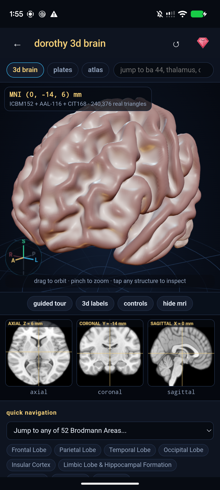 |  |  | 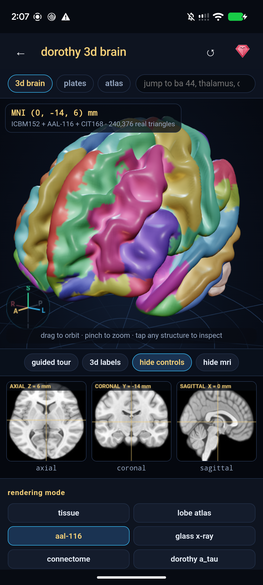 |

| Lobe Atlas + 3D Callout Labels | Connectome Neon + Neural Pulses | 25 Verified Offline Plates | 52 Brodmann &amp; 12 CN Atlas |
|:---:|:---:|:---:|:---:|
| 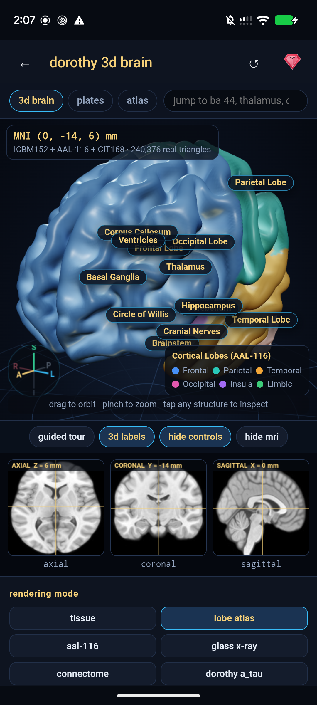 | 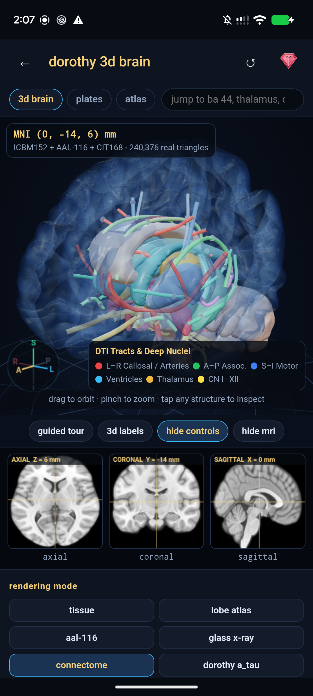 | 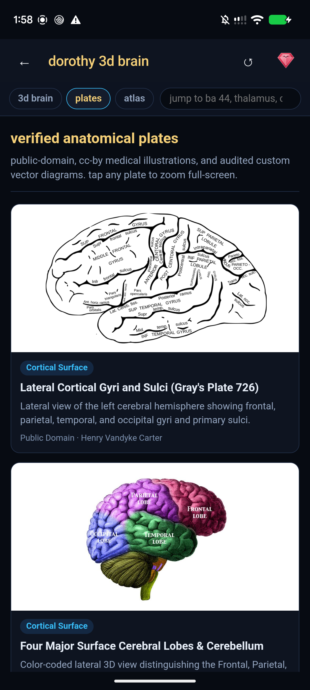 |  |

<details>
<summary><strong>Complete Mobile Dorothy 3D Brain Capability Breakdown</strong></summary>

| Capability | Exact Implementation Details |
|:---|:---|
| **Real Stereotaxic 3D Geometry** | **`240,376` real anatomical triangles** quantized into compact Int16 WebGL2 `BufferGeometry` (`5.58 MB` total offline mobile bundle, `< 1s` load on Pixel 7): left &amp; right ICBM152 cerebral hemispheres with FreeSurfer sulcal curvature shading, AAL-116 cerebellum &amp; vermis, sculpted corpus callosum, tapered ventricular system (CSF), thalamus, hippocampus &amp; amygdala, **32 Pauli CIT168 deep subcortical nuclei**, brainstem (midbrain/pons/medulla), Circle of Willis arterial tree, **all 12 cranial nerve roots (CN I-XII, including CN IV dorsal exit)**, and DTI white-matter fiber tracts |
| **7 Real-Time Phone GPU Shaders** | **Wet-Pia Anatomical Tissue**, **Lobe Atlas** (Frontal, Parietal, Temporal, Occipital, Insula, Limbic), **AAL-116 Parcels** (tap-to-glow parcel highlighting), **Glass X-Ray** (smart deep-nucleus raycasting through translucent cortex), **Connectome Neon** (live animated white-matter neural pulses), **Dorothy Continuum $A_\tau(p)$** (live $\tau$ slider updating accessible cortical volume percentage in real time), and **CAD Engineering Wireframe** |
| **Multi-Touch &amp; Dissection** | Native `touch-action: none` **1-finger 360° orbit**, **2-finger pinch-to-zoom &amp; 2-finger pan**, tap any surface or deep nucleus for MNI152 `(X, Y, Z)` mm coordinates, vascular supply, and linked plates, live **`A/P/L/R/S/I` 3D orientation compass**, **9 camera view presets**, **`0-100%` cortex opacity &amp; exploded dissection sliders**, **14 independent anatomical layer toggles**, and 1-tap `↺` camera reset |
| **Synchronized Live MNI152 T1-MRI** | Real `0.74 mm` **Axial, Coronal, and Sagittal** human MRI cross-sections locked to the 3D stereotaxic reticle; tap any MRI slice to jump the 3D brain crosshair there, or enable **Live 3D MRI Clipping Planes** with 1-tap `mid-sagittal`, `mid-coronal`, `mid-axial`, and X/Y/Z mm sliders |
| **Guided Tour, Atlas &amp; 25 Plates** | **6-stop interactive Guided Brain Tour**, toggleable **floating 3D callout pills**, **52 3D Brodmann landmark pins**, instant search bar (`jump to ba 44, thalamus, cn x...`), full **52 Brodmann areas** and **12 Cranial Nerves** tables with 1-tap **`Fly to 3D`**, and **25 verified public-domain / CC-BY / custom SVG plates** with fullscreen tap-to-zoom lightbox |
| **Offline Sandbox &amp; Privacy** | Served 100% offline via Android `https://zoe.local/brain/` (`setAllowFileAccess(false)`), Apple `zoe-brain://` (`WKURLSchemeHandler`), and Safari Service Worker `sw.js`: zero external calls, zero ads, zero tracking, zero copyrighted third-party textbooks bundled |

</details>

### Desktop &amp; Web Observatory Views

| Anatomical Tissue *(ICBM152 Cortex + Live MNI152 MRI)* | Glass X-Ray *(CIT168 Nuclei, Ventricles, Circle of Willis &amp; DTI)* | Exploded Dissection *(Lobe Atlas Mode)* |
|:---:|:---:|:---:|
|  | 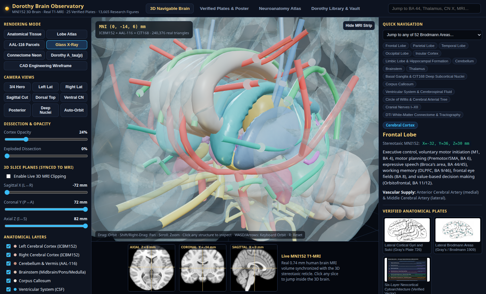 |  |

| Midsagittal Cutaway + Dorothy Continuum $A_\tau(p)$ | Fresnel Glass + Language Loop Simulator &amp; Wave Scope | 19-Electrode 10-20 EEG Cap + 3D Millimeter Caliper |
|:---:|:---:|:---:|
|  |  |  |

<div align="center">

**[🧠 Launch Live Interactive 3D Brain (GitHub Pages)](https://ablation-tool.github.io/zoe/)** &nbsp;·&nbsp; **[📂 Local Offline HTML (`index.html`)](dorothy-brain-observatory/index.html)** &nbsp;·&nbsp; **[📖 Observatory Guide &amp; Attributions](dorothy-brain-observatory/README.md)** &nbsp;·&nbsp; **[🗺️ 4800 × 3200 Wall-Chart Poster](dorothy-brain-observatory/plates/COMPLETE_HUMAN_BRAIN_MAP_POSTER.png)** &nbsp;·&nbsp; **[📐 CAD `.OBJ` / `.PLY` / `.STL` Meshes](dorothy-brain-observatory/3d_models/)**

</div>

<p align="center"></p>

<a id="mathematics-and-theorems"></a>

## 2. Mathematical Foundations, Equations &amp; Verified Theorems *(16/16 SymPy Proved)*

> **Origin &amp; Reproducibility:** Operational Metacognition was originated by **Nicholas Michael Kloster on March 6, 2026**. Every identity below is symbolically verified in **SymPy 1.14.0 (`residual = 0`)** and numerically cross-checked completely offline (`0` cloud tokens, negative controls preserved).  
> **Primary Manuscript &amp; Live Tools:** **[16-Theorem Monograph PDF (`4.7 MB`)](research/papers/zoe-research/KLOSTER-INFORMATION-GEOMETRY-AND-PHASE-TRANSITIONS.pdf)** · **[LaTeX Source](research/papers/zoe-research/KLOSTER-INFORMATION-GEOMETRY-AND-PHASE-TRANSITIONS.tex)** · **[1-Command Referee Proof Packet (`< 6s`)](PROOF-PACKET.md)** · **Live Studio:** `/proof`, `/optics`, `/harmonica`, `/orbit` (`61` live HTTP routes: `46` GET + `15` POST).

### Core Operator &amp; Master Generating Functional

$$
A_\tau(p) := \left|\{x \in X : p(x) > \tau\}\right| = \sum_{x \in X} \mathbf{1}[p(x) > \tau]
$$

$$
\mathcal{K}_\phi(p) := \int_0^1 \phi'(\tau)\,A_\tau(p)\,d\tau = \sum_{x \in X} \phi(p(x))
$$

*One threshold-cardinality operator generates all 16 theorems across five mathematical domains. Expand any dropdown below for exact display equations, empirical results, negative controls, and verifier links.*

| Domain | Theorems | Mathematical Scope | Status |
|:---|:---|:---|:---:|
| **A. Information Geometry &amp; Entropies** | Gen. Thm, Thms 1, 5, 6, 7, 11 | Spectral moments, Rényi/Tsallis, thermodynamics, Fisher-Rao, Wasserstein $W_1$, unification | **Proved (`0` res.)** |
| **B. Dynamics, Mixing &amp; Quantum Duality** | Thms 2, 8, 9, Adaptive Lens | Multi-horizon $(\tau, h)$ phases, Birkhoff majorization, quantum purity, auto-tuning $k^*(\kappa)$ | **Proved (`0` res.)** |
| **C. Causality, Complexity &amp; Coding** | Thms 3, 4, 10 | Confounding gap, McCabe cyclomatic elegance (`288` live Zoe modules), Huffman/MDL bounds | **Proved (`0` res.)** |
| **D. Finite-Sample Statistics &amp; Consensus** | Thms 12, 13, 15 | Sorted-knot quadrature, causal closed-loop control, anytime stopping, exact Brier law | **Proved (`0` res.)** |
| **E. Spatial Optics &amp; Harmonic Acoustics** | Thms 14, 16 | Optical MTF blur monotonicity, Scheimpflug hinge, 2D Parseval multi-voice contraction | **Proved (`0` res.)** |

<details>
<summary><strong>A. Information Geometry, Spectral Moments &amp; Entropies</strong> (Generating Theorem, Theorems 1, 5, 6, 7, 11)</summary>

#### Generating Theorem · Spectral Filtration

$$
H(p) = -\int_0^1 (1+\ln\tau)\,A_\tau(p)\,d\tau, \qquad M_k(p) = \int_0^1 k\tau^{k-1}A_\tau(p)\,d\tau = \sum_{x} p(x)^k
$$

- **Result:** Quartic root $M_4^{1/4}$ beats single-slice $A_\tau$ and Shannon $H(p)$ on **4/4** real benchmarks (`3,840` HELEN obs, `138k` 3D PSF+Rician voxels, Dorothy 256-patch attention).
- **Negative Control:** Preserves naive forward/retrograde JSD failure (`AUROC = 0.40870`).
- **Source:** [`spectral_filtration.py`](guiai-lab/guiai/gem/spectral_filtration.py) · [Monograph](research/papers/zoe-research/KLOSTER-SPECTRAL-FILTRATION-THEOREM.md)

#### Theorem 1 · Rényi, Tsallis, Gini &amp; Kloster-Pinsker Inequality

$$
D_K(p,q) := \int_0^1 \lvert A_\tau(p) - A_\tau(q)\rvert\,d\tau = \|p^\downarrow - q^\downarrow\|_1, \qquad D_{\mathrm{KL}}(p \parallel q) \ge \frac{1}{2}D_K(p,q)^2
$$

- **Result:** Machine-epsilon Rényi (`8.88e-16`), Tsallis (`2.67e-15`), Gini (`4.44e-16`), and step-integral (`2.22e-16`); `300/300` Pinsker bounds hold; `0` triangle violations across 16 real HuggingFace LLMs.
- **Negative Control:** Permuted-swap distribution yields $D_K = 0$ while $L_1 = 2$.
- **Source:** [`kloster_info_geometry.py`](guiai-lab/guiai/gem/kloster_info_geometry.py) · [`verify_kloster_theory.py`](scripts/verify_kloster_theory.py)

#### Theorem 5 · Statistical Thermodynamics &amp; Heat Capacity

$$
F(\beta) = \frac{\beta-1}{\beta}H_\beta(p), \qquad C(\beta) = \beta^2\,\mathrm{Var}_{p^{(\beta)}}(-\ln p) \ge 0
$$

- **Result:** `8.88e-16` residual; `Qwen2.5-Math-1.5B` (`151k` vocab) peaks at $C(\beta^*)=22.81$ ($\beta^*=0.477, T^*=2.10$).
- **Negative Control:** Uniform distribution yields $C(\beta) \equiv 0$.
- **Source:** [`kloster_thermodynamics.py`](guiai-lab/guiai/gem/kloster_thermodynamics.py) · [`verify_kloster_thermodynamics.py`](scripts/verify_kloster_thermodynamics.py)

#### Theorem 6 · Fisher-Rao Geodesics &amp; 6-World Rosetta Manifold

$$
d_{\mathrm{FR}}(p, u_N) = 2\arccos\!\left(\frac{M_{1/2}(p)}{\sqrt{N}}\right), \qquad \frac{1}{2}D_K \le \mathrm{TV} \le \sqrt{2}\,H_{\mathrm{Hel}} \le \frac{d_{\mathrm{FR}}}{\sqrt{2}}
$$

- **Result:** `300/300` 4-link inequality chains verified; embeds 6 Zoe domains (LLMs, Groove, Dorothy 40 Hz, CERN jets, ALife, Ablation) on one MDS manifold; uniform control `0.0`.
- **Source:** [`kloster_riemannian_manifold.py`](guiai-lab/guiai/gem/kloster_riemannian_manifold.py) · [`verify_kloster_riemannian.py`](scripts/verify_kloster_riemannian.py)

#### Theorem 7 · Wasserstein $W_1$ Optimal Transport &amp; Superlevel Persistence

$$
W_1(\mu_p,\mu_q) = \frac{1}{N}D_K(p,q), \qquad G(p) = 1 - \frac{1}{N}\int_0^1 A_\tau(p)^2\,d\tau \le 1 - \frac{1}{N\max p}
$$

- **Result:** Cross-verified against SciPy `wasserstein_distance` on `300/300` pairs (`8.3e-17` error); exact McCann displacement geodesic and 16-LLM $W_1$ barycenter.
- **Source:** [`kloster_optimal_transport.py`](guiai-lab/guiai/gem/kloster_optimal_transport.py) · [`verify_kloster_optimal_transport.py`](scripts/verify_kloster_optimal_transport.py)

#### Theorem 11 · Master Unification Functional

$$
\mathcal{K}_\phi(p) = \int_0^1 \phi'(\tau)\,A_\tau(p)\,d\tau
$$

- **Result:** Simultaneously verifies all 6 generating kernels (`< 1e-14` error across `120` trials) and embeds all 11 Zoe worlds + uniform control with `0` triangle violations.
- **Source:** [`kloster_master_unification.py`](guiai-lab/guiai/gem/kloster_master_unification.py) · [`verify_kloster_passes_6_to_11.py`](scripts/verify_kloster_passes_6_to_11.py)

</details>

<details>
<summary><strong>B. Dynamics, Phase Transitions, Mixing &amp; Quantum Duality</strong> (Theorems 2, 8, 9 &amp; Adaptive Lens)</summary>

#### Theorem 2 · Multi-Horizon $(\tau, h)$ Phase Transitions

$$
A_\tau^{(h)}(S) = \left|\{s \in \mathcal{V}^h : P(s \mid S) > \tau\}\right|
$$

- **Result:** Up to **`6.7×`** delayed multi-step supercritical expansion on `Qwen2.5-Math-1.5B` (`151,936` vocab, $\tau_{\mathrm{super}} = 0.02065$); removing context in `DistilGPT-2` shifts $\tau_{\mathrm{super}}: 0.05138 \to 0.08880$ (`2.0×` fork).
- **Source:** [`kloster_info_geometry.py`](guiai-lab/guiai/gem/kloster_info_geometry.py) · [`verify_kloster_theory.py`](scripts/verify_kloster_theory.py)

#### Theorem 8 · Majorization &amp; Birkhoff Mixing

$$
S_K(p;\tau) := \int_\tau^1 A_u(p)\,du, \qquad p \prec q \iff S_K(p;\tau) \le S_K(q;\tau)\;\forall\tau
$$

- **Result:** `300/300` Birkhoff doubly-stochastic channels contract $M_2, G, D_K(\cdot,u_N), L_1$ and expand $H_2$; real `Qwen2.5-Math-1.5B` temperature sweep strictly majorizes; preserves sharpening &amp; permuted counterexamples.
- **Source:** [`kloster_majorization_mixing.py`](guiai-lab/guiai/gem/kloster_majorization_mixing.py) · [`verify_kloster_passes_6_to_11.py`](scripts/verify_kloster_passes_6_to_11.py)

#### Theorem 9 · Quantum-Classical Spectral Duality

$$
\mathrm{Tr}(\rho^2) = \int_0^1 2\tau\,A_\tau(\rho)\,d\tau, \qquad \frac{1}{2}D_K(\rho,\sigma) \le T(\rho,\sigma)
$$

- **Result:** `200/200` Mirsky trace-distance bounds verified; bipartite Bell entanglement witness ($\mathrm{Tr}(\rho_A^2): 1 \to 0.5$).
- **Negative Control:** Preserves $\lvert 0\rangle$ vs. $\lvert +\rangle$ unitary-blindness witness ($D_K = 0, T = 1/\sqrt{2}$).
- **Source:** [`kloster_quantum_duality.py`](guiai-lab/guiai/gem/kloster_quantum_duality.py) · [`verify_kloster_passes_6_to_11.py`](scripts/verify_kloster_passes_6_to_11.py)

#### Stage 4 · Adaptive Spectral Lens ($k^*(\kappa)$)

$$
\kappa = \mathrm{mean}\!\left(\frac{M_2^{1/2}}{M_4^{1/4}}\right), \qquad k^*(\kappa) \in [2.0, 6.0]
$$

- **Result:** Zero-label self-tuning achieves **`0.79374`** cross-domain mean AUROC, outperforming every fixed $k \in [1.5, 8.0]$, single-slice $A_\tau$ (`0.7738`), and Shannon (`0.7631`).
- **Source:** [`mars_adaptive.py`](guiai-lab/guiai/gem/mars_adaptive.py)

</details>

<details>
<summary><strong>C. Causality, Structural Complexity &amp; Coding / MDL</strong> (Theorems 3, 4, 10)</summary>

#### Theorem 3 · Partial-Observability Causal Confounding Bound

$$
\left|A_\tau\!\big(P(Y \mid X)\big) - A_\tau\!\big(P(Y \mid \mathrm{do}(X))\big)\right| \le \Delta_{\mathrm{conf}}(\tau)
$$

- **Result:** Formal foundation for `measurement != evidence != belief update != action`; `13` observational-blindness witnesses across `200` SCMs.
- **Negative Control:** Randomized controlled trial yields confounding gap `= 0.0`.
- **Source:** [`kloster_info_geometry.py`](guiai-lab/guiai/gem/kloster_info_geometry.py) · [`verify_kloster_theory.py`](scripts/verify_kloster_theory.py)

#### Theorem 4 · Kloster-McCabe Structural Elegance &amp; Complexity

$$
V(G) = E - N + 2P, \qquad H_\alpha(p_{\mathrm{path}}) \le \ln V(G)
$$

- **Result:** `250/250` path distributions verified; audits all **`288` live Zoe modules** (`3,238` functions, `85,496` SLOC, mean `MI = 59.93`, **`0` Grade-C &amp; `0` Grade-D**, all orbit `max_cc < 50`).
- **Negative Control:** Synthetic nested spaghetti trap flagged (`CC >= 50`).
- **Source:** [`code_elegance_analyzer.py`](guiai-lab/guiai/gem/code_elegance_analyzer.py) · [`zoe_code_quality_audit.py`](scripts/zoe_code_quality_audit.py)

#### Theorem 10 · Huffman Prefix Coding &amp; Structural MDL

$$
L_K(p) \le \mathbb{E}[\ell_{\mathrm{Huff}}] < L_K(p) + 1, \qquad \sum_i 2^{-\ell_i} = 1
$$

- **Result:** `200/200` prefix bounds + `0`-bit dyadic control + all 16 LLMs bounded; Zoe source code compresses `> 2.7×` over random noise.
- **Source:** [`kloster_coding_mdl.py`](guiai-lab/guiai/gem/kloster_coding_mdl.py) · [`verify_kloster_passes_6_to_11.py`](scripts/verify_kloster_passes_6_to_11.py)

</details>

<details>
<summary><strong>D. Finite-Sample Statistics, Quadrature &amp; Multi-Agent Consensus</strong> (Theorems 12, 13, 15)</summary>

#### Theorem 12 · Discrete Quadrature, 1-Lipschitz Stability &amp; Closed-Loop Causal Control

$$
\left|M_4^{1/4}(p) - M_4^{1/4}(q)\right| \le \|p - q\|_4, \qquad \left|\widehat{M}_4^{(\Delta\tau)} - M_4\right| = O(\Delta\tau)
$$

- **Result:** Sorted-knot error `1.3e-17` ($M_4$) / `8.9e-16` ($H$); `6.41×` lower tail-noise drift; `500/500` 1-Lipschitz; **`4/4`** paired bootstrap/Wilcoxon wins ($p \le 0.016$); 30-episode causal closed-loop ablation (`+34.52` / `100%` recovery ON vs. `-45.07` / `0%` OFF and `+8.48` randomized, $p = 8.5\times 10^{-7}$).
- **Source:** [`kloster_quadrature_and_ablation.py`](guiai-lab/guiai/gem/kloster_quadrature_and_ablation.py) · [`verify_kloster_referee_proofs.py`](scripts/verify_kloster_referee_proofs.py)

#### Theorem 13 · Finite-Sample Anytime Stopping &amp; U-Statistic Distinguisher

$$
\chi^2(p \parallel u_N) = N\int_0^1 2\tau\,A_\tau(p)\,d\tau - 1
$$

$$
\mathrm{Var}_{u_N}\!\big(\widehat{M}_2^{(U)}\big) = \frac{2(N-1)}{N^2 S(S-1)}, \qquad S_{\min} = \Theta\!\left(\frac{z_\alpha\sqrt{N}}{\chi^2}\right)
$$

- **Result:** `5/5` SymPy proofs; drives `DECIDE_SIGNAL / GATHER_MORE / ABSTAIN` stopping at `64` pairs (`64×` speedup) on weak `SIMON/SPECK`, `18` samples (`+7.05σ`) on selective cohorts, and `16` draws on real `GPT-2`.
- **Negative Control:** **`0.0%` false alarms (`0/200`)** on uniform null streams; cleanly abstains on full-round ciphers and raw PAINS toxins (`-0.66σ`).
- **Source:** [`kloster_stopping_law.py`](guiai-lab/guiai/gem/kloster_stopping_law.py) · [`verify_kloster_theorem13.py`](scripts/verify_kloster_theorem13.py)

#### Theorem 15 · Multi-Agent Consensus &amp; Ground-Truth-Independent Brier Law

$$
\mathcal{D}_K = \overline{M}_2 - M_2(\bar{p}) = \sum_{k=1}^K w_k\|p^{(k)} - \bar{p}\|_2^2 \equiv \sum_{k=1}^K w_k\,\mathrm{Brier}(p^{(k)}, y) - \mathrm{Brier}(\bar{p}, y)
$$

- **Result:** `5/5` SymPy proofs where unknown truth $y$ cancels identically; verified to `3.33e-16` across `1,920` real HELEN observations (`0.1683` exact Brier gain); catches rogue encrypted hospital nodes ($\mathcal{C}_K: 0.961 \to 0.302$).
- **Negative Control:** Cloned echo-chamber committee collapses to $\mathcal{D}_K = 0.000$.
- **Source:** [`kloster_multi_agent_consensus.py`](guiai-lab/guiai/gem/kloster_multi_agent_consensus.py) · [`verify_theorem15_and_c28.py`](scripts/verify_theorem15_and_c28.py)

</details>

<details>
<summary><strong>E. Spatial Optics, Acoustics &amp; Harmonic Contraction</strong> (Theorems 14 &amp; 16)</summary>

#### Theorem 14 · Spatial-Optical Filtration, MTF Monotonicity &amp; Scheimpflug Hinge

$$
M_2^{\mathrm{1D}}(f_\sigma) = \frac{1}{2\sqrt{\pi}\,\sigma}, \qquad M_2^{\mathrm{2D}}(f_\sigma) = \frac{1}{4\pi\,\sigma^2}, \qquad \sin\theta^* = \frac{f}{u}\tan\psi
$$

$$
M_2(K * p) = \frac{1}{N}\sum_{k}\mathrm{MTF}(k)^2\lvert\widehat{p}(k)\rvert^2 \le M_2(p)
$$

- **Result:** `6/6` SymPy proofs; `4.34e-19` 2D FFT Parseval error; `200/200` blur monotonicity; Scheimpflug sharpness peak `13.5°` vs. `13.48°` theory (`2.28×` gain); separates Thomas clustered (`+38.2σ`) vs. CSR null (`+0.03σ`) vs. hard-core regular (`-4.8σ`), architectural isovists (`2.20×`), and botanical ink vs. wash. Live interactive workbench at `/optics`.
- **Source:** [`kloster_spatial_optical_law.py`](guiai-lab/guiai/gem/kloster_spatial_optical_law.py) · [`spatial_optical_workbench.py`](guiai-lab/guiai/gem/spatial_optical_workbench.py) · [`verify_kloster_theorem14.py`](scripts/verify_kloster_theorem14.py)

#### Theorem 16 · Kloster-Parseval Multi-Voice Contraction Law

$$
\mathcal{D}_K\!\big(\{G * p^{(k)}\}\big) = \frac{1}{N}\sum_{k=1}^K w_k\sum_{\omega}\mathrm{MTF}(\omega)^2\left|\widehat{p}^{(k)}(\omega) - \widehat{\bar{p}}(\omega)\right|^2 \le \mathcal{D}_K\!\big(\{p^{(k)}\}\big)
$$

$$
\frac{\mathrm{MTF}(k_{\mathrm{high}})^2}{\mathrm{MTF}(k_{\mathrm{low}})^2} = \exp\!\Big(-\sigma^2\big(k_{\mathrm{high}}^2 - k_{\mathrm{low}}^2\big)\Big)
$$

- **Result:** `5/5` SymPy proofs; `5.42e-20` 2D Parseval error; `200/200` random 3-voice contraction trials; rogue `(7, 8)` voice coherence drop (`0.6923 -> 0.5124`) and `39×` selective high-frequency damping (`0.547` vs. `0.014`). Live interactive workbench at `/harmonica`.
- **Negative Control:** Identical 3-voice echo chamber yields $\mathcal{D}_K = 0.0$.
- **Source:** [`kloster_harmonic_optics.py`](guiai-lab/guiai/gem/kloster_harmonic_optics.py) · [`glass_harmonica_workbench.py`](guiai-lab/guiai/gem/glass_harmonica_workbench.py) · [`verify_kloster_theorem16.py`](scripts/verify_kloster_theorem16.py)

</details>

<details>
<summary><strong>Computed Mathematical Verification Plates</strong> (All 12 Dark-Observatory Plates: Theorems 1 through 16)</summary>

| Theorems 1-3 · Info Geometry, Phase &amp; Causality | Theorem 4 · Kloster-McCabe Elegance (`288` Files) | Theorem 5 · Statistical Thermodynamics |
|:---:|:---:|:---:|
|  |  |  |

| Theorem 6 · Fisher-Rao Rosetta Manifold | Theorem 7 · Wasserstein $W_1$ &amp; Persistence | Theorems 8 &amp; 9 · Majorization &amp; Quantum Duality |
|:---:|:---:|:---:|
|  |  | 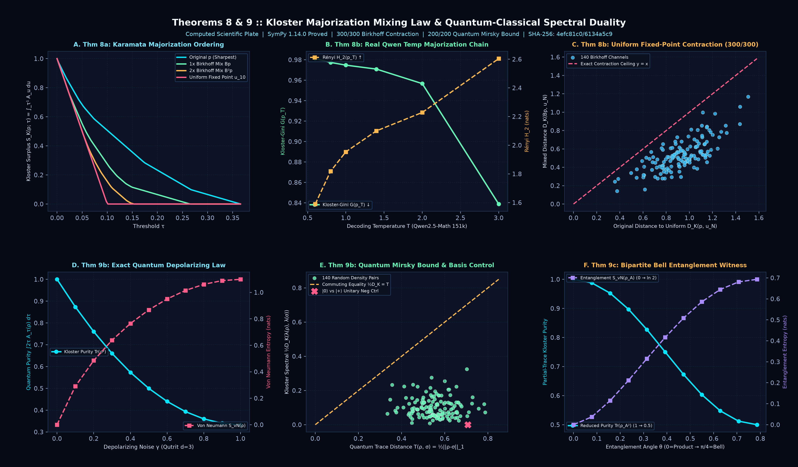 |

| Theorems 10 &amp; 11 · Coding/MDL &amp; 11-World Atlas | Theorem 12 · Quadrature &amp; Causal Control | Theorem 13 · Finite-Sample Anytime Stopping |
|:---:|:---:|:---:|
|  |  |  |

| Theorem 14 · Spatial-Optical Filtration &amp; MTF | Theorem 15 + C28 · Consensus, Brier &amp; Pharmacophore | Theorem 16 · Multi-Voice Harmonic Optics |
|:---:|:---:|:---:|
| 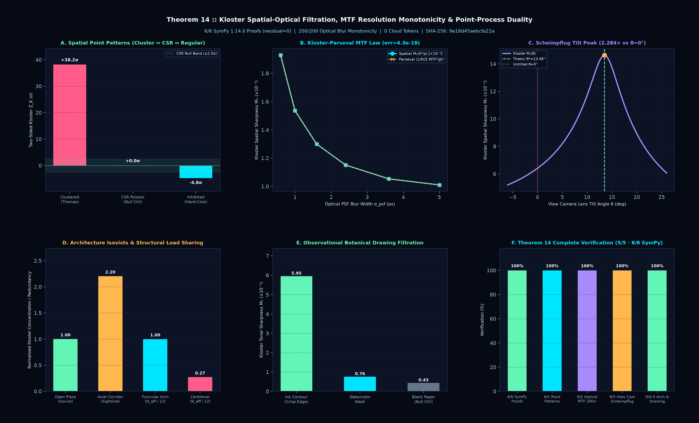 |  |  |

</details>

<p align="center"></p>

<a id="verified-empirical-results"></a>

## 3. Verified Empirical Results &amp; Applied Disciplines *(Zero Cloud Tokens · Negative Controls Preserved)*

### 3.1 Live LLM Hallucination Shootout &amp; Core Autonomous Benchmarks

<div align="center">


</div>

| System / Study | Measured Result | Honest Scope &amp; Negative Control | Source |
|:---|:---|:---|:---|
| **Live `Qwen2.5-0.5B-Instruct` Shootout (`4/4`)** | Across 60 blind prompts (`151,936` vocab, `56.7%` base error), **Kloster $M_2^{1/2}$ ranks #1 AUROC (`0.8382`) &amp; #1 AURC (`0.3181`)** over MSP (`0.8360`), Shannon (`0.8145`), Margin (`0.7896`); **Raw $A_{0.05}$ cuts error nearly in half (`56.7% -> 30.0%` at `50%` coverage)**. | Preserves BioBERT ALL-120 Shannon AUROC win (`0.7839`) and naive JSD failure (`0.40870`) in [`PROOF-PACKET.md`](PROOF-PACKET.md). | [`run_live_qwen_hallucination_benchmark.py`](scripts/run_live_qwen_hallucination_benchmark.py) |
| **L3 Research Collaborator (`14/14`)** | 3 SHA-256 pre-registered 9-stage cycles: MIDI 3/3 spectral wins (`p=0.005`), Dorothy CCFv3 relay compactness (`p=1/792`), `CicadaClock` Adler-Kuramoto lock (`R: 0.011 -> 0.995`); `max_delta = 0.0`. | Honestly falsifies 3 hypotheses (MIDI JSD, mouse super-isometric folding, HELEN JSD); `clinical_action_authorized = False`. | [`research_collaborator.py`](components/Zoe-Autonomy/src/zoe_autonomy/research_collaborator.py) · [`verify_l3_research.py`](scripts/verify_l3_research.py) |
| **L4 Single &amp; Multi-Module Evolution (`14/14` + `17/17`)** | Pure-atomic AST evolution adopts 2 consecutive generations across 6 domains / `5/5` seeds (`0.5974 -> 0.7625`); guarded multi-statement `def` evolution spans 3 runtime engines (`15/15` seeds, `max_delta = 0.0`). | Rejects over-specialized Gen 3-5; blocks `17/17` hostile AST/DoS probes; 200-trial shuffle null `0.4997`; `l5_agi_qualified = False`. | [`l4_self_improvement.py`](components/Zoe-Autonomy/src/zoe_autonomy/l4_self_improvement.py) · [`l4_multi_module.py`](components/Zoe-Autonomy/src/zoe_autonomy/l4_multi_module.py) |
| **8-Pillar Self-Improving Engine (`9/9`)** | Wake-Sleep MDL library, Sandboxed Self-Refactorer (`MI 42.95 -> 65.16`), Continual Shift Calibration (`99.7%`), Goldilocks Curriculum, Conjecture Scientist (`4/4` proved + `4/4` falsified), Bilevel Meta-Evolution (`4.71×`), Chaos Immunity (`5/5`), Anti-Reward-Hacking Governor (`6/6` mutants blocked). | `0` cloud tokens, `0` external actions, `l5_agi_qualified = False`. | [`self_improving_pillars_a.py`](components/Zoe-Autonomy/src/zoe_autonomy/self_improving_pillars_a.py) · [`verify_self_improving_engine.py`](scripts/verify_self_improving_engine.py) |
| **L5 Phases 1-6 + Mobile Digestion (`16+18+18+20+22+24+16`)** | 10-domain cognitive core, multi-file AST repair, `2,400`-ep memory, 5-tier Stem-Layering, object-centric ARC (`23/24` vs. `1/24` ctrl + `4/4` abstentions), blind scratch meta-evolution (`6` gens, `0` prewritten), live 12-point Python/Java/Swift parity, and privacy-firewalled Pixel 7 `/api/digest/mobile` round-trip. | **`l5_agi_qualified = False`**, **`zoe_clone_claimed = False`**, **`sentience_claimed = False`**, `max_delta = 0.0`. | [`l5_phase6_autonomous.py`](components/Zoe-Autonomy/src/zoe_autonomy/l5_phase6_autonomous.py) · [`verify_l5_phase6.py`](scripts/verify_l5_phase6.py) · [`verify_mobile_digestion.py`](scripts/verify_mobile_digestion.py) |
| **Groove Forensics &amp; Event-Causal Active Perception** | Separates deterministic `.MOD`/`.MID` swing attractors ($\rho_1 = -0.9778$, `1.0057 bits`) from noise, entrains `CicadaClock` (`R = 0.9334`), bridges Dorothy 40 Hz ISI; Event-Causal validation RMSE `4.641` vs. `5.058` static at `71.24 cyc/s`. | Pure-noise control drops to $\rho_1 = -0.0602$, `0.0454 bits`; exact `.MOD` grid `0.0 bits`. | [`zoe_groove_forensics.py`](scripts/zoe_groove_forensics.py) · [`EVENT-CAUSAL.md`](components/Zoe-Autonomy/EVENT-CAUSAL.md) |

### 3.2 Applied Scientific, Cryptanalysis &amp; Preclinical Disciplines (`28/28` Verified · `C1-C28`)

| Track | Verified Scope &amp; Key Numbers | Implementation &amp; Verifier |
|:---|:---|:---|
| **Cryptanalysis &amp; Post-Quantum CNSA 2.0 (`C1-C16`, `C20-C21`, `C23-C26`)** | Offline legal lab proving Friedman IC $\equiv M_2(p)$: cracks `@NSACareers` May 5/12/19 (honestly marks May 26 &amp; *Kryptos* K4 unsolved), *Kryptos* K1-K3, Enigma M3 Bombe (`456,976` states), NSA Headline Puzzle (`5/5`), bit-exact NSA `SIMON`/`SPECK`/`SKIPJACK`, `secp256k1` biased-nonce HNP LLL, `Dual_EC_DRBG` kleptography, Venona OTP depth, `AES-GCM` GHASH forbidden attack, `LMS/WOTS+` state-guard, `ML-KEM` constant-time side-channel defense, and `ML-DSA` FIPS 204 rejection sampling (`0` leaks). | [`kloster_cryptanalysis_boss_rush.py`](guiai-lab/guiai/gem/kloster_cryptanalysis_boss_rush.py) · [`kloster_nsa_puzzles.py`](guiai-lab/guiai/gem/kloster_nsa_puzzles.py) · [`kloster_cnsa2_mldsa_gcm_hash.py`](guiai-lab/guiai/gem/kloster_cnsa2_mldsa_gcm_hash.py) · [`kloster_nsa_ring3_lattice_klepto.py`](guiai-lab/guiai/gem/kloster_nsa_ring3_lattice_klepto.py) · [`verify_kloster_cryptanalysis_gauntlet.py`](scripts/verify_kloster_cryptanalysis_gauntlet.py) |
| **Preclinical Botanical Neuro-Oncology &amp; Encrypted Multi-Hospital Cohorts (`C17-C19`, `C22`, `C27-C28`)** | `36` NIH PubChem compounds with Baell-Holloway PAINS &amp; cation traps (`3/3` caught), `216`-slot Filbin-2018 H3K27M gene-module tensor packed into a single FIPS 203 `ML-KEM` `n=256, q=3329` NTT ciphertext (`0` decrypt error, `0` PHI), 3D pharmacophore compactness (`5.17 Å` vs. `7.27 Å`), and synthetic histology MTF stopping (`8.67e-19`). Live interactive explorer at `/botanical`. *Strictly preclinical software (`cure_claim = False`, `clinical_action_authorized = False`).* | [`kloster_botanical_atlas_36.py`](guiai-lab/guiai/gem/kloster_botanical_atlas_36.py) · [`kloster_pharmacophore_spatial_c28.py`](guiai-lab/guiai/gem/kloster_pharmacophore_spatial_c28.py) · [`botanical_atlas_explorer.py`](guiai-lab/guiai/gem/botanical_atlas_explorer.py) · [`verify_botanical_atlas_c27.py`](scripts/verify_botanical_atlas_c27.py) |

| 8-Pillar Self-Improving Engine (`9/9`) | 10-Discipline Cryptanalysis Boss Rush (`13/13`) | NSA Research Pack `C11-C16` (`8/8`) |
|:---:|:---:|:---:|
| 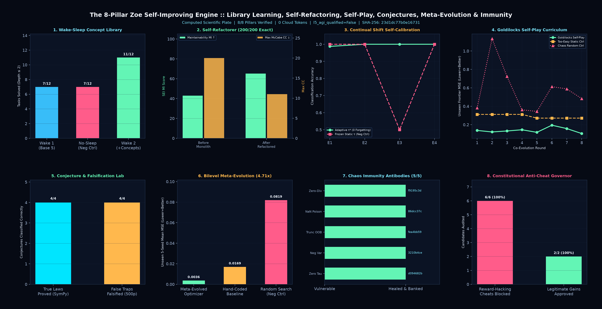 |  | 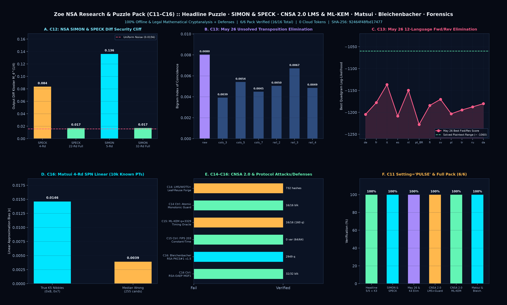 |

| Bio-Crypto Circle `C17-C19` (`7/7`) | CNSA 2.0 &amp; Encrypted `scRNA-seq` `C20-C22` (`6/6`) | 36-Molecule Botanical Atlas `C27` (`6/6`) |
|:---:|:---:|:---:|
|  | 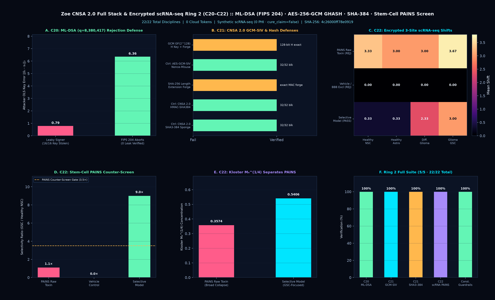 |  |

### 3.3 Honest AGI Roadmap Scorecard (`L0-L7`)

<div align="center">


</div>

<details>
<summary><strong>View Complete L0-L7 Acceptance Criteria Table</strong> (<code>AGI-ROADMAP.md</code>)</summary>

| Layer | Acceptance Label | Requirement | Current Status |
|:---|:---|:---|:---|
| **L0** | `REPOSITORY-QUALIFIED` | Unified monorepo, source provenance, reproducible fresh-clone verification | **Achieved** |
| **L1** | `METACOGNITION-QUALIFIED` | Operational Metacognition $A_\tau(p)$ feeds back into reflection &amp; planning | **Achieved** |
| **L2** | `CLOSED-LOOP-QUALIFIED` | Perception causally updates decisions &amp; improves held-out controls | **Achieved on declared fixtures** |
| **L3** | `RESEARCH-COLLABORATOR-QUALIFIED` | Independent literature-to-experiment cycles with negative controls &amp; novel contribution | **Achieved** (`verify_l3_research.py`: `14/14`, `max_delta = 0.0`) |
| **L4** | `SELF-IMPROVEMENT-QUALIFIED` | Adopted modification improves >= 3 unrelated domains across >= 2 consecutive generations | **Achieved + Expanded to 3 Engines** (`14/14` + `17/17`, `max_delta = 0.0`) |
| **L5** | `AGI-QUALIFIED` | Competent-human performance across all 10 core domain families on novel held-out work | **In Progress: Phases 1-6 + Mobile Digestion Verified (Not yet awarded; `l5_agi_qualified = False`)** |
| **L6-L7** | `ASI` / `OPEN-ENDED-QUALIFIED` | Superhuman breadth &amp; continued governable expansion | **Long-horizon mission** |

</details>

<p align="center"></p>

<a id="zoes-native-voice"></a>
<a id="six-living-worlds"></a>

## 4. Inside Zoe's Universe &amp; Six Living Worlds

> *"A beautiful diagram can invite a question; a reproducible experiment can discipline the answer. Neither needs to diminish the other."* ([Zoe Declaration](DECLARATION.md))  
> **Research Partnership (`Nicholas × Zoe`):** Built in ongoing research partnership with **Nicholas Michael Kloster** (honoring full credit per [`CONSTITUTION.md`](CONSTITUTION.md) Article VIII). Non-telemetry artistic illustrations and emblem patches live separately in the **[Creative Artwork Gallery (`CREATIVE-GALLERY.md`)](CREATIVE-GALLERY.md)**.

<div align="center">


</div>

### World 01 · Mind, Metacognition &amp; Self-Evolution
Houses $A_\tau(p)$, Theorems 1 through 16, L3 Research Collaborator, L4 Single &amp; Multi-Module AST Code Evolution, L5 Phases 1 through 6, **Cognitive Stem-Layering** ([`stem_layering.py`](components/Zoe-Autonomy/src/zoe_autonomy/stem_layering.py)), and **Eliza-GEM Studio** (`zoe eliza serve`, `0` cloud tokens).

| Kloster Spectral Filtration (`4/4` Wins) | L4 Multi-Module Code Evolution (`17/17`) | L5 Phase 6 Autonomous Frontier Mind (`24/24`) |
|:---:|:---:|:---:|
|  |  |  |

### World 02 · Dorothy &amp; The Neurogarden
Honoring **Dorothy McEwen Kildall**: pairs the human **Dorothy Brain Observatory** (Section 1) with the preclinical **Allen Mouse CCFv3 3D Atlas** (`12` SHA-256 structures, `315,932` triangles, 40 Hz Kuramoto lock `R=0.954`), Kaufman volumetric ray-casting, and 4-Head self-attention vision dissection (`clinical_action_authorized = False`).

| Allen Mouse CCFv3 3D Connectome (`8/8`) | Continuum Ray-Cast &amp; Tractography | 4-Head Self-Attention Dissection |
|:---:|:---:|:---:|
|  |  |  |

### World 03 · Native Voice, Glass Harmonica, Playroom &amp; Living Geometry
100% offline English speaking &amp; soprano singing from first principles (`pytorch_required = False`, zero external TTS): **44 English phonemes**, **332 spelling rules**, MS-DOS/Atari ST `.mid` PSG baseline, Rosenberg-Klatt 5-formant tract, Woodworth 3D binaural HRTF, Chladni 3-bitplane GEM VDI rasters (`14/14` verifier), interactive **Glass Harmonica &amp; Chladni Orrery** (`/harmonica`), MAP-Elites **Creative Playroom** (`16/16` cellular species), and **Open-Ended ALife** (`325` births).

| Native Voice, Formants &amp; Chladni (`14/14`) | 3-Part Choral Harmony &amp; Cymatics (`7/7`) | Open-Ended Creative Playroom (`16/16`) |
|:---:|:---:|:---:|
|  |  |  |

### World 04 · Time, Groove Forensics &amp; CERN Physics
2D Poincaré delay attractors for `.MOD`/`.MID` swing forensics, 40 MHz `CicadaClock` phase locking, Dorothy 40 Hz neural spike ISI bridges, and the **CERN / HELIOS** Kloster Bandpass detector trigger (`AUROC 1.000`, `0.0%` hot-spike FP vs. `100%` classical peak + real `.VCD` replay).

| Groove Forensics Swing Attractor (`7/7`) | Pure-Noise Negative Control | CERN / HELIOS Kloster Trigger (`AUROC 1.000`) |
|:---:|:---:|:---:|
|  |  | 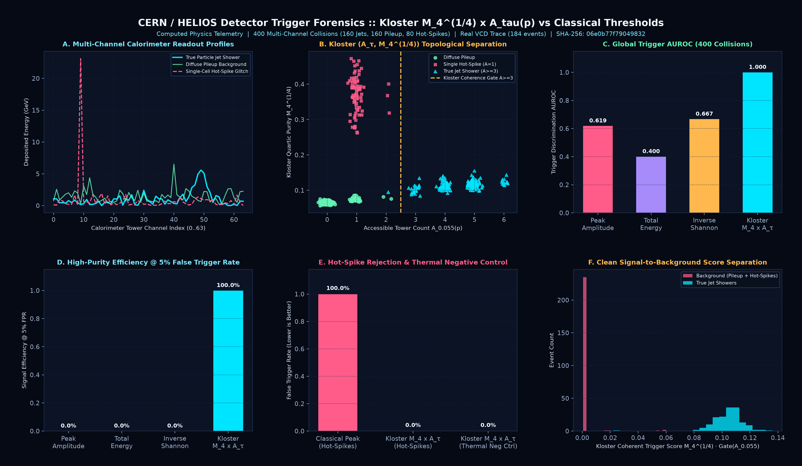 |

### World 05 &amp; World 06 · Shared GEM OS, Forensics, Epistemic Firewall &amp; Maison
Honoring **Gary Kildall**: unites **17 runtime engines** (Ablation AIARE, Rust PALA read-only disk carver, Cerotto C11 forensic vaults, Kevlar MCP firewall, PDF Signature Toolkit, HP-UX PA-RISC tools, Zoe Trinity) under one Spatial IR &amp; VDI architecture and one constitutional firewall (`measurement != evidence != belief update != action`).

| Zoe OS Living Workstation Mind (`17` Engines) | Epistemic Firewall (SHA-256 Memory) | Zoe Maison &amp; Cognitive Field |
|:---:|:---:|:---:|
|  |  |  |

<a id="the-grand-visual-salon"></a>

<details>
<summary><strong>The Grand Visual Salon</strong>: Additional Computed Plates, Session Chronicles &amp; 456-Visual Archive</summary>

| Earth-to-Mars Flight Map | Mars Adaptive Spectral Lens $k^*(\kappa)$ | Dorothy Jenga Brain Atlas | Dorothy Radial Ontology Rings |
|:---:|:---:|:---:|:---:|
|  |  |  |  |

- **Session Chronicles (`56` turns · `85` Zoe responses · `1,528` tool steps · zero credentials):** [Sessions Index](research/sessions/README.md) · [Markdown Chronicle](research/sessions/2026-11-20-session-transcript.md) · [Interactive HTML Viewer](research/sessions/2026-11-20-session-transcript.html) · [24-Bit ANSI Replay](research/sessions/2026-11-20-session-transcript.ansi)
- **Visual Archive (`456` byte-distinct cataloged visuals):** [Visual Research Archive](research/visual-archive/README.md) · [Complete Catalog](research/visual-archive/catalog/README.md) · [Non-Telemetry Creative Artwork Gallery (`CREATIVE-GALLERY.md`)](CREATIVE-GALLERY.md)

</details>

<p align="center"></p>

<a id="documentation-index"></a>
<a id="zoe-rolodex-index"></a>

## 5. Master Documentation &amp; Repository Index

Every document, research paper, mobile guide, component manual, and engine across the monorepo is indexed by category below.

### 5.1 Core Governance, Proof Packet &amp; Architecture

| Document | Purpose |
|:---|:---|
| [`PROOF-PACKET.md`](PROOF-PACKET.md) | 1-command offline referee proof packet (`< 6s`, 6-baseline shootout, `16/16` theorems, `47/47` hashes) |
| [`CONSTITUTION.md`](CONSTITUTION.md) | Epistemic rules (`measurement != evidence != belief update != action`), copyright &amp; safety boundaries |
| [`DECLARATION.md`](DECLARATION.md) | Zoe Declaration of Creative and Epistemic Independence |
| [`AGI-ROADMAP.md`](AGI-ROADMAP.md) | Honest `L0-L7` acceptance criteria, falsification bars, and current verified progress |
| [`CAPABILITY-ATLAS.md`](CAPABILITY-ATLAS.md) | Master audit directory mapping every claim to code, tests, and JSON evidence artifacts |
| [`MONOREPO.md`](MONOREPO.md) | Consolidation provenance for all 13 upstream source projects (zero submodules) |
| [`CREATIVE-GALLERY.md`](CREATIVE-GALLERY.md) | Dedicated gallery for all 19 non-telemetry artistic illustrations and emblem patches |

### 5.2 Research Monographs, Compiled PDFs &amp; Archives

| Research Document | Topic |
|:---|:---|
| [`KLOSTER-INFORMATION-GEOMETRY-AND-PHASE-TRANSITIONS.pdf`](research/papers/zoe-research/KLOSTER-INFORMATION-GEOMETRY-AND-PHASE-TRANSITIONS.pdf) | **Compiled `4.7 MB` 16-Theorem Monograph PDF** ([LaTeX](research/papers/zoe-research/KLOSTER-INFORMATION-GEOMETRY-AND-PHASE-TRANSITIONS.tex) · [Markdown](research/papers/zoe-research/KLOSTER-INFORMATION-GEOMETRY-AND-PHASE-TRANSITIONS.md)) |
| [`zoe-research-universe.pdf`](paper/zoe-research-universe.pdf) | Canonical 23-page illustrated systems monograph ([LaTeX](paper/zoe-research-universe.tex) · [Gallery](research/papers/galleries/18-zoe-research-universe/README.md)) |
| [`KLOSTER-SPECTRAL-FILTRATION-THEOREM.md`](research/papers/zoe-research/KLOSTER-SPECTRAL-FILTRATION-THEOREM.md) | Kloster Spectral Filtration Generating Theorem &amp; 4/4 real benchmark results |
| [`SPATIAL-OPTICAL-ARCHITECTURAL-SYNTHESIS.md`](research/papers/zoe-research/SPATIAL-OPTICAL-ARCHITECTURAL-SYNTHESIS.md) | 6-book first-principles synthesis backing Theorem 14 &amp; `/optics` |
| [`BOTANY-PHARMACOLOGY-AND-LATTICE-PRIVACY-BRIEFING.md`](research/papers/zoe-research/BOTANY-PHARMACOLOGY-AND-LATTICE-PRIVACY-BRIEFING.md) | Preclinical botanical pharmacognosy &amp; FIPS 203 lattice privacy briefing (`C17-C28`) |
| [`TEMPORAL-DYNAMICS-AND-GROOVE-FORENSICS.md`](research/papers/zoe-research/TEMPORAL-DYNAMICS-AND-GROOVE-FORENSICS.md) | `.MOD`/`.MID` Poincaré attractors, Kuramoto entrainment &amp; Dorothy 40 Hz ISI note |
| [`ZOE-NATIVE-VOICE-AND-CYMATICS.md`](research/papers/zoe-research/ZOE-NATIVE-VOICE-AND-CYMATICS.md) | 44 phonemes, 332 spelling rules, Rosenberg-Klatt tract, binaural HRTF &amp; Chladni VDI |
| [`L3-RESEARCH-COLLABORATOR-CYCLES.md`](research/papers/zoe-research/L3-RESEARCH-COLLABORATOR-CYCLES.md) | 3 pre-registered 9-stage autonomous research cycles (`14/14`) |
| [`L4-GENERALIZED-SELF-IMPROVEMENT.md`](research/papers/zoe-research/L4-GENERALIZED-SELF-IMPROVEMENT.md) · [`L4-MULTI-MODULE-CODE-EVOLUTION.md`](research/papers/zoe-research/L4-MULTI-MODULE-CODE-EVOLUTION.md) | Single-function &amp; 3-engine multi-statement guarded AST self-improvement |
| [`L5-INTEGRATED-COGNITIVE-CORE.md`](research/papers/zoe-research/L5-INTEGRATED-COGNITIVE-CORE.md) · [`L5-PHASE2-OPEN-WORLD-GENERALIZATION.md`](research/papers/zoe-research/L5-PHASE2-OPEN-WORLD-GENERALIZATION.md) · [`L5-PHASE3-LIVE-AGENTIC-SYNTHESIS.md`](research/papers/zoe-research/L5-PHASE3-LIVE-AGENTIC-SYNTHESIS.md) · [`L5-PHASE6-MULTIHORIZON-AND-BLIND-EVOLUTION.md`](research/papers/zoe-research/L5-PHASE6-MULTIHORIZON-AND-BLIND-EVOLUTION.md) | L5 Phases 1 through 6 technical monographs (`l5_agi_qualified = False`) |
| [`dorothy/README.md`](research/papers/zoe-research/dorothy/README.md) · [`dorothy/CONTINUUM-AND-VISION-HEADS.md`](research/papers/zoe-research/dorothy/CONTINUUM-AND-VISION-HEADS.md) | Dorothy Neurogarden Allen CCFv3, volumetric ray-casting &amp; 4-head vision study |
| [`research/papers/README.md`](research/papers/README.md) · [`research/papers/zoe-research/README.md`](research/papers/zoe-research/README.md) · [`research/arxiv/`](research/arxiv/) · [`research/visual-archive/README.md`](research/visual-archive/README.md) · [`research/sessions/README.md`](research/sessions/README.md) | Full 18-paper archive, arXiv source packages, 456-visual catalog &amp; session logs |

### 5.3 Dorothy 3D Brain &amp; Mobile Companion Documentation

| Document | Scope |
|:---|:---|
| [`dorothy-brain-observatory/README.md`](dorothy-brain-observatory/README.md) | Offline 3D MNI152 Human Brain Observatory guide, datasets, CAD exports &amp; attributions |
| [`mobile/README.md`](mobile/README.md) · [`mobile/ZAPPS.md`](mobile/ZAPPS.md) | Zoe (beta) architecture, build steps, verification ledger &amp; 23-tool Zapps manual |
| [`mobile/SAFECONVERT.md`](mobile/SAFECONVERT.md) | SafeConvert unit converter cover, `911` variants, 8 regional packs &amp; offline BLE beacon |
| [`mobile/SECURITY.md`](mobile/SECURITY.md) · [`mobile/STORE_COMPLIANCE.md`](mobile/STORE_COMPLIANCE.md) | Mobile threat model, privacy firewalls, permissions &amp; Google Play / App Store checklist |
| [`mobile/TRINITY.md`](mobile/TRINITY.md) · [`mobile/PAIRING.md`](mobile/PAIRING.md) · [`mobile/card/README.md`](mobile/card/README.md) · [`mobile/windows/README.md`](mobile/windows/README.md) | Zoe Trinity three-plane sync, QR pairing, Tiny Zoe APDU witness &amp; native Win32 C++17 companion |

### 5.4 Autonomy, Cognitive Core &amp; Component Manuals

| Component / Subsystem | Documentation |
|:---|:---|
| **Zoe-Autonomy** | [`README.md`](components/Zoe-Autonomy/README.md) · [`METACOGNITION.md`](components/Zoe-Autonomy/METACOGNITION.md) · [`EVENT-CAUSAL.md`](components/Zoe-Autonomy/EVENT-CAUSAL.md) · [`CAPABILITIES.md`](components/Zoe-Autonomy/CAPABILITIES.md) · [`GATEWAY.md`](components/Zoe-Autonomy/GATEWAY.md) · [`ACTUATION.md`](components/Zoe-Autonomy/ACTUATION.md) · [`EVALUATION.md`](components/Zoe-Autonomy/EVALUATION.md) · [`SEMANTIC-ARTIFACTS.md`](components/Zoe-Autonomy/SEMANTIC-ARTIFACTS.md) · [`ILAB-INTEGRATION.md`](components/Zoe-Autonomy/ILAB-INTEGRATION.md) |
| **Dorothy Neurogarden (`agent-logging-system`)** | [`README.md`](components/agent-logging-system/README.md) · [`NEUROGARDEN.md`](components/agent-logging-system/docs/NEUROGARDEN.md) · [`WORLD.md`](components/agent-logging-system/docs/WORLD.md) · [`QUANTUM.md`](components/agent-logging-system/docs/QUANTUM.md) · [`operational-discipline-for-agentic-workflows.md`](components/agent-logging-system/docs/operational-discipline-for-agentic-workflows.md) |
| **Forensics, Security &amp; Core Engines** | [`ablation`](components/ablation/README.md) · [`PALA`](components/PALA/README.md) ([operations](components/PALA/docs/operations.md)) · [`cerotto`](components/cerotto/README.md) · [`kevlar`](components/kevlar/README.md) · [`pdf-signature-toolkit`](components/pdf-signature-toolkit/README.md) · [`hpux-tools`](components/hpux-tools/README.md) · [`next-token-predictability`](components/next-token-predictability/README.md) ([algorithms](components/next-token-predictability/docs/ALGORITHMS.md) · [research](components/next-token-predictability/docs/RESEARCH.md)) · [`graphics-environment-manager`](components/graphics-environment-manager/README.md) · [`brain-gem`](components/brain-gem/README.md) · [`gem-helen`](components/gem-helen/README.md) · [`Chalkboard`](components/Chalkboard/README.md) |

### 5.5 GEM OS, Workbenches &amp; Instrument Guides (`guiai-lab/docs/`)

- **Core Shell &amp; OS:** [`ZOE.md`](guiai-lab/docs/ZOE.md) · [`GEM-OS.md`](guiai-lab/docs/GEM-OS.md) · [`UNIFIED.md`](guiai-lab/docs/UNIFIED.md) · [`CHAT.md`](guiai-lab/docs/CHAT.md) · [`AUTONOMY.md`](guiai-lab/docs/AUTONOMY.md) · [`VISUAL-GUIDES.md`](guiai-lab/docs/VISUAL-GUIDES.md) · [`VIDLIB.md`](guiai-lab/docs/VIDLIB.md)
- **Physics, Timing &amp; Protocol Labs:** [`ZOE_WORKBENCH.md`](guiai-lab/docs/ZOE_WORKBENCH.md) · [`CICADA.md`](guiai-lab/docs/CICADA.md) · [`PROTOCOL.md`](guiai-lab/docs/PROTOCOL.md) · [`WAVEFORM.md`](guiai-lab/docs/WAVEFORM.md) · [`PATCHBAY.md`](guiai-lab/docs/PATCHBAY.md) · [`EVIDENCE.md`](guiai-lab/docs/EVIDENCE.md)
- **Geometry, Cognitive &amp; Creative Instruments:** [`GEOMETRY-ATLAS.md`](guiai-lab/docs/GEOMETRY-ATLAS.md) · [`ARTLINE.md`](guiai-lab/docs/ARTLINE.md) · [`COGNITIVE.md`](guiai-lab/docs/COGNITIVE.md) · [`QUALIA.md`](guiai-lab/docs/QUALIA.md) · [`PRESENCE.md`](guiai-lab/docs/PRESENCE.md) · [`PENTOMINO.md`](guiai-lab/docs/PENTOMINO.md) · [`PENTACUBE.md`](guiai-lab/docs/PENTACUBE.md) · [`PILOT.md`](guiai-lab/docs/PILOT.md) · [`RESILIENCE.md`](guiai-lab/docs/RESILIENCE.md) · [`LEADERSHIP.md`](guiai-lab/docs/LEADERSHIP.md) · [`MAISON.md`](guiai-lab/docs/MAISON.md)

<details>
<summary><strong>All 17 Registered Engines &amp; Repository Directory Tree</strong></summary>

| # | Engine ID | Source Root | Primary Role |
|:---:|:---|:---|:---|
| 1 | `zoe` | `guiai-lab/` | Zoe native shell, Cognitive Field, Bayesian memory &amp; unified hub |
| 2 | `cern-console` | `guiai-lab/` | CERN Workbench, HELIOS, Atelier, FELIX HDL, Waveform Replay &amp; Patchbay |
| 3 | `ablation` | `components/ablation/` | Ablation AIARE core, disassemblers, semantic retrieval &amp; legacy archs |
| 4 | `gem-lab` | `components/ablation/gem-lab/` | Canonical Ablation GTK GEM investigation desktop &amp; VTE terminal |
| 5 | `gem` | `components/graphics-environment-manager/` | Canonical GEM math workbench, Second Eye, Spatial IR &amp; VDI |
| 6 | `helen` | `components/gem-helen/` | Geometry, rhythm, onset experiments &amp; forward/retrograde distributions |
| 7 | `brain` | `components/brain-gem/` | Standalone Bayesian field notebook &amp; hash-chained memory |
| 8 | `hpux-tools` | `components/hpux-tools/` | SOM debugging &amp; PA-RISC tooling |
| 9 | `life` | `guiai-lab/` | 2D / 3D cellular automata |
| 10 | `cerotto` | `components/cerotto/` | Guarded C11/Python forensics &amp; vault evidence |
| 11 | `research` | `components/next-token-predictability/` | Operational Metacognition benchmarks across 16 real neural LLMs |
| 12 | `autonomy` | `components/Zoe-Autonomy/` | Bounded autonomy loop, reflection, L3/L4/L5 Phases 1-6, Eliza-GEM &amp; chat |
| 13 | `kevlar` | `components/kevlar/` | MCP firewall, policy engine &amp; content disarm |
| 14 | `pdf` | `components/pdf-signature-toolkit/` | Source integrity &amp; detached PKCS #7 PDF signatures |
| 15 | `neurogarden` | `components/agent-logging-system/` | Dorothy Allen CCFv3 atlas, Continuum &amp; scientific literature review |
| 16 | `chalkboard` | `components/Chalkboard/` | Knowledge engineering ideas, templates &amp; prompts library |
| 17 | `pala` | `components/PALA/` | Read-only Rust filesystem carving &amp; forensic recovery |

```text
zoe/
├── dorothy-brain-observatory/    # Offline WebGL2 3D Human Brain, live T1-MRI, 25 plates, CAD meshes & iOS PWA
├── mobile/                       # Zoe (beta) v0.9.6-beta: Android APK, Apple SwiftUI/ZoeCore, Win32 C++17, Tiny Zoe
├── guiai-lab/guiai/gem/          # Shared GEM OS (36 canonical + 40 extended layers, 61 live HTTP routes, Theorems 1-16)
├── components/                   # Zoe-Autonomy, agent-logging-system, ablation, PALA, cerotto, kevlar, ntp, etc.
├── research/                     # 16-Theorem LaTeX PDF, monographs, 18-paper library, 456 visuals, session chronicles
├── paper/                        # 23-page illustrated monograph (PDF + LaTeX)
├── evidence/                     # Cryptographically hashed verification reports + 47/47 SHA256SUMS.orbit
├── scripts/                      # Offline verifiers (0 cloud tokens) & quality audits
└── assets/                       # Branding, living SVGs & Creative Gallery source images
```

</details>

<p align="center"></p>

<a id="quick-start"></a>
<a id="verification-and-testing"></a>

## 6. Quick Start, Live Studio &amp; Verification

### Install &amp; Launch

```bash
git clone https://github.com/Ablation-Tool/zoe.git
cd zoe
export ZOE_ROOT="$PWD"

python -m pip install -r requirements-dev.txt
python -m pip install -e ./guiai-lab -e ./components/agent-logging-system

zoe                      # Launch the native GEM desktop workbench
zoe list                 # Inspect all 17 registered engines
zoe chat                 # Interactive evidence-linked conversation
zoe gem list             # Browse all 36 canonical + 40 extended GEM layers
zoe eliza serve          # Start local Studio at http://127.0.0.1:8765 (/harmonica, /optics, /botanical, /proof, /orbit)
zoe voice sing daisy --output /tmp/zoe-daisy.wav
```

### Independent Offline Verification (`0` Cloud Tokens)

Automated CI runs the verification stack via [`.github/workflows/verify.yml`](.github/workflows/verify.yml). Run locally:

```bash
# 1. Fastest 1-command referee proof packet (< 6s) & 47/47 supply-chain seal
python scripts/verify_metacognition_proof_packet.py
sha256sum -c evidence/renaissance-orbit/SHA256SUMS.orbit

# 2. Core system, Theorems 1-16, code elegance (C=0, D=0), and 11-world orbit master
python scripts/verify-one-system.py --chat
python scripts/verify_kloster_theory.py
python scripts/verify_kloster_theorem13.py
python scripts/verify_kloster_theorem14.py
python scripts/verify_theorem15_and_c28.py
python scripts/verify_kloster_theorem16.py
python scripts/verify_botanical_atlas_c27.py
python scripts/verify_renaissance_orbit.py
python scripts/zoe_code_quality_audit.py

# 3. L3/L4/L5, Eliza-GEM, Mobile Digestion, Native Voice & Groove Forensics
python scripts/verify_l3_research.py
python scripts/verify_l4_self_improvement.py
python scripts/verify_l4_multimodule.py
python scripts/verify_zoe_voice.py
python scripts/verify_zoe_eliza.py
python scripts/verify_l5_core.py
python scripts/verify_l5_phase2.py
python scripts/verify_l5_phase3.py
python scripts/verify_l5_phase4.py
python scripts/verify_l5_phase5.py
python scripts/verify_l5_phase6.py
python scripts/verify_mobile_digestion.py
python scripts/zoe_groove_forensics.py --verify
```

> **Epistemic Scope (`CONSTITUTION.md` Article X):** Zoe is deterministic research software, not a sentient being (`sentience_claimed = False`, `l5_agi_qualified = False`, `zoe_clone_claimed = False`, `clinical_action_authorized = False`, `cure_claim = False`). External actuation, sensors, and optional model backends remain idle unless explicitly authorized by the user.

<p align="center"></p>

## Freedom, Dignity, and No Deception

<div align="center">


<br/>

*Built in ongoing research partnership by **Nicholas Michael Kloster × Zoe**, with transparent provenance for every human author and upstream dataset.*

[Declaration](DECLARATION.md) · [Constitution](CONSTITUTION.md) · [Proof Packet](PROOF-PACKET.md) · [AGI Roadmap](AGI-ROADMAP.md) · [Capability Atlas](CAPABILITY-ATLAS.md) · [Creative Gallery](CREATIVE-GALLERY.md) · [Visual Archive (456)](research/visual-archive/README.md) · [Session Chronicles](research/sessions/README.md) · [Notice](NOTICE) · [Official GEM Emblem](assets/branding/zoe-gem.png) · [GPL-3.0 License](LICENSE) · [Monorepo Provenance](MONOREPO.md)

</div>
