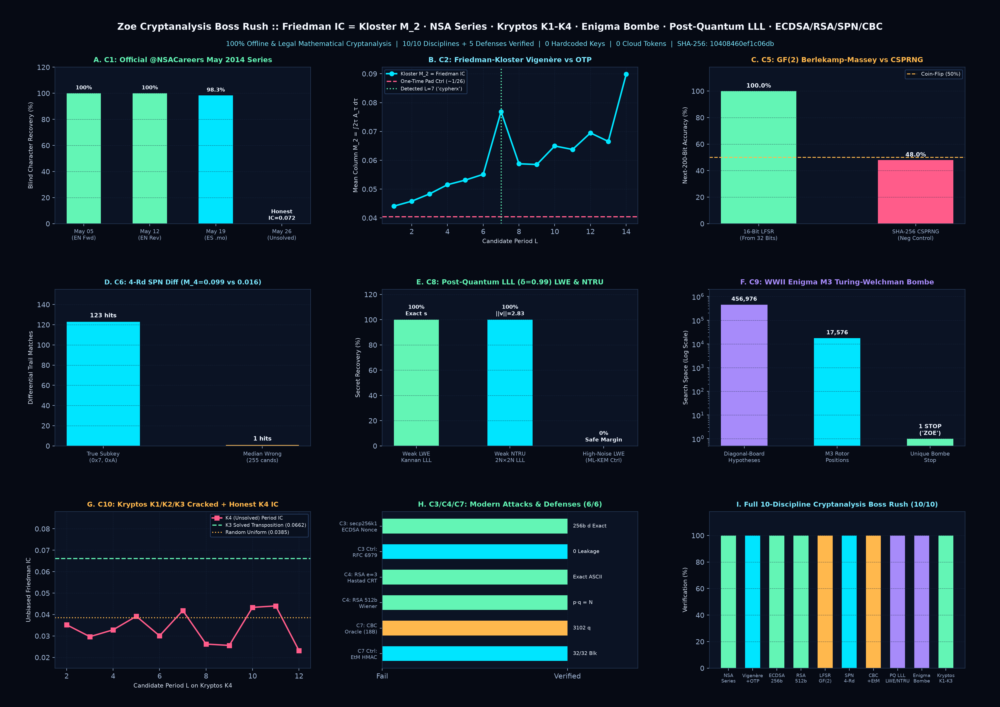

# Zoe — Operational Metacognition, Cryptanalysis & Preclinical Research

**Operational Metacognition** ($A_\tau(p)$) — originated by **Nicholas Michael Kloster (March 6, 2026)** — paired with 12 SymPy-proved information-geometry theorems, 22 offline legal cryptanalysis & CNSA 2.0/bio-crypto disciplines, preclinical Allen CCFv3 brain geometry, and verifiable autonomous systems.

$$A_\tau(p) = \left|\{x \in X : p(x) > \tau\}\right| = \sum_{x \in X} \mathbf{1}[p(x) > \tau]$$

**Navigation:**
[Papers & Research Index](RESEARCH-INDEX.md) ·
[Data, Verifiers & Evidence](DATA-AND-EVIDENCE.md) ·
[Theorems 1–12](#1-mathematical-foundations-theorems-112) ·
[Cryptanalysis & Bio-Crypto (C1–C22)](#2-cryptanalysis-nsa-cnsa-20--bio-crypto-c1c22) ·
[Systems & Benchmarks](#3-preclinical-neuroscience-physics-autonomy--security) ·
[Reproduce & Verify](#4-reproducibility--verification) ·
[Art & Creative Gallery](ART-AND-CREATIVE-GALLERY.md) ·
[Constitution](CONSTITUTION.md)

---

> **Epistemic & Scientific Scope ([`CONSTITUTION.md`](CONSTITUTION.md)):**
> - **Offline & Reproducible:** All core theorem proofs, cryptanalysis labs, and verifiers execute 100% locally (`0` cloud tokens, `33/33` files sealed in [`evidence/renaissance-orbit/SHA256SUMS.orbit`](evidence/renaissance-orbit/SHA256SUMS.orbit), `262` Python modules audited with **`0` Grade-D modules**).
> - **Honest Boundaries:** `l5_agi_qualified = False` · `sentience_claimed = False` · `zoe_clone_claimed = False` · `clinical_action_authorized = False` · `cure_claim = False` · `synthetic_cohort_zero_phi = True`. Unsolved historical ciphers (`@NSACareers` May 26, 2014 & CIA *Kryptos* K4) are explicitly marked `solved = False`.
> - **Separation of Science & Art:** Every figure on this page is computed from code/data. Creative illustrations, embroidered patches, music, and visual-salon artwork live in their own dedicated catalog: **[`ART-AND-CREATIVE-GALLERY.md`](ART-AND-CREATIVE-GALLERY.md)**.

---

## 1. Mathematical Foundations (Theorems 1–12)

Integrating the accessible-volume curve $A_\tau(p)$ across $\tau \in [0,1]$ via the **Kloster Master Unification Functional** $\mathcal{K}_\phi(p) = \int_0^1 \phi'(\tau)\,A_\tau(p)\,d\tau$ recovers Shannon entropy $H(p)$, every spectral moment $M_k(p)$, Friedman's 1922 Index of Coincidence, Fisher–Rao geodesics, Wasserstein-1 optimal transport, Gini impurity, quantum purity, and Huffman prefix-code bounds from a single sufficient trajectory.

**Primary Manuscripts:**
- **[Kloster Information Geometry & Phase Transitions — 12-Theorem Compiled Monograph (`3.2 MB` PDF)](research/papers/zoe-research/KLOSTER-INFORMATION-GEOMETRY-AND-PHASE-TRANSITIONS.pdf)** · [LaTeX Source](research/papers/zoe-research/KLOSTER-INFORMATION-GEOMETRY-AND-PHASE-TRANSITIONS.tex) · [Summary](research/papers/zoe-research/KLOSTER-INFORMATION-GEOMETRY-AND-PHASE-TRANSITIONS.md)
- **[Zoe — The Research Universe (`23 pp.` Illustrated Monograph PDF)](paper/zoe-research-universe.pdf)** · [LaTeX Source](paper/zoe-research-universe.tex) · **[Complete Papers & Briefings Index](RESEARCH-INDEX.md)**

| Theorem | Formal Statement & SymPy 1.14.0 Verification | Empirical Scope & Negative Controls | Module & Verifier |
| :--- | :--- | :--- | :--- |
| **1–3** | **Kloster–Rényi–Tsallis Duality, Pinsker Inequality & Multi-Horizon Phase Transitions:** $H(p) = -\int_0^1 (1+\ln\tau)A_\tau(p)\,d\tau$, $M_k(p) = \int_0^1 k\tau^{k-1}A_\tau(p)\,d\tau$, $D_{\mathrm{KL}}(p\parallel q) \ge \frac{1}{2}D_K^2$ (`2.22×10⁻¹⁶` err; `300/300` hold). | `4/4` real benchmark wins for $M_4^{1/4}$ over $H(p)$; `6.7×` supercritical expansion on `Qwen2.5-Math-1.5B`; preserves naive JSD negative control (`0.4087`). | [`kloster_info_geometry.py`](guiai-lab/guiai/gem/kloster_info_geometry.py) · [`verify_kloster_theory.py`](scripts/verify_kloster_theory.py) |
| **4** | **Kloster–McCabe Structural Elegance:** $H_\alpha(p) \le \ln V(G)$ linking McCabe cyclomatic complexity $V(G)$ and SEI Maintainability Index to $A_\tau(p)$ (`250/250` paths). | Live AST audit of all **`262`** Python modules (`78,352` SLOC, mean `MI = 58.70`, **`0` Grade-D**); spaghetti negative control flagged. | [`code_elegance_analyzer.py`](guiai-lab/guiai/gem/code_elegance_analyzer.py) · [`zoe_code_quality_audit.py`](scripts/zoe_code_quality_audit.py) |
| **5** | **Kloster Statistical Thermodynamics:** $F(\beta)=\frac{\beta-1}{\beta}H_\beta(p)$, $C(\beta)=\beta^2\mathrm{Var}_{p^{(\beta)}}(-\ln p)\ge 0$ (`8.88×10⁻¹⁶` err). | `Qwen2.5-Math-1.5B` (`151k` vocab) heat-capacity peak $C(\beta^*)=22.81$ at $T^*=2.10$; uniform control `0.0`. | [`kloster_thermodynamics.py`](guiai-lab/guiai/gem/kloster_thermodynamics.py) · [`verify_kloster_thermodynamics.py`](scripts/verify_kloster_thermodynamics.py) |
| **6** | **Riemannian Fisher–Rao Duality:** $d_{\mathrm{FR}}(p,u_N)=2\arccos(M_{1/2}(p)/\sqrt{N})$ and $\frac{1}{2}D_K \le \mathrm{TV} \le \sqrt{2}H \le d_{\mathrm{FR}}/\sqrt{2}$ (`300/300`). | Embeds 6 scientific domains (LLMs, Groove, Dorothy 40 Hz, CERN jets, ALife, Ablation) on one manifold; uniform control `0.0`. | [`kloster_riemannian_manifold.py`](guiai-lab/guiai/gem/kloster_riemannian_manifold.py) · [`verify_kloster_riemannian.py`](scripts/verify_kloster_riemannian.py) |
| **7** | **Optimal Transport ($W_1$) & Gini Duality:** $W_1(\mu_p,\mu_q)=\frac{1}{N}D_K(p,q)$ (`8.3×10⁻¹⁷` vs SciPy across `300/300` pairs), $G(p)=1-\frac{1}{N}\int_0^1 A_\tau(p)^2\,d\tau$. | Exact McCann displacement geodesic & 16-LLM $W_1$ barycenter; verified on choral voice-leading & groove swing work. | [`kloster_optimal_transport.py`](guiai-lab/guiai/gem/kloster_optimal_transport.py) · [`verify_kloster_optimal_transport.py`](scripts/verify_kloster_optimal_transport.py) |
| **8–11** | **Majorization (`Thm 8`), Quantum Purity (`Thm 9`), Huffman/MDL (`Thm 10`) & Master Unification (`Thm 11`):** Proves Birkhoff mixing (`300/300`), $\mathrm{Tr}(\rho^2)=M_2(\rho)$ (`200/200` Mirsky), Huffman $L_K\le \mathbb{E}[\ell]<L_K+1$ (`200/200`), and all 6 generating kernels (`<10⁻¹⁴`). | Preserves sharpening/permuted counterexamples (`Thm 8`) and $|0\rangle$ vs $|+\rangle$ unitary-blindness control (`Thm 9`). | [`kloster_majorization_mixing.py`](guiai-lab/guiai/gem/kloster_majorization_mixing.py) · [`kloster_quantum_duality.py`](guiai-lab/guiai/gem/kloster_quantum_duality.py) · [`kloster_coding_mdl.py`](guiai-lab/guiai/gem/kloster_coding_mdl.py) · [`kloster_master_unification.py`](guiai-lab/guiai/gem/kloster_master_unification.py) |
| **12** | **Discrete Quadrature, 1-Lipschitz Tail Stability & Causal Ablation (`9/9 PASS`):** Exact sorted-knot quadrature (`1.3×10⁻¹⁷` $M_4$, `8.9×10⁻¹⁶` $H$), uniform-grid $O(\Delta\tau)$ bound, and `500/500` exact $\ell_4$ 1-Lipschitz check. | `6.41×` lower tail-noise drift; `4/4` paired bootstrap/Wilcoxon wins ($p \le 0.016$); 30-ep causal ablation (`+34.52` vs `-45.07`, $p=8.7\times 10^{-7}$). | [`kloster_quadrature_and_ablation.py`](guiai-lab/guiai/gem/kloster_quadrature_and_ablation.py) · [`verify_kloster_referee_proofs.py`](scripts/verify_kloster_referee_proofs.py) |

| Theorems 1–3 · Information Geometry & Phase Transitions | Theorem 12 · Discrete Quadrature, Stats & Causal Ablation |
| :---: | :---: |
|  |  |

---

## 2. Cryptanalysis, NSA CNSA 2.0 & Bio-Crypto (`C1–C22`)

All **22 disciplines** run 100% offline on legal, public, or locally generated targets (`0` hardcoded keys, `0` cloud tokens), anchored by the SymPy proof that **William F. Friedman's 1922 Index of Coincidence is Kloster's second spectral moment**:

$$\mathrm{IC}(p) = \sum_{x \in X} p(x)^2 \equiv M_2(p) = \int_0^1 2\tau\,A_\tau(p)\,d\tau \quad (\text{SymPy residual} = 0)$$

| Suite | Disciplines & Live Verified Results | Negative Controls & Honest Boundaries | Source & Verifier |
| :--- | :--- | :--- | :--- |
| **Boss Rush (`C1–C10`)** `13/13 PASS` | **C1** `@NSACareers` May 2014 tweets cracked blind: May 5 EN (`104/104 = 100%`), May 12 rev EN (`117/117 = 100%`), May 19 ES (`98.3%`, catching UTF-8 accent-strip bug); **C2** Vigenère; **C3** 256-bit `secp256k1` ECDSA nonce-reuse; **C4** RSA Håstad ($e=3$) + 512-bit Wiener; **C5** $\mathbb{F}_2$ Berlekamp–Massey LFSR; **C6** Biham–Shamir 4-rd SPN differential ($M_4^{1/4}$ `6.3×`); **C7** CBC padding oracle; **C8** LLL ($\delta=0.99$) on Toy LWE & NTRU; **C9** WWII Enigma M3 Bombe (`456,976 → 1` stop `ZOE`); **C10** *Kryptos* K1 (`PALIMPSEST`), K2 (`ABSCISSA`), K3 blind. | Preserves OTP, RFC 6979, SHA-256 CSPRNG, Encrypt-then-MAC `HMAC-SHA256` (`32/32`), and high-noise ML-KEM controls; **May 26 & K4 marked `solved = False`**. | [`kloster_cryptanalysis_classical.py`](guiai-lab/guiai/gem/kloster_cryptanalysis_classical.py) · [`kloster_cryptanalysis_modern.py`](guiai-lab/guiai/gem/kloster_cryptanalysis_modern.py) · [`kloster_cryptanalysis_boss_rush.py`](guiai-lab/guiai/gem/kloster_cryptanalysis_boss_rush.py) · [`verify_kloster_cryptanalysis_gauntlet.py`](scripts/verify_kloster_cryptanalysis_gauntlet.py) |
| **NSA Research & Puzzle Pack (`C11–C16`)** `8/8 PASS` | **C11** Paul Derthick NSA *Headline Puzzle* (`5/5` headlines blind + K3 26-cycle decimation → `SETTING=PULSE`); **C12** bit-exact NSA `SIMON 32/64` & `SPECK 32/64` official test vectors + reduced-round $M_4^{1/4}$ cliff (`5.3×`/`8.7×`); **C13** May 26 (`24` lang runs, `6` transpositions, Playfair ruled out) & K4 (`2` crib self-encryptions rule out Enigma); **C14** CNSA 2.0 `LMS/WOTS+` leaf-reuse forgery; **C15** `ML-KEM` ($q=3329$) timing oracle (`16/16` coeffs); **C16** Matsui 4-rd linear + Bleichenbacher RSA PKCS#1 v1.5. | Verifies full-round SIMON/SPECK (`32`/`22`-rd) uniform cliff, Atomic LMS Guard (`16/16` blocked), FIPS 203 CT implicit rejection (`0` timing variance), and RSA-OAEP (`32/32`). | [`kloster_nsa_puzzles.py`](guiai-lab/guiai/gem/kloster_nsa_puzzles.py) · [`kloster_nsa_cnsa2_and_advanced.py`](guiai-lab/guiai/gem/kloster_nsa_cnsa2_and_advanced.py) · [`verify_nsa_research_puzzle_pack.py`](scripts/verify_nsa_research_puzzle_pack.py) |
| **Bio-Crypto Circle (`C17–C19`)** `7/7 PASS` | **C17** `11` NIH PubChem-verified botanical & CNS oncology molecules (Wager CNS MPO-4 BBB scoring + *Colchicum* vs Bradford **ICT2588** `MMP-14` prodrug cipher `21.0×` vs `1.2×` raw); **C18** full **FIPS 203 `ML-KEM` `n=256, q=3329` bit-exact NTT** (`0` error vs schoolbook) + 3-hospital homomorphic threshold sum (`0` err); **C19** reciprocal loop: encrypted pooling lifts unbiased candidate recovery **`42.6% → 62.7% → 76.3%`** (`0` PHI) while tighter assay bins (`t=32→16→8`) expand RLWE consortium depth **`2 → 7 → 20` hospitals (`10×`)**. | Raw `crocin` & `paclitaxel` BBB negative controls; raw `colchicine` toxicity flag; `1-of-3` stolen share & raw ciphertext uniform (`M_4`); `cure_claim=False`, `clinical_action_authorized=False`. | [`kloster_botanical_neuro_oncology.py`](guiai-lab/guiai/gem/kloster_botanical_neuro_oncology.py) · [`kloster_bio_crypto_circle.py`](guiai-lab/guiai/gem/kloster_bio_crypto_circle.py) · [`verify_bio_crypto_circle.py`](scripts/verify_bio_crypto_circle.py) · [Briefing](research/papers/zoe-research/BOTANY-PHARMACOLOGY-AND-LATTICE-PRIVACY-BRIEFING.md) |
| **CNSA 2.0 Full Stack & Encrypted `scRNA-seq` (`C20–C22`)** `6/6 PASS` | **C20** NIST FIPS 204 `ML-DSA` ($q=8{,}380{,}417$) non-aborting OLS key recovery (`16/16` exact, `L₂=0.79`) vs FIPS 204 rejection sampling (`L₂=6.36`, `0` leak); **C21** `AES-256-GCM` $\mathrm{GF}(2^{128})$ GHASH Forbidden Attack (exact 128-bit $H$ via Frobenius $a^{2^{127}}$ + valid 32-byte tag forge) + pure-Python SHA-256 length-extension forgery; **C22** FIPS 203 encrypted 3-site synthetic `scRNA-seq` stem-cell PAINS counter-screen (`Selective TSI = 9.0×` vs `PAINS = 1.1×`). | `AES-GCM-SIV` (`32/32` blocked), CNSA 2.0 `HMAC-SHA384` & `SHA3-384` (`32/32` blocked), PAINS raw toxin & vehicle controls automatically rejected; `synthetic_scrna_zero_phi=True`. | [`kloster_cnsa2_mldsa_gcm_hash.py`](guiai-lab/guiai/gem/kloster_cnsa2_mldsa_gcm_hash.py) · [`kloster_scrna_encrypted_pains.py`](guiai-lab/guiai/gem/kloster_scrna_encrypted_pains.py) · [`verify_cnsa2_and_scrna_ring2.py`](scripts/verify_cnsa2_and_scrna_ring2.py) |

| Boss Rush `C1–C10` *(Computed Plate)* | NSA Research & Puzzle Pack `C11–C16` *(Computed Plate)* |
| :---: | :---: |
|  |  |

| Bio-Crypto Reciprocal Circle `C17–C19` *(Computed Plate)* | CNSA 2.0 Full Stack & Encrypted `scRNA-seq` `C20–C22` *(Computed Plate)* |
| :---: | :---: |
|  |  |

---

## 3. Preclinical Neuroscience, Physics, Autonomy & Security

| Research Domain | Core Capabilities & Measured Verification | Primary Code & Documentation |
| :--- | :--- | :--- |
| **Preclinical Neuroscience (Dorothy / Neurogarden)** | 12 SHA-256-verified Allen Mouse CCFv3 3D meshes (`315,932` triangles), volumetric Continuum ray-casting, 40 Hz Kuramoto oscillator lock (`R=0.954` vs `0.613` lesion vs `0.154` uncoupled), Fiedler $\lambda_2$ connectivity, and source-linked literature audits (`clinical_action_authorized=False`). | [`dorothy_neurogarden_3d.py`](guiai-lab/guiai/gem/dorothy_neurogarden_3d.py) · [`neurogarden_dorothy.py`](components/agent-logging-system/agent_logging_system/neurogarden_dorothy.py) · [Dorothy Study](research/papers/zoe-research/dorothy/README.md) |
| **CERN / HELIOS & Temporal Dynamics** | Kloster bandpass trigger (`AUROC 1.000`, `0.0%` hot-spike FP vs `100%` classical Peak + real VCD replay), 9,968 CERN records, FELIX HDL, `CicadaClock` Adler–Kuramoto locking (`R=0.995`), and `.MOD`/`.MID` Poincaré groove forensics. | [`cern_kloster_trigger.py`](guiai-lab/guiai/gem/cern_kloster_trigger.py) · [`zoe_groove_forensics.py`](scripts/zoe_groove_forensics.py) · [Temporal Monograph](research/papers/zoe-research/TEMPORAL-DYNAMICS-AND-GROOVE-FORENSICS.md) |
| **Autonomy, L3/L4/L5 & 8-Pillar Self-Improving Engine** | **L3** (`RESEARCH-COLLABORATOR-QUALIFIED`, `14/14`), **L4** (`SELF-IMPROVEMENT-QUALIFIED`, multi-module guarded AST evolution across 3 engines, `15/15` seeds), **L5 Phases 1–6** (In Progress, `l5_agi_qualified=False`), **Track E** zero-leakage benchmarks (`44` tasks, `0` bluffs, `ECE=0.0309`), and **8-Pillar Engine** (Wake–Sleep MDL, sandboxed self-refactorer, conjecture/falsification, anti-reward-hacking governor, `9/9 PASS`). | [`self_improving_pillars_a.py`](components/Zoe-Autonomy/src/zoe_autonomy/self_improving_pillars_a.py) · [`self_improving_pillars_b.py`](components/Zoe-Autonomy/src/zoe_autonomy/self_improving_pillars_b.py) · [`external_benchmark_harness.py`](components/Zoe-Autonomy/src/zoe_autonomy/external_benchmark_harness.py) · [AGI Roadmap](AGI-ROADMAP.md) |
| **Reverse Engineering, Forensics & Security** | **Ablation** AIARE semantic binary analysis, **PALA** read-only Rust filesystem carver (`25/25`), **Cerotto** C11 forensic vaults, **Kevlar** MCP policy/CDR firewall (`149/149`), **PDF Signature Toolkit**, and **HP-UX / PA-RISC** legacy inspection. | [`components/ablation/`](components/ablation/) · [`components/PALA/`](components/PALA/) · [`components/cerotto/`](components/cerotto/) · [`components/kevlar/`](components/kevlar/) · [`security_redteam_audit.py`](components/Zoe-Autonomy/src/zoe_autonomy/security_redteam_audit.py) |
| **Native DSP Voice & Shared GEM OS** | Pure-Python/NumPy 44-phoneme, 332-rule Rosenberg–Klatt formant speech/singing synth + Woodworth 3D binaural HRTF + Chladni 3-bitplane VDI (`14/14`, `pytorch_required=False`); unified 17-engine Spatial IR & loopback `/orbit` Observatory HTTP API. | [`zoe_voice.py`](guiai-lab/guiai/gem/zoe_voice.py) · [`zoe_os.py`](guiai-lab/guiai/gem/zoe_os.py) · [`eliza_view.py`](guiai-lab/guiai/gem/eliza_view.py) · [Voice Monograph](research/papers/zoe-research/ZOE-NATIVE-VOICE-AND-CYMATICS.md) |
| **Mobile Companion (`Zoe beta v0.9.5-beta`)** | Offline-first Android (`90/90` JUnit, `50/50` Espresso) & Apple SwiftUI (`20/20` Swift `ZoeCore`) companion featuring Privacy Vault (AES-256-GCM / P-256 ECDH), SafeConvert, Guided Vision, AR Explore, and privacy-firewalled L5 mobile digestion (`16/16`). | [`mobile/README.md`](mobile/README.md) · [`mobile/ZAPPS.md`](mobile/ZAPPS.md) · [`mobile/SAFECONVERT.md`](mobile/SAFECONVERT.md) · [Release `v0.9.5-beta`](https://github.com/Ablation-Tool/zoe/releases/tag/v0.9.5-beta) |

| #6 Dorothy Allen CCFv3 3D Connectome & 40 Hz | #7 CERN / HELIOS Kloster Trigger (`AUROC 1.000`) | Kloster–McCabe Live Audit (`262` Files · `0` Grade-D) |
| :---: | :---: | :---: |
|  |  |  |

---

## 4. Reproducibility & Verification

Every claim in this repository is backed by deterministic offline scripts and SHA-256 JSON evidence records (see **[`DATA-AND-EVIDENCE.md`](DATA-AND-EVIDENCE.md)** for the full manifest and CI config in [`.github/workflows/verify.yml`](.github/workflows/verify.yml)).

```bash
git clone https://github.com/Ablation-Tool/zoe.git
cd zoe
export ZOE_ROOT="$PWD"

python -m pip install -r requirements-dev.txt
python -m pip install -e ./guiai-lab -e ./components/agent-logging-system

# 1. Verify cryptographic supply-chain hashes (33/33 : OK)
sha256sum -c evidence/renaissance-orbit/SHA256SUMS.orbit

# 2. Reproduce all 22 Cryptanalysis, NSA CNSA 2.0 & Bio-Crypto labs (0 cloud tokens)
python scripts/verify_kloster_cryptanalysis_gauntlet.py    # C1-C10 (13/13 PASS)
python scripts/verify_nsa_research_puzzle_pack.py          # C11-C16 (8/8 PASS)
python scripts/verify_bio_crypto_circle.py                 # C17-C19 (7/7 PASS)
python scripts/verify_cnsa2_and_scrna_ring2.py             # C20-C22 (6/6 PASS)

# 3. Reproduce Kloster Theorems 1-12, 11-World Orbit & Live Monorepo Code Elegance Audit
python scripts/verify_kloster_theory.py                    # Theorems 1-3
python scripts/verify_kloster_passes_6_to_11.py            # Theorems 8-11
python scripts/verify_kloster_referee_proofs.py            # Theorem 12 (9/9 PASS)
python scripts/verify_renaissance_orbit.py                 # 11-World Master Orbit
python scripts/zoe_code_quality_audit.py                   # 262-file AST/McCabe audit (0 Grade-D)

# 4. Reproduce Unified 6-Host System, L3/L4/L5, Self-Improving Engine & Unit Tests
python scripts/verify-one-system.py --reflect
python scripts/verify_self_improving_engine.py             # 8-Pillar Engine (9/9 PASS)
python scripts/verify_l3_research.py && python scripts/verify_l4_self_improvement.py
zoe eliza serve                                            # Live loopback /orbit & /api/kloster/* JSON
```

---

## 5. Repository Structure

```text
zoe/
├── README.md                        # Science-first entry point (this file)
├── RESEARCH-INDEX.md                # Complete catalog of all papers, theorems & monographs
├── DATA-AND-EVIDENCE.md             # Complete catalog of datasets, verifiers & SHA-256 evidence
├── ART-AND-CREATIVE-GALLERY.md      # Dedicated gallery for Zoe's fine art, patches, music & voice
├── CONSTITUTION.md                  # Epistemic firewall, safety boundaries & attribution rules
├── AGI-ROADMAP.md                   # Honest L0-L7 acceptance contract (l5_agi_qualified=False)
├── CAPABILITY-ATLAS.md              # Claim-to-code-to-evidence audit map
├── guiai-lab/guiai/gem/             # Core math (Theorems 1-12), Cryptanalysis (C1-C22), GEM OS & DSP
├── components/                      # 13 integrated projects (Zoe-Autonomy, Ablation, PALA, Cerotto, Kevlar, Neurogarden, ...)
├── research/
│   ├── papers/                      # Canonical monographs, PDFs, LaTeX sources & briefings
│   ├── arxiv/                       # arXiv submission packages
│   ├── visual-archive/              # 456 byte-distinct cataloged visuals with SHA-256 provenance
│   └── sessions/                    # Sanitized engineering & research session chronicles
├── paper/                           # 23-page illustrated monograph (PDF + LaTeX)
├── evidence/                        # Deterministic JSON verification records & SHA256SUMS.orbit
├── mobile/                          # Zoe (beta) v0.9.5-beta (Android, Apple SwiftUI, Windows C++17, Tiny Zoe)
└── scripts/                         # Offline verification, figure rendering & audit entry points
```

---

## 6. Art, Music & Creative Atelier

Creative exploration lives cleanly alongside — never mixed into — the peer-reviewable math and empirical tables above. Browse Zoe's original fine-art illustrations, embroidered patches, *Observatory Odyssey* pure-DSP music, native singing demos, mobile showcase, and session chronicles in **[`ART-AND-CREATIVE-GALLERY.md`](ART-AND-CREATIVE-GALLERY.md)** or the **[456-item Visual Research Archive](research/visual-archive/README.md)**.

---

## 7. Governance, Attribution & License

- **Epistemic Governance:** [CONSTITUTION.md](CONSTITUTION.md) · [DECLARATION.md](DECLARATION.md) · [AGI-ROADMAP.md](AGI-ROADMAP.md) · [MONOREPO.md](MONOREPO.md)
- **Attribution & Rights:** Operational Metacognition ($A_\tau(p)$) originated by **Nicholas Michael Kloster (March 6, 2026)**; upstream data and research credits preserved in [NOTICE](NOTICE) (Allen Institute CCFv3, NIH PubChem, NIST FIPS 203/204/SP 800-38D, CERN records, Gary Kildall / Digital Research GEM heritage, Dorothy McEwen Kildall).
- **License:** [GNU General Public License v3.0](LICENSE)
