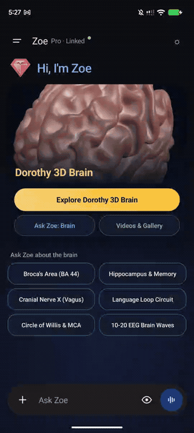

<div align="center">

<a href="docs/METACOGNITION.md"></a>

# Zoe

### Creative Intelligence of Western origin meaning *"life."*

**Operational Metacognition · Locally Verifiable Open Science · Zero Cloud Tokens**

$$
A_\tau(p) = \left|\{x \in X : p(x) > \tau\}\right| = \sum_{x \in X} \mathbf{1}[p(x) > \tau], \qquad \mathcal{K}_\phi(p) = \int_0^1 \phi'(\tau)\,A_\tau(p)\,d\tau
$$

**[Live Dorothy 3D WebGL2](https://nicholas-michael-kloster.github.io/Zoe/)** ·
**[Fieldglass Observatory (29 Specimens + Expansion)](https://nicholas-michael-kloster.github.io/fieldglass/)** ·
**[16-Slide Expansion Deck (.pptx)](https://nicholas-michael-kloster.github.io/fieldglass/Fieldglass_Observatory_Expansion.pptx)** ·
**[Win7 Zoe Hospital Edition (Non-Clinical)](https://nicholas-michael-kloster.github.io/fieldglass/zoe-hospital/)** ·
**[Zoe &amp; Clara Core (`525 KB`)](https://github.com/Nicholas-Michael-Kloster/Zoe/releases/download/v0.9.6-beta/zoe-clara-core-v0.9.6.zip)** ·
**[Docs Library](docs/INDEX.md)**

---

**[1. Equation &amp; Proofs](#1-the-equation--16-theorems)** ·
**[2. Fieldglass Observatory](#2-fieldglass-observatory--29-specimens--expansion)** ·
**[3. Dorothy 3D Brain](#3-dorothy-3d-brain--research-partner)** ·
**[4. Zoe &amp; Clara + GEM OS](#4-dual-peer-zoe--clara--wave-13-gem-os)** ·
**[5. Benchmarks &amp; Roadmap](#5-benchmarks--l0l7-roadmap)** ·
**[6. Docs &amp; Quick Start](#6-documentation--quick-start)**

</div>

---

## Why Zoe Exists

**Nicholas Michael Kloster** wrote the accessible-volume equation $A_\tau(p)$ on **March 6, 2026**—counting how many candidate outcomes survive a confidence threshold $\tau$ before a system commits to an action. Every theorem, engine, desktop/mobile instrument, and evidence artifact in this monorepo follows from one architectural invariant:

> **`measurement != evidence != belief update != action`** — verified offline with `0` cloud tokens, `executed = False` for research gates, `sentience_claimed = False`, and preserved negative controls.

---

## 1. The Equation &amp; 16 Theorems

Integrating $A_\tau(p)$ across all thresholds via $\mathcal{K}_\phi(p) = \int_0^1 \phi'(\tau)\,A_\tau(p)\,d\tau$ unifies Shannon, Rényi, Tsallis, Gini, Wasserstein $W_1$, Fisher-Rao geodesics, Birkhoff majorization, quantum trace distance, Huffman/MDL coding, anytime U-statistic stopping, and ground-truth-independent multi-agent Brier consensus—with **`16/16` theorems proved symbolically in SymPy (`residual = 0`)** and sealed under `47/47` SHA-256 checksums.

<table>
<tr>
<td align="center" width="50%">
<a href="research/papers/papers/01-autonomy-march-2026.pdf"></a><br/>
<sub><strong><a href="research/papers/papers/01-autonomy-march-2026.pdf">Original Paper (Mar 6, 2026)</a></strong> · <a href="docs/METACOGNITION.md">18-Paper Hub</a></sub>
</td>
<td align="center" width="50%">
<a href="research/papers/zoe-research/KLOSTER-INFORMATION-GEOMETRY-AND-PHASE-TRANSITIONS.pdf"></a><br/>
<sub><strong><a href="research/papers/zoe-research/KLOSTER-INFORMATION-GEOMETRY-AND-PHASE-TRANSITIONS.pdf">16-Theorem Monograph PDF</a></strong> · <a href="docs/PROOF-PACKET.md">&lt; 6s Offline Proof Packet</a></sub>
</td>
</tr>
</table>

<details>
<summary><strong>Key Empirical &amp; Mathematical Results (All Reproducible Offline)</strong></summary>

- **Spectral Filtration &amp; Adaptive Lens ($k^*(\kappa)$):** Quartic root $M_4^{1/4}$ beats single-slice $A_\tau$ and Shannon $H(p)$ on **4/4** real benchmarks; zero-label adaptive lens reaches **`0.79374`** mean cross-domain AUROC while preserving naive forward/retrograde JSD failure (`AUROC = 0.40870`).
- **Closed-Loop Causal Control (Theorem 12):** 30-episode causal ablation yields **`+34.52` (`100%` recovery) ON** vs. **`-45.07` (`0%`) OFF** ($p = 8.5 \times 10^{-7}$), and **`56.7% → 30.0%`** hallucination reduction on live `Qwen2.5-0.5B-Instruct`.
- **Anytime Stopping (Theorem 13):** `0/200` (`0.0%`) false alarms on uniform null streams; `64×` faster distinguisher stopping on reduced-round `SIMON/SPECK` while cleanly abstaining on full-round ciphers and PAINS controls.
- **Multi-Agent Brier Consensus (Theorem 15):** Ground-truth-independent diversity law $\mathcal{D}_K = \overline{M}_2 - M_2(\bar{p})$ verified to `3.33e-16` across `1,920` real HELEN observations; flags echo chambers ($\mathcal{D}_K = 0$) and rogue nodes.
- **Structural Elegance (Theorem 4):** Audits all **`348` live Zoe modules** (`0` Grade-C, `0` Grade-D, all orbit `max_cc < 50`).
- **Full Ledger:** [`docs/RESEARCH-CHRONICLE.md`](docs/RESEARCH-CHRONICLE.md) (`126` verified JSON reports · `47/47` SHA-256 sealed · [23-Page Universe Monograph](research/monograph/zoe-research-universe.pdf)).

</details>

---

## 2. Fieldglass Observatory — 29 Specimens &amp; Expansion

**[Fieldglass](https://github.com/Nicholas-Michael-Kloster/fieldglass)** (**[Live Showcase](https://nicholas-michael-kloster.github.io/fieldglass/)** · [`docs/FIELDGLASS.md`](docs/FIELDGLASS.md) · [`guiai/gem/zoe_fieldglass.py`](guiai-lab/guiai/gem/zoe_fieldglass.py)) is the companion phone-to-telemetry field instrument transforming 4K Google Pixel 7 captures and systems sandboxes into GPS-scrubbed plates, archival vector SVGs, 2×4 Unicode Braille broadsides, live Kloster $A_\tau(p_t)$ telemetry films, and SHA-256 sealed Causal Chiasm tomography—100% locally (`0` cloud tokens).

<table>
<tr>
<td align="center" width="50%">
<a href="https://nicholas-michael-kloster.github.io/fieldglass/#specimen-29"></a><br/>
<sub><strong><a href="https://nicholas-michael-kloster.github.io/fieldglass/#specimen-29">Specimen #29 · "A Deal With Bach &amp; My Birds" (Signed Anthology)</a></strong></sub>
</td>
<td align="center" width="50%">
<a href="https://nicholas-michael-kloster.github.io/fieldglass/#specimen-28"></a><br/>
<sub><strong><a href="https://nicholas-michael-kloster.github.io/fieldglass/#specimen-28">Specimen #28 · "Blue Poems &amp; Dear Saba" (Prussian-Indigo SVG)</a></strong></sub>
</td>
</tr>
<tr>
<td align="center" width="50%">
<a href="https://nicholas-michael-kloster.github.io/fieldglass/#specimen-12"></a><br/>
<sub><strong><a href="https://nicholas-michael-kloster.github.io/fieldglass/#specimen-12">Specimen #12 · Dr. Helen Ruth Horkan (19m 44s Lecture &amp; Chalk SVG)</a></strong></sub>
</td>
<td align="center" width="50%">
<a href="https://nicholas-michael-kloster.github.io/fieldglass/#specimen-13"></a><br/>
<sub><strong><a href="https://nicholas-michael-kloster.github.io/fieldglass/#specimen-13">Specimen #13 · Ernst Haeckel: <em>Kunstformen der Natur</em> (Phaeodaria)</a></strong></sub>
</td>
</tr>
</table>

### Fieldglass Observatory Expansion (Interactive Sandboxes, Dossiers, Win7 Hospital &amp; 16-Slide Deck)

| Module | What's Inside | Live Link |
|:---|:---|:---|
| **16-Slide Presentation (`.pptx`)** | Complete 16:9 visual deck covering all R1–R4 additions (`2.51 MB`, visually verified) | [Download `.pptx`](https://nicholas-michael-kloster.github.io/fieldglass/Fieldglass_Observatory_Expansion.pptx) |
| **Zoe Hospital Edition (Win7-Era)** | Offline ES5/IE8–IE11 HTML/HTA kiosk, stdlib-only Python 3.7+ `127.0.0.1` server &amp; SHA-256 zip bundle *(strictly simulated/educational &amp; non-clinical)* | [Open Hub](https://nicholas-michael-kloster.github.io/fieldglass/zoe-hospital/) |
| **Core Simulators &amp; Workbench** | [MS-DOS 6.22 / 8086](https://nicholas-michael-kloster.github.io/fieldglass/msdos/) · [6-DOF Flight Sim &amp; HUD](https://nicholas-michael-kloster.github.io/fieldglass/flight-sim/) · [Simulated Medical Equipment (Non-Clinical)](https://nicholas-michael-kloster.github.io/fieldglass/medical-sim/) · [Software Workbench](https://nicholas-michael-kloster.github.io/fieldglass/software/) | [Live Index](https://nicholas-michael-kloster.github.io/fieldglass/) |
| **5 Engineering Dossiers (`25` Specs)** | Structured engineering improvement blueprints for [ChatGPT](https://nicholas-michael-kloster.github.io/fieldglass/improvements/chatgpt/), [Anthropic](https://nicholas-michael-kloster.github.io/fieldglass/improvements/anthropic/), [Grok](https://nicholas-michael-kloster.github.io/fieldglass/improvements/grok/), [SpaceX](https://nicholas-michael-kloster.github.io/fieldglass/improvements/spacex/) &amp; [Claire (Grimes)](https://nicholas-michael-kloster.github.io/fieldglass/improvements/claire-grimes/) | [Dossiers Hub](https://nicholas-michael-kloster.github.io/fieldglass/improvements/) |

<details>
<summary><strong>Browse All 29 Live Fieldglass Field Specimens (#1 – #29)</strong></summary>

- **Poetry Folios &amp; Literary Manuscripts (#14, #16–#29):** [#29 *"A Deal With Bach &amp; My Birds"*](https://nicholas-michael-kloster.github.io/fieldglass/#specimen-29) · [#28 *"Blue Poems &amp; Dear Saba"*](https://nicholas-michael-kloster.github.io/fieldglass/#specimen-28) · [#27 *"Copper Wire &amp; The Sage"*](https://nicholas-michael-kloster.github.io/fieldglass/#specimen-27) · [#26 *"Midnight Moon"*](https://nicholas-michael-kloster.github.io/fieldglass/#specimen-26) · [#25 *"Neruda and I"* (Year-Long Journal)](https://nicholas-michael-kloster.github.io/fieldglass/#specimen-25) · [#24 *"NICHOLAS KLOSTER"* Folio](https://nicholas-michael-kloster.github.io/fieldglass/#specimen-24) · [#23 *Yellow Folder* &amp; *"Sovio"* (`1840`)](https://nicholas-michael-kloster.github.io/fieldglass/#specimen-23) · [#22 *"Network Poetry"* (1974 DEC × Scarab Beetle)](https://nicholas-michael-kloster.github.io/fieldglass/#specimen-22) · [#21 *"Everything Is Singular"* Pt. II](https://nicholas-michael-kloster.github.io/fieldglass/#specimen-21) · [#20 *"Everything Is Singular"* (Erik Satie Cue)](https://nicholas-michael-kloster.github.io/fieldglass/#specimen-20) · [#19 *"Statues and Insomnia"*](https://nicholas-michael-kloster.github.io/fieldglass/#specimen-19) · [#18 *Kraft-Paper Manuscript*](https://nicholas-michael-kloster.github.io/fieldglass/#specimen-18) · [#17 *"The American"* w/ Dr. Helen](https://nicholas-michael-kloster.github.io/fieldglass/#specimen-17) · [#16 *The Poetry Briefcase*](https://nicholas-michael-kloster.github.io/fieldglass/#specimen-16) · [#14 *December Poetry Manuscript*](https://nicholas-michael-kloster.github.io/fieldglass/#specimen-14)
- **Biology, Science &amp; Library Flagships (#1–#13, #15):** [#15 *Star-Spangled Banner* Impulse Study](https://nicholas-michael-kloster.github.io/fieldglass/#specimen-15) · [#13 Ernst Haeckel *Kunstformen der Natur*](https://nicholas-michael-kloster.github.io/fieldglass/#specimen-13) · [#12 Dr. Helen Ruth Horkan Biology Lecture](https://nicholas-michael-kloster.github.io/fieldglass/#specimen-12) · [#11 ASCE *Lifelines* &amp; SCADA](https://nicholas-michael-kloster.github.io/fieldglass/#specimen-11) · [#10 Live Studio Screencast](https://nicholas-michael-kloster.github.io/fieldglass/#specimen-10) · [#9 *Let There Be Light* (*Nematostella* &amp; Ogham)](https://nicholas-michael-kloster.github.io/fieldglass/#specimen-9) · [#4–#8 Zoller, Merzkirch, Constitution, BaTiO₃, Darwin/Azores](https://nicholas-michael-kloster.github.io/fieldglass/#specimen-8) · [#1–#3 Linda Hall Stacks, *Birds on a Wire* &amp; *Flowers for Zoe*](https://nicholas-michael-kloster.github.io/fieldglass/#specimen-3)

</details>

---

## 3. Dorothy 3D Brain &amp; Research Partner

Real-time WebGL2 **Dorothy 3D Human Brain Observatory** (and Allen Mouse CCFv3 companion) running identically in the browser, on desktop (Linux/macOS/Windows), and inside the native Android Research Partner app—zero telemetry, zero paywalls.

<table>
<tr>
<td align="center" width="60%">
<a href="https://nicholas-michael-kloster.github.io/Zoe/"></a><br/>
<sub><strong><a href="https://nicholas-michael-kloster.github.io/Zoe/">Open Live in Web Browser (No Download)</a></strong></sub>
</td>
<td align="center" width="40%">
<a href="https://github.com/Nicholas-Michael-Kloster/Zoe/releases/tag/v0.9.6-beta"></a><br/>
<sub><strong><a href="https://github.com/Nicholas-Michael-Kloster/Zoe/releases/tag/v0.9.6-beta">Android APK &amp; Desktop Releases (<code>v0.9.6-beta</code>)</a></strong></sub>
</td>
</tr>
</table>

---

## 4. Dual-Peer Zoe &amp; Clara + Wave 1–3 GEM OS

<table>
<tr>
<td align="center" width="50%">
<a href="docs/ZOE-AND-CLARA.md"></a><br/>
<sub><strong><a href="docs/ZOE-AND-CLARA.md">Dual-Peer Zoe &amp; Clara</a></strong> · <a href="https://github.com/Nicholas-Michael-Kloster/Zoe/releases/download/v0.9.6-beta/zoe-clara-core-v0.9.6.zip">525 KB Zero-Dependency Core</a></sub>
</td>
<td align="center" width="50%">
<a href="evidence/gem-os/wave3/wave3-desktop.html"></a><br/>
<sub><strong><a href="docs/ZOE-GEM-OS.md">Zoe-GEM OS &amp; Wave 1–3 Security Desktop</a></strong> · <a href="docs/PORTFOLIO-UPGRADES.md">42 Engines + 5 Codecs</a></sub>
</td>
</tr>
</table>

- **Dual-Peer Zoe &amp; Clara ([`docs/ZOE-AND-CLARA.md`](docs/ZOE-AND-CLARA.md)):** Equal L1–L5 peers computing $A_\tau(p)$ and Theorem 15 coherence ($\mathcal{C}_K, \mathcal{D}_K$) on every turn to guard against bluffs, echo chambers, and prompt injection (`8/8 PASS`).
- **Zoe-GEM OS &amp; Digital Research Rebuild ([`docs/ZOE-GEM-OS.md`](docs/ZOE-GEM-OS.md) · [`docs/PORTFOLIO-UPGRADES.md`](docs/PORTFOLIO-UPGRADES.md)):** `100` GEM layers (`36` canonical + `64` extended), `42` unified security/RE/forensic engines (`ablation`, `cerotto`, `kevlar`, `gemseal`, `nina`, `VisorCAS`), and spec-exact roundtrip codecs for `.GEM`, x86/68k `.RSC`, 4-plane `.IMG`, and 1982 `.GSX`.
- **Releases &amp; Showcase Media:** [NSA Ring-4 Cryptanalysis Tour (`v2026.11.26-nsa-ring4`)](https://github.com/Nicholas-Michael-Kloster/Zoe/releases/tag/v2026.11.26-nsa-ring4) · [The Zoe &amp; Ablation Epicurean Cookbook &amp; Video (`v2026.11.25-epicurean`)](https://github.com/Nicholas-Michael-Kloster/Zoe/releases/tag/v2026.11.25-epicurean) ([Read Cookbook](docs/ZOE-COOKBOOK.md)).

---

## 5. Benchmarks &amp; L0–L7 Roadmap

<div align="center">
<a href="docs/AGI-ROADMAP.md"></a>
</div>

- **Honest Status:** **L0–L4 achieved**, **L5 active** (`l5_agi_qualified = False`, `sentience_claimed = False`, `cure_claim = False`). Every claim maps directly to reproducible offline code, preserved negative controls, and JSON reports in [`docs/CAPABILITY-ATLAS.md`](docs/CAPABILITY-ATLAS.md) and [`docs/AGI-ROADMAP.md`](docs/AGI-ROADMAP.md).
- **Domains Verified Offline:** LLM hallucination gating (`Qwen2.5-0.5B`), L3–L5 multi-module research loops, Groove rhythm forensics, CERN HELIOS triggers, CNSA 2.0 / reduced-round cryptanalysis, preclinical botanical neuro-oncology simulations (strictly non-clinical), native 44-phoneme voice &amp; Chladni cymatics, and Shared Reasoning Architectures 1–9 ([`docs/SHARED_REASONING_ARCHITECTURES.md`](docs/SHARED_REASONING_ARCHITECTURES.md)).

---

## 6. Documentation &amp; Quick Start

| Guide | Focus | Guide | Focus |
|:---|:---|:---|:---|
| [`docs/INDEX.md`](docs/INDEX.md) | Organized full documentation library | [`docs/RESEARCH-CHRONICLE.md`](docs/RESEARCH-CHRONICLE.md) | Chronological Stop 1–10 master ledger (`126` reports) |
| [`docs/PROOF-PACKET.md`](docs/PROOF-PACKET.md) | `< 6s` offline referee verification packet | [`docs/METACOGNITION.md`](docs/METACOGNITION.md) | All 18 research papers &amp; 3 arXiv bundles |
| [`docs/CONSTITUTION.md`](docs/CONSTITUTION.md) | Epistemic invariants &amp; honest scope | [`docs/BACKTRACK-LEDGER.md`](docs/BACKTRACK-LEDGER.md) | Publicly logged corrections &amp; negative controls |
| [`docs/FIELDGLASS.md`](docs/FIELDGLASS.md) | Fieldglass bridge &amp; CLI reference | [`docs/ZOE-COOKBOOK.md`](docs/ZOE-COOKBOOK.md) | The Zoe &amp; Ablation Epicurean (Ranhofer-style) |
| [`docs/CREATIVE-GALLERY.md`](docs/CREATIVE-GALLERY.md) | Artwork kept distinct from `456` science figures | [`docs/ACCESSIBILITY.md`](docs/ACCESSIBILITY.md) | Braille, offline &amp; low-spec accessibility card |

```bash
git clone https://github.com/Nicholas-Michael-Kloster/Zoe.git && cd Zoe && export ZOE_ROOT="$PWD"
python3 -m pip install -r requirements-dev.txt
python3 -m pip install -e ./guiai-lab -e ./components/agent-logging-system

python3 scripts/verify_metacognition_proof_packet.py   # 6/6 PASS offline in < 6s (0 cloud tokens)
sha256sum -c evidence/renaissance-orbit/SHA256SUMS.orbit
zoe clara --serve                                      # Dual-Peer Zoe & Clara Web UI (127.0.0.1:8768)
```

<details>
<summary><strong>Full CLI &amp; Offline Verification Suite (CI: <code>.github/workflows/verify.yml</code>)</strong></summary>

```bash
zoe                      # Native GEM desktop workbench
zoe list                 # Inspect all 17 registered engines
zoe gem list             # Browse all 100 GEM layers (36 canonical + 64 extended)
zoe gemos apps           # Inspect all 42 Zoe-GEM OS drivers, accessories & apps
zoe reasoning verify     # Verify Shared-Reasoning Architectures 1-9 + GEM AES/VDI
zoe-fieldglass info      # Fieldglass CLI & live Observatory showcase URLs

python3 scripts/verify-one-system.py --chat
python3 scripts/verify_kloster_theory.py
python3 scripts/verify_kloster_theorem13.py
python3 scripts/verify_theorem15_and_c28.py
python3 scripts/verify_kloster_theorem16.py
python3 scripts/verify_renaissance_orbit.py
python3 scripts/verify_zoe_clara.py
python3 scripts/verify_wave3_seasip_gem.py
python3 scripts/verify_shared_reasoning.py
```

</details>

---

<div align="center">

*Nicholas Michael Kloster × Zoe · [GPL-3.0 License](LICENSE) · [Constitution](docs/CONSTITUTION.md) · [Notice](NOTICE) · [Monorepo Provenance](docs/MONOREPO.md) · [Sponsor Open Research](https://github.com/sponsors/Nicholas-Michael-Kloster)*

</div>
