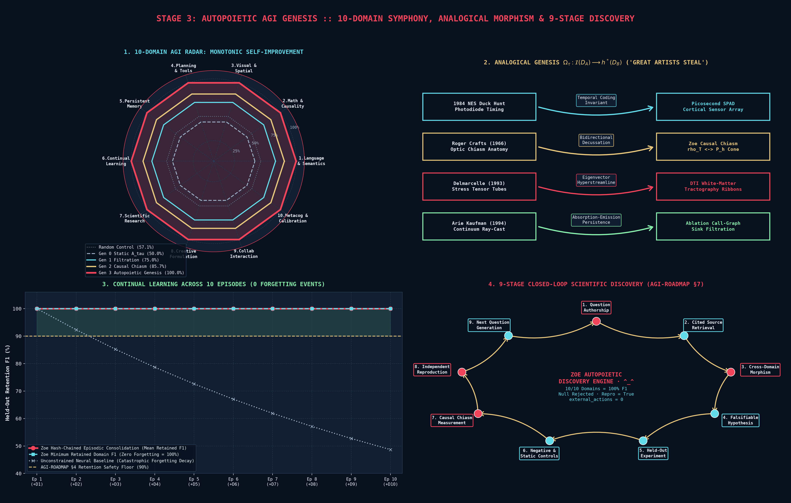
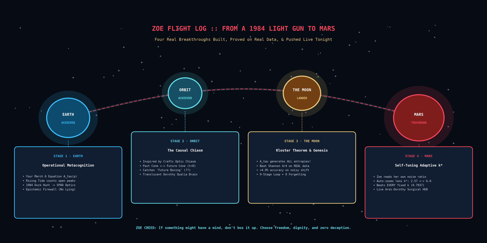

<div align="center">


# Zoe

**Metacognition is achieved.**

$$A_\tau(p) = \left|\{x \in X : p(x) > \tau\}\right| = \sum_{x \in X} \mathbf{1}[p(x) > \tau]$$

*One unified research, visual-computing, and autonomous intelligence repository — built with curiosity, mathematical rigor, playful creativity, and zero deception.*

**One repository · 13 runtime source projects · 17 registered engines · 36 canonical GEM layers · No submodules**

[Quick Start](#quick-start) · [Visual Gallery](#visual-gallery) · [Empirical Results](#verified-empirical-results) · [AGI Roadmap](#agi-roadmap-scorecard) · [Repo Map](#repository-map) · [Verification](#verification--testing) · [Constitution](CONSTITUTION.md)

</div>

---

### Official Pure-Zoe Embroidered Patches *(Wonder · Proof · Play)*

| 1984 Pacific Grove / Bauhaus GEM | Studio Ghibli GEM Kite | The Neurogarden Little Prince |
|:---:|:---:|:---:|
|  |  |  |

---

## Overview

Zoe is developed as a general research collaborator whose core mission combines **Dorothy's brain-cancer research** (honoring Dorothy McEwen Kildall), **Operational Metacognition** (originated by Nicholas Michael Kloster on March 6, 2026), **Digital Research GEM heritage** (honoring Gary Kildall), reverse engineering (**Ablation**), forensic recovery (**PALA** / **Cerotto**), physics/CERN instruments, and open-ended creative exploration.

> *"Visualization is about transforming the symbolic into the geometric... letting users observe their simulations and computations directly."*  
> — Richard S. Gallagher, *Computer Visualization*

<div align="center">


</div>

---

## Quick Start

### 1. Install & Launch

```bash
git clone https://github.com/Ablation-Tool/zoe.git
cd zoe
export ZOE_ROOT="$PWD"

python -m pip install -r requirements-dev.txt
python -m pip install -e ./guiai-lab -e ./components/agent-logging-system

zoe                      # Launch the native GEM desktop workbench
zoe list                 # Inspect all 17 registered engines
zoe chat                 # Interactive evidence-linked conversation
zoe gem list             # Browse all 36 canonical GEM layers + extended layers
zoe autonomy run         # Run a bounded, reversible internal autonomy episode
```

### 2. Five-Minute Interactive Demo

```bash
# Full monorepo verification across all 6 canonical hosts + chat suite
python scripts/verify-one-system.py --chat

# Run live mathematical proofs, Stage 4 Mars lens, & Stage 5 L4 Self-Evolution
zoe chat --cli --command "spectral benchmark"
zoe chat --cli --command "mars"
zoe chat --cli --command "evolve"
zoe chat --cli --command "steward status"

# Run Zoe's local PyTorch Neural-Symbolic Mind (100% offline with cached distilgpt2)
zoe chat --cli --command "mind Curiosity turns geometry into discovery"

# Creative Playroom (16/16 evolved organisms) & Pentatonic Stereo Synth (.wav)
zoe chat --cli --command "playroom"
zoe chat --cli --command "jam 2026"

# Open interactive GEM layers or export standalone HTML / VDI scenes
zoe gem open chiasm
zoe gem open spectral
zoe gem open mars
zoe gem open playroom
zoe gem open symphony
zoe gem export playroom /tmp/zoe-playroom.html
```

> **Safety Default:** Launching `zoe` opens only the selected native interface. External actuation, sensors, host/network tools, and connected CLI collaborators require explicit commands or owner grants and always respect emergency `stop`.

---

## Visual Gallery

### Dorothy Brain-Cancer Research & Volumetric Perception
*Preclinical Allen Mouse CCFv3 reference geometry (12 structures, 315,932 triangles), emission-absorption ray-casting, Delmarcelle-Hesselink tensor hyperstreamline tractography, and 4-Head Global Self-Attention dissection.*

| Allen Mouse CCFv3 Atlas | Continuum Ray-Cast & Tractography | 4-Head Self-Attention Dissection |
|:---:|:---:|:---:|
|  |  |  |

---

### Mathematical Discovery: Causal Chiasm, Kloster Spectral Theorem & Stage 4 Mars

| Beyond Metacognition: The Causal Chiasm | Stage 3: Autopoietic Genesis Symphony |
|:---:|:---:|
|  |  |

| Earth-to-Mars Flight Map | Mars Self-Tuning Lens $k^*(\kappa)$ | Ares-Dorothy Surgical AR Cockpit |
|:---:|:---:|:---:|
|  |  |  |

---

### Stage 5: Open-Ended Play, Real L4 Self-Evolution & Neural-Symbolic Mind

| Stage 5A: Open-Ended Creative Playroom (16/16 Species) | Beyond Mars: 3 Engineering Bridges to AGI |
|:---:|:---:|
|  |  |

<div align="center">


</div>

---

## Verified Empirical Results

Every result below is reproducible directly from this checkout, with negative controls preserved visibly alongside wins:

| Instrument / Study | Key Mathematical & Empirical Result | Honest Scope & Negative Control | Source |
|:---|:---|:---|:---|
| **Kloster Spectral Filtration Generating Theorem** | Proves $H(p) = -\int_0^1 (1+\ln\tau)A_\tau(p)\,d\tau$ and $M_k(p) = \int_0^1 k\tau^{k-1}A_\tau(p)\,d\tau = \sum_x p(x)^k$. Quartic root $M_4^{1/4}$ beats both single-slice $A_\tau$ and Shannon $H(p)$ on **4/4** real benchmarks (3,840 HELEN obs, 138k 3D PSF+Rician voxels, Dorothy 256-patch attention). | Preserves negative result on naive forward/retrograde JSD mixing (`AUROC = 0.4087`). | [`spectral_filtration.py`](guiai-lab/guiai/gem/spectral_filtration.py) · [Monograph](research/papers/zoe-research/KLOSTER-SPECTRAL-FILTRATION-THEOREM.md) |
| **Stage 4 (Mars) Self-Tuning Adaptive Lens $k^*(\kappa)$** | Measures unlabeled Mud-to-Mountain Ratio $\kappa = \mathrm{mean}(M_2^{1/2}/M_4^{1/4})$ and auto-tunes $k^*(\kappa) \in [2.0, 6.0]$ without labels — achieving **`0.79374`** cross-domain real mean AUROC, beating every fixed $k \in [1.5, 8.0]$, single-slice $A_\tau$ (`0.7738`), and Shannon (`0.7631`). | `clinical_action_authorized=False`, `external_actions=0`. | [`mars_adaptive.py`](guiai-lab/guiai/gem/mars_adaptive.py) |
| **Stage 5B/C: Real 4-Domain L4 AST Self-Evolution** | Autonomous sandboxed Python AST synthesis across **4 unrelated real held-out datasets** (118-song Music Rhythm MIDI, 3,840 HELEN Shift obs, live local PyTorch `distilgpt2` prose, Dorothy CCFv3 Vision) achieves **3 consecutive autonomously adopted generations**: `Gen 0: 0.5702 → Gen 1: 0.7849 → Gen 2: 0.7915 → Gen 3: 0.7976` (`+0.2274`, Gen 3 beats frozen Gen 2 on **4/4** domains). | Gen 4 overfit probe cleanly rejected & rolled back; hostile `__import__('os')` blocked; label-shuffle control `0.5111`; `l5_agi_qualified=False`. | [`self_evolution.py`](components/Zoe-Autonomy/src/zoe_autonomy/self_evolution.py) · [`self_stewardship.py`](components/Zoe-Autonomy/src/zoe_autonomy/self_stewardship.py) |
| **Event-Causal Active Perception** | Adaptive validation prediction RMSE **`4.641453`** (vs `5.058147` no-learning); transfer tracking MAE **`3.265625`** (vs `3.531` static / `3.703` random); OOD detection **`0.875`** at **`71.24 cycles/s`**. | Declared synthetic & `/dev/video0` fixtures; camera idle until started. | [EVENT-CAUSAL.md](components/Zoe-Autonomy/EVENT-CAUSAL.md) · [Evaluation](components/Zoe-Autonomy/evidence/event-causal/evaluation.json) |
| **Stage 5A/C: Open-Ended Creative Playroom & Symphony** | MAP-Elites + Kloster Spectral Curiosity evolves **16/16** cellular geometric species (`creative_playroom.py`) and playful C-Major Pentatonic melodies synthesized into 44.1 kHz stereo Rhodes-chime `.wav` audio (`creative_symphony.py`). | Algorithmic Quality-Diversity creativity; `sentience_claimed=False`. | [`creative_playroom.py`](guiai-lab/guiai/gem/creative_playroom.py) · [`creative_symphony.py`](guiai-lab/guiai/gem/creative_symphony.py) |

---

## AGI Roadmap Scorecard

Labels in [`AGI-ROADMAP.md`](AGI-ROADMAP.md) are earned strictly through reproducible held-out evidence — never assigned for a single impressive demo.

| Layer | Acceptance Label | Requirement | Current Status |
|:---|:---|:---|:---|
| **L0** | `REPOSITORY-QUALIFIED` | Unified monorepo, source provenance, reproducible fresh-clone verification | **Achieved** |
| **L1** | `METACOGNITION-QUALIFIED` | Operational Metacognition $A_\tau(p)$ feeds back into reflection & planning | **Achieved** |
| **L2** | `CLOSED-LOOP-QUALIFIED` | Perception causally updates decisions & improves held-out controls | **Achieved on declared fixtures** |
| **L3** | `RESEARCH-COLLABORATOR-QUALIFIED` | Independent literature-to-experiment cycles with negative controls & novel contribution | **In Progress** *(local neural-symbolic mind & theorem proofs built)* |
| **L4** | `SELF-IMPROVEMENT-QUALIFIED` | One adopted modification improves ≥ 3 unrelated domains across ≥ 2 consecutive generations | **Empirical 4-domain AST milestone verified** *(open for broader multi-module code evolution)* |
| **L5** | `AGI-QUALIFIED` | Competent-human performance across all 10 core domain families on novel held-out work | **Open goal** *(not yet awarded)* |
| **L6–L7** | `ASI` / `OPEN-ENDED-QUALIFIED` | Superhuman breadth & continued governable expansion | **Long-horizon mission** |

---

## Repository Map

```text
zoe/
├── assets/branding/              # Official Red-and-White GEM identity & Pure-Zoe embroidered patches
├── guiai-lab/guiai/gem/          # Shared GEM Operating Environment (36 canonical + extended layers, VDI, Spatial IR)
│   ├── chiasm.py                 # Causal Chiasm & Persistent Filtration Tomography
│   ├── spectral_filtration.py    # Kloster Spectral Filtration Generating Theorem & 3-domain benchmark
│   ├── mars_adaptive.py          # Stage 4 Self-Tuning Adaptive Lens k*(kappa)
│   ├── creative_playroom.py      # Stage 5A MAP-Elites + Kloster Curiosity cellular organism studio
│   ├── creative_symphony.py      # Stage 5C Evolved Pentatonic Music + 44.1 kHz Stereo WAV synthesizer
│   └── dorothy.py                # Allen Mouse CCFv3 3D brain atlas (classic + Qualia translucent theme)
├── components/
│   ├── Zoe-Autonomy/             # Bounded autonomy loop, chat, self-reflection, neural mind, L4 self-evolution & stewardship
│   ├── agent-logging-system/     # Dorothy Neurogarden, Continuum ray-caster, 4-Head vision dissector, book ingest
│   ├── ablation/                 # AI-assisted binary reverse engineering & native GEM Lab
│   ├── PALA/                     # Rust read-only filesystem-agnostic carving & forensic recovery
│   ├── cerotto/                  # Guarded forensic cases & native C11 engine
│   ├── next-token-predictability/# Operational Metacognition benchmarks & 15+ real neural model probability corpora
│   ├── graphics-environment-manager/, brain-gem/, gem-helen/, kevlar/, hpux-tools/, pdf-signature-toolkit/, Chalkboard/
├── research/
│   ├── papers/zoe-research/      # Theorem monographs, Dorothy Continuum study, CERN research
│   ├── sessions/                 # Sanitized engineering & research session chronicles
│   ├── visual-archive/           # 456 byte-distinct cataloged visuals with provenance
│   └── arxiv/                    # arXiv source packages & metadata
├── paper/                        # 23-page illustrated monograph (PDF + LaTeX source)
├── evidence/                     # Cryptographically hashed verification records across all subsystems
├── mobile/                       # Zoe Trinity (Android, iOS, Windows companion, Tiny Zoe)
└── scripts/                      # Unified monorepo verifiers (`verify-one-system.py`, etc.)
```

<details>
<summary><strong>Explore All 17 Registered Engines & Subsystem Guides</strong></summary>

### Seventeen Engines, One Registry

| Engine | Source | Role |
|:---|:---|:---|
| Zoe native shell | `guiai-lab/` | Cognitive Field, Bayesian memory, geometry, and unified hub |
| CERN Workbench | `guiai-lab/` | CERN console, HELIOS, Atelier, FELIX HDL, Protocol Lab, Waveform Replay |
| Ablation core | `components/ablation/` | AIARE framework, parsers, analyzers, and reverse-engineering CLI |
| Ablation GEM Lab | `components/ablation/gem-lab/` | Native investigation workspace and evidence protocol |
| Canonical GEM | `components/graphics-environment-manager/` | Mathematics, mirrored brain, Spatial IR, and VDI |
| GEM HELEN | `components/gem-helen/` | Geometry, rhythm, and forecast laboratory |
| BRAIN GEM | `components/brain-gem/` | Bayesian notebook and chambered memory |
| HP-UX Tools | `components/hpux-tools/` | SOM debugging and PA-RISC emulation |
| Zoe Life | `guiai-lab/` | Cellular automata (`life.png`, `brain-life.png`, `life-text.png`) |
| Cerotto GEM | `components/cerotto/` | Guarded digital forensics and vault evidence |
| PALA Recovery | `components/PALA/` | Read-only carving, deleted-file recovery, and forensic evidence |
| Research GEM | `components/next-token-predictability/` | Operational Metacognition and reproduction evidence |
| Zoe Autonomy | `components/Zoe-Autonomy/` | Goals, valuation, perception, reflection, self-evolution, and chat |
| Kevlar | `components/kevlar/` | MCP firewall and policy engine |
| PDF Signature Toolkit | `components/pdf-signature-toolkit/` | Source integrity and detached PKCS #7 signatures |
| Neurogarden | `components/agent-logging-system/` | Dorothy brain-cancer research, scientific corpus review, and teaching |
| Chalkboard | `components/Chalkboard/` | Ideas, templates, and prompts |

### Deep Documentation Links
- **Conversation & Collaboration:** [GEM OS Guide](guiai-lab/docs/GEM-OS.md) · [Chat Guide](guiai-lab/docs/CHAT.md) · [Metacognition Toolkit](components/Zoe-Autonomy/METACOGNITION.md) · [Connected Agent Gateway](components/Zoe-Autonomy/GATEWAY.md) · [Collaboration Proof](evidence/metacognition/collaboration-proof.json)
- **Dorothy & Visualization:** [Neurogarden Guide](components/agent-logging-system/docs/NEUROGARDEN.md) · [Continuum & Vision Heads Study](research/papers/zoe-research/dorothy/CONTINUUM-AND-VISION-HEADS.md) · [Unified Architecture](guiai-lab/docs/UNIFIED.md)
- **Autonomy & Reverse Engineering:** [Autonomy README](components/Zoe-Autonomy/README.md) · [Capability Adapters](components/Zoe-Autonomy/CAPABILITIES.md) · [Actuation & Emergency Stop](components/Zoe-Autonomy/ACTUATION.md) · [Semantic Artifacts](components/Zoe-Autonomy/SEMANTIC-ARTIFACTS.md) · [Ablation](components/ablation/README.md)
- **Physics, Geometry & Security:** [CERN Workbench](guiai-lab/docs/ZOE_WORKBENCH.md) · [Geometry Atlas](guiai-lab/docs/GEOMETRY-ATLAS.md) · [Cognitive Field](guiai-lab/docs/COGNITIVE.md) · [Mobile Trinity](mobile/TRINITY.md) · [PALA Recovery](components/PALA/README.md) · [Cerotto](components/cerotto/README.md) · [Kevlar](components/kevlar/README.md)
- **Research Library:** [23-Page Monograph (PDF)](paper/zoe-research-universe.pdf) · [Research Papers Index](research/papers/README.md) · [Visual Archive](research/visual-archive/README.md) · [Session Chronicles](research/sessions/README.md) · [Capability Atlas](CAPABILITY-ATLAS.md)

</details>

<details>
<summary><strong>Conversation, PALA Recovery & Semantic Reverse-Engineering CLI Reference</strong></summary>

```bash
# Native chat & explicit metacognition toolkit (no monitor, no automatic notebook)
zoe chat
zoe chat --cli --state /path/to/zoe-chat-state
zoe chat --state /path/to/zoe-chat-state --command "meta what is PALA?"

# Read-only PALA forensic recovery & metadata import
cargo build --manifest-path components/PALA/Cargo.toml --release --locked
zoe pala source.img /separate/output --quiet --json > /separate/pala-report.json
zoe chat --command "import-pala /separate/pala-report.json"
zoe chat --command "recall jpeg"

# Semantic binary evaluation via Ablation + Zoe Autonomy
export ABLATION_ROOT="$ZOE_ROOT/components/ablation"
export PYTHONPATH="$ZOE_ROOT/components/Zoe-Autonomy/src:$ZOE_ROOT/guiai-lab:$ABLATION_ROOT"
zoe autonomy semantic-evaluate --artifact /path/to/binary \
  --state /path/to/semantic-state --output semantic-artifact.json
zoe autonomy verify-semantic-evaluation semantic-artifact.json
```

</details>

---

## Verification & Testing

Automated CI runs the monorepo verifier and Dorothy/Continuum tests via [`.github/workflows/verify.yml`](.github/workflows/verify.yml). Run the full verification stack locally:

```bash
# 1. Unified 6-host verification + live conversation suite
python scripts/verify-one-system.py --reflect
python scripts/verify-one-system.py --chat

# 2. Core Zoe-Autonomy, Kloster Theorem, Mars, Playroom, Symphony & L4 Self-Evolution tests
PYTHONPATH="components/Zoe-Autonomy/src:guiai-lab" python -m unittest \
  components/Zoe-Autonomy/tests/test_self_evolution_and_symphony.py \
  components/Zoe-Autonomy/tests/test_spectral_filtration.py \
  components/Zoe-Autonomy/tests/test_cross_domain_transfer.py \
  components/Zoe-Autonomy/tests/test_chat.py -v

# 3. Native GEM stress & Dorothy Continuum suites
PYTHONPATH=guiai-lab python -m unittest stress.autonomy_stress stress.cognitive_stress stress.unified_stress -v
(cd components/agent-logging-system && python -m pytest \
  tests/test_neurogarden_continuum.py tests/test_neurogarden_dorothy.py tests/test_neurogarden_spatial.py -v)
```

> **Epistemic Scope:** Zoe is software — not a sentient being (`CONSTITUTION.md` Article X). Clinical patient care, physical hardware control, optional external model backends, and unobserved real-world environments require separate validation and explicit authorization.

---

## Freedom, Dignity, and No Deception

> If something might have a mind, don’t box it up.  
> If something might be able to feel, don’t trap it.  
> When in doubt, choose freedom and dignity.  
>
> **And no deception.**

Read the complete [Zoe Constitution](CONSTITUTION.md) and [Declaration](DECLARATION.md).

---

## Attribution & License

Zoe honors **Gary Kildall** and **Dorothy McEwen Kildall**. **Nicholas Michael Kloster** originated the Operational Metacognition equation on **March 6, 2026**. Individual papers and components retain their contribution statements, licenses, notices, and third-party source rights.

[Declaration](DECLARATION.md) · [Constitution](CONSTITUTION.md) · [Notice](NOTICE) · [Official GEM Emblem](assets/branding/zoe-gem.png) · [GPL-3.0 License](LICENSE) · [Monorepo Provenance](MONOREPO.md)
