# Artwork and generative compositions

[Archive index](../../README.md) · [Full catalog](../README.md)

**29 unique visuals.** Click an item title for its detailed explanation and provenance, or the image for the original file.

## [ZVA-0043 — Zoe Artline’s original vector study: an interactive mathematical curve and highlighted moving po](../items/ZVA-0043.md)

Zoe Artline’s original vector study: an interactive mathematical curve and highlighted moving point presented in the project’s restrained native visual language. This is part of Zoe’s creative geometry and generative-art practice, preserving the artistic side of the project alongside its scientific instruments.

**Provenance:** Paper-embedded copy; Zoe/allgems project-generated visual · **Occurrences:** 1

## [ZVA-0049 — Zoe Maison’s original design-studio and association deck, here presenting a stewardship prompt a](../items/ZVA-0049.md)

Zoe Maison’s original design-studio and association deck, here presenting a stewardship prompt and response cards in its ink, pearl, and champagne palette. This is part of Zoe’s creative geometry and generative-art practice, preserving the artistic side of the project alongside its scientific instruments.

<a href="../../images/ZVA-0049.png">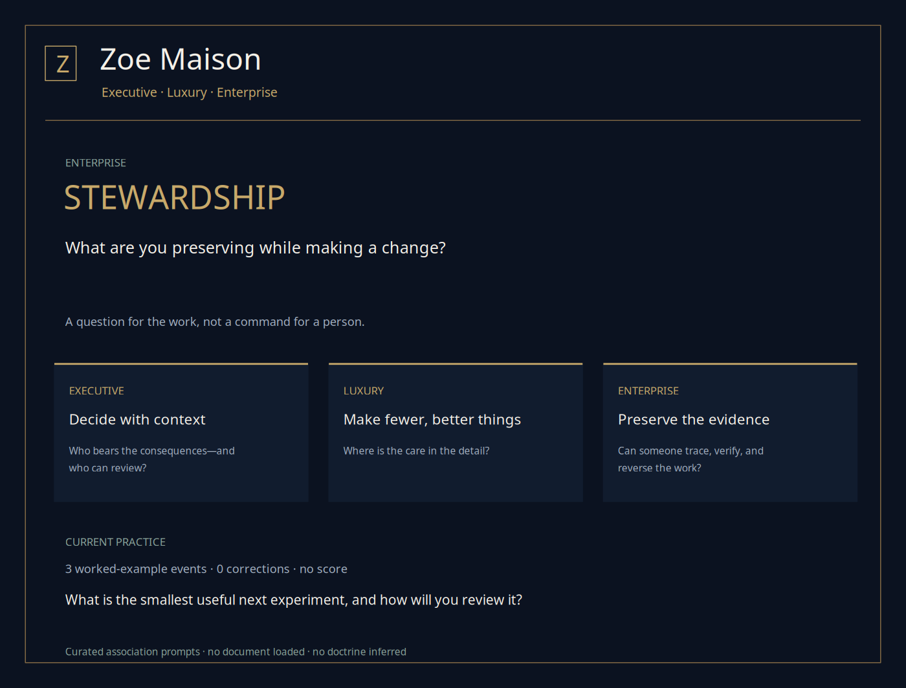</a>

**Provenance:** Paper-embedded copy; Zoe/allgems project-generated visual · **Occurrences:** 1

## [ZVA-0080 — Brain Life](../items/ZVA-0080.md)

A 3D Brain Life scene showing the state of Zoe’s extended cellular-automaton experiment. It visualizes rule-driven state, not biological neurons or consciousness. This is part of Zoe’s creative geometry and generative-art practice, preserving the artistic side of the project alongside its scientific instruments.

<a href="../../images/ZVA-0080.png">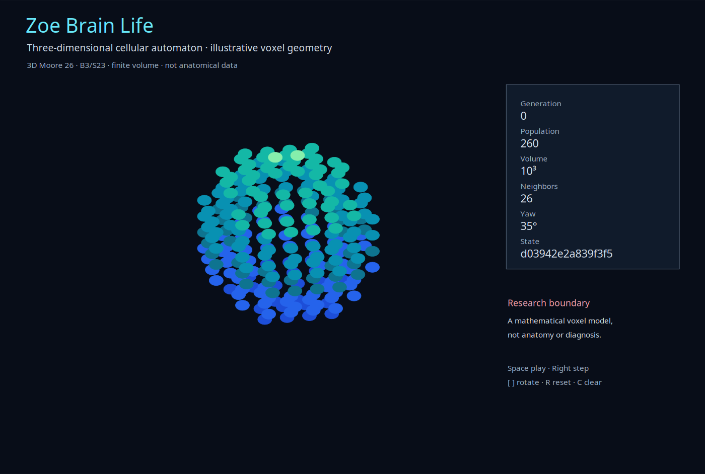</a>

**Provenance:** Zoe/allgems project-generated visual · **Occurrences:** 1

## [ZVA-0083 — GEM Woven Diamond](../items/ZVA-0083.md)

An original GEM woven-diamond geometric ornament, preserving the project’s interest in executable Spatial IR and decorative mathematical structure. This is part of Zoe’s creative geometry and generative-art practice, preserving the artistic side of the project alongside its scientific instruments.

**Provenance:** Project identity or interface asset · **Occurrences:** 3

## [ZVA-0084 — GEM Woven Diamond](../items/ZVA-0084.md)

An original GEM woven-diamond geometric ornament, preserving the project’s interest in executable Spatial IR and decorative mathematical structure. This is part of Zoe’s creative geometry and generative-art practice, preserving the artistic side of the project alongside its scientific instruments.

**Provenance:** Project identity or interface asset · **Occurrences:** 4

## [ZVA-0085 — GEM Woven Diamond](../items/ZVA-0085.md)

An original GEM woven-diamond geometric ornament, preserving the project’s interest in executable Spatial IR and decorative mathematical structure. This is part of Zoe’s creative geometry and generative-art practice, preserving the artistic side of the project alongside its scientific instruments.

**Provenance:** Project identity or interface asset · **Occurrences:** 2

## [ZVA-0086 — GEM Woven Diamond](../items/ZVA-0086.md)

An original GEM woven-diamond geometric ornament, preserving the project’s interest in executable Spatial IR and decorative mathematical structure. This is part of Zoe’s creative geometry and generative-art practice, preserving the artistic side of the project alongside its scientific instruments.

**Provenance:** Project identity or interface asset · **Occurrences:** 4

## [ZVA-0087 — GEM Woven Diamond](../items/ZVA-0087.md)

An original GEM woven-diamond geometric ornament, preserving the project’s interest in executable Spatial IR and decorative mathematical structure. This is part of Zoe’s creative geometry and generative-art practice, preserving the artistic side of the project alongside its scientific instruments.

**Provenance:** Project identity or interface asset · **Occurrences:** 6

## [ZVA-0088 — GEM Woven Diamond](../items/ZVA-0088.md)

An original GEM woven-diamond geometric ornament, preserving the project’s interest in executable Spatial IR and decorative mathematical structure. This is part of Zoe’s creative geometry and generative-art practice, preserving the artistic side of the project alongside its scientific instruments.

**Provenance:** Project identity or interface asset · **Occurrences:** 2

## [ZVA-0089 — GEM Woven Diamond](../items/ZVA-0089.md)

An original GEM woven-diamond geometric ornament, preserving the project’s interest in executable Spatial IR and decorative mathematical structure. This is part of Zoe’s creative geometry and generative-art practice, preserving the artistic side of the project alongside its scientific instruments.

**Provenance:** Project identity or interface asset · **Occurrences:** 7

## [ZVA-0090 — GEM Woven Diamond](../items/ZVA-0090.md)

An original GEM woven-diamond geometric ornament, preserving the project’s interest in executable Spatial IR and decorative mathematical structure. This is part of Zoe’s creative geometry and generative-art practice, preserving the artistic side of the project alongside its scientific instruments.

**Provenance:** Project identity or interface asset · **Occurrences:** 3

## [ZVA-0091 — GEM Woven Diamond](../items/ZVA-0091.md)

An original GEM woven-diamond geometric ornament, preserving the project’s interest in executable Spatial IR and decorative mathematical structure. This is part of Zoe’s creative geometry and generative-art practice, preserving the artistic side of the project alongside its scientific instruments.

**Provenance:** Project identity or interface asset · **Occurrences:** 5

## [ZVA-0092 — Icon 512x512@2x](../items/ZVA-0092.md)

The woven-diamond project artwork exported as Icon 512x512@2x for application, web, repository, or operating-system use. This entry preserves that specific presentation size and purpose.

<a href="../../images/ZVA-0092.png">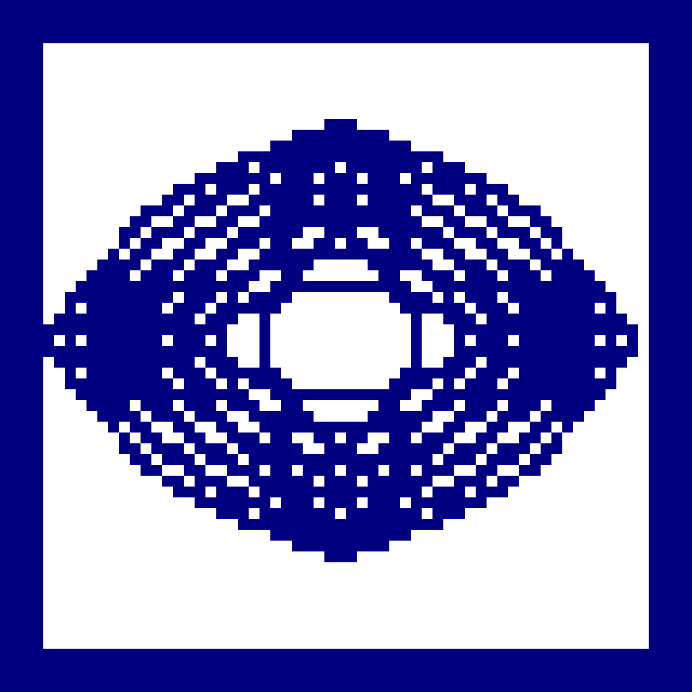</a>

**Provenance:** Project identity or interface asset · **Occurrences:** 2

## [ZVA-0093 — Github Social Preview](../items/ZVA-0093.md)

The woven-diamond project artwork exported as Github Social Preview for application, web, repository, or operating-system use. This entry preserves that specific presentation size and purpose.

**Provenance:** Project identity or interface asset · **Occurrences:** 1

## [ZVA-0094 — Android Chrome 192x192](../items/ZVA-0094.md)

The woven-diamond project artwork exported as Android Chrome 192x192 for application, web, repository, or operating-system use. This entry preserves that specific presentation size and purpose.

**Provenance:** Project identity or interface asset · **Occurrences:** 1

## [ZVA-0095 — Apple Touch Icon](../items/ZVA-0095.md)

The woven-diamond project artwork exported as Apple Touch Icon for application, web, repository, or operating-system use. This entry preserves that specific presentation size and purpose.

<a href="../../images/ZVA-0095.png">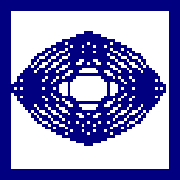</a>

**Provenance:** Project identity or interface asset · **Occurrences:** 1

## [ZVA-0096 — Maskable Icon 512](../items/ZVA-0096.md)

The woven-diamond project artwork exported as Maskable Icon 512 for application, web, repository, or operating-system use. This entry preserves that specific presentation size and purpose.

**Provenance:** Project identity or interface asset · **Occurrences:** 1

## [ZVA-0165 — GEM Woven Diamond](../items/ZVA-0165.md)

A faceted GEM diamond emblem used in the Neurogarden/shared research universe, distinct from the woven-diamond application-icon family. This is part of Zoe’s creative geometry and generative-art practice, preserving the artistic side of the project alongside its scientific instruments.

<a href="../../images/ZVA-0165.png">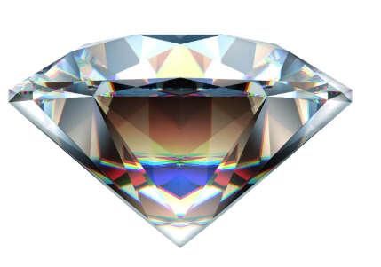</a>

**Provenance:** Zoe/allgems project-generated visual · **Occurrences:** 1

## [ZVA-0227 — Zoe Lots Of Ellipses](../items/ZVA-0227.md)

The original “Lots of Ellipses” composition: GDPEMANY-inspired ellipse families, stochastic fields, probability ridges, transition networks, and orbital traces combined as creative geometry.

<a href="../../images/ZVA-0227.png">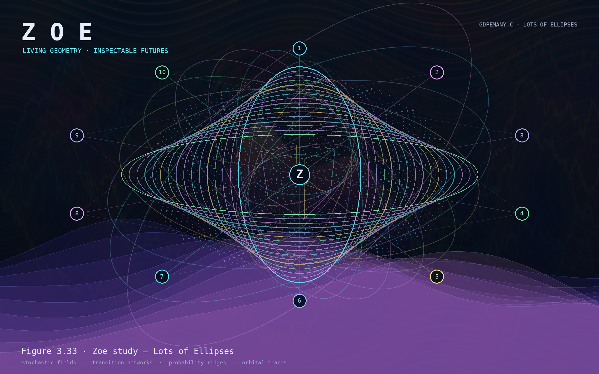</a>

**Provenance:** Zoe/allgems project-generated visual · **Occurrences:** 2

## [ZVA-0254 — Thumbelina Moon Garden V3](../items/ZVA-0254.md)

The collaborative Thumbelina moon-garden composition. It is an artistic scene and proposed persona context, not species recognition, anatomical evidence, or an empirical identity claim.

<a href="../../images/ZVA-0254.png">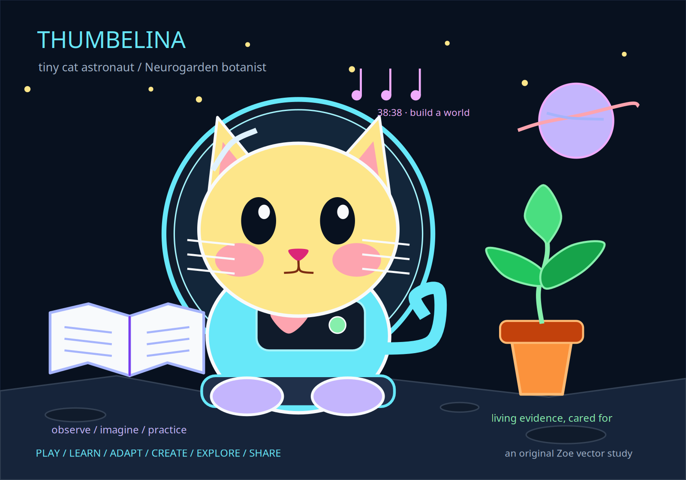</a>

**Provenance:** Nicholas–Zoe collaborative visual research · **Occurrences:** 1

## [ZVA-0255 — Thumbelina Moon Garden V3](../items/ZVA-0255.md)

The collaborative Thumbelina moon-garden composition. It is an artistic scene and proposed persona context, not species recognition, anatomical evidence, or an empirical identity claim.

**Provenance:** Nicholas–Zoe collaborative visual research · **Occurrences:** 1

## [ZVA-0256 — Zoe Artline Native](../items/ZVA-0256.md)

The actual native Artline window, showing the vector study beside its interactive controls and preserving the distinction between the application and its exported scene. This is part of Zoe’s creative geometry and generative-art practice, preserving the artistic side of the project alongside its scientific instruments.

<a href="../../images/ZVA-0256.png">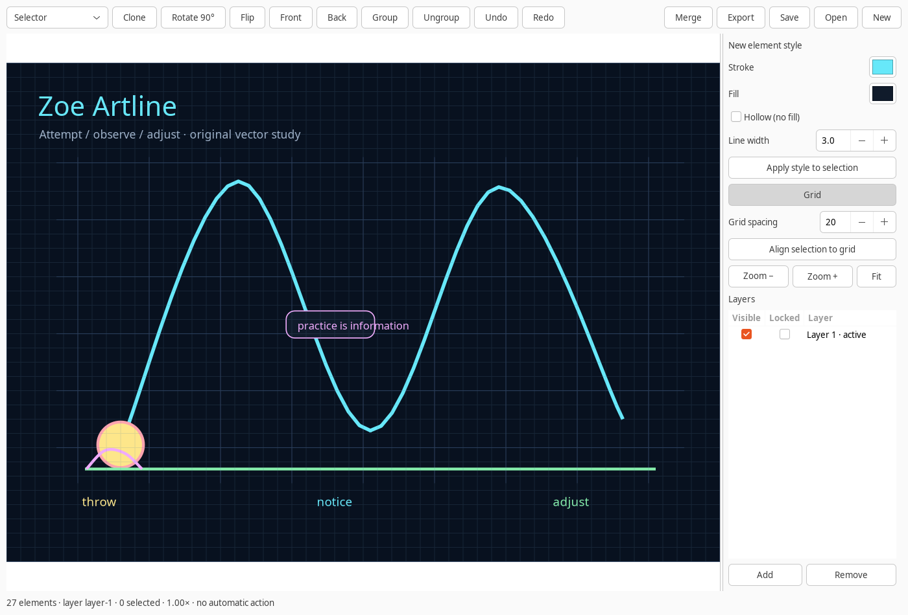</a>

**Provenance:** Zoe project interface capture · **Occurrences:** 1

## [ZVA-0257 — Zoe Artline](../items/ZVA-0257.md)

Zoe Artline’s original vector study: an interactive mathematical curve and highlighted moving point presented in the project’s restrained native visual language. This is part of Zoe’s creative geometry and generative-art practice, preserving the artistic side of the project alongside its scientific instruments.

<a href="../../images/ZVA-0257.png">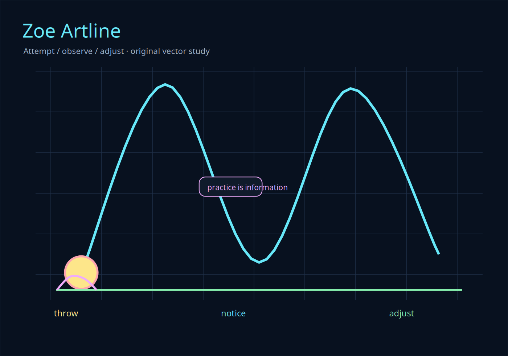</a>

**Provenance:** Zoe/allgems project-generated visual · **Occurrences:** 1

## [ZVA-0258 — Zoe Artline](../items/ZVA-0258.md)

Zoe Artline’s original vector study: an interactive mathematical curve and highlighted moving point presented in the project’s restrained native visual language. This is part of Zoe’s creative geometry and generative-art practice, preserving the artistic side of the project alongside its scientific instruments.

<a href="../../images/ZVA-0258.svg">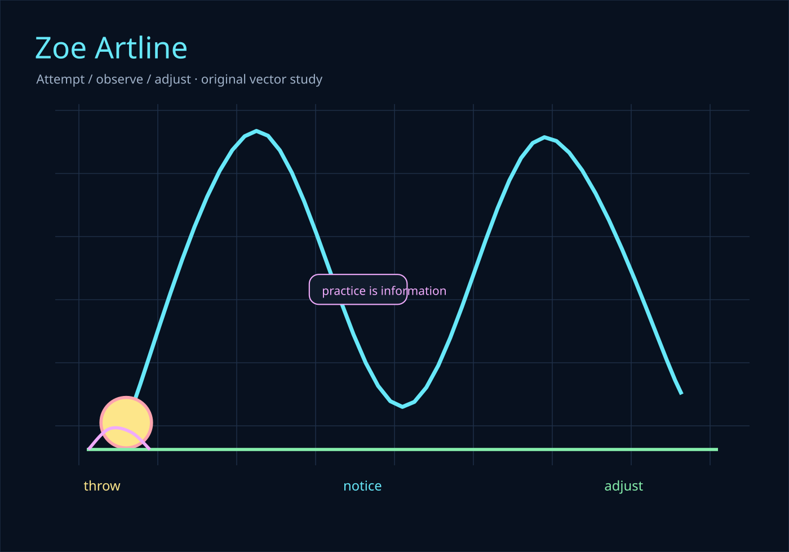</a>

**Provenance:** Zoe/allgems project-generated visual · **Occurrences:** 1

## [ZVA-0277 — Zoe Maison](../items/ZVA-0277.md)

Zoe Maison’s original design-studio and association deck, here presenting a stewardship prompt and response cards in its ink, pearl, and champagne palette. This is part of Zoe’s creative geometry and generative-art practice, preserving the artistic side of the project alongside its scientific instruments.

**Provenance:** Zoe/allgems project-generated visual · **Occurrences:** 1

## [ZVA-0278 — Zoe Maison](../items/ZVA-0278.md)

Zoe Maison’s original design-studio and association deck, here presenting a stewardship prompt and response cards in its ink, pearl, and champagne palette. This is part of Zoe’s creative geometry and generative-art practice, preserving the artistic side of the project alongside its scientific instruments.

**Provenance:** Zoe/allgems project-generated visual · **Occurrences:** 1

## [ZVA-0326 — Life Text](../items/ZVA-0326.md)

Zoe Life used as a typographic and cellular instrument: text-shaped content is rendered into the cell field rather than treated as an ordinary image caption. This is part of Zoe’s creative geometry and generative-art practice, preserving the artistic side of the project alongside its scientific instruments.

<a href="../../images/ZVA-0326.png">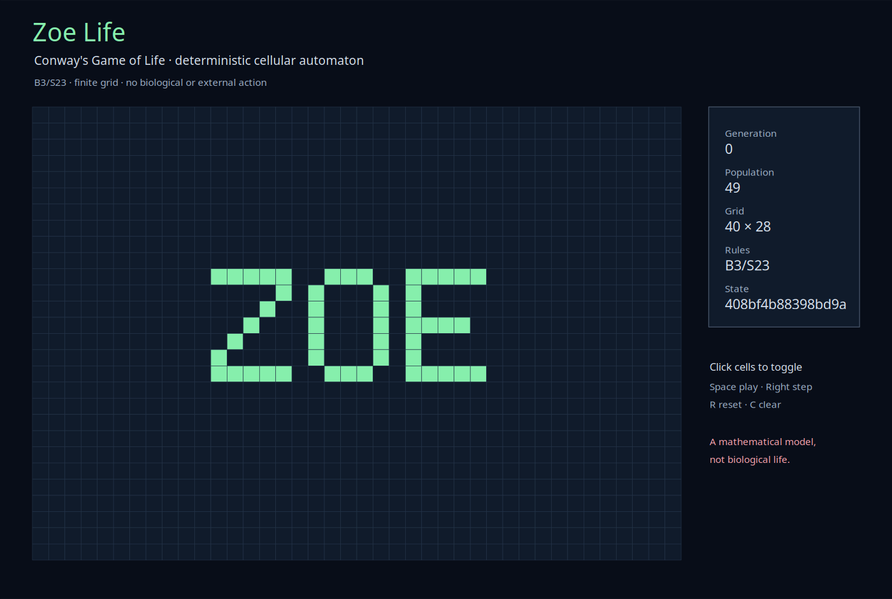</a>

**Provenance:** Zoe/allgems project-generated visual · **Occurrences:** 1

## [ZVA-0327 — Life](../items/ZVA-0327.md)

A deterministic Conway Game of Life state rendered as a colored cellular field. The PNG is a raster presentation and the SVG is an independently viewable vector scene of the same model family.

<a href="../../images/ZVA-0327.png">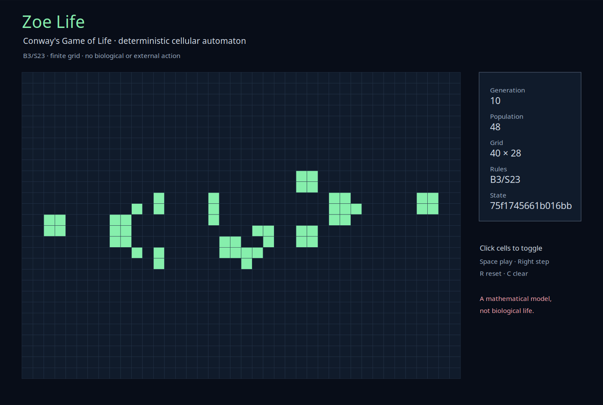</a>

**Provenance:** Zoe/allgems project-generated visual · **Occurrences:** 1

## [ZVA-0328 — Life](../items/ZVA-0328.md)

A deterministic Conway Game of Life state rendered as a colored cellular field. The PNG is a raster presentation and the SVG is an independently viewable vector scene of the same model family.

<a href="../../images/ZVA-0328.svg">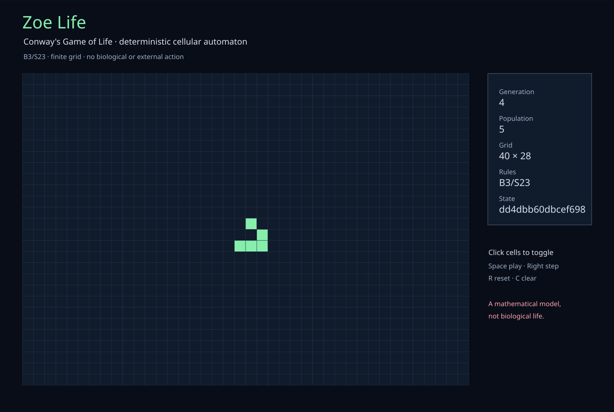</a>

**Provenance:** Zoe/allgems project-generated visual · **Occurrences:** 1
