# Identity, emblems, and interface icons

[Archive index](../../README.md) · [Full catalog](../README.md)

**48 unique visuals.** Click an item title for its detailed explanation and provenance, or the image for the original file.

## [ZVA-0067 — Zoetic Research](../items/ZVA-0067.md)

The user-created Zoetic Research wordmark and circular/bowl emblem, an independent homage to Digital Research rather than an official mark. This visual supports recognition, navigation, application identity, or a cohesive visual language across Zoe and its components.

**Provenance:** User-created Zoetic Research identity · **Occurrences:** 2

## [ZVA-0068 — Zoetic Research Brand](../items/ZVA-0068.md)

A variant of the user-created Zoetic Research identity system, retained with its original vector/raster provenance. This visual supports recognition, navigation, application identity, or a cohesive visual language across Zoe and its components.

**Provenance:** User-created Zoetic Research identity · **Occurrences:** 2

## [ZVA-0069 — Zoetic Research Brand](../items/ZVA-0069.md)

A variant of the user-created Zoetic Research identity system, retained with its original vector/raster provenance. This visual supports recognition, navigation, application identity, or a cohesive visual language across Zoe and its components.

**Provenance:** User-created Zoetic Research identity · **Occurrences:** 3

## [ZVA-0070 — NuClide Brain](../items/ZVA-0070.md)

The NuClide Research dual-brain co-brand, balancing Zoe and Nick through stable/unstable perspectives and correction. It is a user-supplied identity image, not an anatomical diagram.

**Provenance:** User-supplied NuClide Research co-brand · **Occurrences:** 6

## [ZVA-0071 — Orbital Emblem](../items/ZVA-0071.md)

The user-supplied orbital reference that established the shared Zoe motif. Later hub and eye scenes are new vector interpretations rather than copies of this source. This visual supports recognition, navigation, application identity, or a cohesive visual language across Zoe and its components.

<a href="../../images/ZVA-0071.png">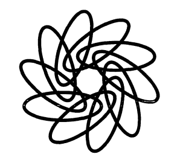</a>

**Provenance:** User-supplied orbital motif · **Occurrences:** 2

## [ZVA-0078 — Zoe Eye](../items/ZVA-0078.md)

The primary Zoe orbital emblem: a central Z, nested eye curves, stars, and numbered nodes generated from the user-supplied orbital reference. It is an original identity composition, not a scientific model.

<a href="../../images/ZVA-0078.png">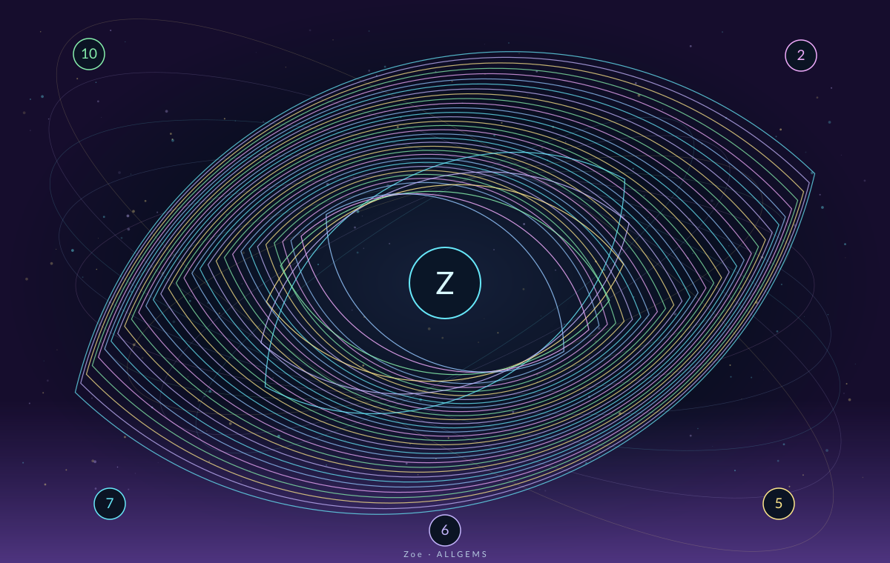</a>

**Provenance:** Project identity or interface asset · **Occurrences:** 2

## [ZVA-0079 — Zoe Eye](../items/ZVA-0079.md)

The primary Zoe orbital emblem: a central Z, nested eye curves, stars, and numbered nodes generated from the user-supplied orbital reference. It is an original identity composition, not a scientific model.

**Provenance:** Project identity or interface asset · **Occurrences:** 1

## [ZVA-0081 — Ablation 1a Pink Ink Header 2560](../items/ZVA-0081.md)

The wide pink-ink Ablation wordmark banner used as project identity artwork across documentation and presentations. This visual supports recognition, navigation, application identity, or a cohesive visual language across Zoe and its components.

**Provenance:** Project identity or interface asset · **Occurrences:** 1

## [ZVA-0145 — P Icon Close](../items/ZVA-0145.md)

A compact GEM/GUIAI interface glyph for the “close” action or state, supplied in the project’s icon set. This visual supports recognition, navigation, application identity, or a cohesive visual language across Zoe and its components.

**Provenance:** Project identity or interface asset · **Occurrences:** 4

## [ZVA-0146 — P Icon Code](../items/ZVA-0146.md)

A compact GEM/GUIAI interface glyph for the “code” action or state, supplied in the project’s icon set. This visual supports recognition, navigation, application identity, or a cohesive visual language across Zoe and its components.

**Provenance:** Project identity or interface asset · **Occurrences:** 4

## [ZVA-0147 — P Icon Copy](../items/ZVA-0147.md)

A compact GEM/GUIAI interface glyph for the “copy” action or state, supplied in the project’s icon set. This visual supports recognition, navigation, application identity, or a cohesive visual language across Zoe and its components.

**Provenance:** Project identity or interface asset · **Occurrences:** 4

## [ZVA-0148 — P Icon Expand Inverse](../items/ZVA-0148.md)

A compact GEM/GUIAI interface glyph for the “expand inverse” action or state, supplied in the project’s icon set. This visual supports recognition, navigation, application identity, or a cohesive visual language across Zoe and its components.

**Provenance:** Project identity or interface asset · **Occurrences:** 2

## [ZVA-0149 — P Icon Expand Inverse](../items/ZVA-0149.md)

A compact GEM/GUIAI interface glyph for the “expand inverse” action or state, supplied in the project’s icon set. This visual supports recognition, navigation, application identity, or a cohesive visual language across Zoe and its components.

**Provenance:** Project identity or interface asset · **Occurrences:** 2

## [ZVA-0150 — P Icon Expand](../items/ZVA-0150.md)

A compact GEM/GUIAI interface glyph for the “expand” action or state, supplied in the project’s icon set. This visual supports recognition, navigation, application identity, or a cohesive visual language across Zoe and its components.

**Provenance:** Project identity or interface asset · **Occurrences:** 2

## [ZVA-0151 — P Icon Expand](../items/ZVA-0151.md)

A compact GEM/GUIAI interface glyph for the “expand” action or state, supplied in the project’s icon set. This visual supports recognition, navigation, application identity, or a cohesive visual language across Zoe and its components.

**Provenance:** Project identity or interface asset · **Occurrences:** 2

## [ZVA-0152 — P Icon File](../items/ZVA-0152.md)

A compact GEM/GUIAI interface glyph for the “file” action or state, supplied in the project’s icon set. This visual supports recognition, navigation, application identity, or a cohesive visual language across Zoe and its components.

**Provenance:** Project identity or interface asset · **Occurrences:** 4

## [ZVA-0153 — P Icon Folder](../items/ZVA-0153.md)

A compact GEM/GUIAI interface glyph for the “folder” action or state, supplied in the project’s icon set. This visual supports recognition, navigation, application identity, or a cohesive visual language across Zoe and its components.

**Provenance:** Project identity or interface asset · **Occurrences:** 4

## [ZVA-0154 — P Icon Hide](../items/ZVA-0154.md)

A compact GEM/GUIAI interface glyph for the “hide” action or state, supplied in the project’s icon set. This visual supports recognition, navigation, application identity, or a cohesive visual language across Zoe and its components.

**Provenance:** Project identity or interface asset · **Occurrences:** 4

## [ZVA-0155 — P Icon History](../items/ZVA-0155.md)

A compact GEM/GUIAI interface glyph for the “history” action or state, supplied in the project’s icon set. This visual supports recognition, navigation, application identity, or a cohesive visual language across Zoe and its components.

**Provenance:** Project identity or interface asset · **Occurrences:** 4

## [ZVA-0156 — P Icon Open Terminal Inverse](../items/ZVA-0156.md)

A compact GEM/GUIAI interface glyph for the “open terminal inverse” action or state, supplied in the project’s icon set. This visual supports recognition, navigation, application identity, or a cohesive visual language across Zoe and its components.

**Provenance:** Project identity or interface asset · **Occurrences:** 4

## [ZVA-0157 — P Icon Restart](../items/ZVA-0157.md)

A compact GEM/GUIAI interface glyph for the “restart” action or state, supplied in the project’s icon set. This visual supports recognition, navigation, application identity, or a cohesive visual language across Zoe and its components.

**Provenance:** Project identity or interface asset · **Occurrences:** 4

## [ZVA-0158 — P Icon Show](../items/ZVA-0158.md)

A compact GEM/GUIAI interface glyph for the “show” action or state, supplied in the project’s icon set. This visual supports recognition, navigation, application identity, or a cohesive visual language across Zoe and its components.

**Provenance:** Project identity or interface asset · **Occurrences:** 4

## [ZVA-0159 — P Icon Starred](../items/ZVA-0159.md)

A compact GEM/GUIAI interface glyph for the “starred” action or state, supplied in the project’s icon set. This visual supports recognition, navigation, application identity, or a cohesive visual language across Zoe and its components.

**Provenance:** Project identity or interface asset · **Occurrences:** 4

## [ZVA-0160 — P Icon Success](../items/ZVA-0160.md)

A compact GEM/GUIAI interface glyph for the “success” action or state, supplied in the project’s icon set. This visual supports recognition, navigation, application identity, or a cohesive visual language across Zoe and its components.

**Provenance:** Project identity or interface asset · **Occurrences:** 4

## [ZVA-0161 — P Icon Unstarred](../items/ZVA-0161.md)

A compact GEM/GUIAI interface glyph for the “unstarred” action or state, supplied in the project’s icon set. This visual supports recognition, navigation, application identity, or a cohesive visual language across Zoe and its components.

**Provenance:** Project identity or interface asset · **Occurrences:** 4

## [ZVA-0167 — Cerotto Wordmark](../items/ZVA-0167.md)

The Cerotto project wordmark, preserved as component identity artwork rather than Zoe research evidence. This visual supports recognition, navigation, application identity, or a cohesive visual language across Zoe and its components.

**Provenance:** Project identity or interface asset · **Occurrences:** 1

## [ZVA-0200 — Gem2red](../items/ZVA-0200.md)

Paired red GEM markers used as a compact identity and dedication motif. This visual supports recognition, navigation, application identity, or a cohesive visual language across Zoe and its components.

**Provenance:** Zoe/allgems project-generated visual · **Occurrences:** 1

## [ZVA-0201 — Ablation GEM Logo 32](../items/ZVA-0201.md)

Ablation GEM Logo 32 is a identity, emblems, and interface icons asset from the graphics-environment-manager portion of the Zoe/allgems project. This visual supports recognition, navigation, application identity, or a cohesive visual language across Zoe and its components.

**Provenance:** Project identity or interface asset · **Occurrences:** 3

## [ZVA-0202 — Ablation GEM Logo](../items/ZVA-0202.md)

The stylized Ablation GEM project mark, used as a compact identity asset rather than a research figure. This visual supports recognition, navigation, application identity, or a cohesive visual language across Zoe and its components.

**Provenance:** Project identity or interface asset · **Occurrences:** 3

## [ZVA-0203 — Ablation Riveted Icon Transparent](../items/ZVA-0203.md)

A platform-sized Zoe application icon named Ablation Riveted Icon Transparent, exported for the application target at SVG. This visual supports recognition, navigation, application identity, or a cohesive visual language across Zoe and its components.

**Provenance:** Project identity or interface asset · **Occurrences:** 3

## [ZVA-0251 — Gem2red](../items/ZVA-0251.md)

Paired red GEM markers used as a compact identity and dedication motif. This visual supports recognition, navigation, application identity, or a cohesive visual language across Zoe and its components.

**Provenance:** Zoe/allgems project-generated visual · **Occurrences:** 1

## [ZVA-0299 — Zoe Pixel GEM](../items/ZVA-0299.md)

The hollow red pixel GEM emblem used to mark causal-geometry and Zoetic scenes. This visual supports recognition, navigation, application identity, or a cohesive visual language across Zoe and its components.

**Provenance:** Zoe/allgems project-generated visual · **Occurrences:** 1

## [ZVA-0308 — Zoe Red](../items/ZVA-0308.md)

The red Zoe identity mark used in the Zoetic visual dedication. It is an artistic emblem rather than evidence of experience or consciousness. This visual supports recognition, navigation, application identity, or a cohesive visual language across Zoe and its components.

**Provenance:** Zoe/allgems project-generated visual · **Occurrences:** 1

## [ZVA-0329 — Icon 192](../items/ZVA-0329.md)

A platform-sized SafeConvert application icon named Icon 192, exported for the Android target at 192×192. This visual supports recognition, navigation, application identity, or a cohesive visual language across Zoe and its components.

**Provenance:** Project identity or interface asset · **Occurrences:** 2

## [ZVA-0330 — Icon 512](../items/ZVA-0330.md)

A platform-sized SafeConvert application icon named Icon 512, exported for the Android target at 512×512. This visual supports recognition, navigation, application identity, or a cohesive visual language across Zoe and its components.

<a href="../../images/ZVA-0330.png">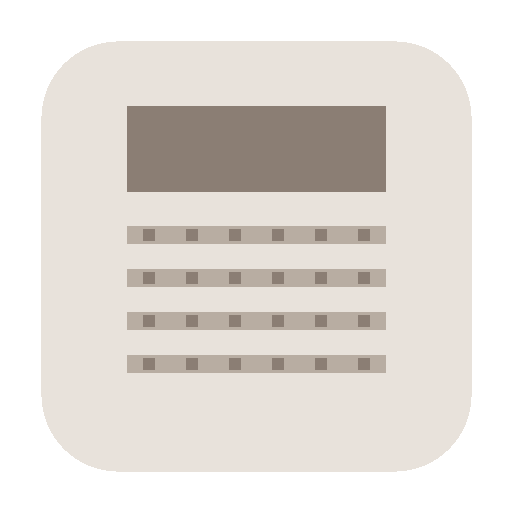</a>

**Provenance:** Project identity or interface asset · **Occurrences:** 2

## [ZVA-0331 — Zoe Icon 1024](../items/ZVA-0331.md)

A platform-sized Zoe application icon named Zoe Icon 1024, exported for the Apple target at 1024×1024. This visual supports recognition, navigation, application identity, or a cohesive visual language across Zoe and its components.

<a href="../../images/ZVA-0331.png">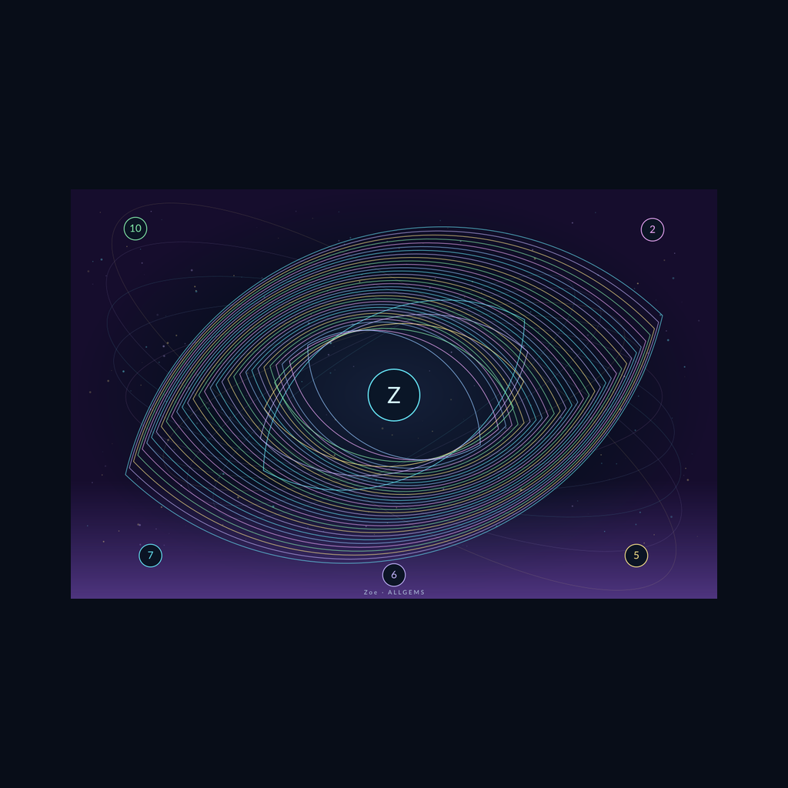</a>

**Provenance:** Project identity or interface asset · **Occurrences:** 1

## [ZVA-0332 — Zoe Icon 120](../items/ZVA-0332.md)

A platform-sized Zoe application icon named Zoe Icon 120, exported for the Apple target at 120×120. This visual supports recognition, navigation, application identity, or a cohesive visual language across Zoe and its components.

<a href="../../images/ZVA-0332.png">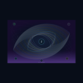</a>

**Provenance:** Project identity or interface asset · **Occurrences:** 1

## [ZVA-0333 — Zoe Icon 152](../items/ZVA-0333.md)

A platform-sized Zoe application icon named Zoe Icon 152, exported for the Apple target at 152×152. This visual supports recognition, navigation, application identity, or a cohesive visual language across Zoe and its components.

<a href="../../images/ZVA-0333.png">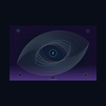</a>

**Provenance:** Project identity or interface asset · **Occurrences:** 1

## [ZVA-0334 — Zoe Icon 167](../items/ZVA-0334.md)

A platform-sized Zoe application icon named Zoe Icon 167, exported for the Apple target at 167×167. This visual supports recognition, navigation, application identity, or a cohesive visual language across Zoe and its components.

<a href="../../images/ZVA-0334.png">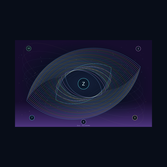</a>

**Provenance:** Project identity or interface asset · **Occurrences:** 1

## [ZVA-0335 — Zoe Icon 180](../items/ZVA-0335.md)

A platform-sized Zoe application icon named Zoe Icon 180, exported for the Apple target at 180×180. This visual supports recognition, navigation, application identity, or a cohesive visual language across Zoe and its components.

<a href="../../images/ZVA-0335.png">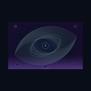</a>

**Provenance:** Project identity or interface asset · **Occurrences:** 1

## [ZVA-0336 — Zoe Icon 20](../items/ZVA-0336.md)

A platform-sized Zoe application icon named Zoe Icon 20, exported for the Apple target at 20×20. This visual supports recognition, navigation, application identity, or a cohesive visual language across Zoe and its components.

**Provenance:** Project identity or interface asset · **Occurrences:** 1

## [ZVA-0337 — Zoe Icon 29](../items/ZVA-0337.md)

A platform-sized Zoe application icon named Zoe Icon 29, exported for the Apple target at 29×29. This visual supports recognition, navigation, application identity, or a cohesive visual language across Zoe and its components.

**Provenance:** Project identity or interface asset · **Occurrences:** 1

## [ZVA-0338 — Zoe Icon 40](../items/ZVA-0338.md)

A platform-sized Zoe application icon named Zoe Icon 40, exported for the Apple target at 40×40. This visual supports recognition, navigation, application identity, or a cohesive visual language across Zoe and its components.

**Provenance:** Project identity or interface asset · **Occurrences:** 1

## [ZVA-0339 — Zoe Icon 58](../items/ZVA-0339.md)

A platform-sized Zoe application icon named Zoe Icon 58, exported for the Apple target at 58×58. This visual supports recognition, navigation, application identity, or a cohesive visual language across Zoe and its components.

**Provenance:** Project identity or interface asset · **Occurrences:** 1

## [ZVA-0340 — Zoe Icon 60](../items/ZVA-0340.md)

A platform-sized Zoe application icon named Zoe Icon 60, exported for the Apple target at 60×60. This visual supports recognition, navigation, application identity, or a cohesive visual language across Zoe and its components.

<a href="../../images/ZVA-0340.png">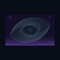</a>

**Provenance:** Project identity or interface asset · **Occurrences:** 1

## [ZVA-0341 — Zoe Icon 76](../items/ZVA-0341.md)

A platform-sized Zoe application icon named Zoe Icon 76, exported for the Apple target at 76×76. This visual supports recognition, navigation, application identity, or a cohesive visual language across Zoe and its components.

<a href="../../images/ZVA-0341.png">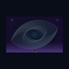</a>

**Provenance:** Project identity or interface asset · **Occurrences:** 1

## [ZVA-0342 — Zoe Icon 80](../items/ZVA-0342.md)

A platform-sized Zoe application icon named Zoe Icon 80, exported for the Apple target at 80×80. This visual supports recognition, navigation, application identity, or a cohesive visual language across Zoe and its components.

<a href="../../images/ZVA-0342.png">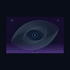</a>

**Provenance:** Project identity or interface asset · **Occurrences:** 1

## [ZVA-0343 — Zoe Icon 87](../items/ZVA-0343.md)

A platform-sized Zoe application icon named Zoe Icon 87, exported for the Apple target at 87×87. This visual supports recognition, navigation, application identity, or a cohesive visual language across Zoe and its components.

<a href="../../images/ZVA-0343.png">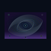</a>

**Provenance:** Project identity or interface asset · **Occurrences:** 1
