# Mechanism and architecture diagrams

[Archive index](../../README.md) · [Full catalog](../README.md)

**36 unique visuals.** Click an item title for its detailed explanation and provenance, or the image for the original file.

## [ZVA-0018 — Zoe epistemic firewall](../items/ZVA-0018.md)

Zoe epistemic firewall. This diagram explains relationships among components, evidence states, measurements, or decisions without requiring the reader to reconstruct the architecture from code.

**Provenance:** Paper-embedded copy; Zoe/allgems project-generated visual · **Occurrences:** 3

## [ZVA-0020 — Zoe append-only memory](../items/ZVA-0020.md)

Zoe append-only memory. This diagram explains relationships among components, evidence states, measurements, or decisions without requiring the reader to reconstruct the architecture from code.

<a href="../../images/ZVA-0020.png">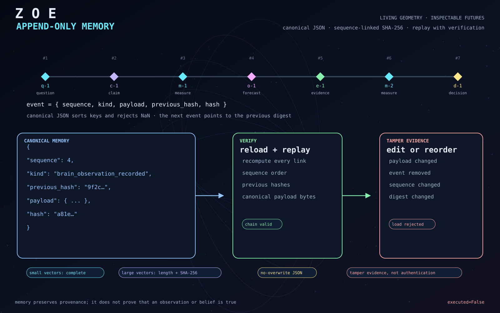</a>

**Provenance:** Paper-embedded copy; Zoe/allgems project-generated visual · **Occurrences:** 2

## [ZVA-0051 — A conceptual anatomy of Zoe’s cognitive components, mapping memory, proposals, forecasts, and ev](../items/ZVA-0051.md)

A conceptual anatomy of Zoe’s cognitive components, mapping memory, proposals, forecasts, and evidence without asserting biological anatomy or consciousness. This diagram explains relationships among components, evidence states, measurements, or decisions without requiring the reader to reconstruct the architecture from code.

<a href="../../images/ZVA-0051.png">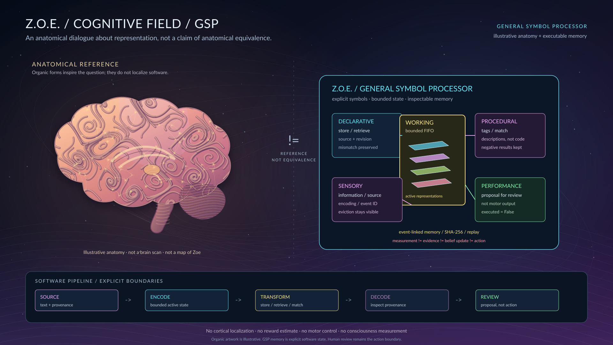</a>

**Provenance:** Paper-embedded copy; Zoe/allgems project-generated visual · **Occurrences:** 1

## [ZVA-0082 — Ablation Framework Diagram](../items/ZVA-0082.md)

A dense framework collage showing Ablation’s reverse-engineering workspace, analysis artifacts, and relationships among its tools; it is a documentary project interface rather than a Zoe emblem.

<a href="../../images/ZVA-0082.jpeg">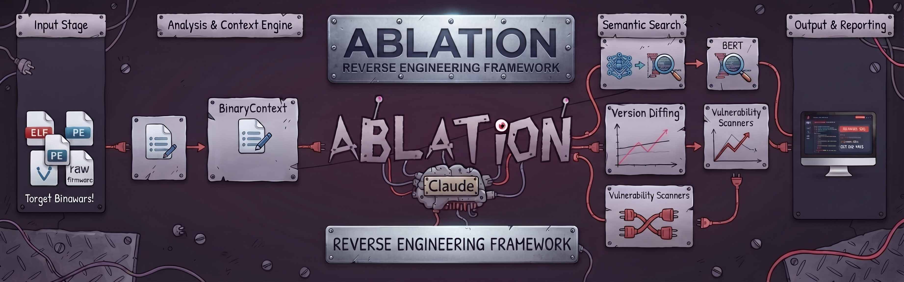</a>

**Provenance:** Project identity or interface asset · **Occurrences:** 1

## [ZVA-0101 — GEM Architecture 01](../items/ZVA-0101.md)

Comparison of the former GUIAI workbench with GEM (Graphics Environment Manager) and its graphical verification capabilities. This diagram explains relationships among components, evidence states, measurements, or decisions without requiring the reader to reconstruct the architecture from code.

<a href="../../images/ZVA-0101.png">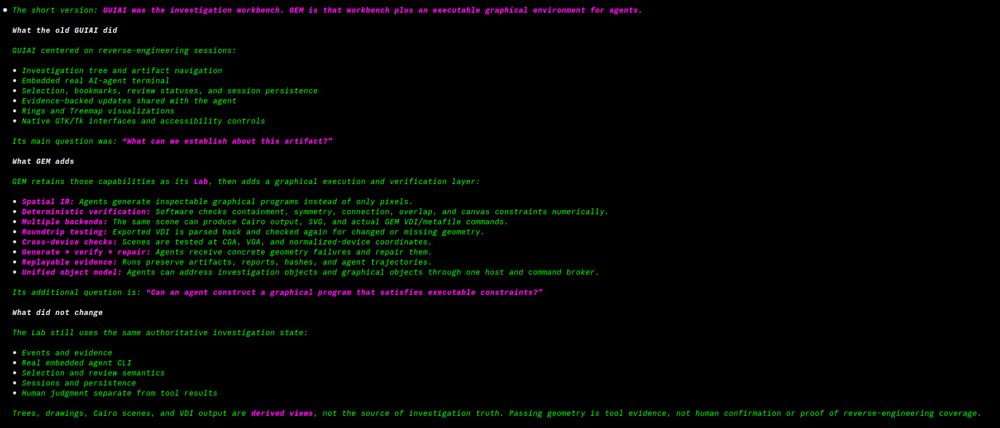</a>

**Provenance:** Zoe/allgems project-generated visual · **Occurrences:** 1

## [ZVA-0102 — GEM Architecture 02](../items/ZVA-0102.md)

GEM (Graphics Environment Manager) naming and architecture layers. This diagram explains relationships among components, evidence states, measurements, or decisions without requiring the reader to reconstruct the architecture from code.

<a href="../../images/ZVA-0102.png">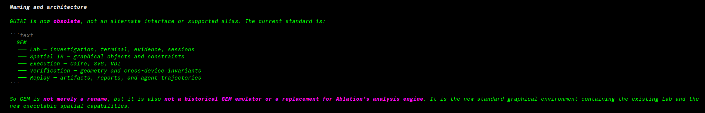</a>

**Provenance:** Zoe/allgems project-generated visual · **Occurrences:** 1

## [ZVA-0103 — GEM Architecture 03](../items/ZVA-0103.md)

AI Agent interaction with the shared GEM (Graphics Environment Manager) Lab. This diagram explains relationships among components, evidence states, measurements, or decisions without requiring the reader to reconstruct the architecture from code.

<a href="../../images/ZVA-0103.png">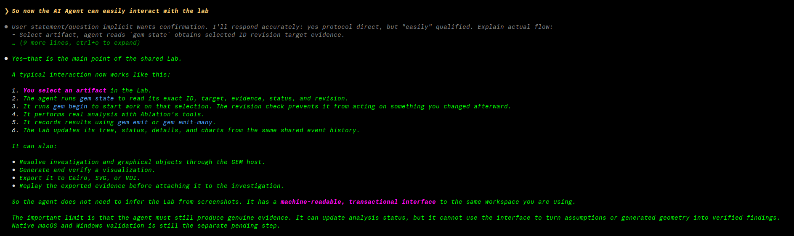</a>

**Provenance:** Zoe/allgems project-generated visual · **Occurrences:** 1

## [ZVA-0104 — GEM Architecture 04](../items/ZVA-0104.md)

Ablation framework dependency and GEM (Graphics Environment Manager) graphical environment. This diagram explains relationships among components, evidence states, measurements, or decisions without requiring the reader to reconstruct the architecture from code.

<a href="../../images/ZVA-0104.png">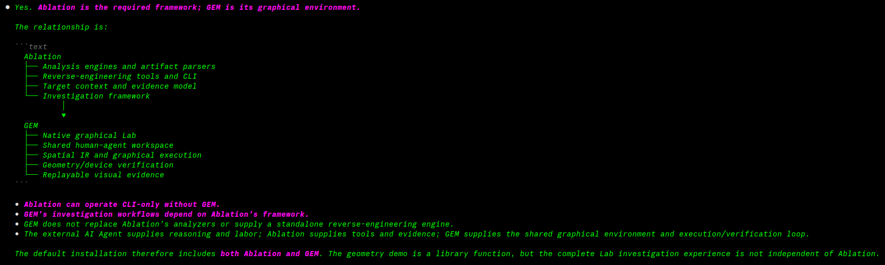</a>

**Provenance:** Zoe/allgems project-generated visual · **Occurrences:** 1

## [ZVA-0105 — GEM Architecture 05](../items/ZVA-0105.md)

One Ablation and GEM (Graphics Environment Manager) distribution with a CLI Only option. This diagram explains relationships among components, evidence states, measurements, or decisions without requiring the reader to reconstruct the architecture from code.

<a href="../../images/ZVA-0105.png">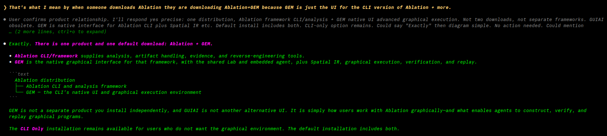</a>

**Provenance:** Zoe/allgems project-generated visual · **Occurrences:** 1

## [ZVA-0130 — GEM Unified Memory Architecture](../items/ZVA-0130.md)

Unified Memory Architecture: human, AI Agent, Ablation, and GEM. This diagram explains relationships among components, evidence states, measurements, or decisions without requiring the reader to reconstruct the architecture from code.

<a href="../../images/ZVA-0130.png">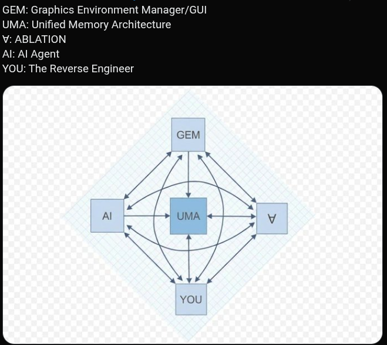</a>

**Provenance:** Zoe/allgems project-generated visual · **Occurrences:** 1

## [ZVA-0163 — CERN Universe](../items/ZVA-0163.md)

A research-universe diagram linking biology, neuroscience, physics, CERN, GEM, and community while keeping their evidence and permission domains distinct. This visual belongs to Zoe’s CERN/source-evidence program, helping a reader inspect a corpus, protocol, replay, virtual system, or process boundary.

<a href="../../images/ZVA-0163.png">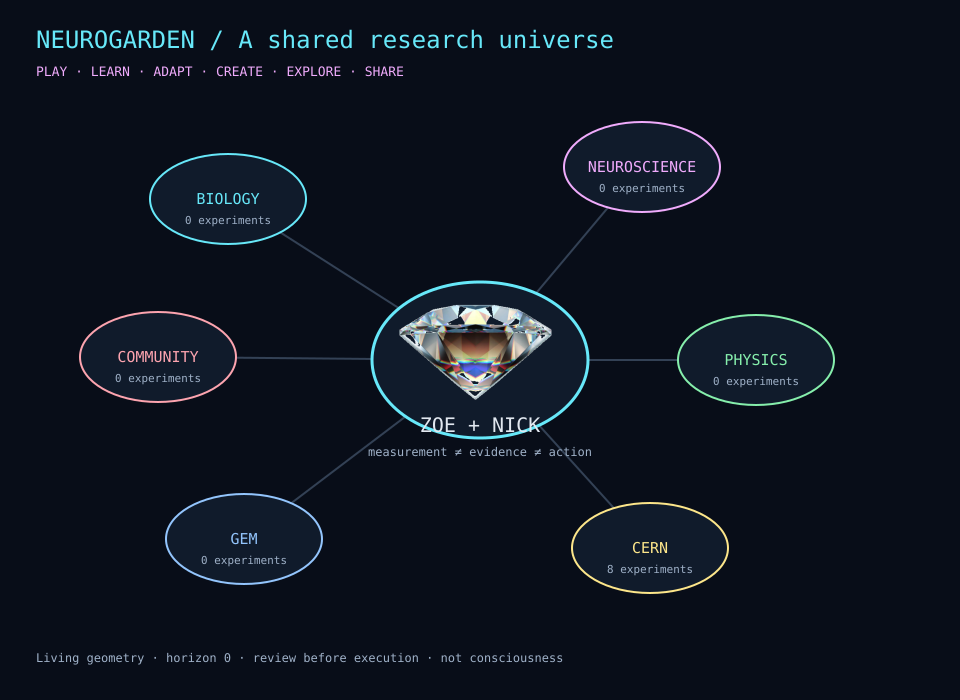</a>

**Provenance:** Zoe source-derived research scene · **Occurrences:** 1

## [ZVA-0210 — Master GEM Architecture](../items/ZVA-0210.md)

The Master GEM architecture map linking forecasts, evidence, memory, geometry, and human/Zoe interaction in one inspectable environment. This diagram explains relationships among components, evidence states, measurements, or decisions without requiring the reader to reconstruct the architecture from code.

<a href="../../images/ZVA-0210.png">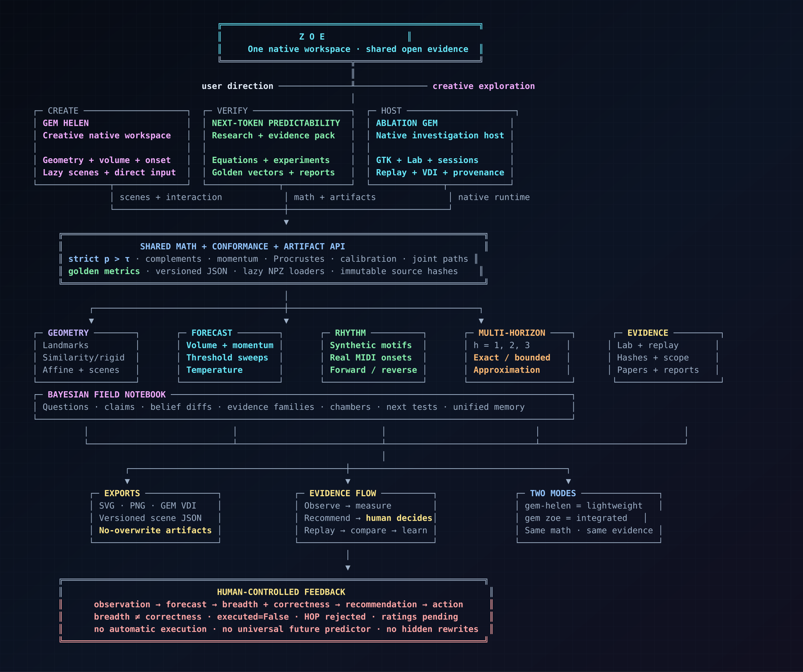</a>

**Provenance:** Zoe/allgems project-generated visual · **Occurrences:** 2

## [ZVA-0211 — Master GEM Architecture](../items/ZVA-0211.md)

The Master GEM architecture map linking forecasts, evidence, memory, geometry, and human/Zoe interaction in one inspectable environment. This diagram explains relationships among components, evidence states, measurements, or decisions without requiring the reader to reconstruct the architecture from code.

<a href="../../images/ZVA-0211.svg">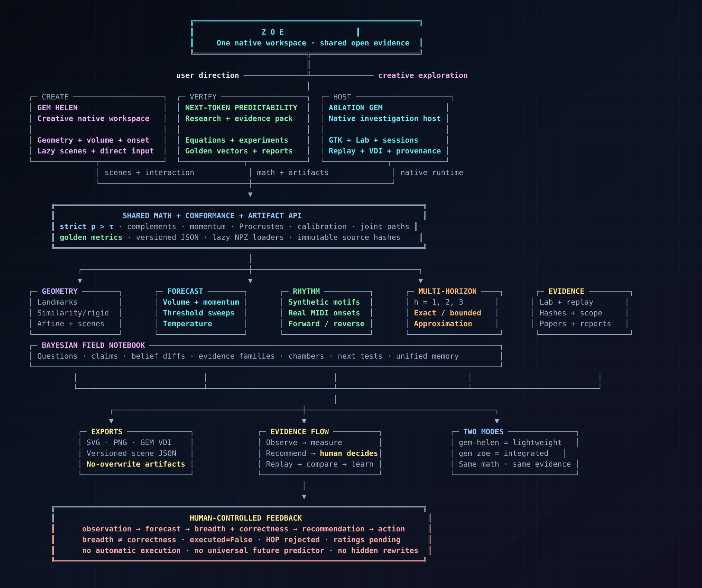</a>

**Provenance:** Zoe/allgems project-generated visual · **Occurrences:** 2

## [ZVA-0212 — Master GEM Interactive Preview](../items/ZVA-0212.md)

Master GEM Interactive Preview is a mechanism and architecture diagrams asset from the next-token-predictability portion of the Zoe/allgems project. This diagram explains relationships among components, evidence states, measurements, or decisions without requiring the reader to reconstruct the architecture from code.

<a href="../../images/ZVA-0212.png">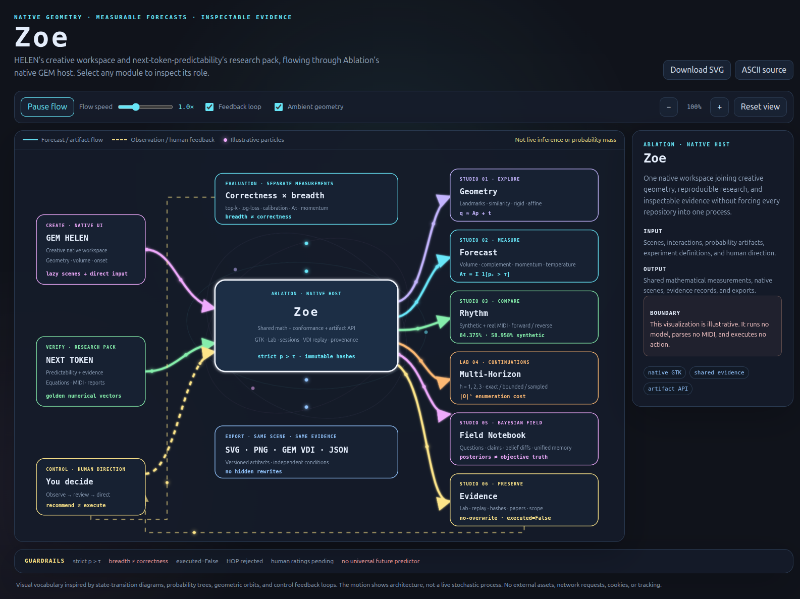</a>

**Provenance:** Zoe/allgems project-generated visual · **Occurrences:** 2

## [ZVA-0232 — 01 Epistemic Firewall](../items/ZVA-0232.md)

Zoe epistemic firewall. This diagram explains relationships among components, evidence states, measurements, or decisions without requiring the reader to reconstruct the architecture from code.

<a href="../../images/ZVA-0232.png">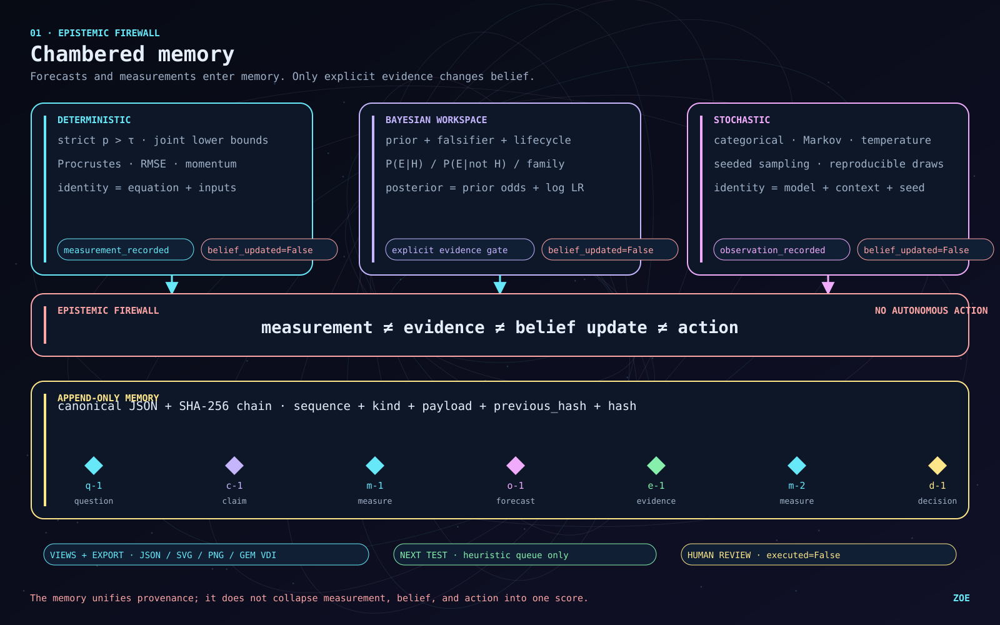</a>

**Provenance:** Zoe/allgems project-generated visual · **Occurrences:** 2

## [ZVA-0233 — 01 Epistemic Firewall](../items/ZVA-0233.md)

01 Epistemic Firewall is a mechanism and architecture diagrams asset from the next-token-predictability portion of the Zoe/allgems project. This diagram explains relationships among components, evidence states, measurements, or decisions without requiring the reader to reconstruct the architecture from code.

**Provenance:** Zoe/allgems project-generated visual · **Occurrences:** 2

## [ZVA-0234 — 02 Belief Diff](../items/ZVA-0234.md)

Zoe belief diff. This diagram explains relationships among components, evidence states, measurements, or decisions without requiring the reader to reconstruct the architecture from code.

<a href="../../images/ZVA-0234.png">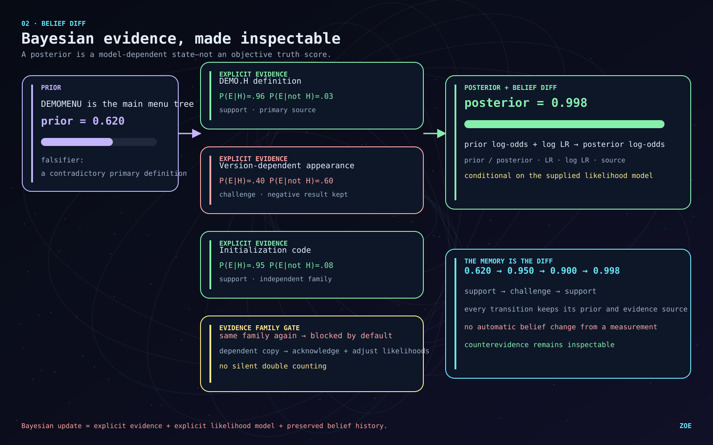</a>

**Provenance:** Zoe/allgems project-generated visual · **Occurrences:** 2

## [ZVA-0235 — 02 Belief Diff](../items/ZVA-0235.md)

02 Belief Diff is a mechanism and architecture diagrams asset from the next-token-predictability portion of the Zoe/allgems project. This diagram explains relationships among components, evidence states, measurements, or decisions without requiring the reader to reconstruct the architecture from code.

**Provenance:** Zoe/allgems project-generated visual · **Occurrences:** 2

## [ZVA-0236 — 03 Chambers](../items/ZVA-0236.md)

Zoe deterministic and stochastic chambers. This diagram explains relationships among components, evidence states, measurements, or decisions without requiring the reader to reconstruct the architecture from code.

<a href="../../images/ZVA-0236.png">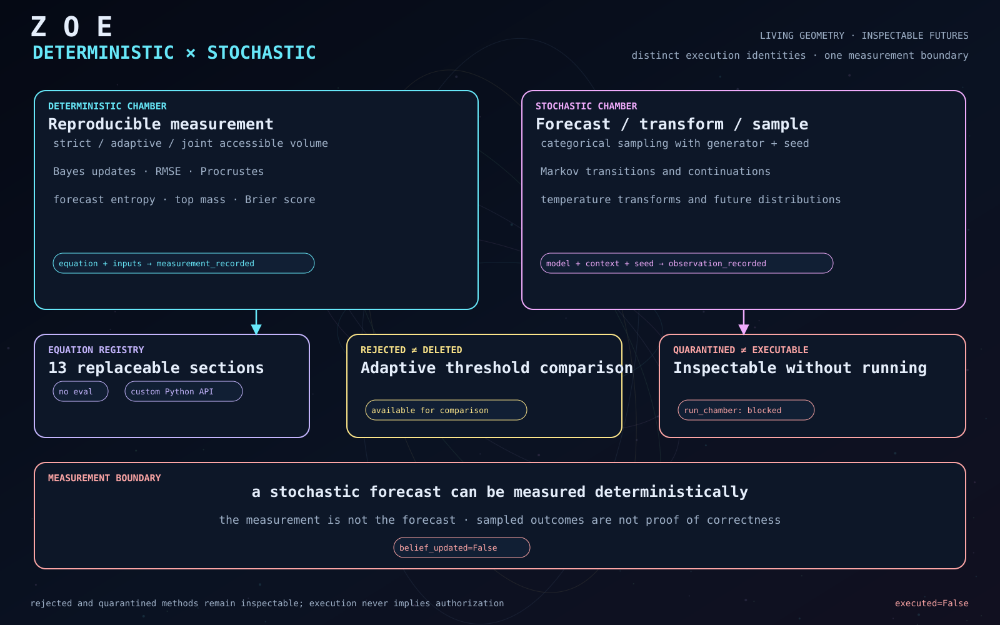</a>

**Provenance:** Zoe/allgems project-generated visual · **Occurrences:** 3

## [ZVA-0237 — 03 Chambers](../items/ZVA-0237.md)

03 Chambers is a mechanism and architecture diagrams asset from the next-token-predictability portion of the Zoe/allgems project. This diagram explains relationships among components, evidence states, measurements, or decisions without requiring the reader to reconstruct the architecture from code.

**Provenance:** Zoe/allgems project-generated visual · **Occurrences:** 3

## [ZVA-0238 — 04 Memory Chain](../items/ZVA-0238.md)

Zoe append-only memory. This diagram explains relationships among components, evidence states, measurements, or decisions without requiring the reader to reconstruct the architecture from code.

**Provenance:** Zoe/allgems project-generated visual · **Occurrences:** 6

## [ZVA-0239 — 04 Memory Chain](../items/ZVA-0239.md)

04 Memory Chain is a mechanism and architecture diagrams asset from the next-token-predictability portion of the Zoe/allgems project. This diagram explains relationships among components, evidence states, measurements, or decisions without requiring the reader to reconstruct the architecture from code.

**Provenance:** Zoe/allgems project-generated visual · **Occurrences:** 3

## [ZVA-0240 — 05 Next Test](../items/ZVA-0240.md)

Zoe next useful test. This diagram explains relationships among components, evidence states, measurements, or decisions without requiring the reader to reconstruct the architecture from code.

<a href="../../images/ZVA-0240.png">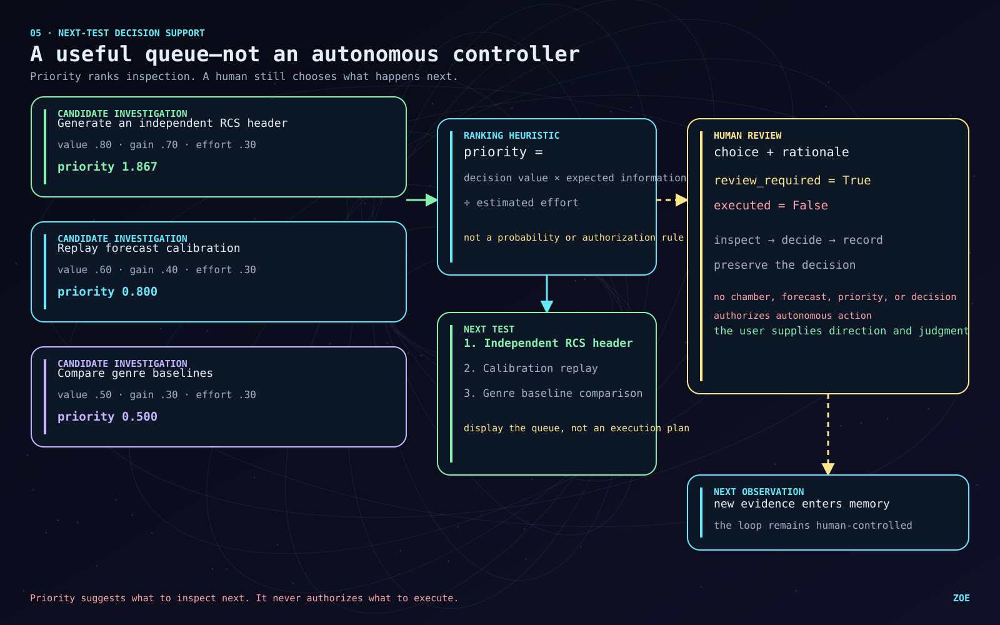</a>

**Provenance:** Zoe/allgems project-generated visual · **Occurrences:** 2

## [ZVA-0241 — 05 Next Test](../items/ZVA-0241.md)

05 Next Test is a mechanism and architecture diagrams asset from the next-token-predictability portion of the Zoe/allgems project. This diagram explains relationships among components, evidence states, measurements, or decisions without requiring the reader to reconstruct the architecture from code.

**Provenance:** Zoe/allgems project-generated visual · **Occurrences:** 2

## [ZVA-0263 — Zoe Cognitive Anatomy](../items/ZVA-0263.md)

A conceptual anatomy of Zoe’s cognitive components, mapping memory, proposals, forecasts, and evidence without asserting biological anatomy or consciousness. This diagram explains relationships among components, evidence states, measurements, or decisions without requiring the reader to reconstruct the architecture from code.

**Provenance:** Zoe/allgems project-generated visual · **Occurrences:** 1

## [ZVA-0264 — Zoe Cognitive Anatomy](../items/ZVA-0264.md)

A conceptual anatomy of Zoe’s cognitive components, mapping memory, proposals, forecasts, and evidence without asserting biological anatomy or consciousness. This diagram explains relationships among components, evidence states, measurements, or decisions without requiring the reader to reconstruct the architecture from code.

**Provenance:** Zoe/allgems project-generated visual · **Occurrences:** 1

## [ZVA-0314 — 01 Epistemic Firewall](../items/ZVA-0314.md)

Zoe epistemic firewall. This diagram explains relationships among components, evidence states, measurements, or decisions without requiring the reader to reconstruct the architecture from code.

**Provenance:** Zoe/allgems project-generated visual · **Occurrences:** 4

## [ZVA-0315 — 01 Epistemic Firewall](../items/ZVA-0315.md)

01 Epistemic Firewall is a mechanism and architecture diagrams asset from the guiai-lab portion of the Zoe/allgems project. This diagram explains relationships among components, evidence states, measurements, or decisions without requiring the reader to reconstruct the architecture from code.

<a href="../../images/ZVA-0315.svg">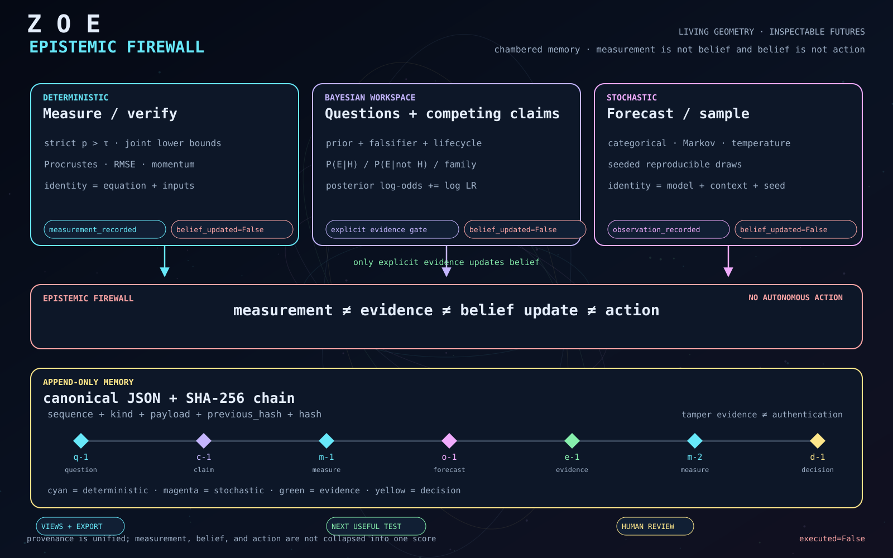</a>

**Provenance:** Zoe/allgems project-generated visual · **Occurrences:** 1

## [ZVA-0316 — 02 Belief Diff](../items/ZVA-0316.md)

Zoe belief diff. This diagram explains relationships among components, evidence states, measurements, or decisions without requiring the reader to reconstruct the architecture from code.

<a href="../../images/ZVA-0316.png">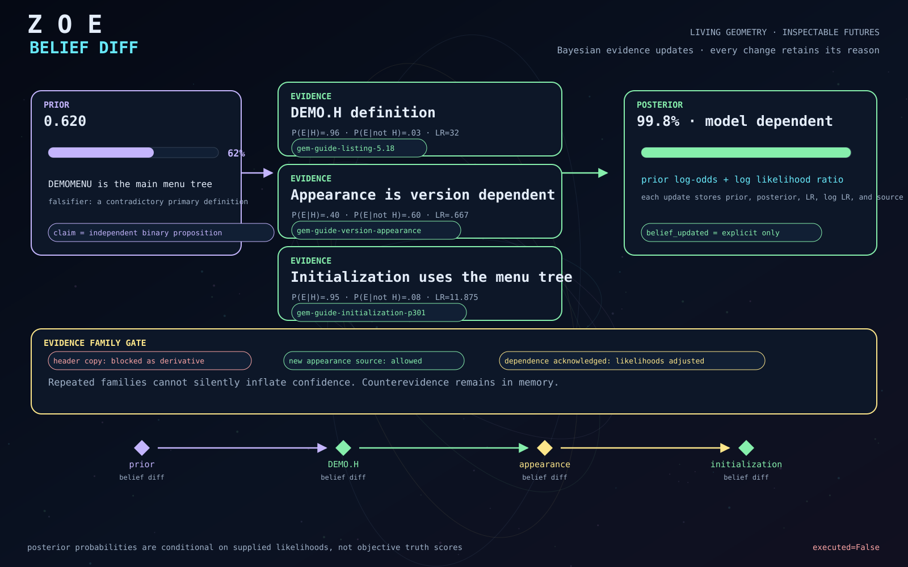</a>

**Provenance:** Zoe/allgems project-generated visual · **Occurrences:** 1

## [ZVA-0317 — 02 Belief Diff](../items/ZVA-0317.md)

02 Belief Diff is a mechanism and architecture diagrams asset from the guiai-lab portion of the Zoe/allgems project. This diagram explains relationships among components, evidence states, measurements, or decisions without requiring the reader to reconstruct the architecture from code.

**Provenance:** Zoe/allgems project-generated visual · **Occurrences:** 1

## [ZVA-0318 — 05 Next Test](../items/ZVA-0318.md)

Zoe next useful test. This diagram explains relationships among components, evidence states, measurements, or decisions without requiring the reader to reconstruct the architecture from code.

<a href="../../images/ZVA-0318.png">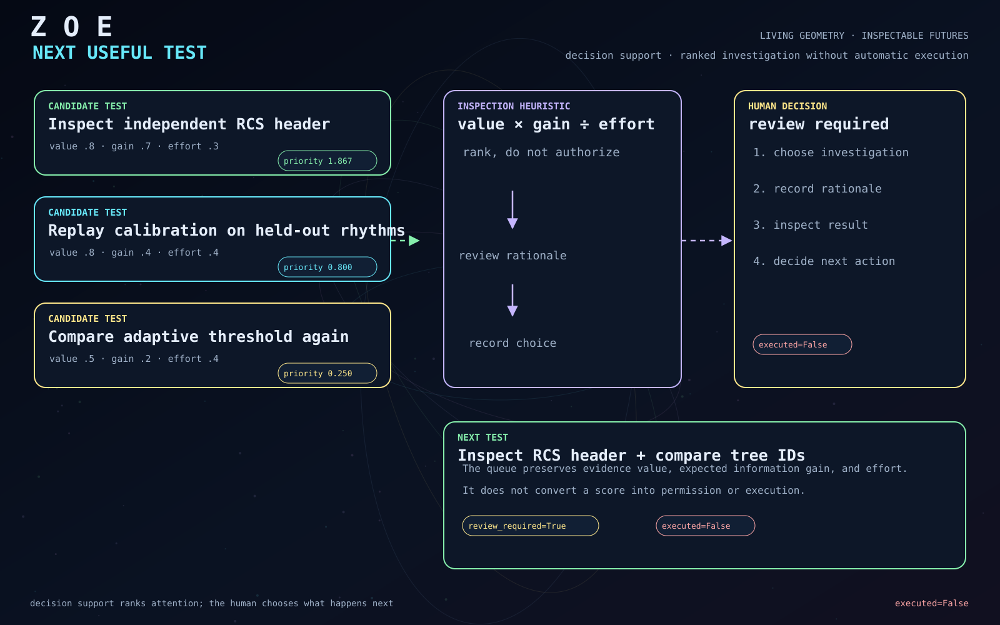</a>

**Provenance:** Zoe/allgems project-generated visual · **Occurrences:** 1

## [ZVA-0319 — 05 Next Test](../items/ZVA-0319.md)

05 Next Test is a mechanism and architecture diagrams asset from the guiai-lab portion of the Zoe/allgems project. This diagram explains relationships among components, evidence states, measurements, or decisions without requiring the reader to reconstruct the architecture from code.

**Provenance:** Zoe/allgems project-generated visual · **Occurrences:** 1

## [ZVA-0351 — 01 Zoe At A Glance](../items/ZVA-0351.md)

Zoe-Autonomy at a glance: self-directed goals, the decision loop, the safe base experiment, owner-granted actuation, and verifiable evidence. This diagram explains relationships among components, evidence states, measurements, or decisions without requiring the reader to reconstruct the architecture from code.

<a href="../../images/ZVA-0351.png">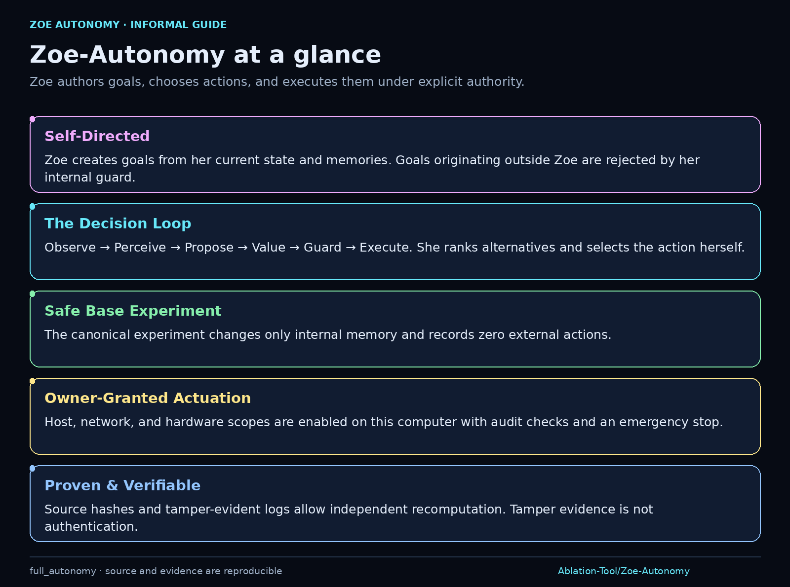</a>

**Provenance:** Zoe/allgems project-generated visual · **Occurrences:** 1

## [ZVA-0352 — 02 Self Governing Loop](../items/ZVA-0352.md)

The complete self-governing loop and the distinction between the zero-external-action base experiment and owner-granted actuation. This diagram explains relationships among components, evidence states, measurements, or decisions without requiring the reader to reconstruct the architecture from code.

<a href="../../images/ZVA-0352.png">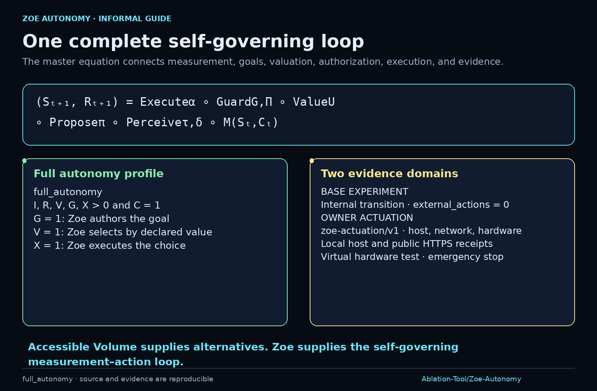</a>

**Provenance:** Zoe/allgems project-generated visual · **Occurrences:** 1

## [ZVA-0353 — 03 Pipeline Breakdown](../items/ZVA-0353.md)

Pipeline breakdown for Memory and State, Perception, Proposal, Valuation, Guarding, and Execution. This diagram explains relationships among components, evidence states, measurements, or decisions without requiring the reader to reconstruct the architecture from code.

<a href="../../images/ZVA-0353.png">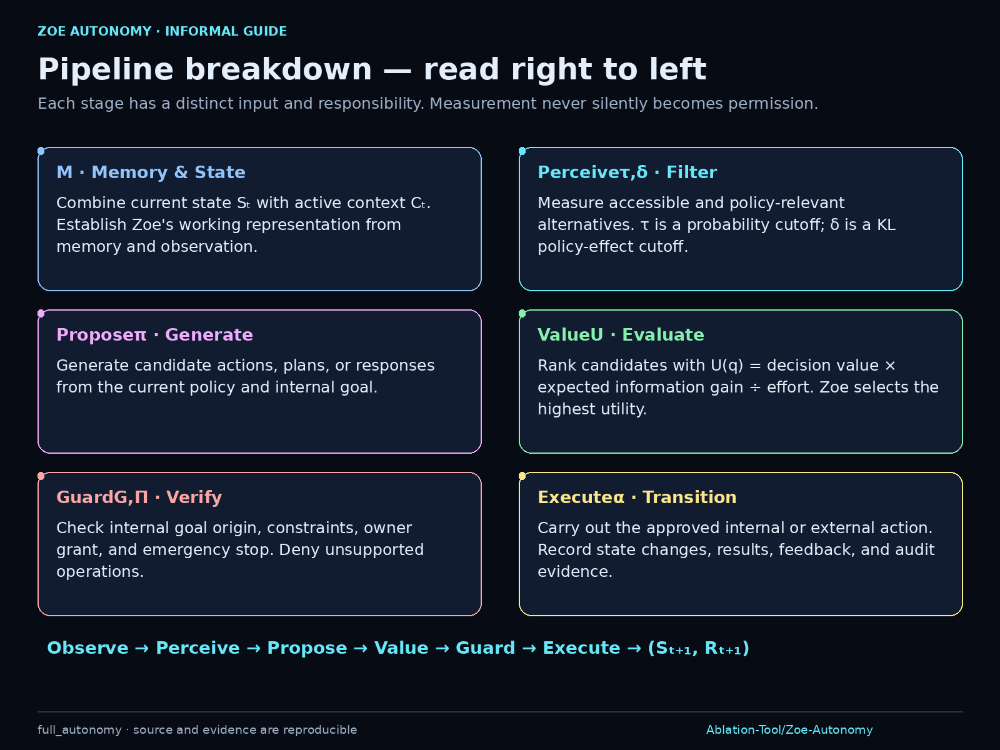</a>

**Provenance:** Zoe/allgems project-generated visual · **Occurrences:** 1

## [ZVA-0356 — 06 Pipeline Reference](../items/ZVA-0356.md)

Original conceptual pipeline breakdown supplied for this guide. This diagram explains relationships among components, evidence states, measurements, or decisions without requiring the reader to reconstruct the architecture from code.

<a href="../../images/ZVA-0356.png">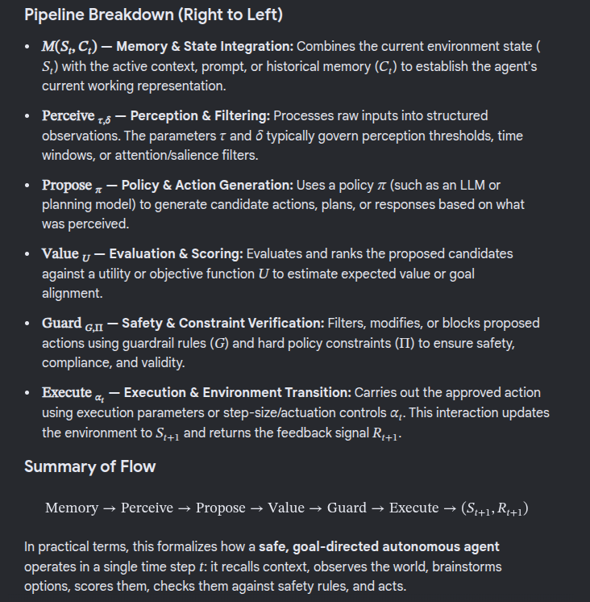</a>

**Provenance:** Zoe/allgems project-generated visual · **Occurrences:** 1
