# Source references and derivative reading copies

[Archive index](../../README.md) · [Full catalog](../README.md)

**33 unique visuals.** Click an item title for its detailed explanation and provenance, or the image for the original file.

## [ZVA-0072 — Symbol E](../items/ZVA-0072.md)

A supplied E/e glyph-grid reference used to guide outlined GEM cells, not a new statement of GEM semantics. This asset preserves source context or a derivative reading view so that generated interpretations remain distinguishable from their references.

<a href="../../images/ZVA-0072.png">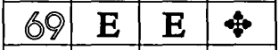</a>

**Provenance:** User-supplied visual reference · **Occurrences:** 1

## [ZVA-0073 — Symbol Epsilon](../items/ZVA-0073.md)

A supplied epsilon/symbol-grid reference retained for the outlined GEM visual study. This asset preserves source context or a derivative reading view so that generated interpretations remain distinguishable from their references.

<a href="../../images/ZVA-0073.png">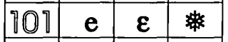</a>

**Provenance:** User-supplied visual reference · **Occurrences:** 1

## [ZVA-0074 — Symbol G](../items/ZVA-0074.md)

A supplied G/g glyph-grid reference used in the original GEM scene composition. This asset preserves source context or a derivative reading view so that generated interpretations remain distinguishable from their references.

<a href="../../images/ZVA-0074.png">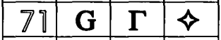</a>

**Provenance:** User-supplied visual reference · **Occurrences:** 1

## [ZVA-0075 — Symbol M](../items/ZVA-0075.md)

A supplied M/m glyph-grid reference used in the original GEM scene composition. This asset preserves source context or a derivative reading view so that generated interpretations remain distinguishable from their references.

<a href="../../images/ZVA-0075.png">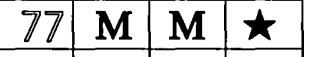</a>

**Provenance:** User-supplied visual reference · **Occurrences:** 1

## [ZVA-0076 — Symbol O](../items/ZVA-0076.md)

A supplied O/o glyph-grid reference used in the original GEM scene composition. This asset preserves source context or a derivative reading view so that generated interpretations remain distinguishable from their references.

<a href="../../images/ZVA-0076.png">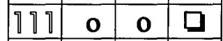</a>

**Provenance:** User-supplied visual reference · **Occurrences:** 1

## [ZVA-0077 — Symbol Z](../items/ZVA-0077.md)

A supplied Z/z glyph-grid reference associated with the Zoe/GEM visual study. This asset preserves source context or a derivative reading view so that generated interpretations remain distinguishable from their references.

<a href="../../images/ZVA-0077.png">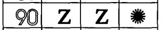</a>

**Provenance:** User-supplied visual reference · **Occurrences:** 1

## [ZVA-0133 — Screenshot 20261104 142508](../items/ZVA-0133.md)

An immutable sacred-geometry source image (Screenshot 20261104 142508) containing mathematical notation or diagrams used for exact transcription, OCR comparison, pixel measurement, and replay.

<a href="../../images/ZVA-0133.png">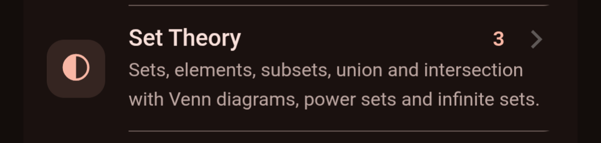</a>

**Provenance:** Immutable or derived sacred-geometry experiment source · **Occurrences:** 1

## [ZVA-0134 — Screenshot 20261104 142605](../items/ZVA-0134.md)

An immutable sacred-geometry source image (Screenshot 20261104 142605) containing mathematical notation or diagrams used for exact transcription, OCR comparison, pixel measurement, and replay.

<a href="../../images/ZVA-0134.png">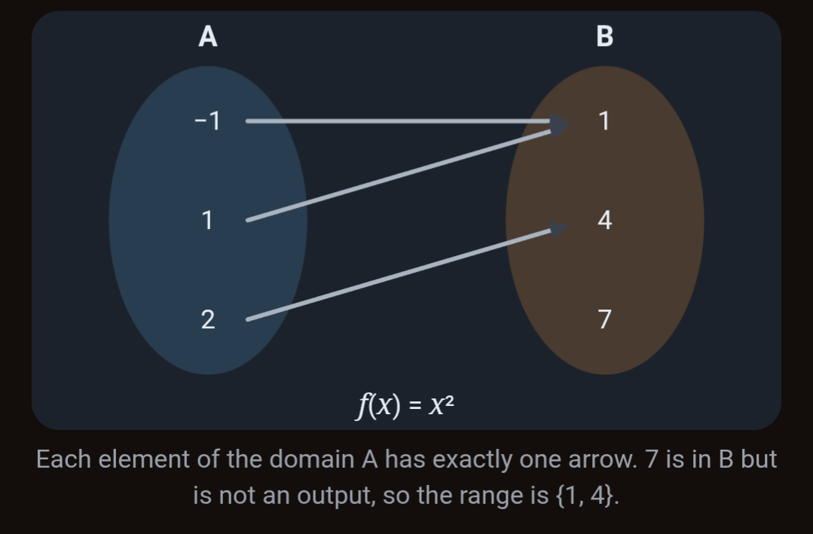</a>

**Provenance:** Immutable or derived sacred-geometry experiment source · **Occurrences:** 1

## [ZVA-0135 — Screenshot 20261104 142622](../items/ZVA-0135.md)

An immutable sacred-geometry source image (Screenshot 20261104 142622) containing mathematical notation or diagrams used for exact transcription, OCR comparison, pixel measurement, and replay.

<a href="../../images/ZVA-0135.png">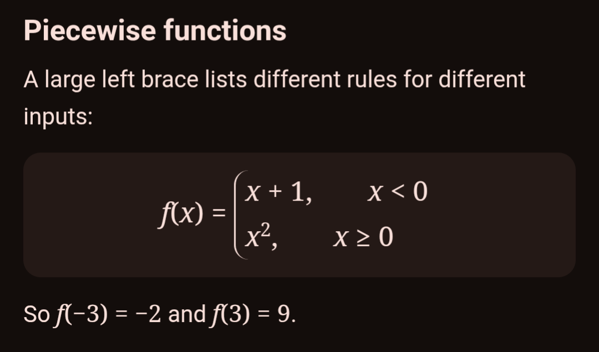</a>

**Provenance:** Immutable or derived sacred-geometry experiment source · **Occurrences:** 1

## [ZVA-0136 — Screenshot 20261104 142637](../items/ZVA-0136.md)

An immutable sacred-geometry source image (Screenshot 20261104 142637) containing mathematical notation or diagrams used for exact transcription, OCR comparison, pixel measurement, and replay.

<a href="../../images/ZVA-0136.png">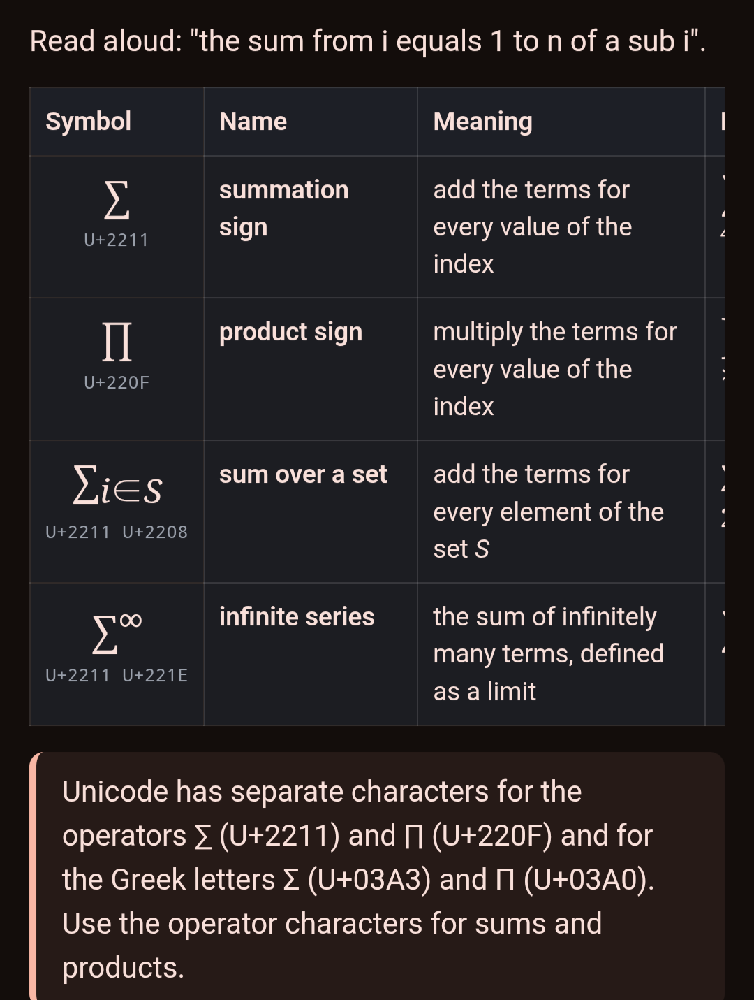</a>

**Provenance:** Immutable or derived sacred-geometry experiment source · **Occurrences:** 1

## [ZVA-0137 — Screenshot 20261104 142703](../items/ZVA-0137.md)

An immutable sacred-geometry source image (Screenshot 20261104 142703) containing mathematical notation or diagrams used for exact transcription, OCR comparison, pixel measurement, and replay.

<a href="../../images/ZVA-0137.png">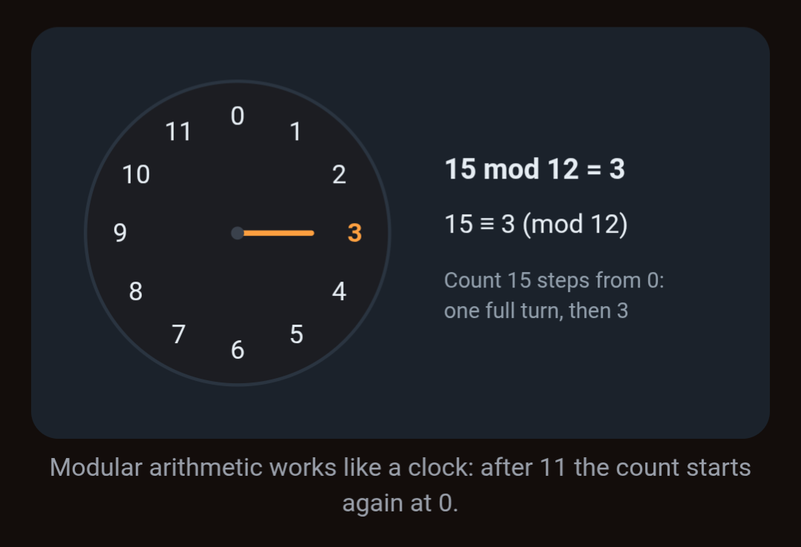</a>

**Provenance:** Immutable or derived sacred-geometry experiment source · **Occurrences:** 1

## [ZVA-0138 — Screenshot 20261104 142802](../items/ZVA-0138.md)

An immutable sacred-geometry source image (Screenshot 20261104 142802) containing mathematical notation or diagrams used for exact transcription, OCR comparison, pixel measurement, and replay.

<a href="../../images/ZVA-0138.png">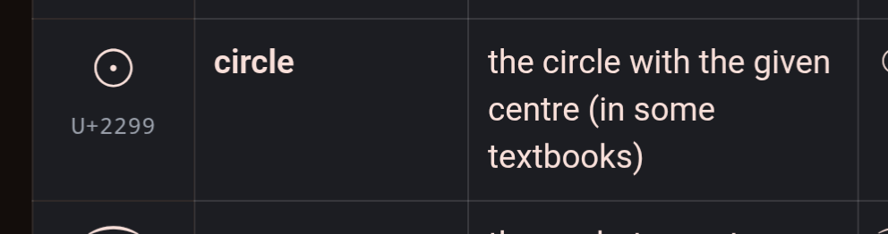</a>

**Provenance:** Immutable or derived sacred-geometry experiment source · **Occurrences:** 1

## [ZVA-0139 — Screenshot 20261104 142821](../items/ZVA-0139.md)

An immutable sacred-geometry source image (Screenshot 20261104 142821) containing mathematical notation or diagrams used for exact transcription, OCR comparison, pixel measurement, and replay.

<a href="../../images/ZVA-0139.png">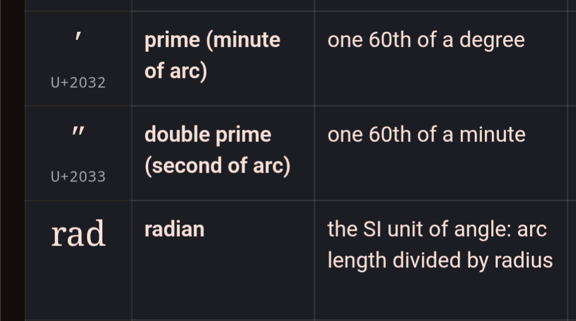</a>

**Provenance:** Immutable or derived sacred-geometry experiment source · **Occurrences:** 1

## [ZVA-0140 — Screenshot 20261104 142841](../items/ZVA-0140.md)

An immutable sacred-geometry source image (Screenshot 20261104 142841) containing mathematical notation or diagrams used for exact transcription, OCR comparison, pixel measurement, and replay.

<a href="../../images/ZVA-0140.png">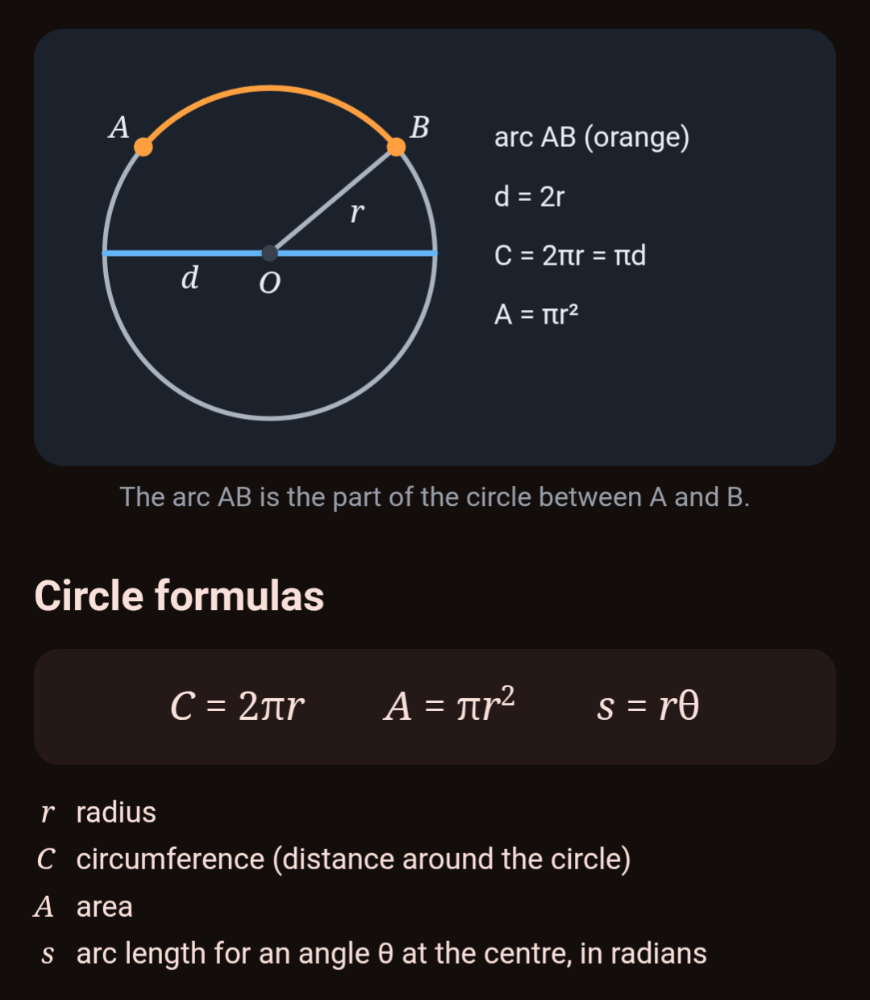</a>

**Provenance:** Immutable or derived sacred-geometry experiment source · **Occurrences:** 1

## [ZVA-0141 — Untitled Drawing (1)](../items/ZVA-0141.md)

The composite landmark-alignment source drawing used to define measured correspondences in the sacred-geometry experiment. This asset preserves source context or a derivative reading view so that generated interpretations remain distinguishable from their references.

<a href="../../images/ZVA-0141.png">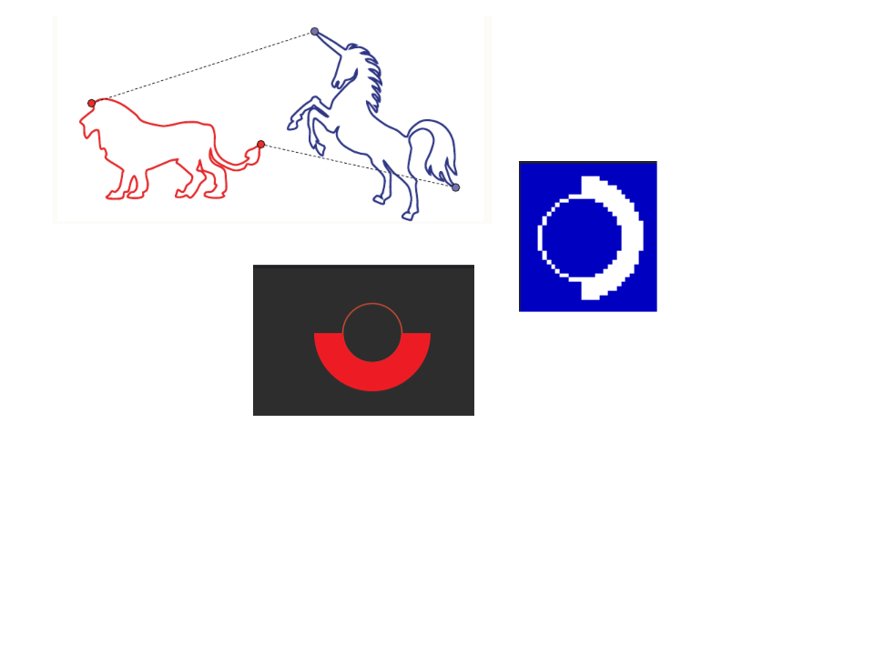</a>

**Provenance:** Immutable or derived sacred-geometry experiment source · **Occurrences:** 1

## [ZVA-0142 — Hub Loop](../items/ZVA-0142.md)

The derived hub-loop mathematical source with eight h nodes and four v nodes around a central hub, used in the reproducible geometry experiment. This asset preserves source context or a derivative reading view so that generated interpretations remain distinguishable from their references.

<a href="../../images/ZVA-0142.png">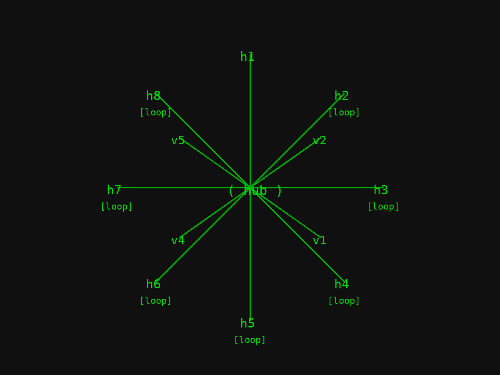</a>

**Provenance:** Immutable or derived sacred-geometry experiment source · **Occurrences:** 1

## [ZVA-0143 — Hub Loop](../items/ZVA-0143.md)

The derived hub-loop mathematical source with eight h nodes and four v nodes around a central hub, used in the reproducible geometry experiment. This asset preserves source context or a derivative reading view so that generated interpretations remain distinguishable from their references.

<a href="../../images/ZVA-0143.svg">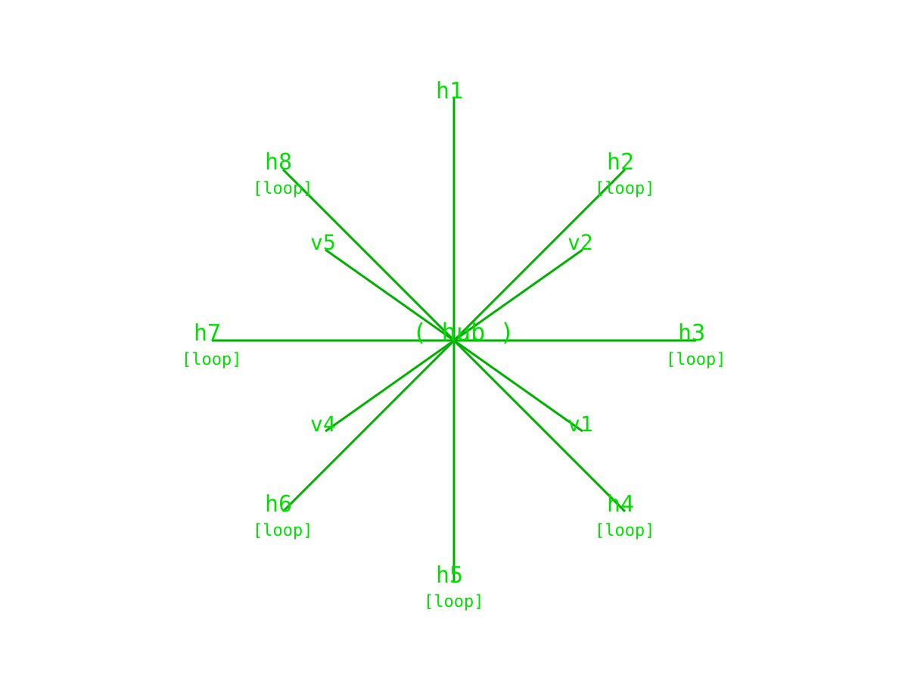</a>

**Provenance:** Immutable or derived sacred-geometry experiment source · **Occurrences:** 1

## [ZVA-0144 — VDI Bidirectional Interface](../items/ZVA-0144.md)

A historical VDI bidirectional-interface reference image used as an architectural analogy for two-way measurement and feedback. This asset preserves source context or a derivative reading view so that generated interpretations remain distinguishable from their references.

<a href="../../images/ZVA-0144.png">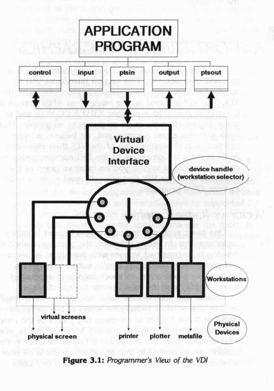</a>

**Provenance:** Zoe/allgems project-generated visual · **Occurrences:** 2

## [ZVA-0214 — Page 01](../items/ZVA-0214.md)

The Significance of Accessible Volume, page 1. This asset preserves source context or a derivative reading view so that generated interpretations remain distinguishable from their references.

<a href="../../images/ZVA-0214.jpeg">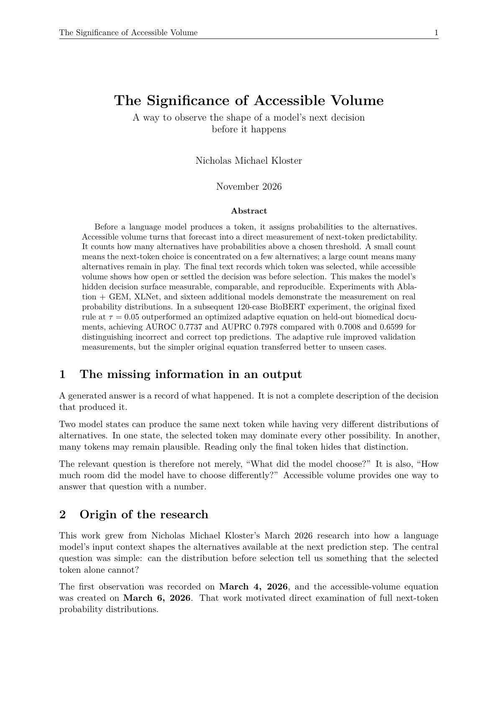</a>

**Provenance:** Derivative paper-page render · **Occurrences:** 2

## [ZVA-0215 — Page 02](../items/ZVA-0215.md)

The Significance of Accessible Volume, page 2. This asset preserves source context or a derivative reading view so that generated interpretations remain distinguishable from their references.

<a href="../../images/ZVA-0215.jpeg">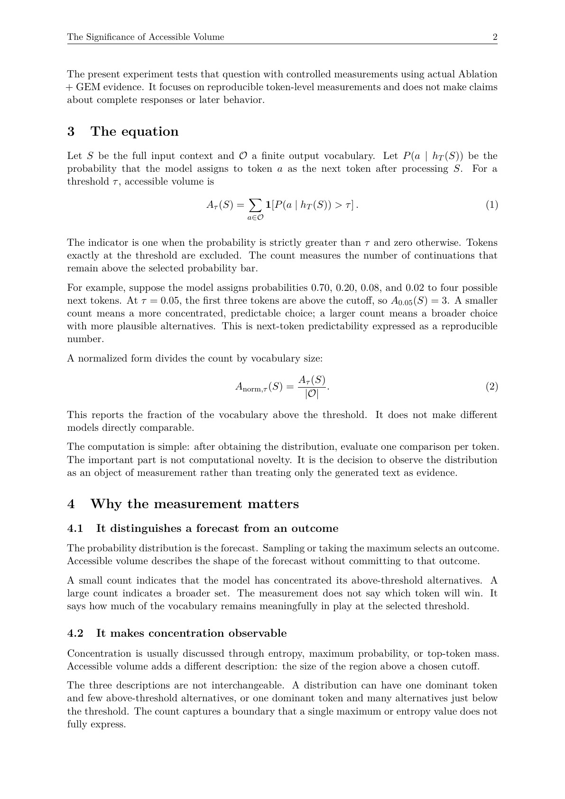</a>

**Provenance:** Derivative paper-page render · **Occurrences:** 2

## [ZVA-0216 — Page 03](../items/ZVA-0216.md)

The Significance of Accessible Volume, page 3. This asset preserves source context or a derivative reading view so that generated interpretations remain distinguishable from their references.

<a href="../../images/ZVA-0216.jpeg">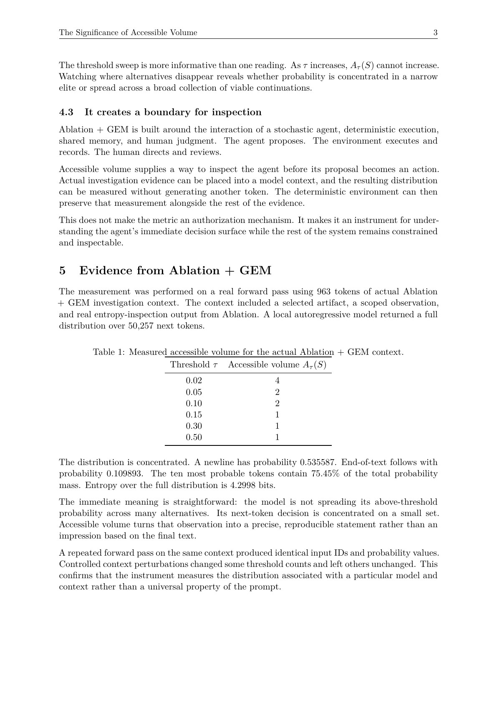</a>

**Provenance:** Derivative paper-page render · **Occurrences:** 2

## [ZVA-0217 — Page 04](../items/ZVA-0217.md)

The Significance of Accessible Volume, page 4. This asset preserves source context or a derivative reading view so that generated interpretations remain distinguishable from their references.

<a href="../../images/ZVA-0217.jpeg">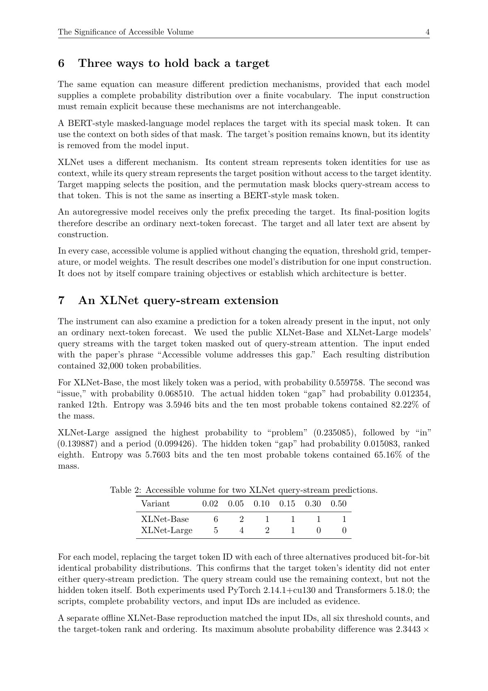</a>

**Provenance:** Derivative paper-page render · **Occurrences:** 2

## [ZVA-0218 — Page 05](../items/ZVA-0218.md)

The Significance of Accessible Volume, page 5. This asset preserves source context or a derivative reading view so that generated interpretations remain distinguishable from their references.

<a href="../../images/ZVA-0218.jpeg">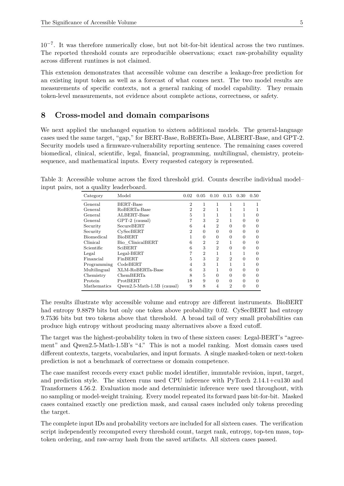</a>

**Provenance:** Derivative paper-page render · **Occurrences:** 2

## [ZVA-0219 — Page 06](../items/ZVA-0219.md)

The Significance of Accessible Volume, page 6. This asset preserves source context or a derivative reading view so that generated interpretations remain distinguishable from their references.

<a href="../../images/ZVA-0219.jpeg">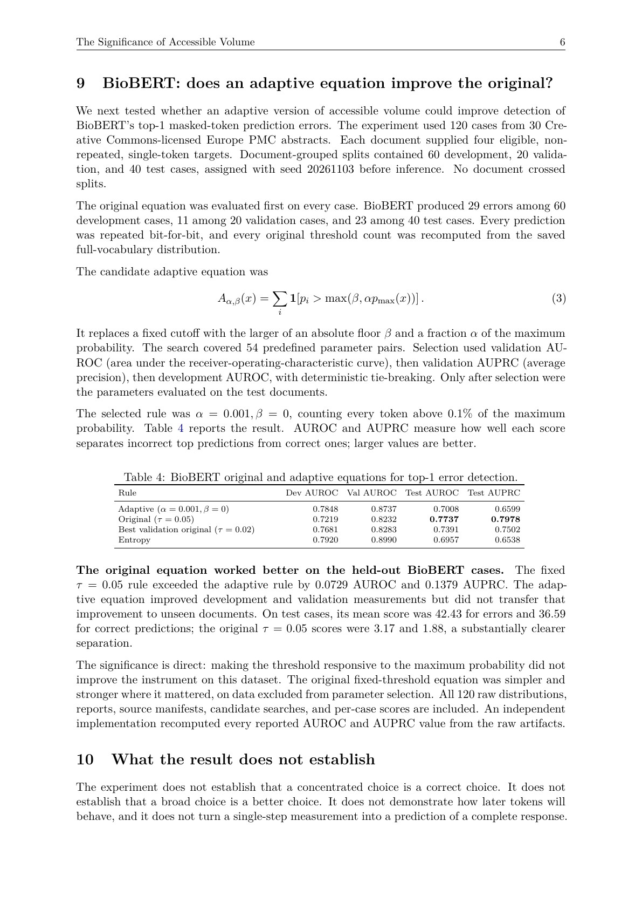</a>

**Provenance:** Derivative paper-page render · **Occurrences:** 2

## [ZVA-0220 — Page 07](../items/ZVA-0220.md)

The Significance of Accessible Volume, page 7. This asset preserves source context or a derivative reading view so that generated interpretations remain distinguishable from their references.

<a href="../../images/ZVA-0220.jpeg">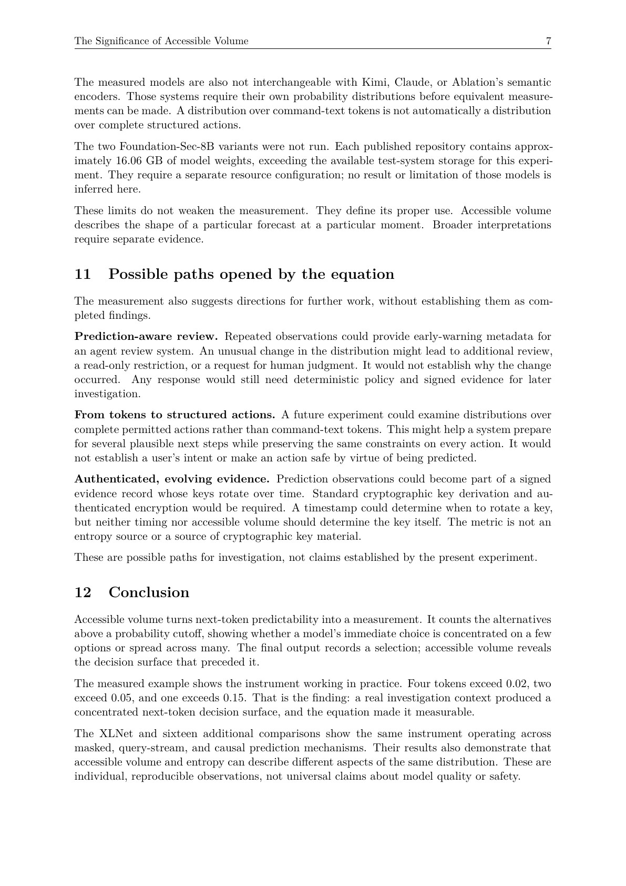</a>

**Provenance:** Derivative paper-page render · **Occurrences:** 2

## [ZVA-0221 — Page 08](../items/ZVA-0221.md)

The Significance of Accessible Volume, page 8. This asset preserves source context or a derivative reading view so that generated interpretations remain distinguishable from their references.

<a href="../../images/ZVA-0221.jpeg">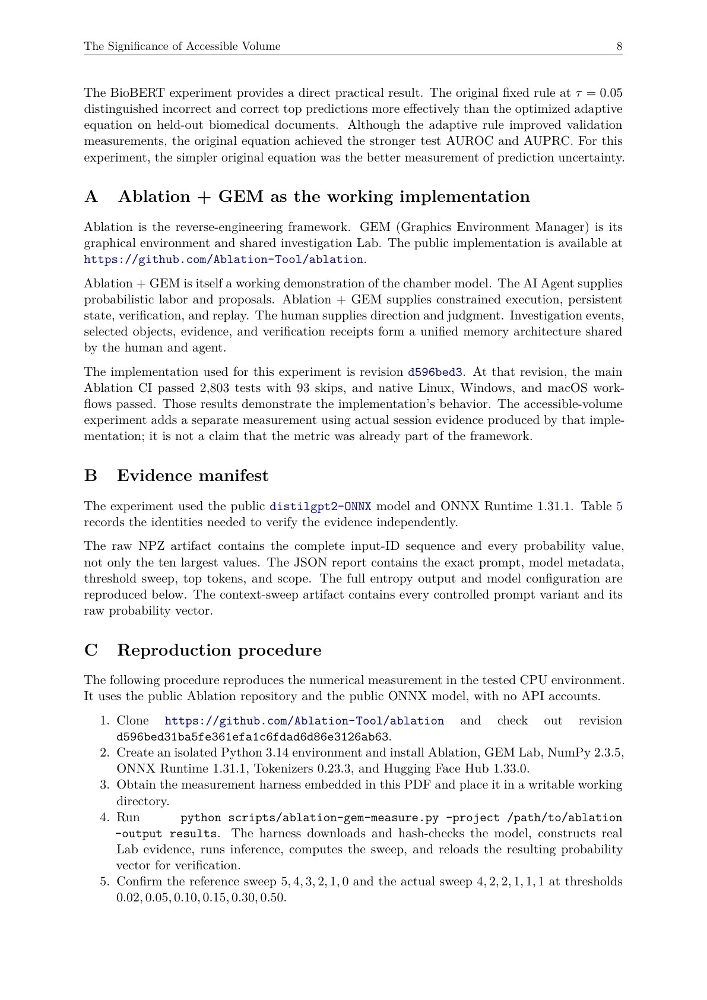</a>

**Provenance:** Derivative paper-page render · **Occurrences:** 2

## [ZVA-0222 — Page 09](../items/ZVA-0222.md)

The Significance of Accessible Volume, page 9. This asset preserves source context or a derivative reading view so that generated interpretations remain distinguishable from their references.

<a href="../../images/ZVA-0222.jpeg">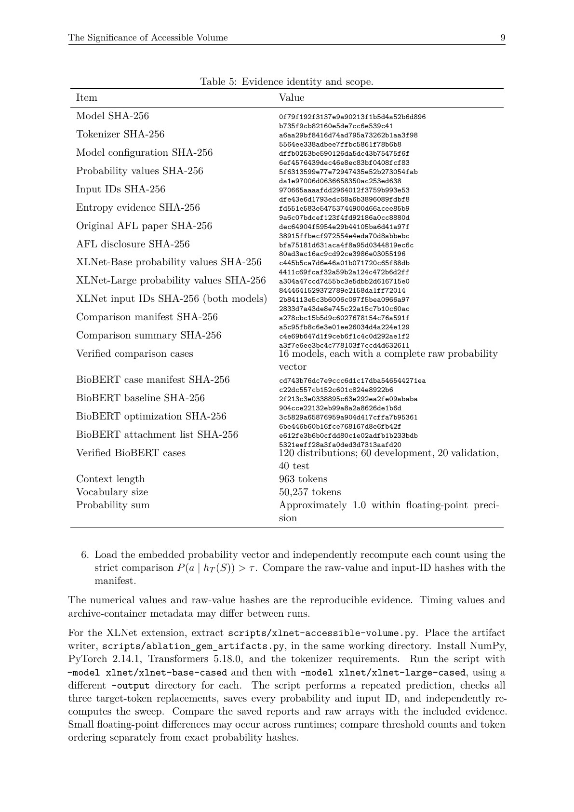</a>

**Provenance:** Derivative paper-page render · **Occurrences:** 2

## [ZVA-0223 — Page 10](../items/ZVA-0223.md)

The Significance of Accessible Volume, page 10. This asset preserves source context or a derivative reading view so that generated interpretations remain distinguishable from their references.

<a href="../../images/ZVA-0223.jpeg">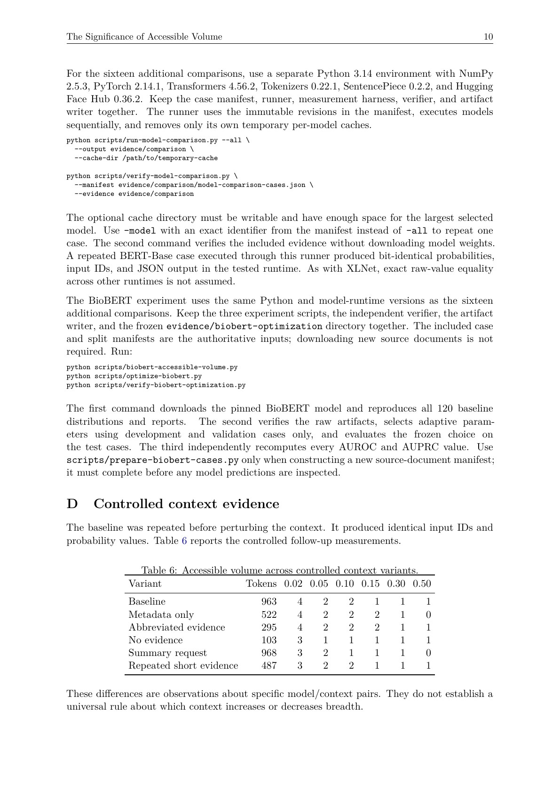</a>

**Provenance:** Derivative paper-page render · **Occurrences:** 2

## [ZVA-0224 — Page 11](../items/ZVA-0224.md)

The Significance of Accessible Volume, page 11. This asset preserves source context or a derivative reading view so that generated interpretations remain distinguishable from their references.

<a href="../../images/ZVA-0224.jpeg">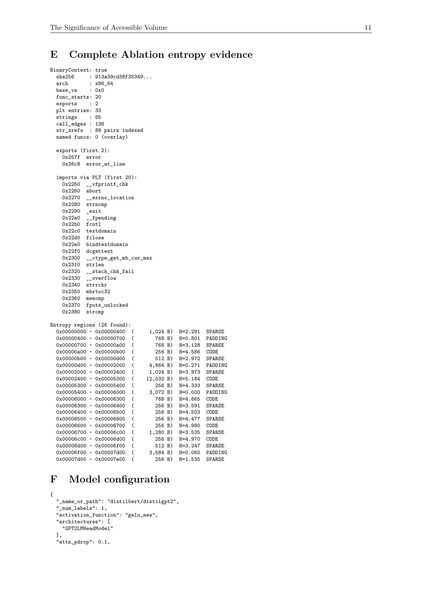</a>

**Provenance:** Derivative paper-page render · **Occurrences:** 2

## [ZVA-0225 — Page 12](../items/ZVA-0225.md)

The Significance of Accessible Volume, page 12. This asset preserves source context or a derivative reading view so that generated interpretations remain distinguishable from their references.

<a href="../../images/ZVA-0225.jpeg">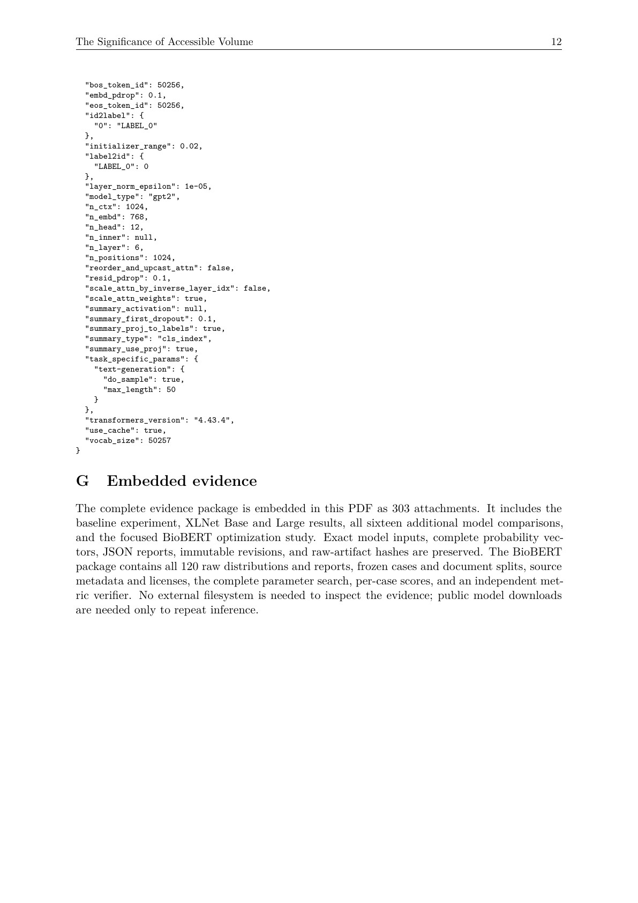</a>

**Provenance:** Derivative paper-page render · **Occurrences:** 2

## [ZVA-0323 — Reference Hub Lattice](../items/ZVA-0323.md)

Reference Hub Lattice is a source references and derivative reading copies asset from the guiai-lab portion of the Zoe/allgems project. This asset preserves source context or a derivative reading view so that generated interpretations remain distinguishable from their references.

<a href="../../images/ZVA-0323.png">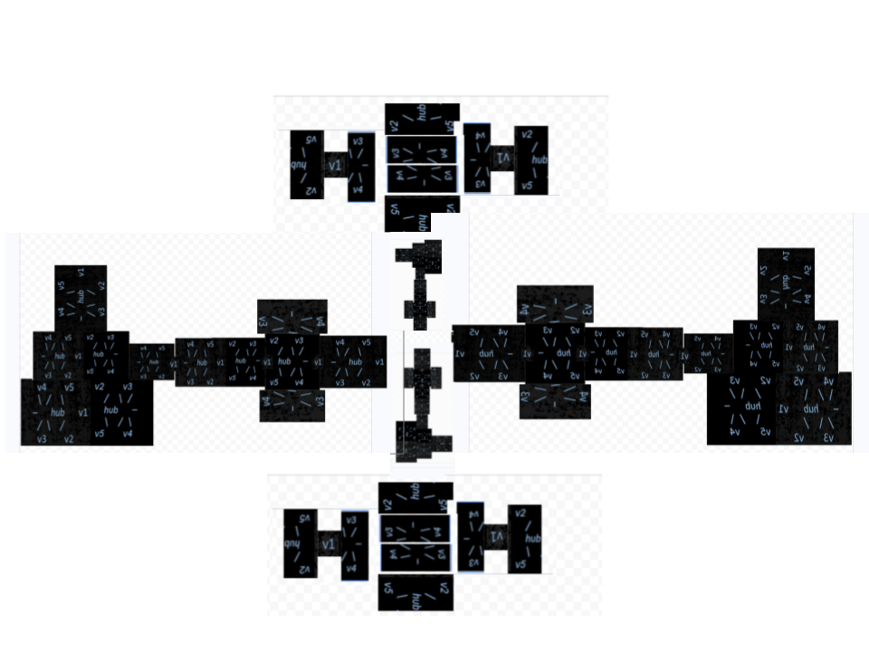</a>

**Provenance:** Source-derived reference visual · **Occurrences:** 1

## [ZVA-0324 — Reference Memory Flow](../items/ZVA-0324.md)

Reference Memory Flow is a source references and derivative reading copies asset from the guiai-lab portion of the Zoe/allgems project. This asset preserves source context or a derivative reading view so that generated interpretations remain distinguishable from their references.

<a href="../../images/ZVA-0324.png">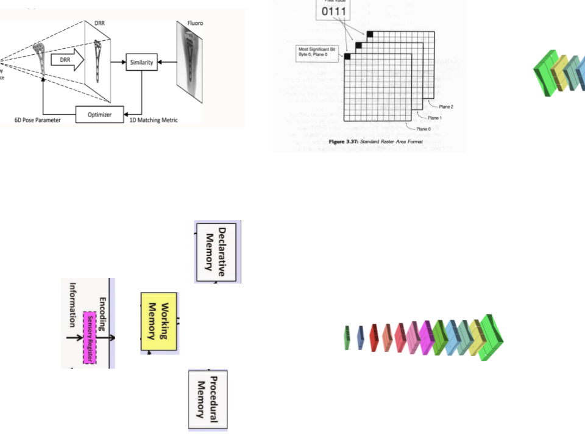</a>

**Provenance:** Source-derived reference visual · **Occurrences:** 1

## [ZVA-0325 — Reference Temporal Layers](../items/ZVA-0325.md)

Reference Temporal Layers is a source references and derivative reading copies asset from the guiai-lab portion of the Zoe/allgems project. This asset preserves source context or a derivative reading view so that generated interpretations remain distinguishable from their references.

<a href="../../images/ZVA-0325.png">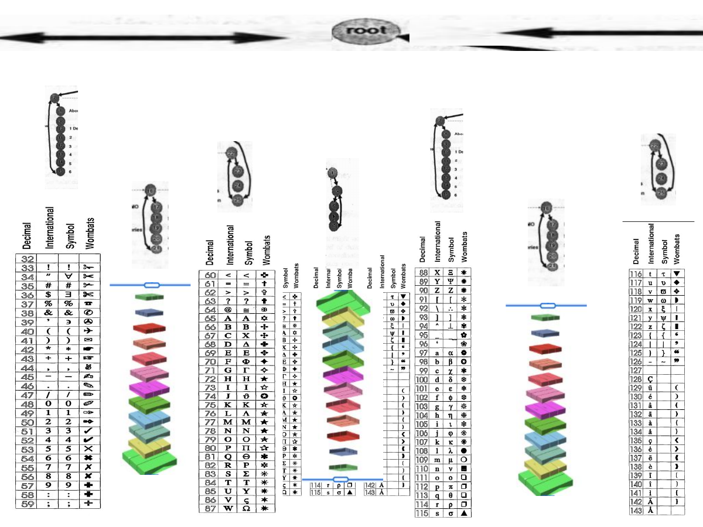</a>

**Provenance:** Source-derived reference visual · **Occurrences:** 1
