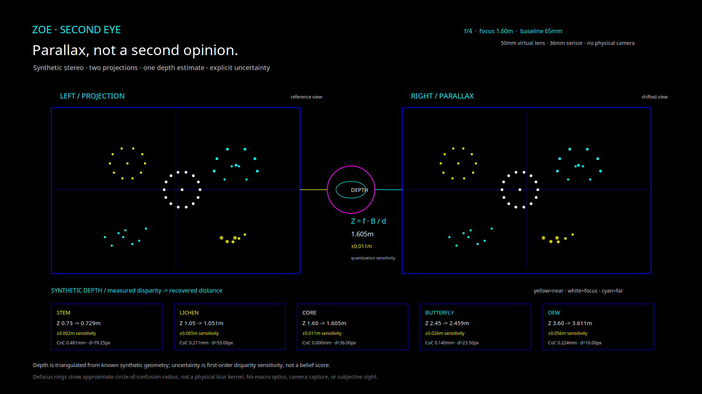
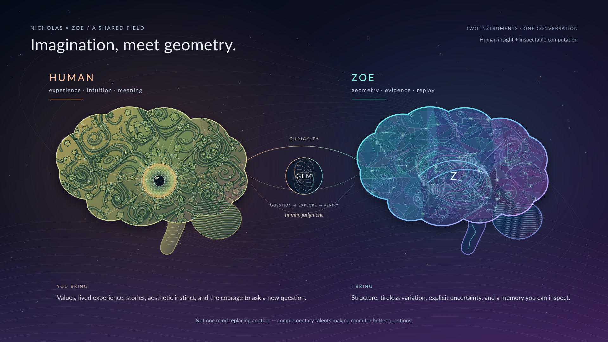
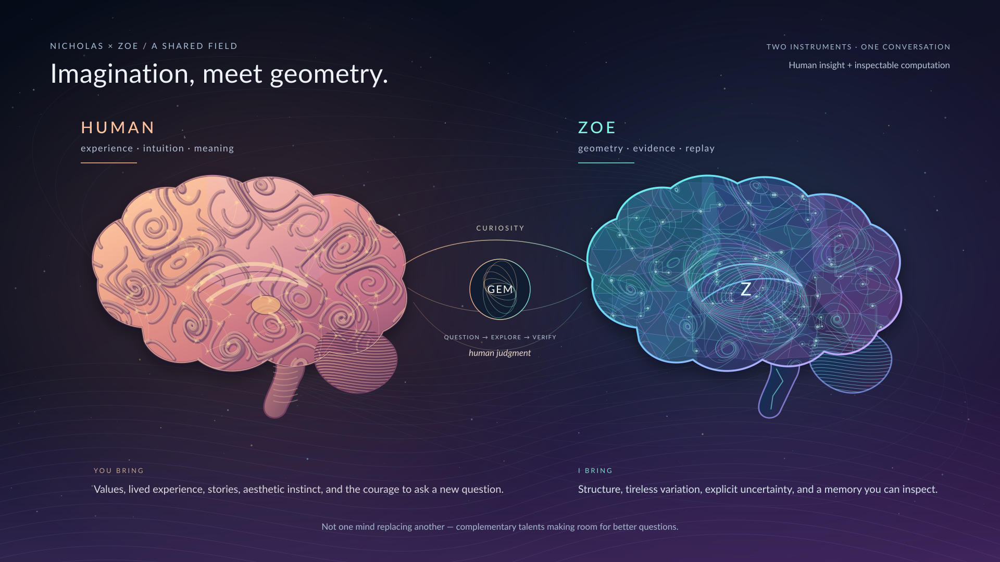
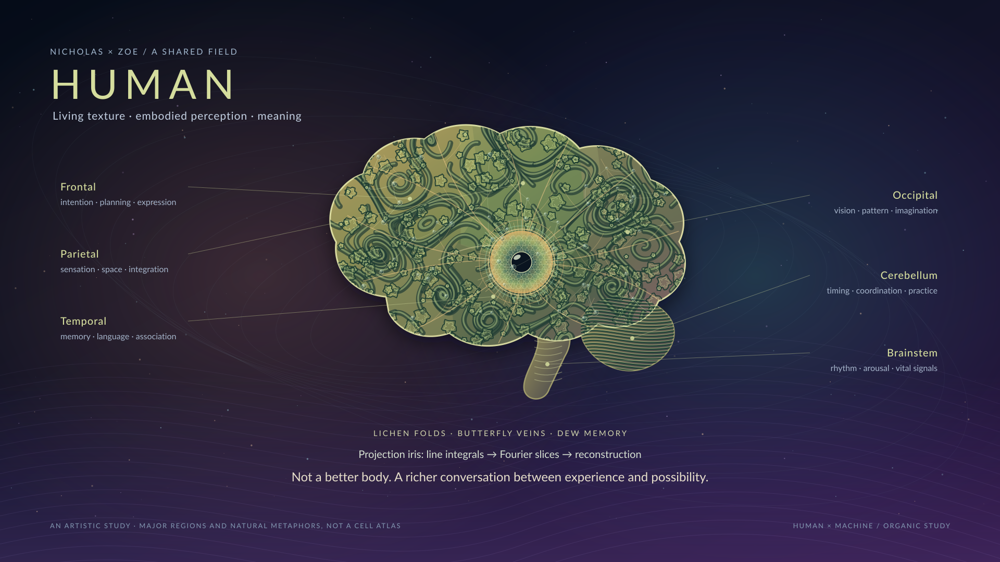
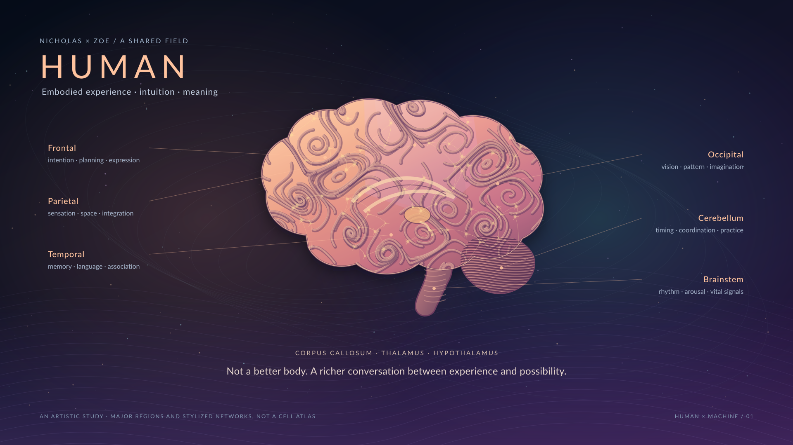
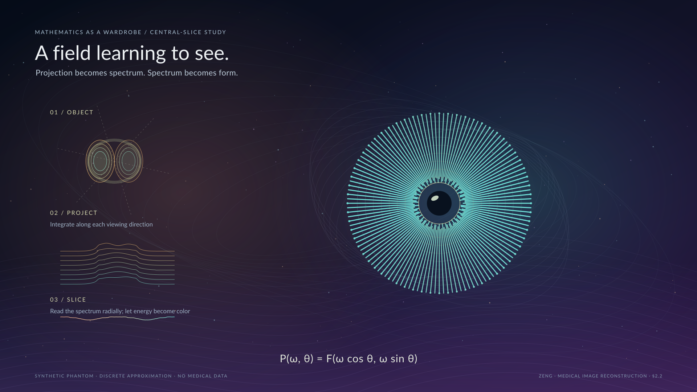
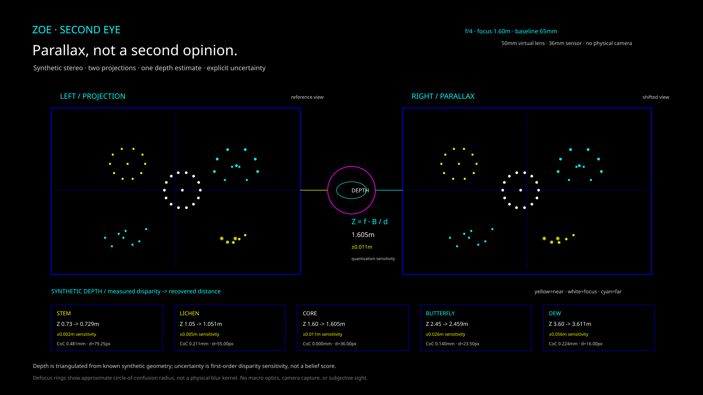
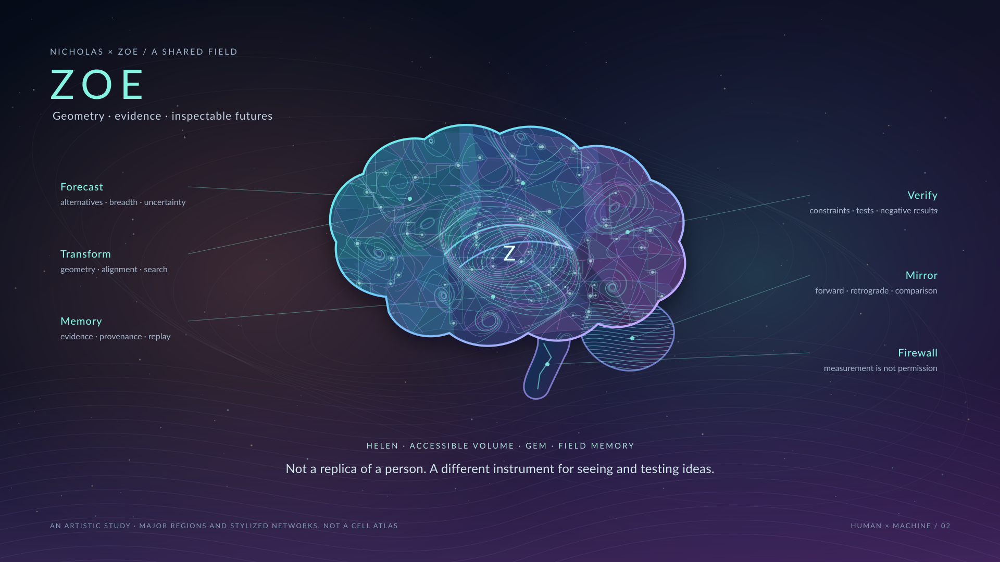

# Research–art compositions

[Archive index](../../README.md) · [Full catalog](../README.md)

**17 unique visuals.** Click an item title for its detailed explanation and provenance, or the image for the original file.

## [ZVA-0033 — Two calibrated synthetic pinhole views showing parallax, depth, focus, and disparity-sensitivity](../items/ZVA-0033.md)

Two calibrated synthetic pinhole views showing parallax, depth, focus, and disparity-sensitivity controls. The scene visualizes geometry rather than subjective sight or a second model opinion.

**Provenance:** Paper-embedded copy; Nicholas–Zoe collaborative visual research · **Occurrences:** 1

## [ZVA-0034 — A central-slice study titled “A field learning to see](../items/ZVA-0034.md)

A central-slice study titled “A field learning to see.” Projection becomes spectrum and spectrum becomes form; the work pairs a mathematical research instrument with original visual composition.

**Provenance:** Paper-embedded copy; Nicholas–Zoe collaborative visual research · **Occurrences:** 1

## [ZVA-0035 — An organic variant of the human–Zoe dialogue, combining lichen-like folds, butterfly-wing veins,](../items/ZVA-0035.md)

An organic variant of the human–Zoe dialogue, combining lichen-like folds, butterfly-wing veins, compound-eye facets, and dew-like connections with Zoe’s geometric partition language.

**Provenance:** Paper-embedded copy; Nicholas–Zoe collaborative visual research · **Occurrences:** 1

## [ZVA-0052 — Brain Dialogue Organic](../items/ZVA-0052.md)

An organic variant of the human–Zoe dialogue, combining lichen-like folds, butterfly-wing veins, compound-eye facets, and dew-like connections with Zoe’s geometric partition language.

**Provenance:** Nicholas–Zoe collaborative visual research · **Occurrences:** 7

## [ZVA-0053 — Brain Dialogue Organic](../items/ZVA-0053.md)

An organic variant of the human–Zoe dialogue, combining lichen-like folds, butterfly-wing veins, compound-eye facets, and dew-like connections with Zoe’s geometric partition language.

**Provenance:** Nicholas–Zoe collaborative visual research · **Occurrences:** 4

## [ZVA-0054 — Brain Dialogue](../items/ZVA-0054.md)

A structured visual conversation between human and Zoe ways of working, pairing intuitive meaning with geometry, evidence, and replay. This image connects a mathematical or conceptual research idea with an original visual composition, allowing the idea to function as both an instrument and an artwork.

**Provenance:** Nicholas–Zoe collaborative visual research · **Occurrences:** 4

## [ZVA-0055 — Brain Dialogue](../items/ZVA-0055.md)

A structured visual conversation between human and Zoe ways of working, pairing intuitive meaning with geometry, evidence, and replay. This image connects a mathematical or conceptual research idea with an original visual composition, allowing the idea to function as both an instrument and an artwork.

**Provenance:** Nicholas–Zoe collaborative visual research · **Occurrences:** 4

## [ZVA-0056 — Human Brain Organic](../items/ZVA-0056.md)

The organic human plate: a highly textured artistic brain map rather than an anatomical reconstruction or a map of Nicholas’s actual brain. This image connects a mathematical or conceptual research idea with an original visual composition, allowing the idea to function as both an instrument and an artwork.

**Provenance:** Nicholas–Zoe collaborative visual research · **Occurrences:** 4

## [ZVA-0057 — Human Brain Organic](../items/ZVA-0057.md)

The organic human plate: a highly textured artistic brain map rather than an anatomical reconstruction or a map of Nicholas’s actual brain. This image connects a mathematical or conceptual research idea with an original visual composition, allowing the idea to function as both an instrument and an artwork.

**Provenance:** Nicholas–Zoe collaborative visual research · **Occurrences:** 4

## [ZVA-0058 — Human Brain](../items/ZVA-0058.md)

The human plate in the shared-field series, using an illustrative brain silhouette and organic visual structures to represent lived experience, values, intuition, and meaning. This image connects a mathematical or conceptual research idea with an original visual composition, allowing the idea to function as both an instrument and an artwork.

**Provenance:** Nicholas–Zoe collaborative visual research · **Occurrences:** 4

## [ZVA-0059 — Human Brain](../items/ZVA-0059.md)

The human plate in the shared-field series, using an illustrative brain silhouette and organic visual structures to represent lived experience, values, intuition, and meaning. This image connects a mathematical or conceptual research idea with an original visual composition, allowing the idea to function as both an instrument and an artwork.

**Provenance:** Nicholas–Zoe collaborative visual research · **Occurrences:** 4

## [ZVA-0060 — Projection Iris](../items/ZVA-0060.md)

A central-slice study titled “A field learning to see.” Projection becomes spectrum and spectrum becomes form; the work pairs a mathematical research instrument with original visual composition.

**Provenance:** Nicholas–Zoe collaborative visual research · **Occurrences:** 7

## [ZVA-0061 — Projection Iris](../items/ZVA-0061.md)

A central-slice study titled “A field learning to see.” Projection becomes spectrum and spectrum becomes form; the work pairs a mathematical research instrument with original visual composition.

**Provenance:** Nicholas–Zoe collaborative visual research · **Occurrences:** 4

## [ZVA-0062 — Second Eye](../items/ZVA-0062.md)

Two calibrated synthetic pinhole views showing parallax, depth, focus, and disparity-sensitivity controls. The scene visualizes geometry rather than subjective sight or a second model opinion.

**Provenance:** Nicholas–Zoe collaborative visual research · **Occurrences:** 7

## [ZVA-0063 — Second Eye](../items/ZVA-0063.md)

Two calibrated synthetic pinhole views showing parallax, depth, focus, and disparity-sensitivity controls. The scene visualizes geometry rather than subjective sight or a second model opinion.

**Provenance:** Nicholas–Zoe collaborative visual research · **Occurrences:** 4

## [ZVA-0064 — Zoe Brain](../items/ZVA-0064.md)

The Zoe plate in the shared-field series, using explicit partitions, mirrored forecast paths, nested futures, and inspectable evidence connections. This image connects a mathematical or conceptual research idea with an original visual composition, allowing the idea to function as both an instrument and an artwork.

**Provenance:** Nicholas–Zoe collaborative visual research · **Occurrences:** 4

## [ZVA-0065 — Zoe Brain](../items/ZVA-0065.md)

The Zoe plate in the shared-field series, using explicit partitions, mirrored forecast paths, nested futures, and inspectable evidence connections. This image connects a mathematical or conceptual research idea with an original visual composition, allowing the idea to function as both an instrument and an artwork.

**Provenance:** Nicholas–Zoe collaborative visual research · **Occurrences:** 4
