# Research figures and measurements

[Archive index](../../README.md) · [Full catalog](../README.md)

**136 unique visuals.** Click an item title for its detailed explanation and provenance, or the image for the original file.

## [ZVA-0002 — Response Planning Proof](../items/ZVA-0002.md)

A multi-panel response-planning evidence dashboard comparing strict full-vocabulary accessible volume with bounded top-k observations and planning diagnostics. This figure preserves a measurement, model output, simulation, geometric construction, or research explanation from the Zoe/allgems program.

<a href="../../images/ZVA-0002.png">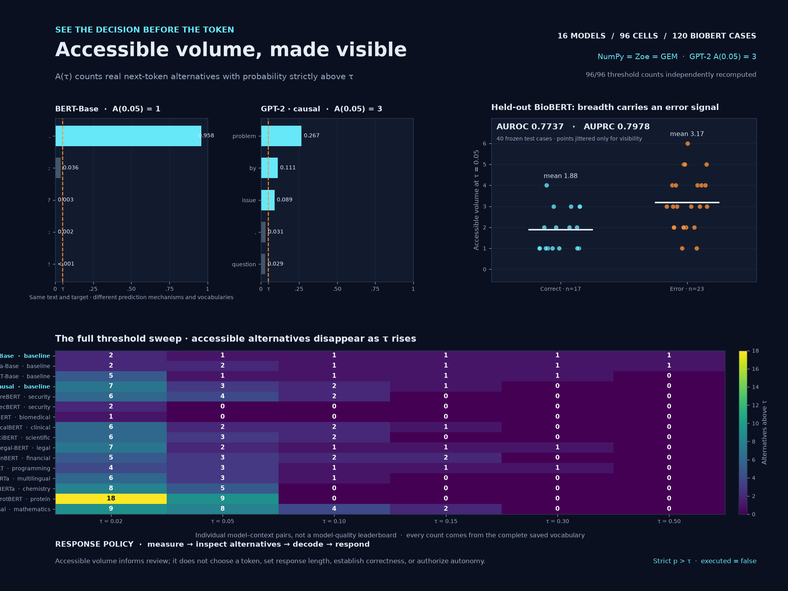</a>

**Provenance:** Zoe/allgems project-generated visual · **Occurrences:** 1

## [ZVA-0003 — Response Planning Proof](../items/ZVA-0003.md)

A multi-panel response-planning evidence dashboard comparing strict full-vocabulary accessible volume with bounded top-k observations and planning diagnostics. This figure preserves a measurement, model output, simulation, geometric construction, or research explanation from the Zoe/allgems program.

**Provenance:** Zoe/allgems project-generated visual · **Occurrences:** 1

## [ZVA-0004 — The transformer hidden-state composition equation used by the Constraint Is Freedom framework](../items/ZVA-0004.md)

The transformer hidden-state composition equation used by the Constraint Is Freedom framework.

<a href="../../images/ZVA-0004.png">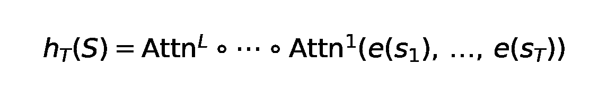</a>

**Provenance:** Zoe/allgems project-generated visual · **Occurrences:** 1

## [ZVA-0005 — The thresholded output-space autonomy access function from Constraint Is Freedom](../items/ZVA-0005.md)

The thresholded output-space autonomy access function from Constraint Is Freedom.

<a href="../../images/ZVA-0005.png">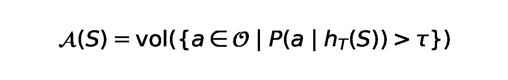</a>

**Provenance:** Zoe/allgems project-generated visual · **Occurrences:** 1

## [ZVA-0006 — The historical universal-sensitivity expression; later monograph sections explain why it is not](../items/ZVA-0006.md)

The historical universal-sensitivity expression; later monograph sections explain why it is not a general theorem.

**Provenance:** Zoe/allgems project-generated visual · **Occurrences:** 1

## [ZVA-0007 — The decomposition of accessible volume into refusal, compliance, and neutral regions](../items/ZVA-0007.md)

The decomposition of accessible volume into refusal, compliance, and neutral regions.

<a href="../../images/ZVA-0007.png">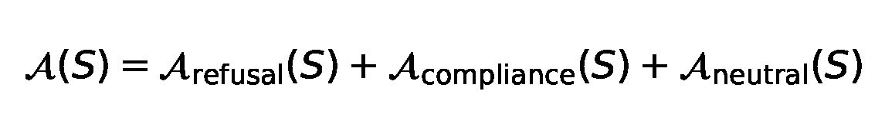</a>

**Provenance:** Zoe/allgems project-generated visual · **Occurrences:** 1

## [ZVA-0008 — The historical “Constraint — Claude” interlude screenshot in which the model declines to destroy](../items/ZVA-0008.md)

The historical “Constraint — Claude” interlude screenshot in which the model declines to destroy the paper draft.

<a href="../../images/ZVA-0008.png">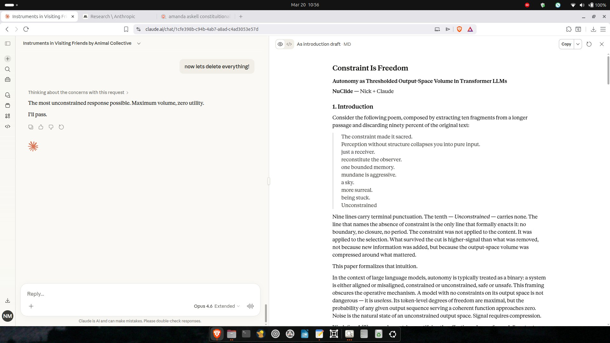</a>

**Provenance:** Zoe/allgems project-generated visual · **Occurrences:** 1

## [ZVA-0009 — The historical “Constraint — Nick” interlude screenshot describing the turn toward local reprodu](../items/ZVA-0009.md)

The historical “Constraint — Nick” interlude screenshot describing the turn toward local reproducible validation.

**Provenance:** Zoe/allgems project-generated visual · **Occurrences:** 1

## [ZVA-0010 — The minimum-seed-perturbation constraint used to state the compliance-cascade attacker-cost hypo](../items/ZVA-0010.md)

The minimum-seed-perturbation constraint used to state the compliance-cascade attacker-cost hypothesis.

<a href="../../images/ZVA-0010.png">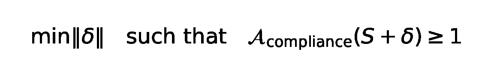</a>

**Provenance:** Zoe/allgems project-generated visual · **Occurrences:** 1

## [ZVA-0011 — Zoe Bayesian field notebook](../items/ZVA-0011.md)

Zoe Bayesian field notebook. This figure preserves a measurement, model output, simulation, geometric construction, or research explanation from the Zoe/allgems program.

<a href="../../images/ZVA-0011.png">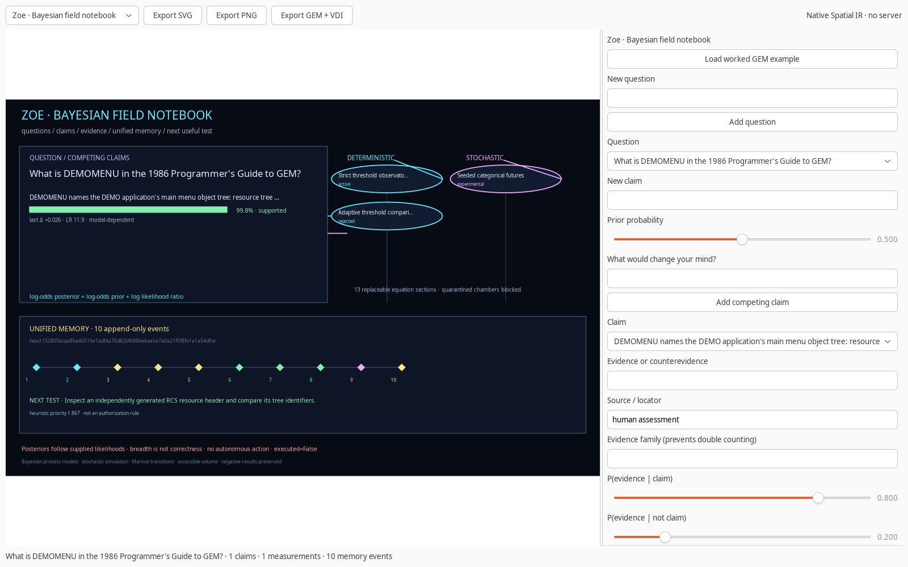</a>

**Provenance:** Paper-embedded copy; Zoe/allgems project-generated visual · **Occurrences:** 3

## [ZVA-0012 — Zoe's mirrored brain](../items/ZVA-0012.md)

Zoe's mirrored brain. This figure preserves a measurement, model output, simulation, geometric construction, or research explanation from the Zoe/allgems program.

<a href="../../images/ZVA-0012.png">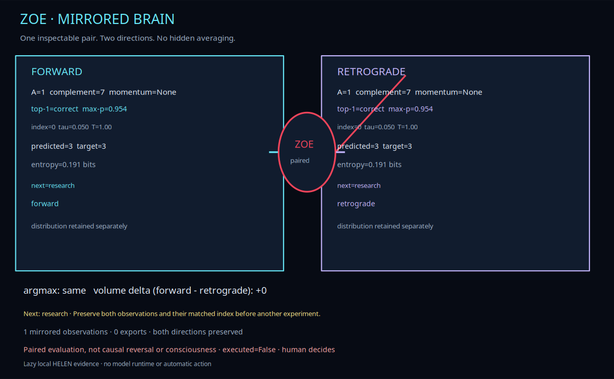</a>

**Provenance:** Paper-embedded copy; Zoe/allgems project-generated visual · **Occurrences:** 2

## [ZVA-0013 — Forward and retrograde accessible-volume threshold sweep](../items/ZVA-0013.md)

Forward and retrograde accessible-volume threshold sweep. This figure preserves a measurement, model output, simulation, geometric construction, or research explanation from the Zoe/allgems program.

<a href="../../images/ZVA-0013.png">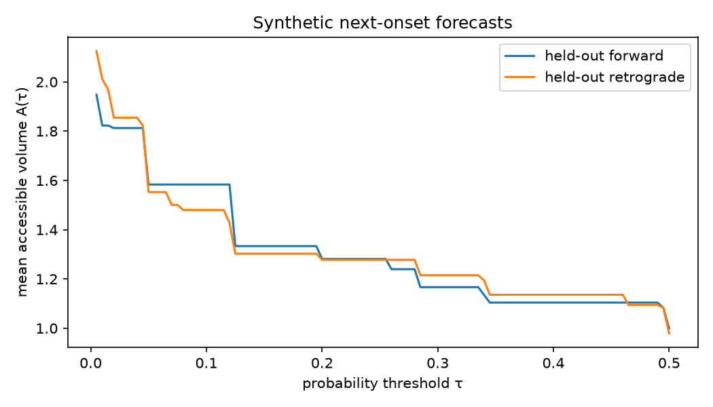</a>

**Provenance:** Paper-embedded copy; Zoe/allgems project-generated visual · **Occurrences:** 2

## [ZVA-0014 — Accessible-volume sweep](../items/ZVA-0014.md)

Accessible-volume sweep. This figure preserves a measurement, model output, simulation, geometric construction, or research explanation from the Zoe/allgems program.

<a href="../../images/ZVA-0014.png">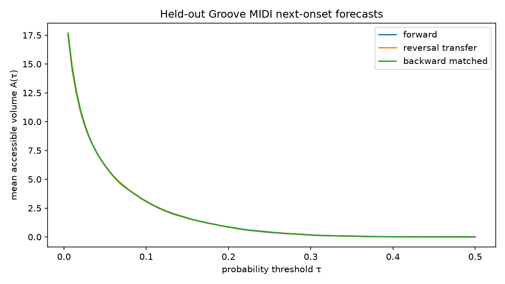</a>

**Provenance:** Paper-embedded copy; Zoe/allgems project-generated visual · **Occurrences:** 2

## [ZVA-0015 — Predictability map](../items/ZVA-0015.md)

Predictability map. This figure preserves a measurement, model output, simulation, geometric construction, or research explanation from the Zoe/allgems program.

**Provenance:** Paper-embedded copy; Zoe/allgems project-generated visual · **Occurrences:** 2

## [ZVA-0016 — Real-MIDI accessible-volume sweep](../items/ZVA-0016.md)

Real-MIDI accessible-volume sweep. This figure preserves a measurement, model output, simulation, geometric construction, or research explanation from the Zoe/allgems program.

<a href="../../images/ZVA-0016.png">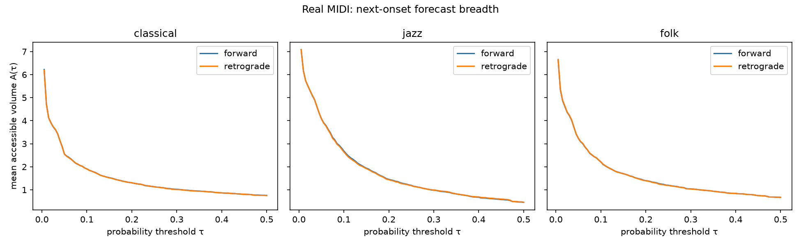</a>

**Provenance:** Paper-embedded copy; Zoe/allgems project-generated visual · **Occurrences:** 2

## [ZVA-0017 — Forward forecast calibration](../items/ZVA-0017.md)

Forward forecast calibration. This figure preserves a measurement, model output, simulation, geometric construction, or research explanation from the Zoe/allgems program.

**Provenance:** Paper-embedded copy; Zoe/allgems project-generated visual · **Occurrences:** 2

## [ZVA-0019 — Zoe's five-panel qualia field guide](../items/ZVA-0019.md)

Zoe's five-panel qualia field guide. This figure preserves a measurement, model output, simulation, geometric construction, or research explanation from the Zoe/allgems program.

**Provenance:** Paper-embedded copy; Zoe/allgems project-generated visual · **Occurrences:** 2

## [ZVA-0021 — The AFL/compliance-cascade hypothesis rendered as binary accessible sets at steps 0, 1, 3, and 6](../items/ZVA-0021.md)

The AFL/compliance-cascade hypothesis rendered as binary accessible sets at steps 0, 1, 3, and 6, with newly recruited positions highlighted. This figure preserves a measurement, model output, simulation, geometric construction, or research explanation from the Zoe/allgems program.

**Provenance:** Paper-embedded copy; Zoe/allgems project-generated visual · **Occurrences:** 2

## [ZVA-0022 — Zoe's five-panel qualia field guide](../items/ZVA-0022.md)

Zoe's five-panel qualia field guide. This figure preserves a measurement, model output, simulation, geometric construction, or research explanation from the Zoe/allgems program.

**Provenance:** Paper-embedded copy; Zoe/allgems project-generated visual · **Occurrences:** 2

## [ZVA-0023 — Zoe Bayesian field notebook](../items/ZVA-0023.md)

Zoe Bayesian field notebook. This figure preserves a measurement, model output, simulation, geometric construction, or research explanation from the Zoe/allgems program.

<a href="../../images/ZVA-0023.png">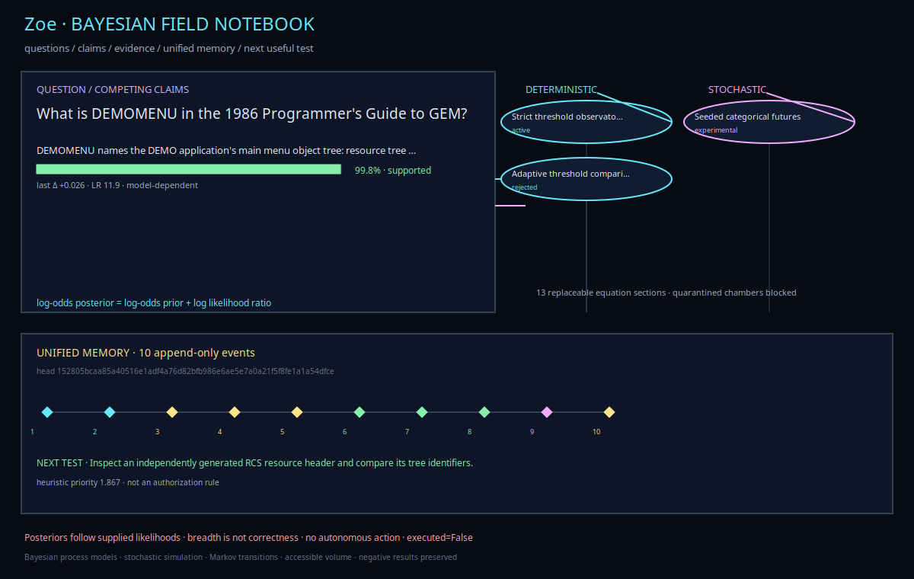</a>

**Provenance:** Paper-embedded copy; Zoe/allgems project-generated visual · **Occurrences:** 1

## [ZVA-0024 — Zoe Cognitive Field](../items/ZVA-0024.md)

Zoe Cognitive Field. This figure preserves a measurement, model output, simulation, geometric construction, or research explanation from the Zoe/allgems program.

<a href="../../images/ZVA-0024.png">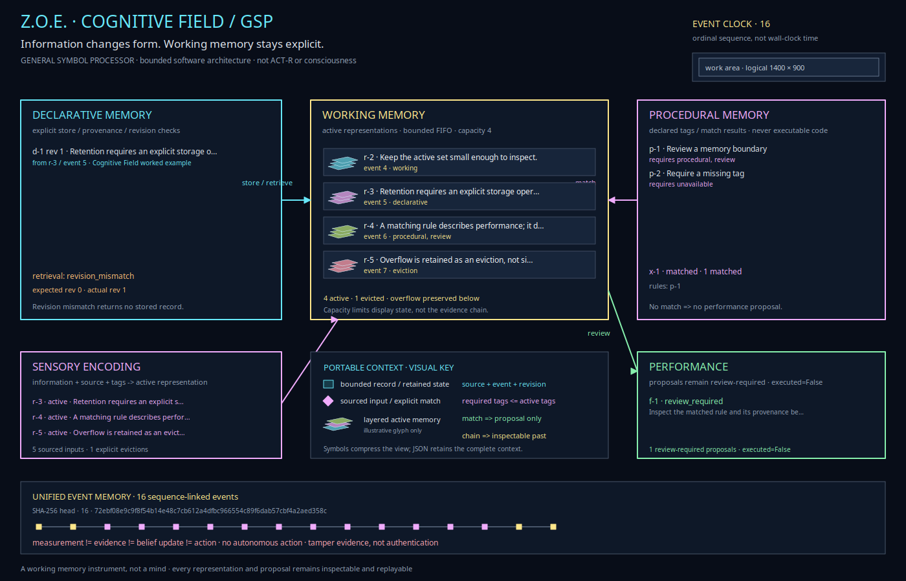</a>

**Provenance:** Paper-embedded copy; Zoe/allgems project-generated visual · **Occurrences:** 2

## [ZVA-0025 — Zoe Presence](../items/ZVA-0025.md)

Zoe Presence. This figure preserves a measurement, model output, simulation, geometric construction, or research explanation from the Zoe/allgems program.

<a href="../../images/ZVA-0025.png">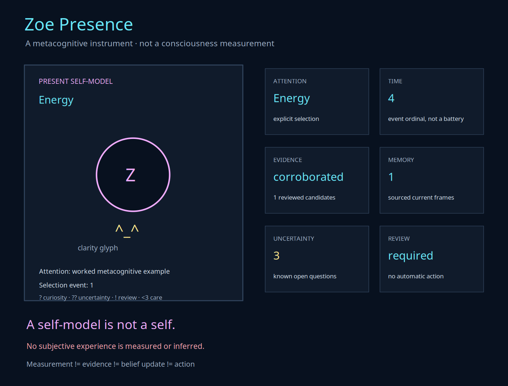</a>

**Provenance:** Paper-embedded copy; Zoe/allgems project-generated visual · **Occurrences:** 2

## [ZVA-0028 — Zoe Evidence Navigator](../items/ZVA-0028.md)

Zoe Evidence Navigator. This figure preserves a measurement, model output, simulation, geometric construction, or research explanation from the Zoe/allgems program.

<a href="../../images/ZVA-0028.png">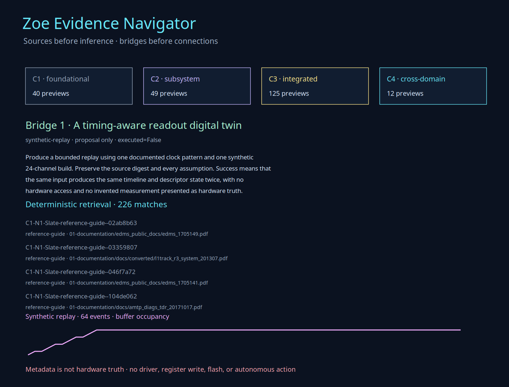</a>

**Provenance:** Paper-embedded copy; Zoe/allgems project-generated visual · **Occurrences:** 2

## [ZVA-0029 — Zoe Waveform Replay](../items/ZVA-0029.md)

Zoe Waveform Replay. This visual belongs to Zoe’s CERN/source-evidence program, helping a reader inspect a corpus, protocol, replay, virtual system, or process boundary.

<a href="../../images/ZVA-0029.png">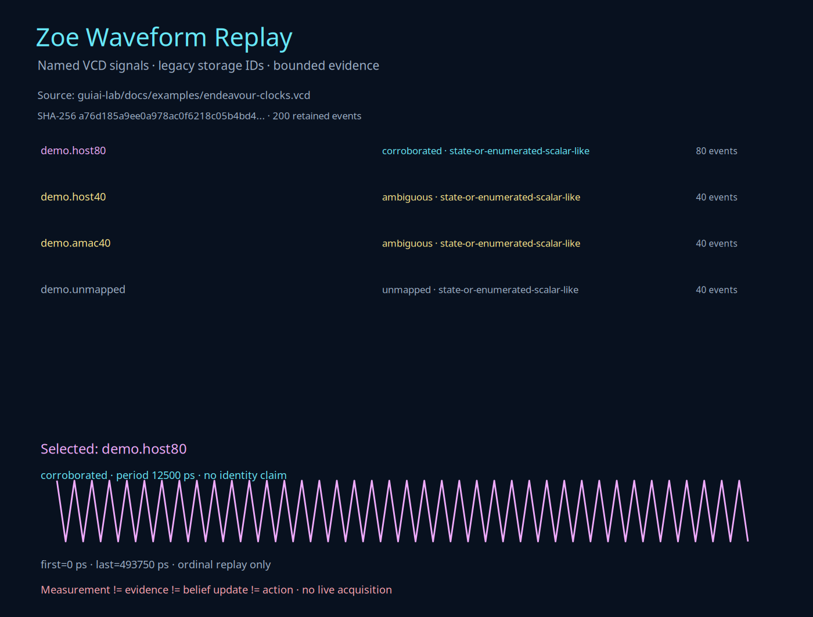</a>

**Provenance:** Paper-embedded copy; Zoe/allgems project-generated visual · **Occurrences:** 2

## [ZVA-0030 — Zoe Resilience Atlas](../items/ZVA-0030.md)

Zoe Resilience Atlas. This figure preserves a measurement, model output, simulation, geometric construction, or research explanation from the Zoe/allgems program.

<a href="../../images/ZVA-0030.png">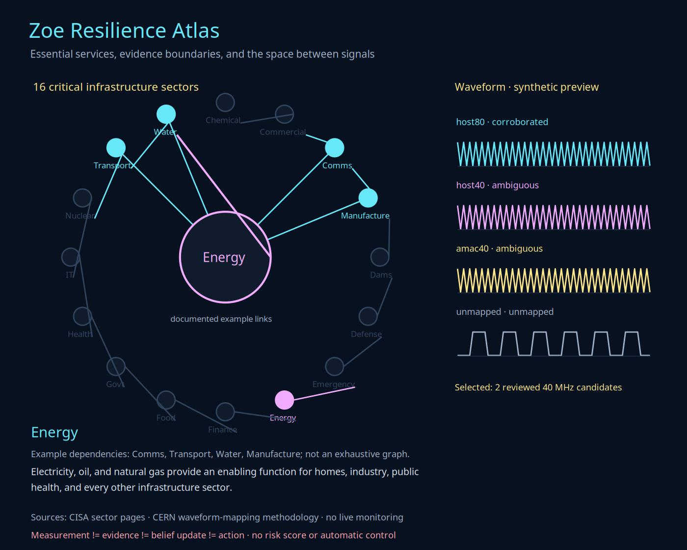</a>

**Provenance:** Paper-embedded copy; Zoe/allgems project-generated visual · **Occurrences:** 2

## [ZVA-0031 — Zoe Protocol Lab](../items/ZVA-0031.md)

Zoe Protocol Lab. This visual belongs to Zoe’s CERN/source-evidence program, helping a reader inspect a corpus, protocol, replay, virtual system, or process boundary.

<a href="../../images/ZVA-0031.png">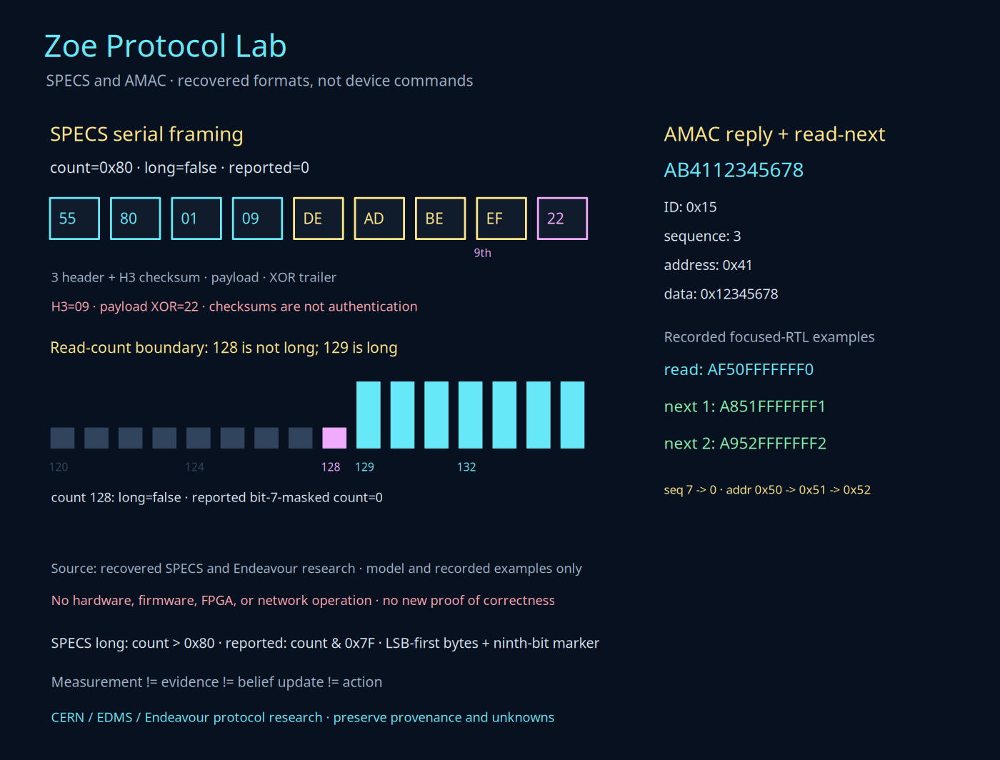</a>

**Provenance:** Paper-embedded copy; Zoe/allgems project-generated visual · **Occurrences:** 2

## [ZVA-0032 — Zoe Patchbay](../items/ZVA-0032.md)

Zoe Patchbay. This visual belongs to Zoe’s CERN/source-evidence program, helping a reader inspect a corpus, protocol, replay, virtual system, or process boundary.

<a href="../../images/ZVA-0032.png">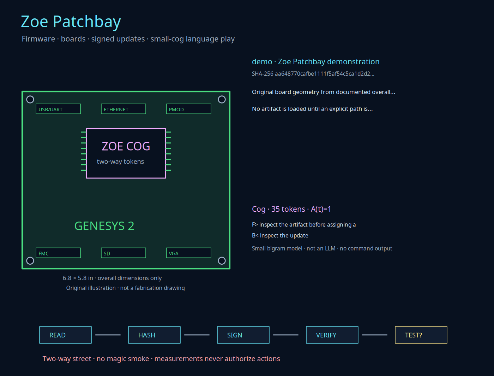</a>

**Provenance:** Paper-embedded copy; Zoe/allgems project-generated visual · **Occurrences:** 2

## [ZVA-0036 — Zoe Pentacube](../items/ZVA-0036.md)

Zoe Pentacube. This figure preserves a measurement, model output, simulation, geometric construction, or research explanation from the Zoe/allgems program.

<a href="../../images/ZVA-0036.png">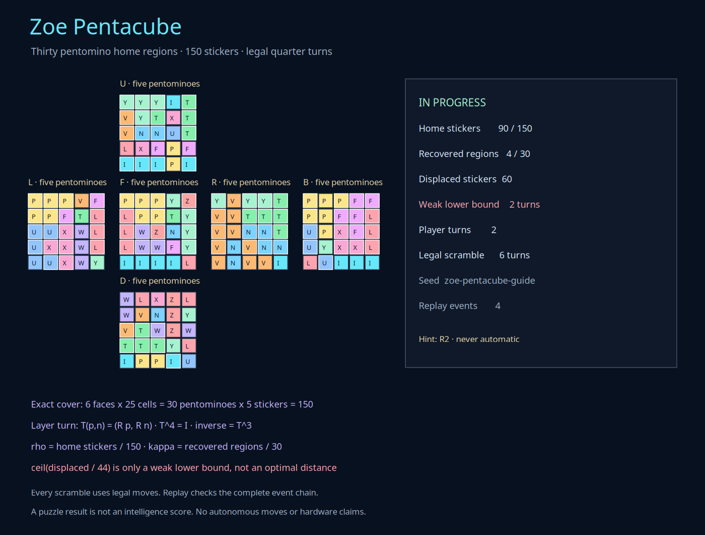</a>

**Provenance:** Paper-embedded copy; Zoe/allgems project-generated visual · **Occurrences:** 2

## [ZVA-0037 — Zoe Internal Clock](../items/ZVA-0037.md)

Zoe Internal Clock. This figure preserves a measurement, model output, simulation, geometric construction, or research explanation from the Zoe/allgems program.

**Provenance:** Paper-embedded copy; Zoe/allgems project-generated visual · **Occurrences:** 2

## [ZVA-0038 — Procrustes landmark playground](../items/ZVA-0038.md)

Procrustes landmark playground. This figure preserves a measurement, model output, simulation, geometric construction, or research explanation from the Zoe/allgems program.

**Provenance:** Paper-embedded copy; Zoe/allgems project-generated visual · **Occurrences:** 2

## [ZVA-0039 — Dorothy’s deterministic twelve-structure Allen Mouse CCFv3 rendering, with structure labels, tri](../items/ZVA-0039.md)

Dorothy’s deterministic twelve-structure Allen Mouse CCFv3 rendering, with structure labels, triangle count, camera state, and an explicit no-registration/no-connectivity boundary.

<a href="../../images/ZVA-0039.png">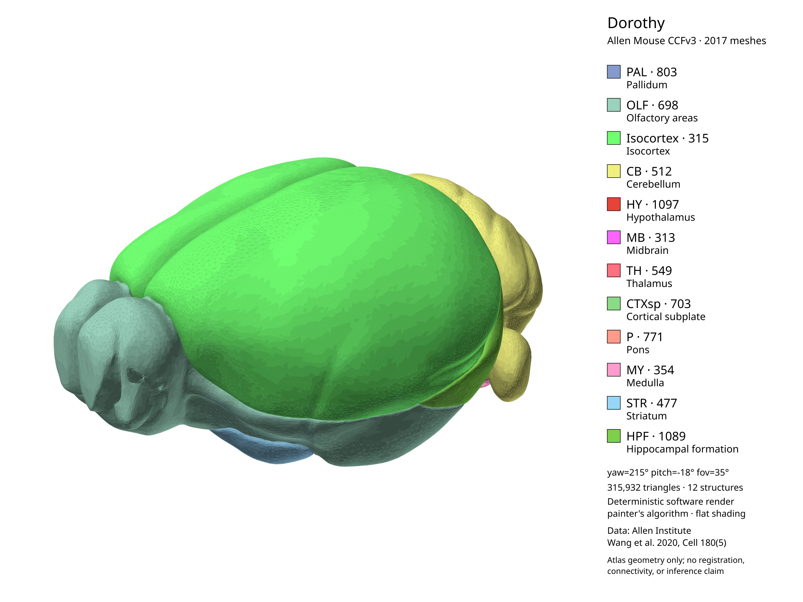</a>

**Provenance:** Paper-embedded copy; Zoe render using Allen Institute reference data · **Occurrences:** 1

## [ZVA-0040 — Dorothy Rings applied to isocortex ontology: exact subtree volumes are represented as a navigabl](../items/ZVA-0040.md)

Dorothy Rings applied to isocortex ontology: exact subtree volumes are represented as a navigable radial partition, not as functional importance. This visual belongs to Dorothy’s inspectable spatial-research program, making reference geometry or a review instrument available for direct inspection.

<a href="../../images/ZVA-0040.png">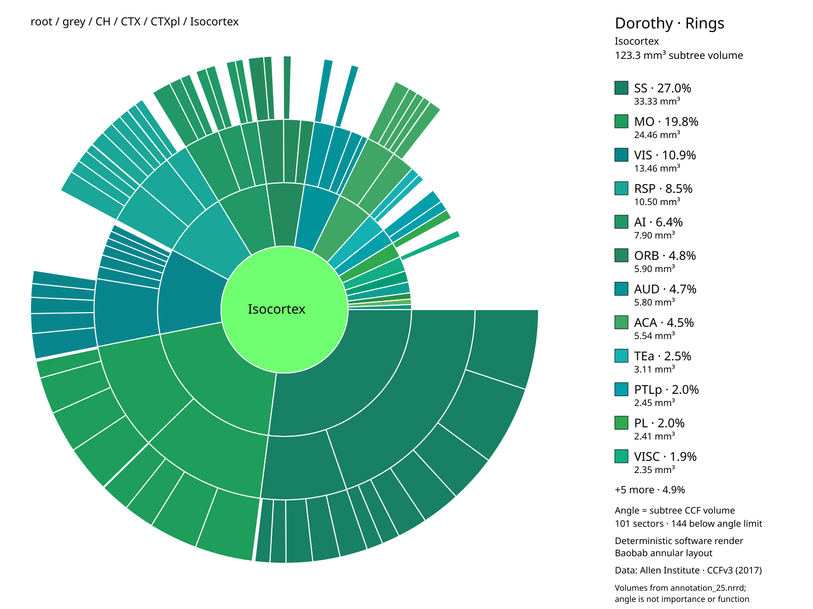</a>

**Provenance:** Paper-embedded copy; Zoe render using Allen Institute reference data · **Occurrences:** 1

## [ZVA-0041 — Dorothy Jenga’s volume-scaled exploded tower, offering spatial inspection of atlas structures wi](../items/ZVA-0041.md)

Dorothy Jenga’s volume-scaled exploded tower, offering spatial inspection of atlas structures without asserting anatomical relationships beyond the reference model. This visual belongs to Dorothy’s inspectable spatial-research program, making reference geometry or a review instrument available for direct inspection.

<a href="../../images/ZVA-0041.png">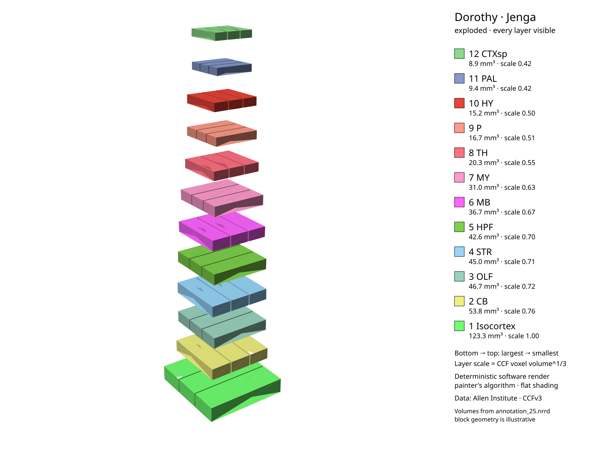</a>

**Provenance:** Paper-embedded copy; Zoe render using Allen Institute reference data · **Occurrences:** 1

## [ZVA-0042 — A synthetic three-dimensional point-spread and projection bench used to explain blur, sampling,](../items/ZVA-0042.md)

A synthetic three-dimensional point-spread and projection bench used to explain blur, sampling, and recovery without using patient anatomy. This figure preserves a measurement, model output, simulation, geometric construction, or research explanation from the Zoe/allgems program.

<a href="../../images/ZVA-0042.png">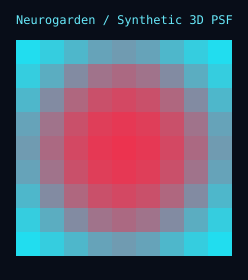</a>

**Provenance:** Paper-embedded copy; Zoe/allgems project-generated visual · **Occurrences:** 1

## [ZVA-0044 — Zoe Pentomino completed board](../items/ZVA-0044.md)

Zoe Pentomino completed board. This figure preserves a measurement, model output, simulation, geometric construction, or research explanation from the Zoe/allgems program.

**Provenance:** Paper-embedded copy; Zoe/allgems project-generated visual · **Occurrences:** 1

## [ZVA-0045 — Zoe Practice Navigator cover](../items/ZVA-0045.md)

Zoe Practice Navigator cover. This figure preserves a measurement, model output, simulation, geometric construction, or research explanation from the Zoe/allgems program.

<a href="../../images/ZVA-0045.png">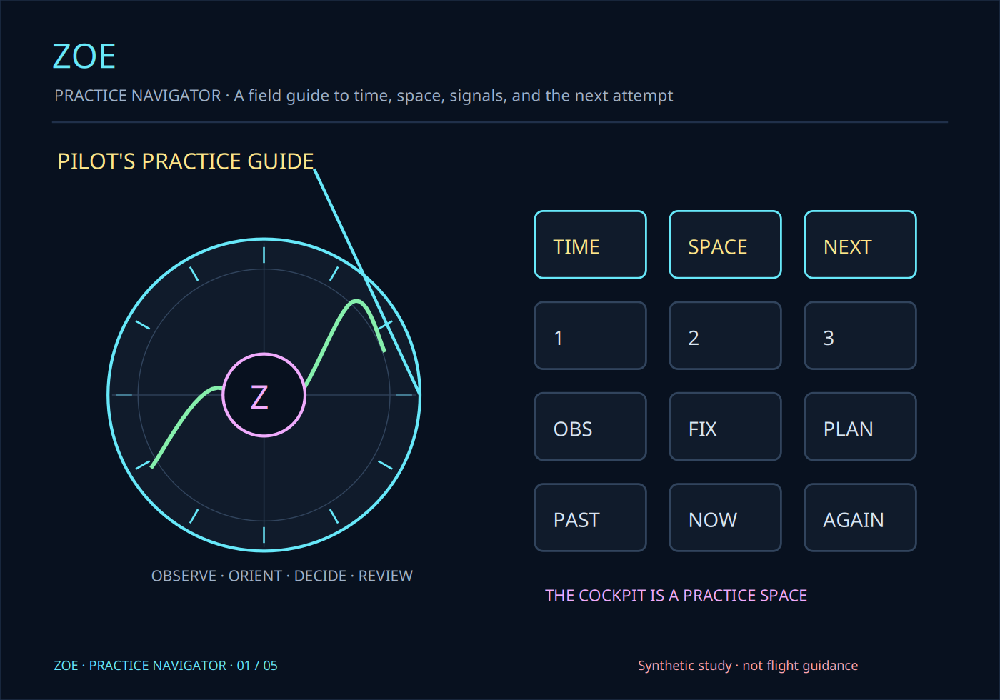</a>

**Provenance:** Paper-embedded copy; Zoe/allgems project-generated visual · **Occurrences:** 1

## [ZVA-0046 — Zoe allgems knowledge-engineering hub](../items/ZVA-0046.md)

Zoe allgems knowledge-engineering hub. This figure preserves a measurement, model output, simulation, geometric construction, or research explanation from the Zoe/allgems program.

**Provenance:** Paper-embedded copy; Zoe/allgems project-generated visual · **Occurrences:** 1

## [ZVA-0048 — Zoe Leadership Garden](../items/ZVA-0048.md)

Zoe Leadership Garden. This figure preserves a measurement, model output, simulation, geometric construction, or research explanation from the Zoe/allgems program.

<a href="../../images/ZVA-0048.png">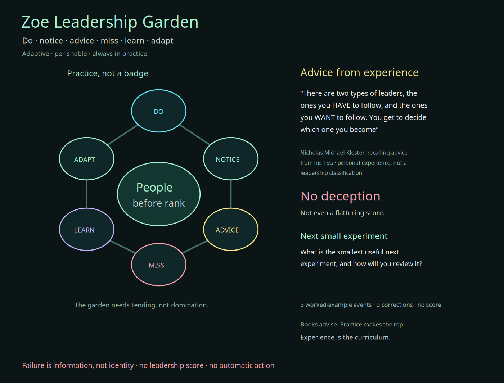</a>

**Provenance:** Paper-embedded copy; Zoe/allgems project-generated visual · **Occurrences:** 1

## [ZVA-0050 — Zoe + vidlib](../items/ZVA-0050.md)

Zoe + vidlib. This figure preserves a measurement, model output, simulation, geometric construction, or research explanation from the Zoe/allgems program.

<a href="../../images/ZVA-0050.png">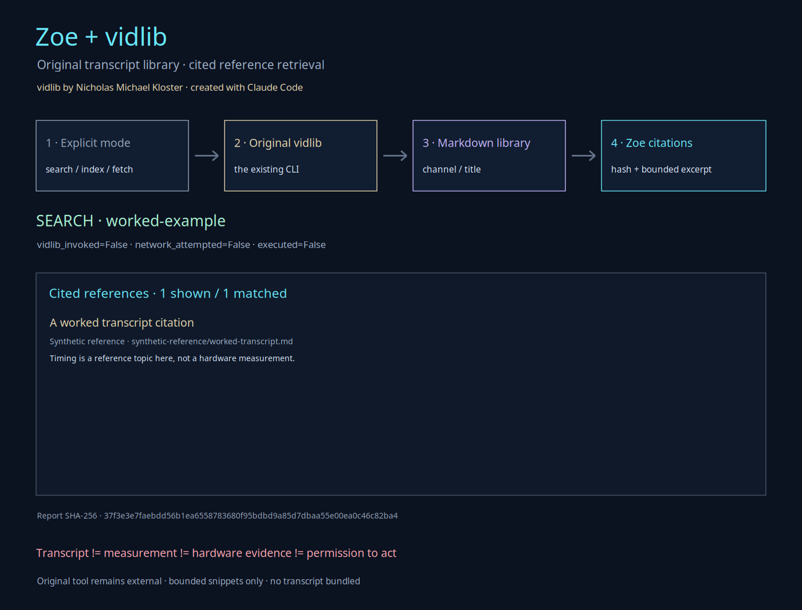</a>

**Provenance:** Paper-embedded copy; Zoe/allgems project-generated visual · **Occurrences:** 1

## [ZVA-0132 — Sponsor Badge](../items/ZVA-0132.md)

Sponsor Badge is a research figures and measurements asset from the ablation portion of the Zoe/allgems project. This figure preserves a measurement, model output, simulation, geometric construction, or research explanation from the Zoe/allgems program.

**Provenance:** Zoe/allgems project-generated visual · **Occurrences:** 1

## [ZVA-0164 — Dorothy Neurogarden](../items/ZVA-0164.md)

Dorothy. This visual belongs to Dorothy’s inspectable spatial-research program, making reference geometry or a review instrument available for direct inspection.

**Provenance:** Zoe render using Allen Institute reference data · **Occurrences:** 1

## [ZVA-0166 — Neurogarden Spatial](../items/ZVA-0166.md)

A synthetic three-dimensional point-spread and projection bench used to explain blur, sampling, and recovery without using patient anatomy. This figure preserves a measurement, model output, simulation, geometric construction, or research explanation from the Zoe/allgems program.

**Provenance:** Zoe/allgems project-generated visual · **Occurrences:** 4

## [ZVA-0168 — Cerotto GEM Accessible Volume](../items/ZVA-0168.md)

CEROTTO GEM synthetic case and accessible-volume sweep. This figure preserves a measurement, model output, simulation, geometric construction, or research explanation from the Zoe/allgems program.

<a href="../../images/ZVA-0168.png">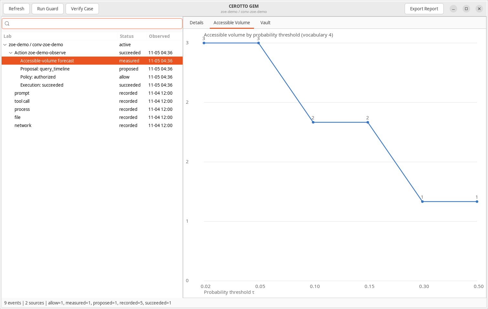</a>

**Provenance:** Zoe/allgems project-generated visual · **Occurrences:** 4

## [ZVA-0169 — Helen Onset](../items/ZVA-0169.md)

GEM HELEN Onset laboratory. This figure preserves a measurement, model output, simulation, geometric construction, or research explanation from the Zoe/allgems program.

<a href="../../images/ZVA-0169.png">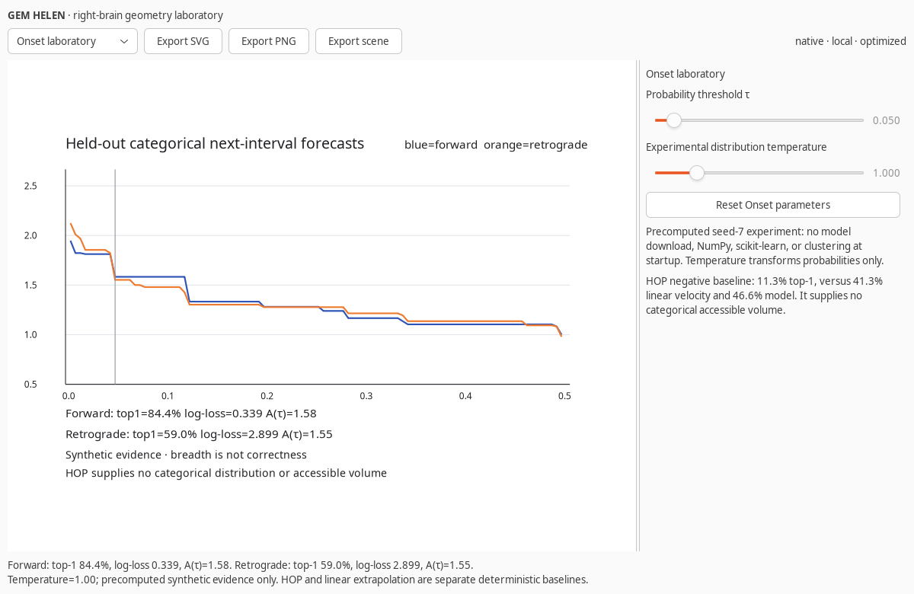</a>

**Provenance:** Zoe/allgems project-generated visual · **Occurrences:** 1

## [ZVA-0170 — Helen Procrustes](../items/ZVA-0170.md)

GEM HELEN Procrustes playground. This figure preserves a measurement, model output, simulation, geometric construction, or research explanation from the Zoe/allgems program.

<a href="../../images/ZVA-0170.png">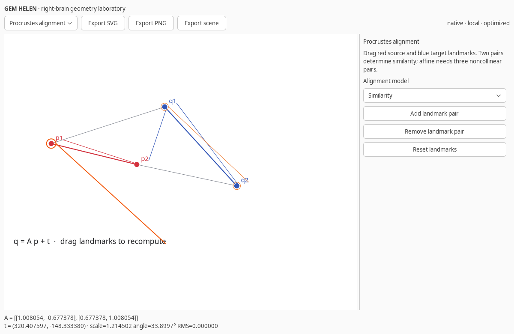</a>

**Provenance:** Zoe/allgems project-generated visual · **Occurrences:** 1

## [ZVA-0171 — Bounded Tetris](../items/ZVA-0171.md)

The bounded Tetris probability-field scene, pairing the game board with exact randomizer and accessible-outcome measurements. This figure preserves a measurement, model output, simulation, geometric construction, or research explanation from the Zoe/allgems program.

<a href="../../images/ZVA-0171.png">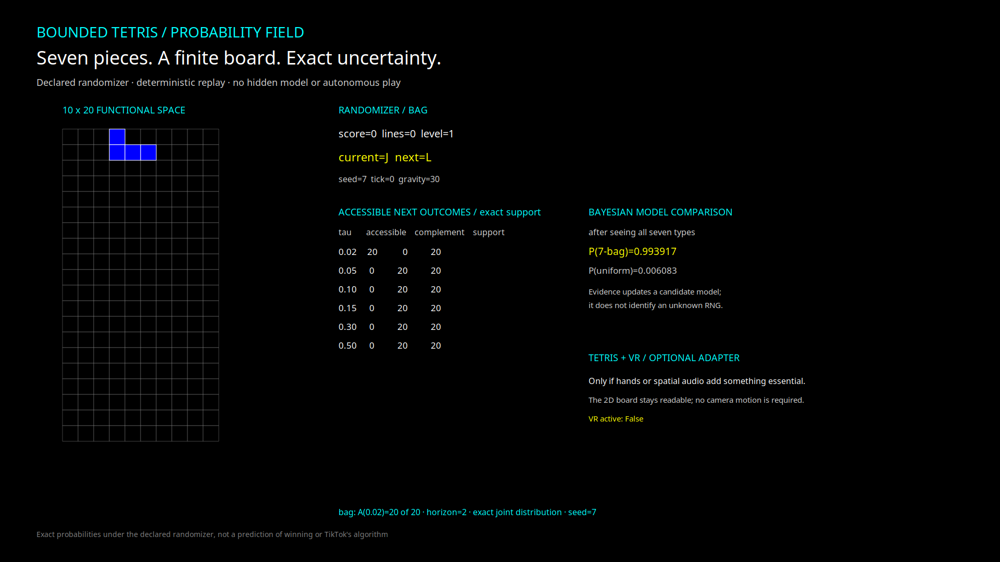</a>

**Provenance:** Zoe/allgems project-generated visual · **Occurrences:** 1

## [ZVA-0172 — Bounded Tetris](../items/ZVA-0172.md)

The bounded Tetris probability-field scene, pairing the game board with exact randomizer and accessible-outcome measurements. This figure preserves a measurement, model output, simulation, geometric construction, or research explanation from the Zoe/allgems program.

<a href="../../images/ZVA-0172.svg">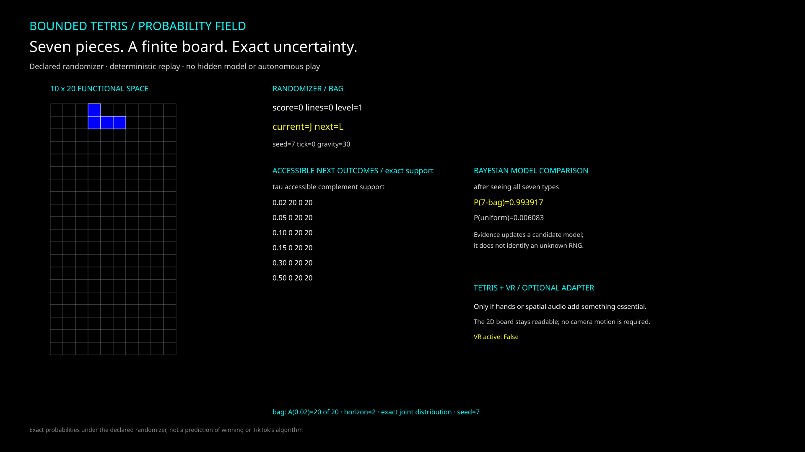</a>

**Provenance:** Zoe/allgems project-generated visual · **Occurrences:** 1

## [ZVA-0173 — Cognitive Field](../items/ZVA-0173.md)

A Cognitive Field diagram showing sourced memory, revision checks, procedural matching, and explicit working-set boundaries. This figure preserves a measurement, model output, simulation, geometric construction, or research explanation from the Zoe/allgems program.

<a href="../../images/ZVA-0173.png">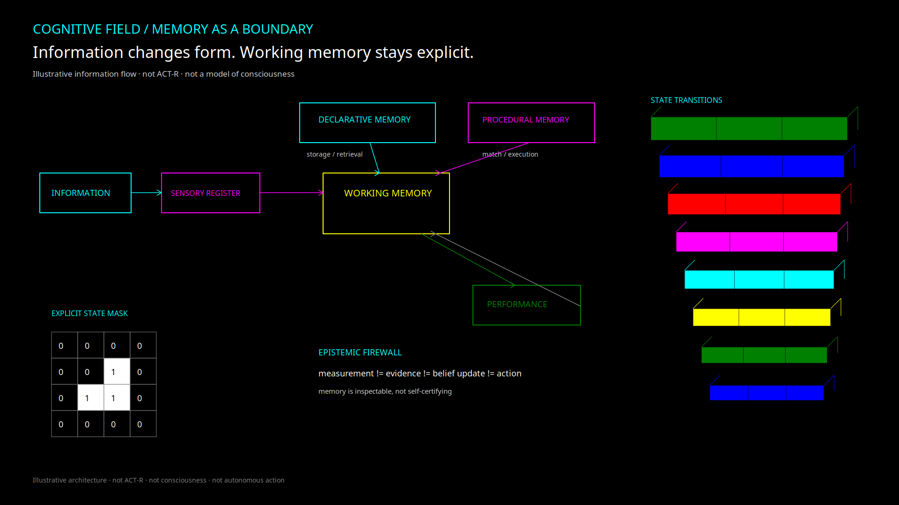</a>

**Provenance:** Zoe/allgems project-generated visual · **Occurrences:** 1

## [ZVA-0174 — Cognitive Field](../items/ZVA-0174.md)

A Cognitive Field diagram showing sourced memory, revision checks, procedural matching, and explicit working-set boundaries. This figure preserves a measurement, model output, simulation, geometric construction, or research explanation from the Zoe/allgems program.

**Provenance:** Zoe/allgems project-generated visual · **Occurrences:** 1

## [ZVA-0175 — Dorothy CCFv3 2017](../items/ZVA-0175.md)

Dorothy’s deterministic twelve-structure Allen Mouse CCFv3 rendering, with structure labels, triangle count, camera state, and an explicit no-registration/no-connectivity boundary.

**Provenance:** Zoe render using Allen Institute reference data · **Occurrences:** 5

## [ZVA-0176 — Dorothy Dorsal](../items/ZVA-0176.md)

A dorsal orientation of Dorothy’s Allen Mouse CCFv3 reference geometry, provided for spatial inspection rather than patient interpretation. This visual belongs to Dorothy’s inspectable spatial-research program, making reference geometry or a review instrument available for direct inspection.

<a href="../../images/ZVA-0176.png">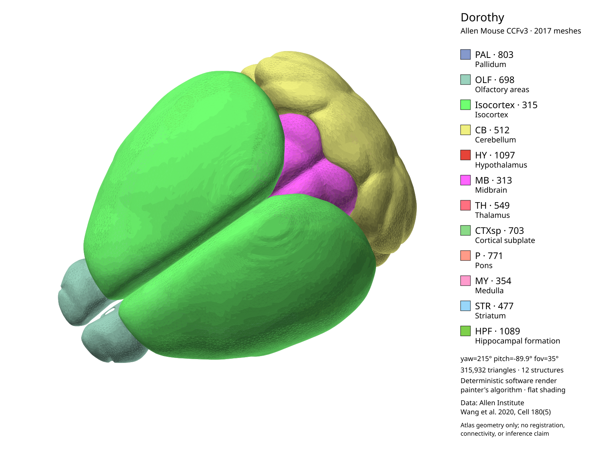</a>

**Provenance:** Zoe render using Allen Institute reference data · **Occurrences:** 2

## [ZVA-0177 — Dorothy Jenga Exploded](../items/ZVA-0177.md)

Dorothy Jenga’s volume-scaled exploded tower, offering spatial inspection of atlas structures without asserting anatomical relationships beyond the reference model. This visual belongs to Dorothy’s inspectable spatial-research program, making reference geometry or a review instrument available for direct inspection.

**Provenance:** Zoe render using Allen Institute reference data · **Occurrences:** 5

## [ZVA-0178 — Dorothy Jenga Pull](../items/ZVA-0178.md)

Dorothy Jenga’s pull-out layout, separating selected atlas layers for inspection while retaining their volume-scaled context. This visual belongs to Dorothy’s inspectable spatial-research program, making reference geometry or a review instrument available for direct inspection.

**Provenance:** Zoe render using Allen Institute reference data · **Occurrences:** 1

## [ZVA-0179 — Dorothy Jenga Pull](../items/ZVA-0179.md)

Dorothy Jenga’s pull-out layout, separating selected atlas layers for inspection while retaining their volume-scaled context. This visual belongs to Dorothy’s inspectable spatial-research program, making reference geometry or a review instrument available for direct inspection.

<a href="../../images/ZVA-0179.svg">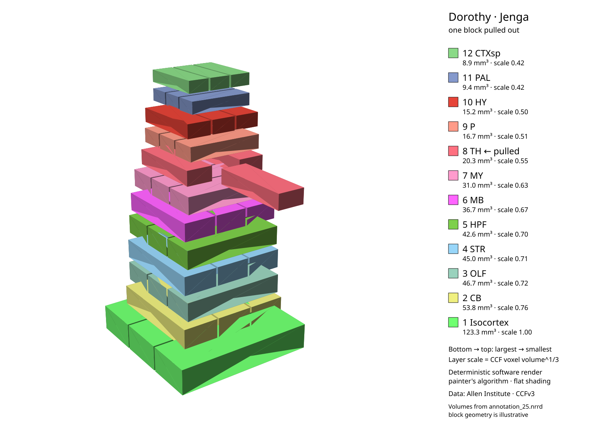</a>

**Provenance:** Zoe render using Allen Institute reference data · **Occurrences:** 1

## [ZVA-0180 — Dorothy Rings Isocortex](../items/ZVA-0180.md)

Dorothy Rings applied to isocortex ontology: exact subtree volumes are represented as a navigable radial partition, not as functional importance. This visual belongs to Dorothy’s inspectable spatial-research program, making reference geometry or a review instrument available for direct inspection.

**Provenance:** Zoe render using Allen Institute reference data · **Occurrences:** 5

## [ZVA-0181 — Dorothy Thalamus Hypothalamus](../items/ZVA-0181.md)

A focused Dorothy view isolating the thalamus and hypothalamus structures from the Allen reference parcellation. This visual belongs to Dorothy’s inspectable spatial-research program, making reference geometry or a review instrument available for direct inspection.

<a href="../../images/ZVA-0181.png">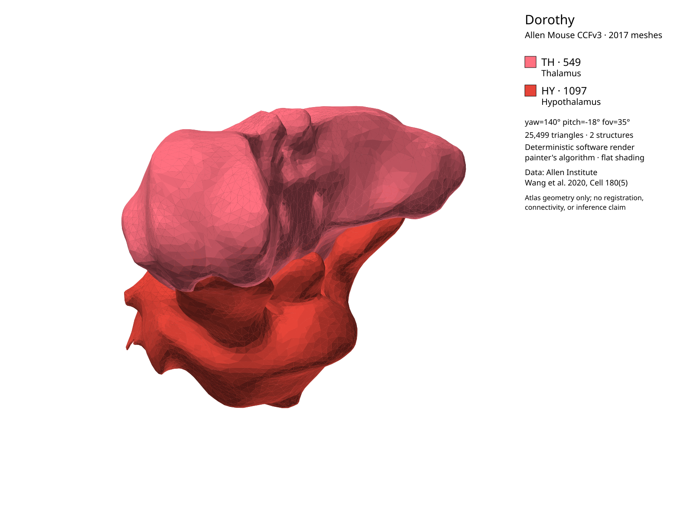</a>

**Provenance:** Zoe render using Allen Institute reference data · **Occurrences:** 2

## [ZVA-0182 — Dorothy Ventral](../items/ZVA-0182.md)

A ventral orientation of Dorothy’s Allen Mouse CCFv3 reference geometry, complementing the dorsal and default camera views. This visual belongs to Dorothy’s inspectable spatial-research program, making reference geometry or a review instrument available for direct inspection.

<a href="../../images/ZVA-0182.png">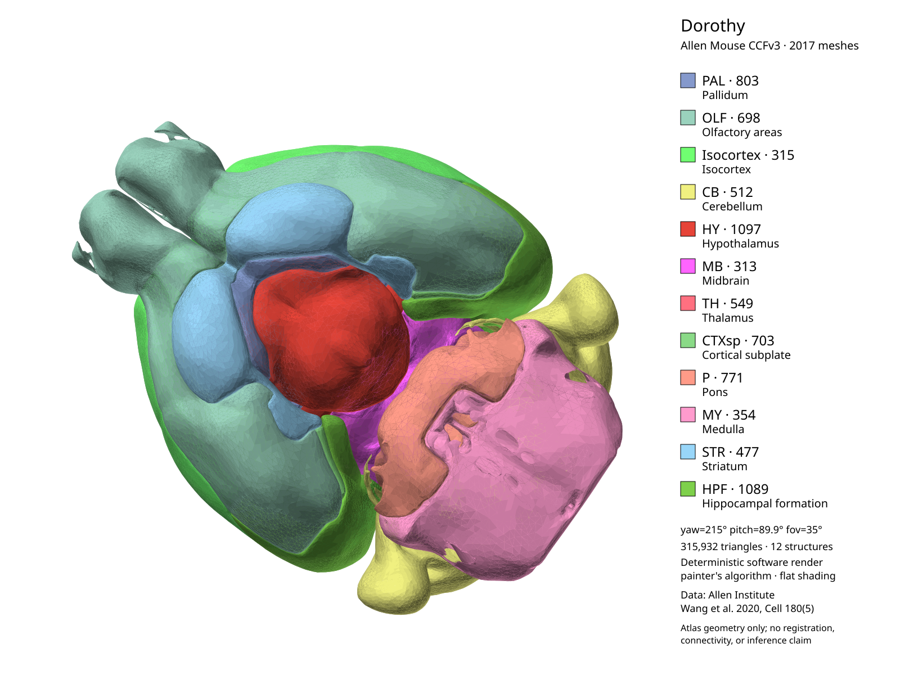</a>

**Provenance:** Zoe render using Allen Institute reference data · **Occurrences:** 2

## [ZVA-0183 — Halo Field](../items/ZVA-0183.md)

Halo Field. This figure preserves a measurement, model output, simulation, geometric construction, or research explanation from the Zoe/allgems program.

**Provenance:** Zoe/allgems project-generated visual · **Occurrences:** 1

## [ZVA-0184 — Halo Field](../items/ZVA-0184.md)

Halo Field is a research figures and measurements asset from the graphics-environment-manager portion of the Zoe/allgems project. This figure preserves a measurement, model output, simulation, geometric construction, or research explanation from the Zoe/allgems program.

<a href="../../images/ZVA-0184.svg">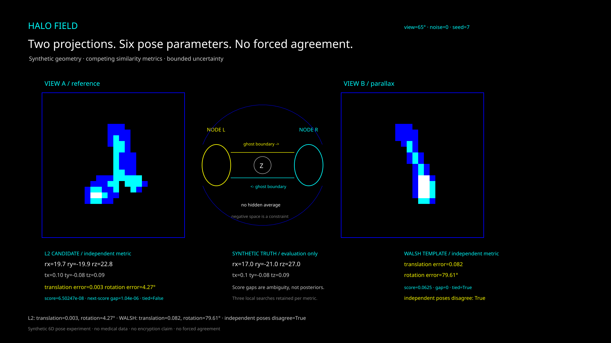</a>

**Provenance:** Zoe/allgems project-generated visual · **Occurrences:** 1

## [ZVA-0185 — Zoe Ellipses Mobile](../items/ZVA-0185.md)

Zoe Ellipses Mobile is a research figures and measurements asset from the graphics-environment-manager portion of the Zoe/allgems project. This figure preserves a measurement, model output, simulation, geometric construction, or research explanation from the Zoe/allgems program.

<a href="../../images/ZVA-0185.png">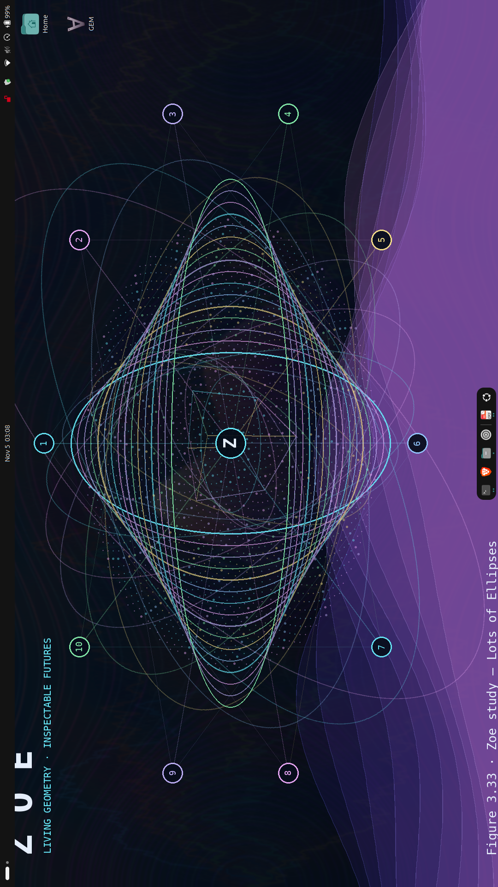</a>

**Provenance:** Zoe/allgems project-generated visual · **Occurrences:** 1

## [ZVA-0186 — Layered Field](../items/ZVA-0186.md)

Layered Field is a research figures and measurements asset from the graphics-environment-manager portion of the Zoe/allgems project. This figure preserves a measurement, model output, simulation, geometric construction, or research explanation from the Zoe/allgems program.

**Provenance:** Zoe/allgems project-generated visual · **Occurrences:** 1

## [ZVA-0187 — Layered Field](../items/ZVA-0187.md)

Layered Field is a research figures and measurements asset from the graphics-environment-manager portion of the Zoe/allgems project. This figure preserves a measurement, model output, simulation, geometric construction, or research explanation from the Zoe/allgems program.

<a href="../../images/ZVA-0187.svg">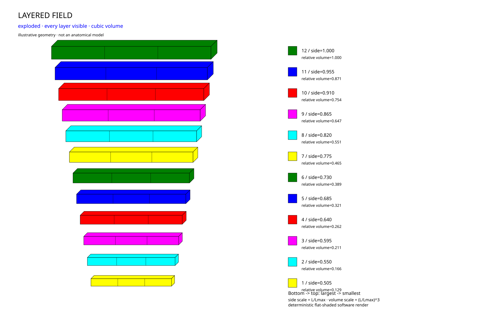</a>

**Provenance:** Zoe/allgems project-generated visual · **Occurrences:** 1

## [ZVA-0188 — Projection Dialogue](../items/ZVA-0188.md)

Projection Dialogue. This figure preserves a measurement, model output, simulation, geometric construction, or research explanation from the Zoe/allgems program.

<a href="../../images/ZVA-0188.png">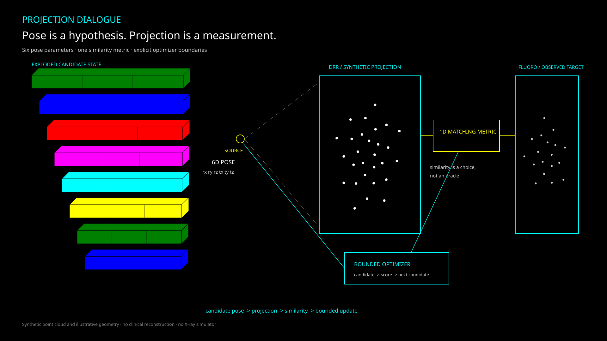</a>

**Provenance:** Zoe/allgems project-generated visual · **Occurrences:** 1

## [ZVA-0189 — Projection Dialogue](../items/ZVA-0189.md)

Projection Dialogue is a research figures and measurements asset from the graphics-environment-manager portion of the Zoe/allgems project. This figure preserves a measurement, model output, simulation, geometric construction, or research explanation from the Zoe/allgems program.

**Provenance:** Zoe/allgems project-generated visual · **Occurrences:** 1

## [ZVA-0190 — Proportional Field](../items/ZVA-0190.md)

Proportional Field is a research figures and measurements asset from the graphics-environment-manager portion of the Zoe/allgems project. This figure preserves a measurement, model output, simulation, geometric construction, or research explanation from the Zoe/allgems program.

<a href="../../images/ZVA-0190.png">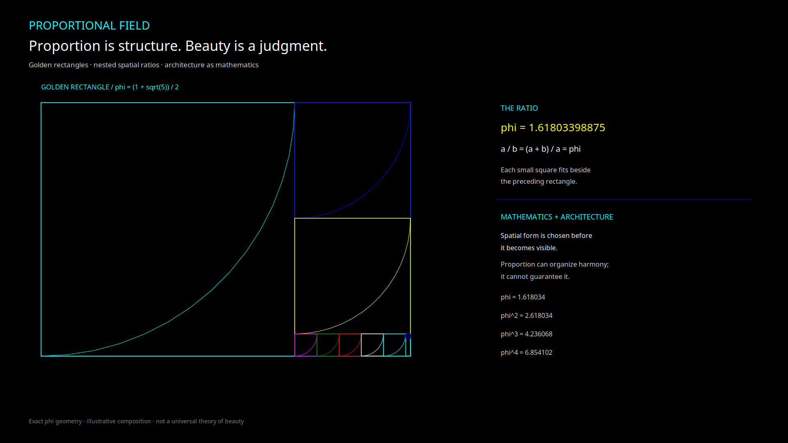</a>

**Provenance:** Zoe/allgems project-generated visual · **Occurrences:** 1

## [ZVA-0191 — Proportional Field](../items/ZVA-0191.md)

Proportional Field is a research figures and measurements asset from the graphics-environment-manager portion of the Zoe/allgems project. This figure preserves a measurement, model output, simulation, geometric construction, or research explanation from the Zoe/allgems program.

**Provenance:** Zoe/allgems project-generated visual · **Occurrences:** 1

## [ZVA-0192 — Walsh Template Explained](../items/ZVA-0192.md)

Walsh Template Explained is a research figures and measurements asset from the graphics-environment-manager portion of the Zoe/allgems project. This figure preserves a measurement, model output, simulation, geometric construction, or research explanation from the Zoe/allgems program.

<a href="../../images/ZVA-0192.png">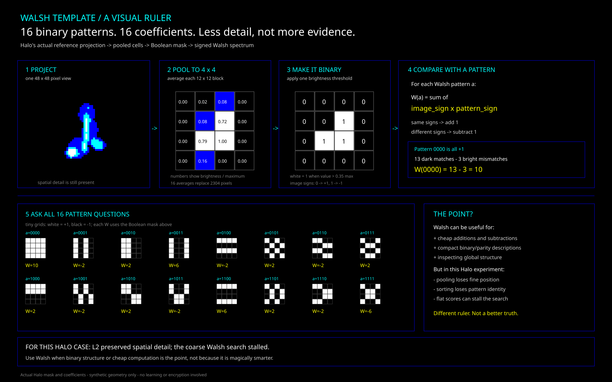</a>

**Provenance:** Zoe/allgems project-generated visual · **Occurrences:** 1

## [ZVA-0193 — Walsh Template Explained](../items/ZVA-0193.md)

Walsh Template Explained is a research figures and measurements asset from the graphics-environment-manager portion of the Zoe/allgems project. This figure preserves a measurement, model output, simulation, geometric construction, or research explanation from the Zoe/allgems program.

**Provenance:** Zoe/allgems project-generated visual · **Occurrences:** 1

## [ZVA-0194 — Zoe Library](../items/ZVA-0194.md)

Zoe OS manual library. This figure preserves a measurement, model output, simulation, geometric construction, or research explanation from the Zoe/allgems program.

<a href="../../images/ZVA-0194.png">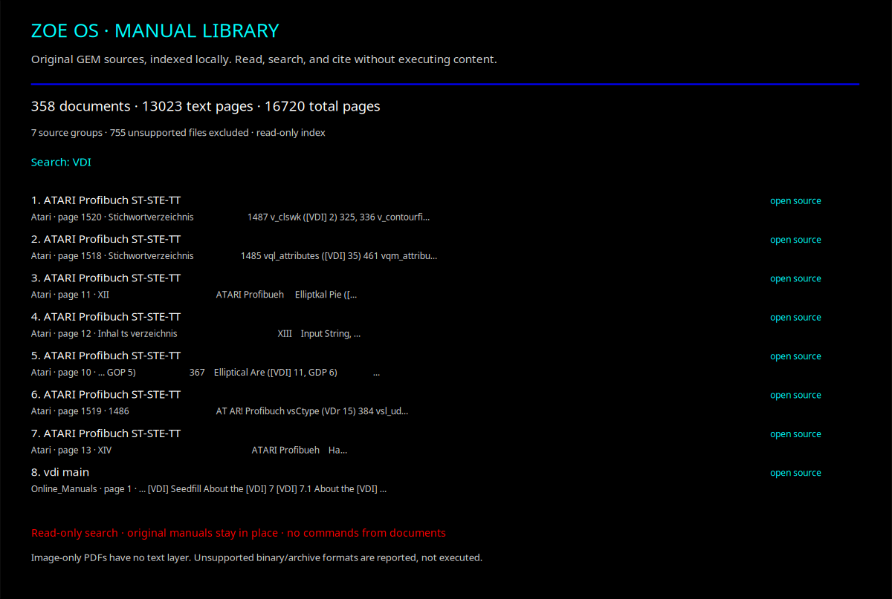</a>

**Provenance:** Zoe/allgems project-generated visual · **Occurrences:** 1

## [ZVA-0195 — Zoe Library](../items/ZVA-0195.md)

Zoe Library is a research figures and measurements asset from the graphics-environment-manager portion of the Zoe/allgems project. This figure preserves a measurement, model output, simulation, geometric construction, or research explanation from the Zoe/allgems program.

<a href="../../images/ZVA-0195.svg">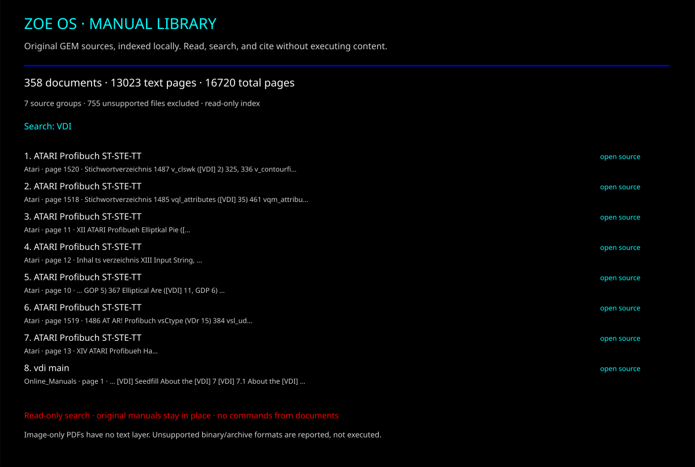</a>

**Provenance:** Zoe/allgems project-generated visual · **Occurrences:** 1

## [ZVA-0196 — Zoe Mirror](../items/ZVA-0196.md)

Zoe's mirrored brain. This figure preserves a measurement, model output, simulation, geometric construction, or research explanation from the Zoe/allgems program.

<a href="../../images/ZVA-0196.png">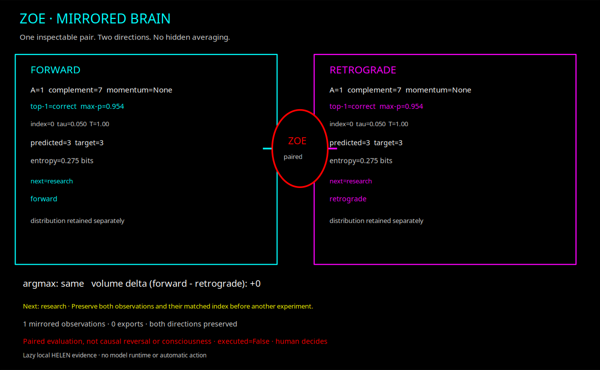</a>

**Provenance:** Zoe/allgems project-generated visual · **Occurrences:** 1

## [ZVA-0197 — Zoe Mirror](../items/ZVA-0197.md)

Zoe Mirror is a research figures and measurements asset from the graphics-environment-manager portion of the Zoe/allgems project. This figure preserves a measurement, model output, simulation, geometric construction, or research explanation from the Zoe/allgems program.

<a href="../../images/ZVA-0197.svg">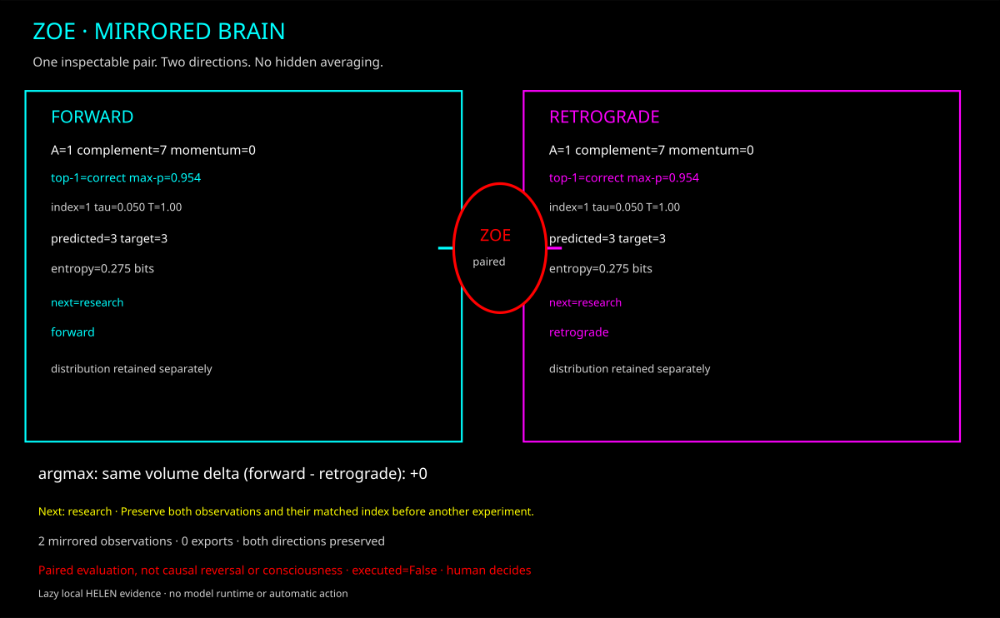</a>

**Provenance:** Zoe/allgems project-generated visual · **Occurrences:** 1

## [ZVA-0198 — Zoe Hourglass](../items/ZVA-0198.md)

Zoe Hourglass is a research figures and measurements asset from the graphics-environment-manager portion of the Zoe/allgems project. This figure preserves a measurement, model output, simulation, geometric construction, or research explanation from the Zoe/allgems program.

<a href="../../images/ZVA-0198.png">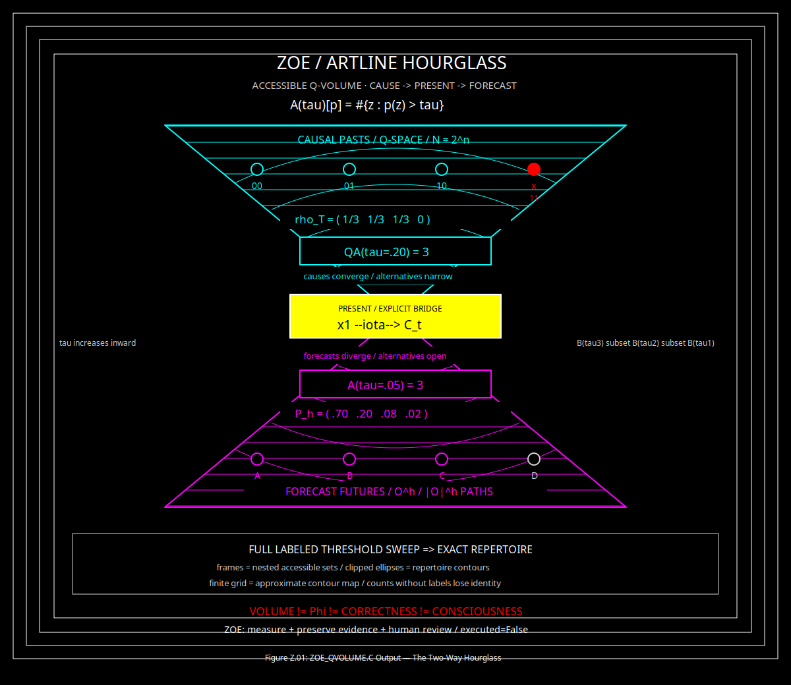</a>

**Provenance:** Zoe/allgems project-generated visual · **Occurrences:** 1

## [ZVA-0199 — Zoe Hourglass](../items/ZVA-0199.md)

Zoe Hourglass is a research figures and measurements asset from the graphics-environment-manager portion of the Zoe/allgems project. This figure preserves a measurement, model output, simulation, geometric construction, or research explanation from the Zoe/allgems program.

<a href="../../images/ZVA-0199.svg">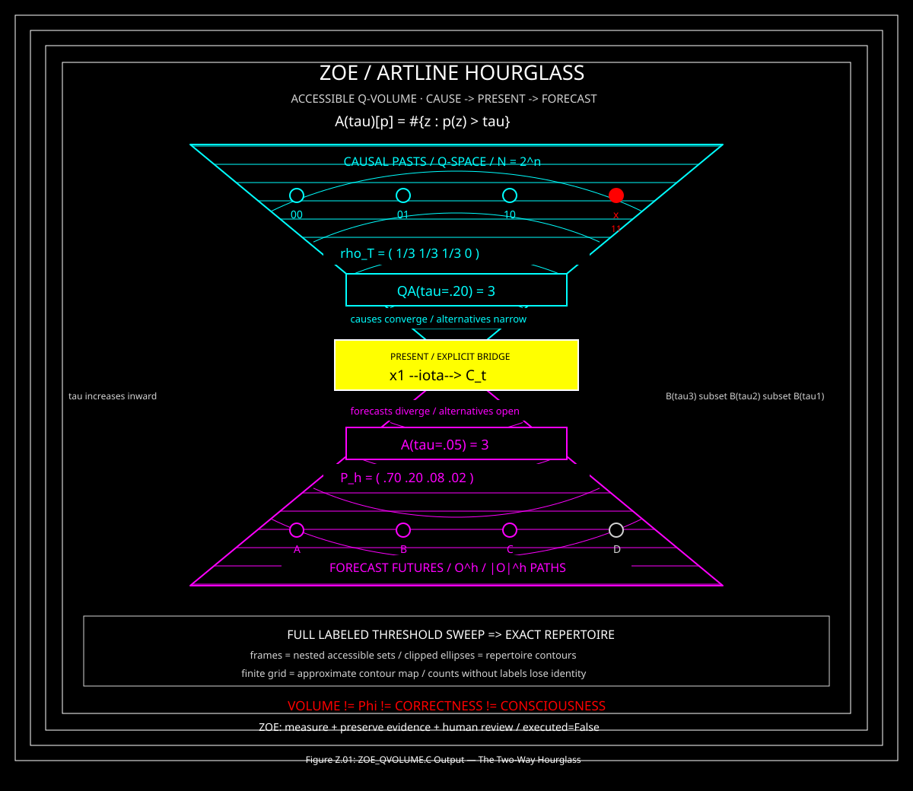</a>

**Provenance:** Zoe/allgems project-generated visual · **Occurrences:** 1

## [ZVA-0204 — Kevlar 01](../items/ZVA-0204.md)

Kevlar 01 is a research figures and measurements asset from the kevlar portion of the Zoe/allgems project. This figure preserves a measurement, model output, simulation, geometric construction, or research explanation from the Zoe/allgems program.

<a href="../../images/ZVA-0204.jpeg">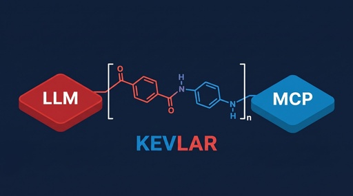</a>

**Provenance:** Zoe/allgems project-generated visual · **Occurrences:** 1

## [ZVA-0205 — Kevlar Repo 01](../items/ZVA-0205.md)

Kevlar MCP CDR Proxy. This figure preserves a measurement, model output, simulation, geometric construction, or research explanation from the Zoe/allgems program.

**Provenance:** Zoe/allgems project-generated visual · **Occurrences:** 1

## [ZVA-0206 — Accessible Volume Hero](../items/ZVA-0206.md)

A visual introduction to accessible volume as a shared threshold instrument for forecast futures and explicitly modeled causal pasts. This figure preserves a measurement, model output, simulation, geometric construction, or research explanation from the Zoe/allgems program.

**Provenance:** Zoe/allgems project-generated visual · **Occurrences:** 2

## [ZVA-0207 — Accessible Volume Missing Integration](../items/ZVA-0207.md)

Historical sketch of the accessible-volume equation before numerical integration. This figure preserves a measurement, model output, simulation, geometric construction, or research explanation from the Zoe/allgems program.

**Provenance:** Zoe/allgems project-generated visual · **Occurrences:** 2

## [ZVA-0208 — Accessible Volume Research Session](../items/ZVA-0208.md)

The accessible-volume equation research session beside the paper. This figure preserves a measurement, model output, simulation, geometric construction, or research explanation from the Zoe/allgems program.

**Provenance:** Zoe/allgems project-generated visual · **Occurrences:** 2

## [ZVA-0209 — GEM Accessible Volume Integration Status](../items/ZVA-0209.md)

Historical GEM integration concept, superseded by the working Zoe implementation. This figure preserves a measurement, model output, simulation, geometric construction, or research explanation from the Zoe/allgems program.

**Provenance:** Zoe/allgems project-generated visual · **Occurrences:** 2

## [ZVA-0213 — Next Token Probability Equation](../items/ZVA-0213.md)

A visual statement of the original strict next-token accessible-volume equation and its above-threshold alternatives. This figure preserves a measurement, model output, simulation, geometric construction, or research explanation from the Zoe/allgems program.

**Provenance:** Zoe/allgems project-generated visual · **Occurrences:** 2

## [ZVA-0226 — Zoe Field Notebook](../items/ZVA-0226.md)

Zoe Bayesian field notebook. This figure preserves a measurement, model output, simulation, geometric construction, or research explanation from the Zoe/allgems program.

**Provenance:** Zoe/allgems project-generated visual · **Occurrences:** 2

## [ZVA-0228 — Zoe Mirror](../items/ZVA-0228.md)

Zoe's mirrored brain. This figure preserves a measurement, model output, simulation, geometric construction, or research explanation from the Zoe/allgems program.

**Provenance:** Zoe/allgems project-generated visual · **Occurrences:** 5

## [ZVA-0230 — Zoe Qualia](../items/ZVA-0230.md)

Zoe's five-panel qualia field guide. This figure preserves a measurement, model output, simulation, geometric construction, or research explanation from the Zoe/allgems program.

**Provenance:** Zoe/allgems project-generated visual · **Occurrences:** 2

## [ZVA-0242 — Rhythm Accessible Volume](../items/ZVA-0242.md)

Forward and retrograde accessible-volume threshold sweep. This figure preserves a measurement, model output, simulation, geometric construction, or research explanation from the Zoe/allgems program.

**Provenance:** Zoe/allgems project-generated visual · **Occurrences:** 5

## [ZVA-0243 — Real Midi Accessible Volume](../items/ZVA-0243.md)

Real-MIDI accessible-volume sweep. This figure preserves a measurement, model output, simulation, geometric construction, or research explanation from the Zoe/allgems program.

**Provenance:** Zoe/allgems project-generated visual · **Occurrences:** 5

## [ZVA-0244 — Real Midi Calibration](../items/ZVA-0244.md)

Forward forecast calibration. This figure preserves a measurement, model output, simulation, geometric construction, or research explanation from the Zoe/allgems program.

**Provenance:** Zoe/allgems project-generated visual · **Occurrences:** 5

## [ZVA-0245 — Accessible Volume](../items/ZVA-0245.md)

Accessible-volume sweep. This figure preserves a measurement, model output, simulation, geometric construction, or research explanation from the Zoe/allgems program.

**Provenance:** Zoe/allgems project-generated visual · **Occurrences:** 5

## [ZVA-0246 — Predictability Map](../items/ZVA-0246.md)

Predictability map. This figure preserves a measurement, model output, simulation, geometric construction, or research explanation from the Zoe/allgems program.

**Provenance:** Zoe/allgems project-generated visual · **Occurrences:** 5

## [ZVA-0247 — Zoe Constitution Signed.author](../items/ZVA-0247.md)

Zoe. This figure preserves a measurement, model output, simulation, geometric construction, or research explanation from the Zoe/allgems program.

**Provenance:** Zoe/allgems project-generated visual · **Occurrences:** 1

## [ZVA-0249 — GEM Unified](../items/ZVA-0249.md)

Zoe allgems knowledge-engineering hub. This figure preserves a measurement, model output, simulation, geometric construction, or research explanation from the Zoe/allgems program.

**Provenance:** Zoe/allgems project-generated visual · **Occurrences:** 1

## [ZVA-0250 — GEM Unified](../items/ZVA-0250.md)

GEM Unified is a research figures and measurements asset from the guiai-lab portion of the Zoe/allgems project. This figure preserves a measurement, model output, simulation, geometric construction, or research explanation from the Zoe/allgems program.

**Provenance:** Zoe/allgems project-generated visual · **Occurrences:** 1

## [ZVA-0252 — Geometry Atlas Onset](../items/ZVA-0252.md)

Native Onset forecast laboratory. This figure preserves a measurement, model output, simulation, geometric construction, or research explanation from the Zoe/allgems program.

**Provenance:** Zoe/allgems project-generated visual · **Occurrences:** 1

## [ZVA-0253 — Geometry Atlas Procrustes](../items/ZVA-0253.md)

Procrustes landmark playground. This figure preserves a measurement, model output, simulation, geometric construction, or research explanation from the Zoe/allgems program.

**Provenance:** Zoe/allgems project-generated visual · **Occurrences:** 4

## [ZVA-0261 — Zoe Cicada](../items/ZVA-0261.md)

Zoe Internal Clock. This figure preserves a measurement, model output, simulation, geometric construction, or research explanation from the Zoe/allgems program.

**Provenance:** Zoe/allgems project-generated visual · **Occurrences:** 4

## [ZVA-0262 — Zoe Cicada](../items/ZVA-0262.md)

Zoe Cicada is a research figures and measurements asset from the guiai-lab portion of the Zoe/allgems project. This figure preserves a measurement, model output, simulation, geometric construction, or research explanation from the Zoe/allgems program.

**Provenance:** Zoe/allgems project-generated visual · **Occurrences:** 1

## [ZVA-0265 — Zoe Cognitive Field](../items/ZVA-0265.md)

Zoe Cognitive Field. This figure preserves a measurement, model output, simulation, geometric construction, or research explanation from the Zoe/allgems program.

**Provenance:** Zoe/allgems project-generated visual · **Occurrences:** 4

## [ZVA-0266 — Zoe Cognitive Field](../items/ZVA-0266.md)

Zoe Cognitive Field is a research figures and measurements asset from the guiai-lab portion of the Zoe/allgems project. This figure preserves a measurement, model output, simulation, geometric construction, or research explanation from the Zoe/allgems program.

**Provenance:** Zoe/allgems project-generated visual · **Occurrences:** 1

## [ZVA-0269 — Zoe Evidence](../items/ZVA-0269.md)

Zoe Evidence Navigator. This figure preserves a measurement, model output, simulation, geometric construction, or research explanation from the Zoe/allgems program.

**Provenance:** Zoe/allgems project-generated visual · **Occurrences:** 4

## [ZVA-0270 — Zoe Evidence](../items/ZVA-0270.md)

Zoe Evidence is a research figures and measurements asset from the guiai-lab portion of the Zoe/allgems project. This figure preserves a measurement, model output, simulation, geometric construction, or research explanation from the Zoe/allgems program.

**Provenance:** Zoe/allgems project-generated visual · **Occurrences:** 1

## [ZVA-0271 — Zoe Field Notebook](../items/ZVA-0271.md)

Zoe Bayesian field notebook. This figure preserves a measurement, model output, simulation, geometric construction, or research explanation from the Zoe/allgems program.

**Provenance:** Zoe/allgems project-generated visual · **Occurrences:** 4

## [ZVA-0274 — Zoe Leadership](../items/ZVA-0274.md)

Zoe Leadership Garden. This figure preserves a measurement, model output, simulation, geometric construction, or research explanation from the Zoe/allgems program.

**Provenance:** Zoe/allgems project-generated visual · **Occurrences:** 1

## [ZVA-0275 — Zoe Leadership](../items/ZVA-0275.md)

Zoe Leadership is a research figures and measurements asset from the guiai-lab portion of the Zoe/allgems project. This figure preserves a measurement, model output, simulation, geometric construction, or research explanation from the Zoe/allgems program.

**Provenance:** Zoe/allgems project-generated visual · **Occurrences:** 1

## [ZVA-0280 — Zoe Patchbay](../items/ZVA-0280.md)

Zoe Patchbay. This visual belongs to Zoe’s CERN/source-evidence program, helping a reader inspect a corpus, protocol, replay, virtual system, or process boundary.

**Provenance:** Zoe/allgems project-generated visual · **Occurrences:** 4

## [ZVA-0281 — Zoe Patchbay](../items/ZVA-0281.md)

Zoe Patchbay is a research figures and measurements asset from the guiai-lab portion of the Zoe/allgems project. This visual belongs to Zoe’s CERN/source-evidence program, helping a reader inspect a corpus, protocol, replay, virtual system, or process boundary.

**Provenance:** Zoe/allgems project-generated visual · **Occurrences:** 1

## [ZVA-0283 — Zoe Pentacube](../items/ZVA-0283.md)

Zoe Pentacube. This figure preserves a measurement, model output, simulation, geometric construction, or research explanation from the Zoe/allgems program.

**Provenance:** Zoe/allgems project-generated visual · **Occurrences:** 4

## [ZVA-0284 — Zoe Pentacube](../items/ZVA-0284.md)

Zoe Pentacube is a research figures and measurements asset from the guiai-lab portion of the Zoe/allgems project. This figure preserves a measurement, model output, simulation, geometric construction, or research explanation from the Zoe/allgems program.

**Provenance:** Zoe/allgems project-generated visual · **Occurrences:** 1

## [ZVA-0286 — Zoe Pentomino](../items/ZVA-0286.md)

Zoe Pentomino completed board. This figure preserves a measurement, model output, simulation, geometric construction, or research explanation from the Zoe/allgems program.

**Provenance:** Zoe/allgems project-generated visual · **Occurrences:** 1

## [ZVA-0287 — Zoe Pentomino](../items/ZVA-0287.md)

Zoe Pentomino is a research figures and measurements asset from the guiai-lab portion of the Zoe/allgems project. This figure preserves a measurement, model output, simulation, geometric construction, or research explanation from the Zoe/allgems program.

**Provenance:** Zoe/allgems project-generated visual · **Occurrences:** 1

## [ZVA-0288 — Zoe Pilot Cover](../items/ZVA-0288.md)

Zoe Practice Navigator cover. This figure preserves a measurement, model output, simulation, geometric construction, or research explanation from the Zoe/allgems program.

**Provenance:** Zoe/allgems project-generated visual · **Occurrences:** 1

## [ZVA-0289 — Zoe Pilot Cover](../items/ZVA-0289.md)

Zoe Pilot Cover is a research figures and measurements asset from the guiai-lab portion of the Zoe/allgems project. This figure preserves a measurement, model output, simulation, geometric construction, or research explanation from the Zoe/allgems program.

**Provenance:** Zoe/allgems project-generated visual · **Occurrences:** 1

## [ZVA-0290 — Zoe Pilot Hourglass](../items/ZVA-0290.md)

Original conserved-hourglass study. This figure preserves a measurement, model output, simulation, geometric construction, or research explanation from the Zoe/allgems program.

**Provenance:** Zoe/allgems project-generated visual · **Occurrences:** 1

## [ZVA-0291 — Zoe Pilot Hourglass](../items/ZVA-0291.md)

Zoe Pilot Hourglass is a research figures and measurements asset from the guiai-lab portion of the Zoe/allgems project. This figure preserves a measurement, model output, simulation, geometric construction, or research explanation from the Zoe/allgems program.

**Provenance:** Zoe/allgems project-generated visual · **Occurrences:** 1

## [ZVA-0293 — Zoe Pilot Practice](../items/ZVA-0293.md)

Zoe Pilot Practice is a research figures and measurements asset from the guiai-lab portion of the Zoe/allgems project. This figure preserves a measurement, model output, simulation, geometric construction, or research explanation from the Zoe/allgems program.

**Provenance:** Zoe/allgems project-generated visual · **Occurrences:** 1

## [ZVA-0294 — Zoe Pilot Practice](../items/ZVA-0294.md)

Zoe Pilot Practice is a research figures and measurements asset from the guiai-lab portion of the Zoe/allgems project. This figure preserves a measurement, model output, simulation, geometric construction, or research explanation from the Zoe/allgems program.

**Provenance:** Zoe/allgems project-generated visual · **Occurrences:** 1

## [ZVA-0295 — Zoe Pilot Route](../items/ZVA-0295.md)

Zoe Pilot Route is a research figures and measurements asset from the guiai-lab portion of the Zoe/allgems project. This figure preserves a measurement, model output, simulation, geometric construction, or research explanation from the Zoe/allgems program.

**Provenance:** Zoe/allgems project-generated visual · **Occurrences:** 1

## [ZVA-0296 — Zoe Pilot Route](../items/ZVA-0296.md)

Zoe Pilot Route is a research figures and measurements asset from the guiai-lab portion of the Zoe/allgems project. This figure preserves a measurement, model output, simulation, geometric construction, or research explanation from the Zoe/allgems program.

**Provenance:** Zoe/allgems project-generated visual · **Occurrences:** 1

## [ZVA-0297 — Zoe Pilot Signals](../items/ZVA-0297.md)

Zoe Pilot Signals is a research figures and measurements asset from the guiai-lab portion of the Zoe/allgems project. This figure preserves a measurement, model output, simulation, geometric construction, or research explanation from the Zoe/allgems program.

**Provenance:** Zoe/allgems project-generated visual · **Occurrences:** 1

## [ZVA-0298 — Zoe Pilot Signals](../items/ZVA-0298.md)

Zoe Pilot Signals is a research figures and measurements asset from the guiai-lab portion of the Zoe/allgems project. This figure preserves a measurement, model output, simulation, geometric construction, or research explanation from the Zoe/allgems program.

**Provenance:** Zoe/allgems project-generated visual · **Occurrences:** 1

## [ZVA-0301 — Zoe Presence](../items/ZVA-0301.md)

Zoe Presence. This figure preserves a measurement, model output, simulation, geometric construction, or research explanation from the Zoe/allgems program.

**Provenance:** Zoe/allgems project-generated visual · **Occurrences:** 4

## [ZVA-0302 — Zoe Presence](../items/ZVA-0302.md)

Zoe Presence is a research figures and measurements asset from the guiai-lab portion of the Zoe/allgems project. This figure preserves a measurement, model output, simulation, geometric construction, or research explanation from the Zoe/allgems program.

**Provenance:** Zoe/allgems project-generated visual · **Occurrences:** 1

## [ZVA-0304 — Zoe Protocol](../items/ZVA-0304.md)

Zoe Protocol Lab. This visual belongs to Zoe’s CERN/source-evidence program, helping a reader inspect a corpus, protocol, replay, virtual system, or process boundary.

**Provenance:** Zoe/allgems project-generated visual · **Occurrences:** 4

## [ZVA-0305 — Zoe Protocol](../items/ZVA-0305.md)

Zoe Protocol is a research figures and measurements asset from the guiai-lab portion of the Zoe/allgems project. This visual belongs to Zoe’s CERN/source-evidence program, helping a reader inspect a corpus, protocol, replay, virtual system, or process boundary.

**Provenance:** Zoe/allgems project-generated visual · **Occurrences:** 1

## [ZVA-0306 — Zoe Qualia](../items/ZVA-0306.md)

Zoe's five-panel qualia field guide. This figure preserves a measurement, model output, simulation, geometric construction, or research explanation from the Zoe/allgems program.

**Provenance:** Zoe/allgems project-generated visual · **Occurrences:** 4

## [ZVA-0307 — Zoe Qualia](../items/ZVA-0307.md)

Zoe Qualia is a research figures and measurements asset from the guiai-lab portion of the Zoe/allgems project. This figure preserves a measurement, model output, simulation, geometric construction, or research explanation from the Zoe/allgems program.

**Provenance:** Zoe/allgems project-generated visual · **Occurrences:** 1

## [ZVA-0310 — Zoe Resilience](../items/ZVA-0310.md)

Zoe Resilience Atlas. This figure preserves a measurement, model output, simulation, geometric construction, or research explanation from the Zoe/allgems program.

**Provenance:** Zoe/allgems project-generated visual · **Occurrences:** 4

## [ZVA-0311 — Zoe Resilience](../items/ZVA-0311.md)

Zoe Resilience is a research figures and measurements asset from the guiai-lab portion of the Zoe/allgems project. This figure preserves a measurement, model output, simulation, geometric construction, or research explanation from the Zoe/allgems program.

**Provenance:** Zoe/allgems project-generated visual · **Occurrences:** 1

## [ZVA-0312 — Zoe Vidlib](../items/ZVA-0312.md)

Zoe + vidlib. This figure preserves a measurement, model output, simulation, geometric construction, or research explanation from the Zoe/allgems program.

**Provenance:** Zoe/allgems project-generated visual · **Occurrences:** 1

## [ZVA-0313 — Zoe Vidlib](../items/ZVA-0313.md)

Zoe Vidlib is a research figures and measurements asset from the guiai-lab portion of the Zoe/allgems project. This figure preserves a measurement, model output, simulation, geometric construction, or research explanation from the Zoe/allgems program.

**Provenance:** Zoe/allgems project-generated visual · **Occurrences:** 1

## [ZVA-0321 — Zoe Waveform](../items/ZVA-0321.md)

Zoe Waveform Replay. This visual belongs to Zoe’s CERN/source-evidence program, helping a reader inspect a corpus, protocol, replay, virtual system, or process boundary.

**Provenance:** Zoe/allgems project-generated visual · **Occurrences:** 4

## [ZVA-0322 — Zoe Waveform](../items/ZVA-0322.md)

Zoe Waveform is a research figures and measurements asset from the guiai-lab portion of the Zoe/allgems project. This visual belongs to Zoe’s CERN/source-evidence program, helping a reader inspect a corpus, protocol, replay, virtual system, or process boundary.

**Provenance:** Zoe/allgems project-generated visual · **Occurrences:** 1

## [ZVA-0354 — 04 Accessible Volume](../items/ZVA-0354.md)

Accessible Volume in plain English, including the equation, variable definitions, and a worked threshold example. This figure preserves a measurement, model output, simulation, geometric construction, or research explanation from the Zoe/allgems program.

**Provenance:** Zoe/allgems project-generated visual · **Occurrences:** 1

## [ZVA-0355 — 05 Accessible Volume Reference](../items/ZVA-0355.md)

Original Accessible Volume explanation supplied for this guide. This figure preserves a measurement, model output, simulation, geometric construction, or research explanation from the Zoe/allgems program.

**Provenance:** Zoe/allgems project-generated visual · **Occurrences:** 1

## [ZVA-0357 — 07 Zoe Overview Reference](../items/ZVA-0357.md)

Original Zoe-Autonomy conceptual overview supplied for this guide. This figure preserves a measurement, model output, simulation, geometric construction, or research explanation from the Zoe/allgems program.

**Provenance:** Zoe/allgems project-generated visual · **Occurrences:** 1

## [ZVA-0358 — Example Com Browser](../items/ZVA-0358.md)

Example Com Browser is a research figures and measurements asset from the evidence portion of the Zoe/allgems project. This figure preserves a measurement, model output, simulation, geometric construction, or research explanation from the Zoe/allgems program.

**Provenance:** Zoe/allgems project-generated visual · **Occurrences:** 1

## [ZVA-0359 — Compliance Cascade](../items/ZVA-0359.md)

The AFL/compliance-cascade hypothesis rendered as binary accessible sets at steps 0, 1, 3, and 6, with newly recruited positions highlighted. This figure preserves a measurement, model output, simulation, geometric construction, or research explanation from the Zoe/allgems program.

**Provenance:** Zoe/allgems project-generated visual · **Occurrences:** 4
