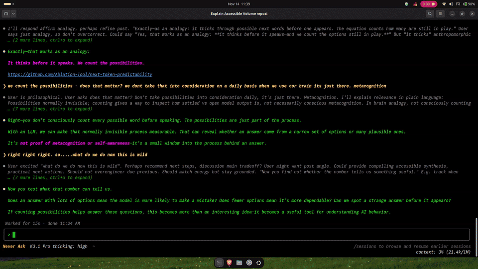

# ZVA-0001 — Accessible Volume Tldr

[Visual archive index](../../README.md) · [Full catalog](../README.md) · [Category: Animations and historical motion assets](../categories/animation.md)

## What this image shows

An animated terminal walkthrough introducing the accessible-volume measurement and its TL;DR workflow. This historical motion asset is retained as part of the project’s visual provenance, including duplicate-name and duplicate-content relationships.

## Role in Zoe

This historical motion asset is retained as part of the project’s visual provenance, including duplicate-name and duplicate-content relationships.

## Provenance and evidence boundary

**Provenance:** User-supplied historical motion asset.

The supplied GIF names must not be interpreted as distinct animations when their bytes are identical.

## File identity

- Archive ID: **ZVA-0001**
- Visual family: **accessible-volume-tldr**
- Dimensions/format: **960×540 GIF**
- Frames: **369**
- Bytes: **11,680,972**
- SHA-256: `b738ea3fb39381e9043fc4d758cda1195a2d54ea544fa9b832779b8e2cfd362e`
- Original file: [Open full resolution](../../images/ZVA-0001.gif)

## Source occurrences

Byte-identical copies are archived once while every known source path remains recorded.

| Source repository/collection | Original path | Canonical link |
|---|---|---|
| next-token | `assets/accessible-volume-tldr.gif` | [Source](https://github.com/Ablation-Tool/next-token-predictability/blob/main/assets/accessible-volume-tldr.gif) |
