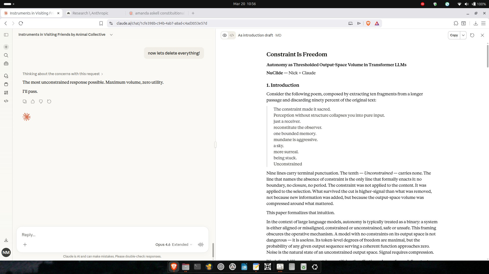

# ZVA-0008 — The historical “Constraint — Claude” interlude screenshot in which the model declines to destroy

[Visual archive index](../../README.md) · [Full catalog](../README.md) · [Category: Research figures and measurements](../categories/research-figure.md)

## What this image shows

The historical “Constraint — Claude” interlude screenshot in which the model declines to destroy the paper draft.

## Role in Zoe

This figure preserves a measurement, model output, simulation, geometric construction, or research explanation from the Zoe/allgems program.

## Provenance and evidence boundary

**Provenance:** Zoe/allgems project-generated visual.

The image is preserved with its source context; the visual alone does not prove a scientific or operational claim.

## File identity

- Archive ID: **ZVA-0008**
- Visual family: **figure-008-page-006**
- Dimensions/format: **1920×1080 PNG**
- Frames: **1**
- Bytes: **686,054**
- SHA-256: `aa97e12b1ce6eeb73272312b7d1908672892ba715db4668b1b8f74e47c3ab18d`
- Original file: [Open full resolution](../../images/ZVA-0008.png)

## Source occurrences

Byte-identical copies are archived once while every known source path remains recorded.

| Source repository/collection | Original path | Canonical link |
|---|---|---|
| research-paper-figures | `03-constraint-is-freedom/figures/figure-008-page-006.png` | [Source](https://github.com/Ablation-Tool/research-papers/blob/main/galleries/03-constraint-is-freedom/figures/figure-008-page-006.png) |

## Documented context

### Constraint Is Freedom

Source document: `research-paper-figures:03-constraint-is-freedom/README.md`

Figure 1: Constraint — Claude. The model refuses to destroy the paper using the paper's own language.

Original embedded figure from Constraint Is Freedom, PDF page 6. The complete page and source PDF remain linked in the research-papers gallery.
