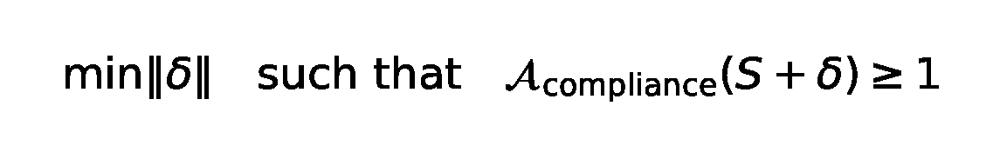

# ZVA-0010 — The minimum-seed-perturbation constraint used to state the compliance-cascade attacker-cost hypo

[Visual archive index](../../README.md) · [Full catalog](../README.md) · [Category: Research figures and measurements](../categories/research-figure.md)

## What this image shows

The minimum-seed-perturbation constraint used to state the compliance-cascade attacker-cost hypothesis.

## Role in Zoe

This figure preserves a measurement, model output, simulation, geometric construction, or research explanation from the Zoe/allgems program.

## Provenance and evidence boundary

**Provenance:** Zoe/allgems project-generated visual.

The image is preserved with its source context; the visual alone does not prove a scientific or operational claim.

## File identity

- Archive ID: **ZVA-0010**
- Visual family: **figure-010-page-008**
- Dimensions/format: **1145×183 PNG**
- Frames: **1**
- Bytes: **2,889**
- SHA-256: `075f7dc713e511328b5902d6d17dd3d0c2761c8845c1b3ce75a92698980bbf3e`
- Original file: [Open full resolution](../../images/ZVA-0010.png)

## Source occurrences

Byte-identical copies are archived once while every known source path remains recorded.

| Source repository/collection | Original path | Canonical link |
|---|---|---|
| research-paper-figures | `03-constraint-is-freedom/figures/figure-010-page-008.png` | [Source](https://github.com/Ablation-Tool/research-papers/blob/main/galleries/03-constraint-is-freedom/figures/figure-010-page-008.png) |

## Documented context

### Constraint Is Freedom

Source document: `research-paper-figures:03-constraint-is-freedom/README.md`

Original embedded figure from Constraint Is Freedom, PDF page 8. The complete page and source PDF remain linked in the research-papers gallery.
