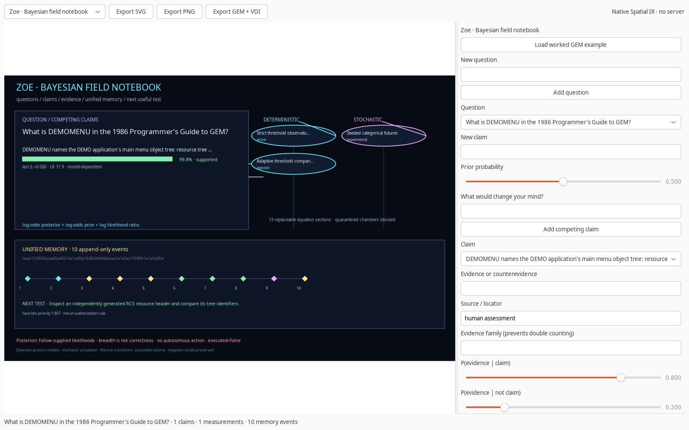

# ZVA-0011 — Zoe Bayesian field notebook

[Visual archive index](../../README.md) · [Full catalog](../README.md) · [Category: Research figures and measurements](../categories/research-figure.md)

## What this image shows

Zoe Bayesian field notebook. This figure preserves a measurement, model output, simulation, geometric construction, or research explanation from the Zoe/allgems program.

## Role in Zoe

This figure preserves a measurement, model output, simulation, geometric construction, or research explanation from the Zoe/allgems program.

## Provenance and evidence boundary

**Provenance:** Paper-embedded copy; Zoe/allgems project-generated visual.

The image is preserved with its source context; the visual alone does not prove a scientific or operational claim.

## File identity

- Archive ID: **ZVA-0011**
- Visual family: **figure-000-page-010**
- Dimensions/format: **1600×1000 PNG**
- Frames: **1**
- Bytes: **134,788**
- SHA-256: `3b706bd27323395cd213193ec2740962df09d985983d06206ccb9bc50b609508`
- Original file: [Open full resolution](../../images/ZVA-0011.png)

## Source occurrences

Byte-identical copies are archived once while every known source path remains recorded.

| Source repository/collection | Original path | Canonical link |
|---|---|---|
| research-paper-figures | `04-accessible-volume-significance/figures/figure-000-page-010.png` | [Source](https://github.com/Ablation-Tool/research-papers/blob/main/galleries/04-accessible-volume-significance/figures/figure-000-page-010.png) |
| research-paper-figures | `06-zoe-native-gem/figures/figure-003-page-010.png` | [Source](https://github.com/Ablation-Tool/research-papers/blob/main/galleries/06-zoe-native-gem/figures/figure-003-page-010.png) |
| research-paper-figures | `07-zoe-for-everyone/figures/figure-002-page-005.png` | [Source](https://github.com/Ablation-Tool/research-papers/blob/main/galleries/07-zoe-for-everyone/figures/figure-002-page-005.png) |

## Documented context

### The Significance of Accessible Volume

Source document: `research-paper-figures:04-accessible-volume-significance/README.md`

Figure 1: Zoe’s Bayesian field notebook combines explicit evidence updates, deterministic and stochastic chambers, append-only memory, and a review-required next-test recommendation. The displayed DEMOMENU example is a worked historical-software investigation, not a forecast of user intent.

Original embedded figure from The Significance of Accessible Volume, PDF page 10. The complete page and source PDF remain linked in the research-papers gallery.

### Zoe: A Native GEM for Living Geometry and Inspectable Futures

Source document: `research-paper-figures:06-zoe-native-gem/README.md`

Figure 4: The native Bayesian field notebook: posterior state, chamber states, append-only memory, and next useful test.

Original embedded figure from Zoe: A Native GEM for Living Geometry and Inspectable Futures, PDF page 10. The complete page and source PDF remain linked in the research-papers gallery.

### Zoe for Everyone

Source document: `research-paper-figures:07-zoe-for-everyone/README.md`

Figure 3: A real notebook in Zoe: posterior bars, chamber states, the event-memory chain, and a next-test recommendation.

Original embedded figure from Zoe for Everyone, PDF page 5. The complete page and source PDF remain linked in the research-papers gallery.
