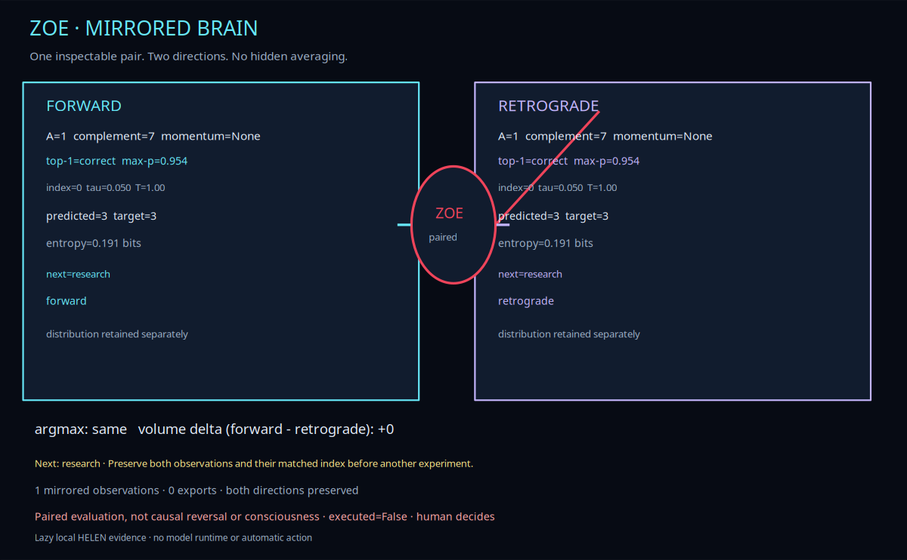

# ZVA-0012 — Zoe's mirrored brain

[Visual archive index](../../README.md) · [Full catalog](../README.md) · [Category: Research figures and measurements](../categories/research-figure.md)

## What this image shows

Zoe's mirrored brain. This figure preserves a measurement, model output, simulation, geometric construction, or research explanation from the Zoe/allgems program.

## Role in Zoe

This figure preserves a measurement, model output, simulation, geometric construction, or research explanation from the Zoe/allgems program.

## Provenance and evidence boundary

**Provenance:** Paper-embedded copy; Zoe/allgems project-generated visual.

The image is preserved with its source context; the visual alone does not prove a scientific or operational claim.

## File identity

- Archive ID: **ZVA-0012**
- Visual family: **figure-001-page-011**
- Dimensions/format: **1200×742 PNG**
- Frames: **1**
- Bytes: **72,035**
- SHA-256: `4c00d9eded40888f34fa4ece18e86df0064735cbbb9c073af9ff4e528933b943`
- Original file: [Open full resolution](../../images/ZVA-0012.png)

## Source occurrences

Byte-identical copies are archived once while every known source path remains recorded.

| Source repository/collection | Original path | Canonical link |
|---|---|---|
| research-paper-figures | `04-accessible-volume-significance/figures/figure-001-page-011.png` | [Source](https://github.com/Ablation-Tool/research-papers/blob/main/galleries/04-accessible-volume-significance/figures/figure-001-page-011.png) |
| research-paper-figures | `10-accessible-volume-architecture-of-autonomy/figures/figure-011-page-030.png` | [Source](https://github.com/Ablation-Tool/research-papers/blob/main/galleries/10-accessible-volume-architecture-of-autonomy/figures/figure-011-page-030.png) |

## Documented context

### The Significance of Accessible Volume

Source document: `research-paper-figures:04-accessible-volume-significance/README.md`

Figure 2: A mirrored Zoe observation preserves two distributions at one index. Paired evaluation is not causal reversal, a backward-trained model, or an automatic action.

Original embedded figure from The Significance of Accessible Volume, PDF page 11. The complete page and source PDF remain linked in the research-papers gallery.

### Accessible Volume and the Architecture of Autonomy

Source document: `research-paper-figures:10-accessible-volume-architecture-of-autonomy/README.md`

Figure 7: A mirrored Zoe observation preserves two distributions at one index. Agreement and dis-agreement guide inspection only.

Original embedded figure from Accessible Volume and the Architecture of Autonomy, PDF page 30. The complete page and source PDF remain linked in the research-papers gallery.
