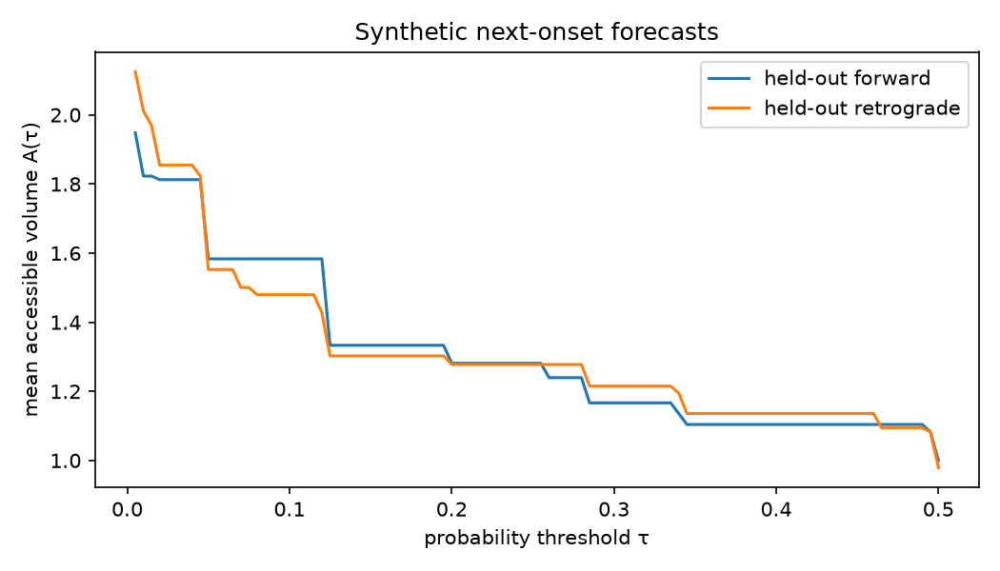

# ZVA-0013 — Forward and retrograde accessible-volume threshold sweep

[Visual archive index](../../README.md) · [Full catalog](../README.md) · [Category: Research figures and measurements](../categories/research-figure.md)

## What this image shows

Forward and retrograde accessible-volume threshold sweep. This figure preserves a measurement, model output, simulation, geometric construction, or research explanation from the Zoe/allgems program.

## Role in Zoe

This figure preserves a measurement, model output, simulation, geometric construction, or research explanation from the Zoe/allgems program.

## Provenance and evidence boundary

**Provenance:** Paper-embedded copy; Zoe/allgems project-generated visual.

The image is preserved with its source context; the visual alone does not prove a scientific or operational claim.

## File identity

- Archive ID: **ZVA-0013**
- Visual family: **figure-000-page-005**
- Dimensions/format: **1050×600 PNG**
- Frames: **1**
- Bytes: **41,593**
- SHA-256: `f4a42267f40663fc7739a631d86fb997e96e3bc51e6c4579e6be8246bfe8e280`
- Original file: [Open full resolution](../../images/ZVA-0013.png)

## Source occurrences

Byte-identical copies are archived once while every known source path remains recorded.

| Source repository/collection | Original path | Canonical link |
|---|---|---|
| research-paper-figures | `05-accessible-volume-beyond-next-token/figures/figure-000-page-005.png` | [Source](https://github.com/Ablation-Tool/research-papers/blob/main/galleries/05-accessible-volume-beyond-next-token/figures/figure-000-page-005.png) |
| research-paper-figures | `10-accessible-volume-architecture-of-autonomy/figures/figure-000-page-022.png` | [Source](https://github.com/Ablation-Tool/research-papers/blob/main/galleries/10-accessible-volume-architecture-of-autonomy/figures/figure-000-page-022.png) |

## Documented context

### Accessible Volume Beyond the Next Token

Source document: `research-paper-figures:05-accessible-volume-beyond-next-token/README.md`

Figure 1: Synthetic forward and retrograde accessible-volume threshold sweeps. Similar breadth coexists with substantially different accuracy and log-loss.

Original embedded figure from Accessible Volume Beyond the Next Token, PDF page 5. The complete page and source PDF remain linked in the research-papers gallery.

### Accessible Volume and the Architecture of Autonomy

Source document: `research-paper-figures:10-accessible-volume-architecture-of-autonomy/README.md`

Figure 1: Synthetic forward and retrograde accessible-volume sweeps. Similar breadth coexists with substantially different correctness and log-loss.

Original embedded figure from Accessible Volume and the Architecture of Autonomy, PDF page 22. The complete page and source PDF remain linked in the research-papers gallery.
