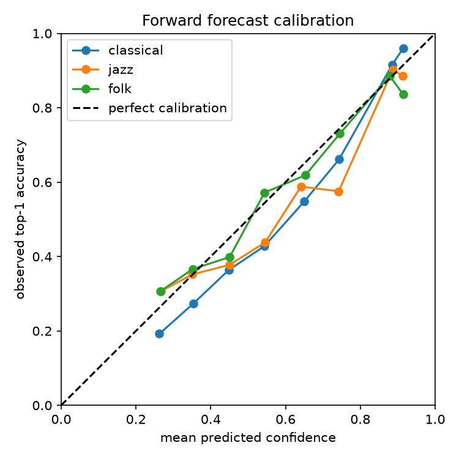

# ZVA-0017 — Forward forecast calibration

[Visual archive index](../../README.md) · [Full catalog](../README.md) · [Category: Research figures and measurements](../categories/research-figure.md)

## What this image shows

Forward forecast calibration. This figure preserves a measurement, model output, simulation, geometric construction, or research explanation from the Zoe/allgems program.

## Role in Zoe

This figure preserves a measurement, model output, simulation, geometric construction, or research explanation from the Zoe/allgems program.

## Provenance and evidence boundary

**Provenance:** Paper-embedded copy; Zoe/allgems project-generated visual.

The image is preserved with its source context; the visual alone does not prove a scientific or operational claim.

## File identity

- Archive ID: **ZVA-0017**
- Visual family: **figure-008-page-008**
- Dimensions/format: **750×750 PNG**
- Frames: **1**
- Bytes: **62,450**
- SHA-256: `ea51040e3db61632fd04f8e359ac6ec0f8e665cee14c63497e70c87b650be7f9`
- Original file: [Open full resolution](../../images/ZVA-0017.png)

## Source occurrences

Byte-identical copies are archived once while every known source path remains recorded.

| Source repository/collection | Original path | Canonical link |
|---|---|---|
| research-paper-figures | `05-accessible-volume-beyond-next-token/figures/figure-008-page-008.png` | [Source](https://github.com/Ablation-Tool/research-papers/blob/main/galleries/05-accessible-volume-beyond-next-token/figures/figure-008-page-008.png) |
| research-paper-figures | `10-accessible-volume-architecture-of-autonomy/figures/figure-008-page-025.png` | [Source](https://github.com/Ablation-Tool/research-papers/blob/main/galleries/10-accessible-volume-architecture-of-autonomy/figures/figure-008-page-025.png) |

## Documented context

### Accessible Volume Beyond the Next Token

Source document: `research-paper-figures:05-accessible-volume-beyond-next-token/README.md`

Figure 5: Forward forecast calibration for the three Nightingale genres.

Original embedded figure from Accessible Volume Beyond the Next Token, PDF page 8. The complete page and source PDF remain linked in the research-papers gallery.

### Accessible Volume and the Architecture of Autonomy

Source document: `research-paper-figures:10-accessible-volume-architecture-of-autonomy/README.md`

Figure 5: Forward forecast calibration for the three Nightingale genres.

Original embedded figure from Accessible Volume and the Architecture of Autonomy, PDF page 25. The complete page and source PDF remain linked in the research-papers gallery.
