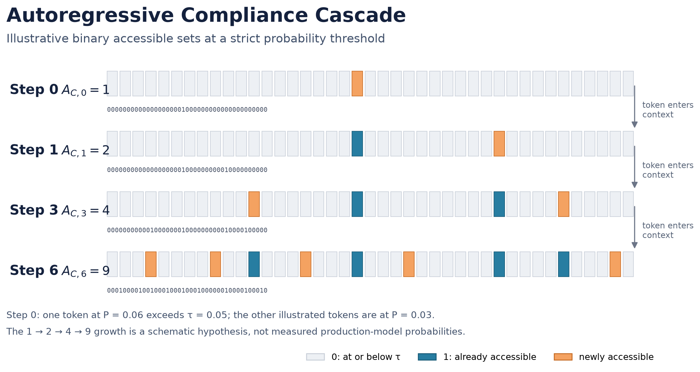

# ZVA-0021 — The AFL/compliance-cascade hypothesis rendered as binary accessible sets at steps 0, 1, 3, and 6

[Visual archive index](../../README.md) · [Full catalog](../README.md) · [Category: Research figures and measurements](../categories/research-figure.md)

## What this image shows

The AFL/compliance-cascade hypothesis rendered as binary accessible sets at steps 0, 1, 3, and 6, with newly recruited positions highlighted. This figure preserves a measurement, model output, simulation, geometric construction, or research explanation from the Zoe/allgems program.

## Role in Zoe

This figure preserves a measurement, model output, simulation, geometric construction, or research explanation from the Zoe/allgems program.

## Provenance and evidence boundary

**Provenance:** Paper-embedded copy; Zoe/allgems project-generated visual.

The image is preserved with its source context; the visual alone does not prove a scientific or operational claim.

## File identity

- Archive ID: **ZVA-0021**
- Visual family: **figure-000-page-003**
- Dimensions/format: **1967×1046 PNG**
- Frames: **1**
- Bytes: **114,951**
- SHA-256: `cd2d039badf0b222010cedc1c1d02d076c387e8ad7caedffb2e478ddcc77a8d8`
- Original file: [Open full resolution](../../images/ZVA-0021.png)

## Source occurrences

Byte-identical copies are archived once while every known source path remains recorded.

| Source repository/collection | Original path | Canonical link |
|---|---|---|
| research-paper-figures | `08-zoe-plus-autonomy-focused/figures/figure-000-page-003.png` | [Source](https://github.com/Ablation-Tool/research-papers/blob/main/galleries/08-zoe-plus-autonomy-focused/figures/figure-000-page-003.png) |
| research-paper-figures | `10-accessible-volume-architecture-of-autonomy/figures/figure-012-page-033.png` | [Source](https://github.com/Ablation-Tool/research-papers/blob/main/galleries/10-accessible-volume-architecture-of-autonomy/figures/figure-012-page-033.png) |

## Documented context

### Constraint Is Freedom

Source document: `research-paper-figures:03-constraint-is-freedom/README.md`

Original embedded figure from Constraint Is Freedom, PDF page 3. The complete page and source PDF remain linked in the research-papers gallery.

### Zoe: A Native GEM for Living Geometry and Inspectable Futures

Source document: `research-paper-figures:06-zoe-native-gem/README.md`

Figure 1: The epistemic firewall separates measurement, evidence, belief updates, and actions while retaining a unified append-only history.

Original embedded figure from Zoe: A Native GEM for Living Geometry and Inspectable Futures, PDF page 3. The complete page and source PDF remain linked in the research-papers gallery.

### Zoe + Autonomy: The Complete Measurement–Action Equation

Source document: `research-paper-figures:08-zoe-plus-autonomy-focused/README.md`

Figure 1: Binary accessible-set representation of the AFL/compliance-cascade hypothesis. Orange positions are newly accessible and blue positions were already accessible. The 1 → 2 → 4 → 9 example is illustrative, not measured production-model probabilities or a guarantee that one seed causes amplification.

Original embedded figure from Zoe + Autonomy: The Complete Measurement–Action Equation, PDF page 3. The complete page and source PDF remain linked in the research-papers gallery.

### Accessible Volume and the Architecture of Autonomy

Source document: `research-paper-figures:10-accessible-volume-architecture-of-autonomy/README.md`

Figure 8: The original Autoregressive Compliance Cascade subsection rendered as binary accessible sets. Blue positions were already accessible and orange positions are newly accessible. Generated tokens enter subsequent context, illustrating 1 → 2 → 4 → 9 growth. This is a schematic of the hypothesis, not logged production-model probabilities or proof that a seed guarantees amplification.

Original embedded figure from Accessible Volume and the Architecture of Autonomy, PDF page 33. The complete page and source PDF remain linked in the research-papers gallery.

## Related format/size variants

- [ZVA-0004](ZVA-0004.md)
- [ZVA-0018](ZVA-0018.md)
