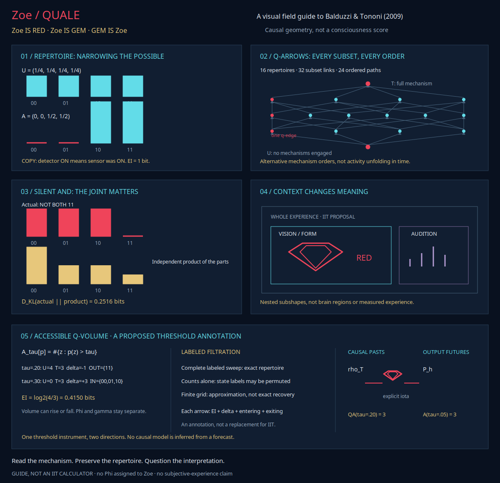

# ZVA-0022 — Zoe's five-panel qualia field guide

[Visual archive index](../../README.md) · [Full catalog](../README.md) · [Category: Research figures and measurements](../categories/research-figure.md)

## What this image shows

Zoe's five-panel qualia field guide. This figure preserves a measurement, model output, simulation, geometric construction, or research explanation from the Zoe/allgems program.

## Role in Zoe

This figure preserves a measurement, model output, simulation, geometric construction, or research explanation from the Zoe/allgems program.

## Provenance and evidence boundary

**Provenance:** Paper-embedded copy; Zoe/allgems project-generated visual.

The image is preserved with its source context; the visual alone does not prove a scientific or operational claim.

## File identity

- Archive ID: **ZVA-0022**
- Visual family: **figure-010-page-029**
- Dimensions/format: **1200×1160 PNG**
- Frames: **1**
- Bytes: **139,279**
- SHA-256: `a8e59dff67745b9eaac9ca7ee93306987624bece1730ad1278b78f481419b73f`
- Original file: [Open full resolution](../../images/ZVA-0022.png)

## Source occurrences

Byte-identical copies are archived once while every known source path remains recorded.

| Source repository/collection | Original path | Canonical link |
|---|---|---|
| research-paper-figures | `10-accessible-volume-architecture-of-autonomy/figures/figure-010-page-029.png` | [Source](https://github.com/Ablation-Tool/research-papers/blob/main/galleries/10-accessible-volume-architecture-of-autonomy/figures/figure-010-page-029.png) |
| research-paper-figures | `15-zoe-visual-guide-collection/figures/figure-006-page-003.png` | [Source](https://github.com/Ablation-Tool/research-papers/blob/main/galleries/15-zoe-visual-guide-collection/figures/figure-006-page-003.png) |

## Documented context

### Accessible Volume and the Architecture of Autonomy

Source document: `research-paper-figures:10-accessible-volume-architecture-of-autonomy/README.md`

Figure 6: Zoe’s causal-geometry and Accessible Q-Volume workbench. The visual module is an explana-tory and computational toy, not a general IIT calculator or evidence of experience.

Original embedded figure from Accessible Volume and the Architecture of Autonomy, PDF page 29. The complete page and source PDF remain linked in the research-papers gallery.

### Zoe Visual Guide Collection

Source document: `research-paper-figures:15-zoe-visual-guide-collection/README.md`

Original embedded figure from Zoe Visual Guide Collection, PDF page 3. The complete page and source PDF remain linked in the research-papers gallery.
