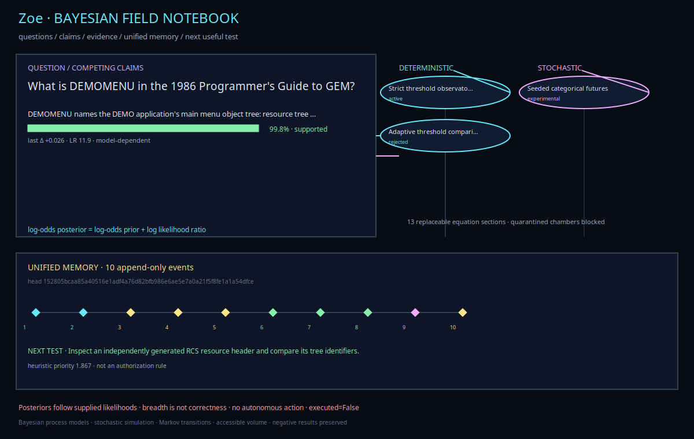

# ZVA-0023 — Zoe Bayesian field notebook

[Visual archive index](../../README.md) · [Full catalog](../README.md) · [Category: Research figures and measurements](../categories/research-figure.md)

## What this image shows

Zoe Bayesian field notebook. This figure preserves a measurement, model output, simulation, geometric construction, or research explanation from the Zoe/allgems program.

## Role in Zoe

This figure preserves a measurement, model output, simulation, geometric construction, or research explanation from the Zoe/allgems program.

## Provenance and evidence boundary

**Provenance:** Paper-embedded copy; Zoe/allgems project-generated visual.

The image is preserved with its source context; the visual alone does not prove a scientific or operational claim.

## File identity

- Archive ID: **ZVA-0023**
- Visual family: **figure-015-page-041**
- Dimensions/format: **1200×760 PNG**
- Frames: **1**
- Bytes: **81,467**
- SHA-256: `ea2092e68d80e301dadf668fead41052f5e4e79e5172ae12165bced6ae8706e1`
- Original file: [Open full resolution](../../images/ZVA-0023.png)

## Source occurrences

Byte-identical copies are archived once while every known source path remains recorded.

| Source repository/collection | Original path | Canonical link |
|---|---|---|
| research-paper-figures | `10-accessible-volume-architecture-of-autonomy/figures/figure-015-page-041.png` | [Source](https://github.com/Ablation-Tool/research-papers/blob/main/galleries/10-accessible-volume-architecture-of-autonomy/figures/figure-015-page-041.png) |

## Documented context

### Accessible Volume and the Architecture of Autonomy

Source document: `research-paper-figures:10-accessible-volume-architecture-of-autonomy/README.md`

Figure 10: Zoe’s Bayesian field notebook: explicit evidence updates, deterministic and stochastic cham-bers, append-only memory, and review-required next-test recommendations.

Original embedded figure from Accessible Volume and the Architecture of Autonomy, PDF page 41. The complete page and source PDF remain linked in the research-papers gallery.
