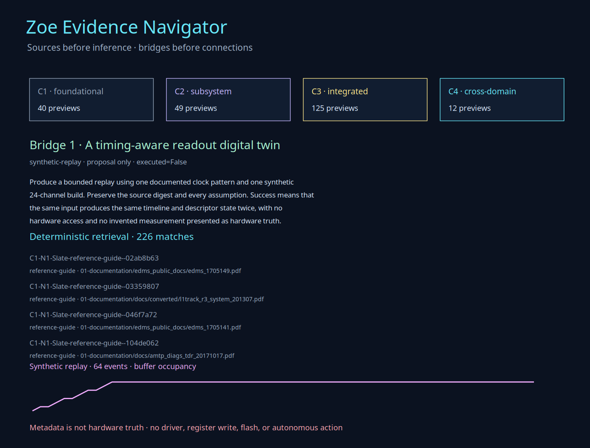

# ZVA-0028 — Zoe Evidence Navigator

[Visual archive index](../../README.md) · [Full catalog](../README.md) · [Category: Research figures and measurements](../categories/research-figure.md)

## What this image shows

Zoe Evidence Navigator. This figure preserves a measurement, model output, simulation, geometric construction, or research explanation from the Zoe/allgems program.

## Role in Zoe

This figure preserves a measurement, model output, simulation, geometric construction, or research explanation from the Zoe/allgems program.

## Provenance and evidence boundary

**Provenance:** Paper-embedded copy; Zoe/allgems project-generated visual.

The image is preserved with its source context; the visual alone does not prove a scientific or operational claim.

## File identity

- Archive ID: **ZVA-0028**
- Visual family: **figure-021-page-048**
- Dimensions/format: **1400×1064 PNG**
- Frames: **1**
- Bytes: **123,548**
- SHA-256: `815b19eea52e3ce8fbb6d0f04151a2961f912bb9658a25f58e372523b5e86cef`
- Original file: [Open full resolution](../../images/ZVA-0028.png)

## Source occurrences

Byte-identical copies are archived once while every known source path remains recorded.

| Source repository/collection | Original path | Canonical link |
|---|---|---|
| research-paper-figures | `10-accessible-volume-architecture-of-autonomy/figures/figure-021-page-048.png` | [Source](https://github.com/Ablation-Tool/research-papers/blob/main/galleries/10-accessible-volume-architecture-of-autonomy/figures/figure-021-page-048.png) |
| research-paper-figures | `15-zoe-visual-guide-collection/figures/figure-018-page-008.png` | [Source](https://github.com/Ablation-Tool/research-papers/blob/main/galleries/15-zoe-visual-guide-collection/figures/figure-018-page-008.png) |

## Documented context

### Accessible Volume and the Architecture of Autonomy

Source document: `research-paper-figures:10-accessible-volume-architecture-of-autonomy/README.md`

Original embedded figure from Accessible Volume and the Architecture of Autonomy, PDF page 48. The complete page and source PDF remain linked in the research-papers gallery.

### Zoe Visual Guide Collection

Source document: `research-paper-figures:15-zoe-visual-guide-collection/README.md`

Original embedded figure from Zoe Visual Guide Collection, PDF page 8. The complete page and source PDF remain linked in the research-papers gallery.
