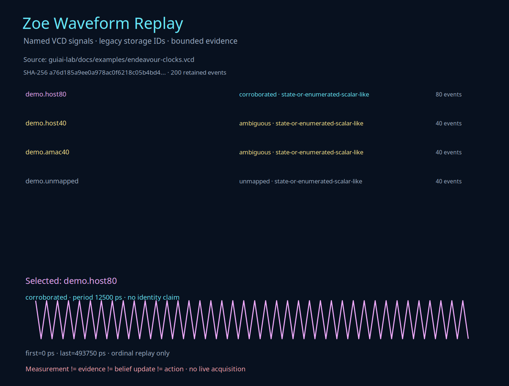

# ZVA-0029 — Zoe Waveform Replay

[Visual archive index](../../README.md) · [Full catalog](../README.md) · [Category: Research figures and measurements](../categories/research-figure.md)

## What this image shows

Zoe Waveform Replay. This visual belongs to Zoe’s CERN/source-evidence program, helping a reader inspect a corpus, protocol, replay, virtual system, or process boundary.

## Role in Zoe

This visual belongs to Zoe’s CERN/source-evidence program, helping a reader inspect a corpus, protocol, replay, virtual system, or process boundary.

## Provenance and evidence boundary

**Provenance:** Paper-embedded copy; Zoe/allgems project-generated visual.

The image is preserved with its source context; the visual alone does not prove a scientific or operational claim.

## File identity

- Archive ID: **ZVA-0029**
- Visual family: **figure-022-page-048**
- Dimensions/format: **1400×1064 PNG**
- Frames: **1**
- Bytes: **122,567**
- SHA-256: `82c8b0dd15f593bd0e849d798f768cefc4a942adab5386178dd9a0246b43bff9`
- Original file: [Open full resolution](../../images/ZVA-0029.png)

## Source occurrences

Byte-identical copies are archived once while every known source path remains recorded.

| Source repository/collection | Original path | Canonical link |
|---|---|---|
| research-paper-figures | `10-accessible-volume-architecture-of-autonomy/figures/figure-022-page-048.png` | [Source](https://github.com/Ablation-Tool/research-papers/blob/main/galleries/10-accessible-volume-architecture-of-autonomy/figures/figure-022-page-048.png) |
| research-paper-figures | `15-zoe-visual-guide-collection/figures/figure-014-page-006.png` | [Source](https://github.com/Ablation-Tool/research-papers/blob/main/galleries/15-zoe-visual-guide-collection/figures/figure-014-page-006.png) |

## Documented context

### Accessible Volume and the Architecture of Autonomy

Source document: `research-paper-figures:10-accessible-volume-architecture-of-autonomy/README.md`

Original embedded figure from Accessible Volume and the Architecture of Autonomy, PDF page 48. The complete page and source PDF remain linked in the research-papers gallery.

### Zoe Visual Guide Collection

Source document: `research-paper-figures:15-zoe-visual-guide-collection/README.md`

Original embedded figure from Zoe Visual Guide Collection, PDF page 6. The complete page and source PDF remain linked in the research-papers gallery.
