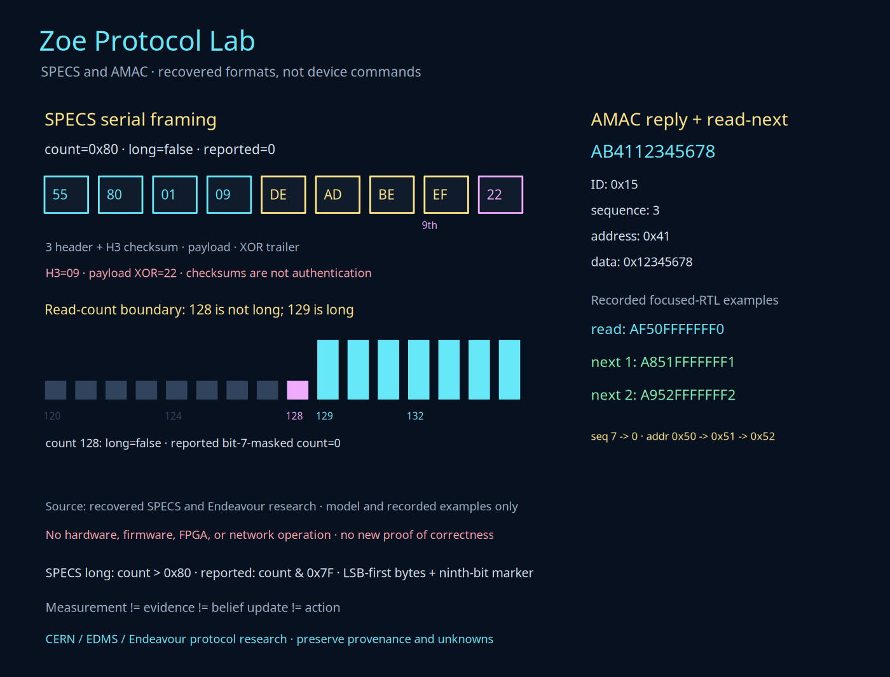

# ZVA-0031 — Zoe Protocol Lab

[Visual archive index](../../README.md) · [Full catalog](../README.md) · [Category: Research figures and measurements](../categories/research-figure.md)

## What this image shows

Zoe Protocol Lab. This visual belongs to Zoe’s CERN/source-evidence program, helping a reader inspect a corpus, protocol, replay, virtual system, or process boundary.

## Role in Zoe

This visual belongs to Zoe’s CERN/source-evidence program, helping a reader inspect a corpus, protocol, replay, virtual system, or process boundary.

## Provenance and evidence boundary

**Provenance:** Paper-embedded copy; Zoe/allgems project-generated visual.

The image is preserved with its source context; the visual alone does not prove a scientific or operational claim.

## File identity

- Archive ID: **ZVA-0031**
- Visual family: **figure-024-page-049**
- Dimensions/format: **1400×1064 PNG**
- Frames: **1**
- Bytes: **139,233**
- SHA-256: `31fb0cddc858316932eef468dc10bce2bb6a1e6cdafc372002e18e953381f2a0`
- Original file: [Open full resolution](../../images/ZVA-0031.png)

## Source occurrences

Byte-identical copies are archived once while every known source path remains recorded.

| Source repository/collection | Original path | Canonical link |
|---|---|---|
| research-paper-figures | `10-accessible-volume-architecture-of-autonomy/figures/figure-024-page-049.png` | [Source](https://github.com/Ablation-Tool/research-papers/blob/main/galleries/10-accessible-volume-architecture-of-autonomy/figures/figure-024-page-049.png) |
| research-paper-figures | `15-zoe-visual-guide-collection/figures/figure-013-page-005.png` | [Source](https://github.com/Ablation-Tool/research-papers/blob/main/galleries/15-zoe-visual-guide-collection/figures/figure-013-page-005.png) |

## Documented context

### Accessible Volume and the Architecture of Autonomy

Source document: `research-paper-figures:10-accessible-volume-architecture-of-autonomy/README.md`

Figure 17: Zoe Protocol Lab: recovered SPECS and AMAC protocol examples. No hardware, firmware, FPGA, or network operation is performed, and checksums are not authentication.

Original embedded figure from Accessible Volume and the Architecture of Autonomy, PDF page 49. The complete page and source PDF remain linked in the research-papers gallery.

### Zoe Visual Guide Collection

Source document: `research-paper-figures:15-zoe-visual-guide-collection/README.md`

Original embedded figure from Zoe Visual Guide Collection, PDF page 5. The complete page and source PDF remain linked in the research-papers gallery.
