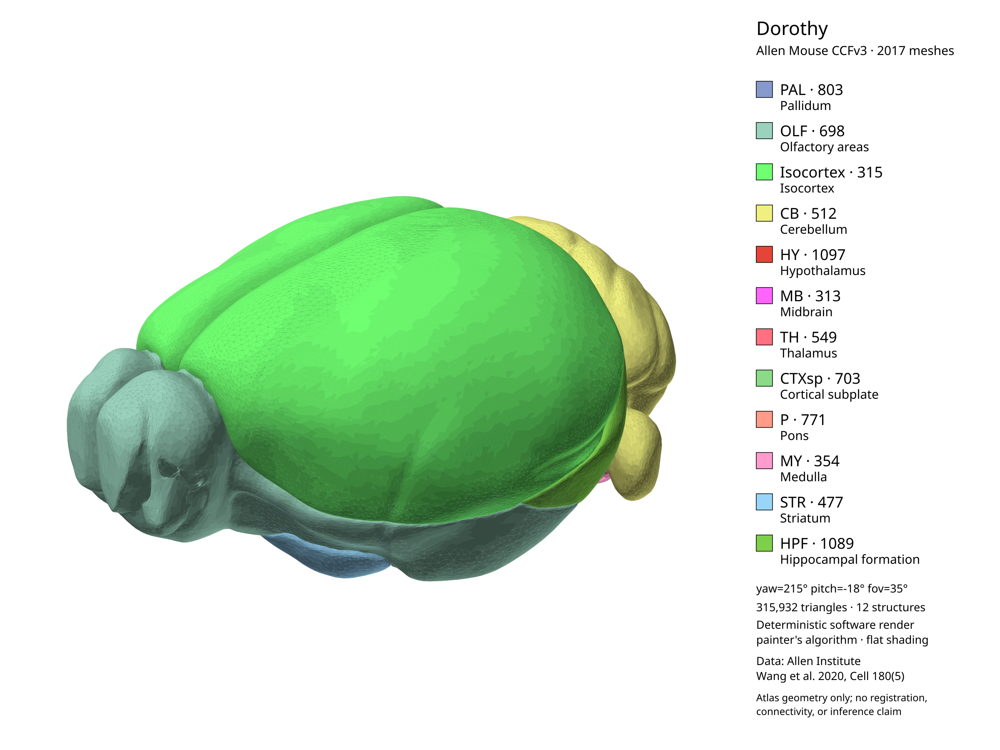

# ZVA-0039 — Dorothy’s deterministic twelve-structure Allen Mouse CCFv3 rendering, with structure labels, tri

[Visual archive index](../../README.md) · [Full catalog](../README.md) · [Category: Research figures and measurements](../categories/research-figure.md)

## What this image shows

Dorothy’s deterministic twelve-structure Allen Mouse CCFv3 rendering, with structure labels, triangle count, camera state, and an explicit no-registration/no-connectivity boundary.

## Role in Zoe

This visual belongs to Dorothy’s inspectable spatial-research program, making reference geometry or a review instrument available for direct inspection.

## Provenance and evidence boundary

**Provenance:** Paper-embedded copy; Zoe render using Allen Institute reference data.

Preclinical mouse-atlas geometry only; not patient anatomy, registration, diagnosis, or treatment evidence.

## File identity

- Archive ID: **ZVA-0039**
- Visual family: **figure-032-page-069**
- Dimensions/format: **2400×1800 PNG**
- Frames: **1**
- Bytes: **1,300,940**
- SHA-256: `d82f35700af7c07306a157c8ff697f10374478f7975e1c31c81215400af323f7`
- Original file: [Open full resolution](../../images/ZVA-0039.png)

## Source occurrences

Byte-identical copies are archived once while every known source path remains recorded.

| Source repository/collection | Original path | Canonical link |
|---|---|---|
| research-paper-figures | `10-accessible-volume-architecture-of-autonomy/figures/figure-032-page-069.png` | [Source](https://github.com/Ablation-Tool/research-papers/blob/main/galleries/10-accessible-volume-architecture-of-autonomy/figures/figure-032-page-069.png) |

## Documented context

### Accessible Volume and the Architecture of Autonomy

Source document: `research-paper-figures:10-accessible-volume-architecture-of-autonomy/README.md`

Original embedded figure from Accessible Volume and the Architecture of Autonomy, PDF page 69. The complete page and source PDF remain linked in the research-papers gallery.
