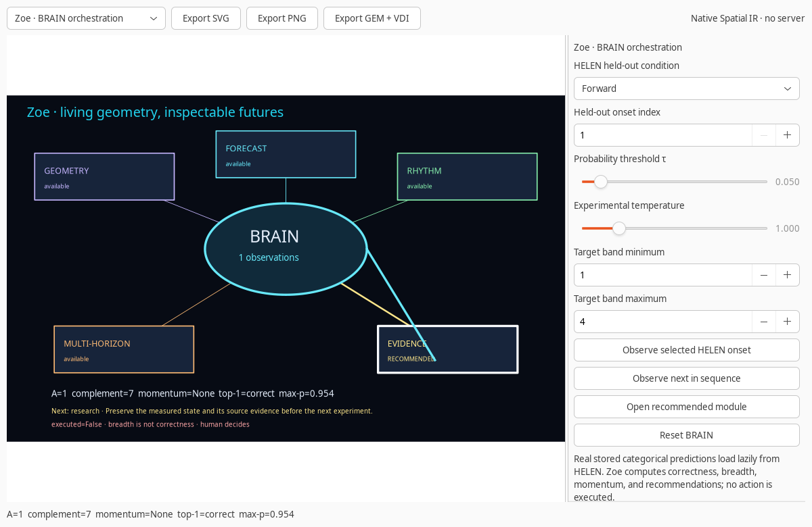

# ZVA-0047 — Zoe native BRAIN after a real HELEN observation

[Visual archive index](../../README.md) · [Full catalog](../README.md) · [Category: Native interfaces and application scenes](../categories/interface.md)

## What this image shows

Zoe native BRAIN after a real HELEN observation. This image documents a native, mobile, browser, or desktop interface and its available controls at a particular recorded state.

## Role in Zoe

This image documents a native, mobile, browser, or desktop interface and its available controls at a particular recorded state.

## Provenance and evidence boundary

**Provenance:** Paper-embedded copy; Zoe project interface capture.

A screenshot documents the displayed interface state; it is not independent experimental validation.

## File identity

- Archive ID: **ZVA-0047**
- Visual family: **figure-009-page-003**
- Dimensions/format: **1200×780 PNG**
- Frames: **1**
- Bytes: **86,265**
- SHA-256: `a57ff601a5b3e42369da1030dfd3115abe5930394392c66be59252b17e4a80d7`
- Original file: [Open full resolution](../../images/ZVA-0047.png)

## Source occurrences

Byte-identical copies are archived once while every known source path remains recorded.

| Source repository/collection | Original path | Canonical link |
|---|---|---|
| research-paper-figures | `15-zoe-visual-guide-collection/figures/figure-009-page-003.png` | [Source](https://github.com/Ablation-Tool/research-papers/blob/main/galleries/15-zoe-visual-guide-collection/figures/figure-009-page-003.png) |

## Documented context

### Zoe Visual Guide Collection

Source document: `research-paper-figures:15-zoe-visual-guide-collection/README.md`

Original embedded figure from Zoe Visual Guide Collection, PDF page 3. The complete page and source PDF remain linked in the research-papers gallery.
