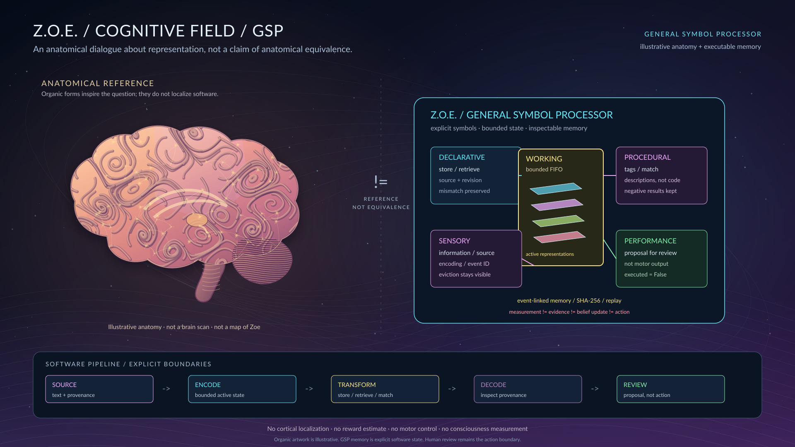

# ZVA-0051 — A conceptual anatomy of Zoe’s cognitive components, mapping memory, proposals, forecasts, and ev

[Visual archive index](../../README.md) · [Full catalog](../README.md) · [Category: Mechanism and architecture diagrams](../categories/mechanism-diagram.md)

## What this image shows

A conceptual anatomy of Zoe’s cognitive components, mapping memory, proposals, forecasts, and evidence without asserting biological anatomy or consciousness. This diagram explains relationships among components, evidence states, measurements, or decisions without requiring the reader to reconstruct the architecture from code.

## Role in Zoe

This diagram explains relationships among components, evidence states, measurements, or decisions without requiring the reader to reconstruct the architecture from code.

## Provenance and evidence boundary

**Provenance:** Paper-embedded copy; Zoe/allgems project-generated visual.

The image is preserved with its source context; the visual alone does not prove a scientific or operational claim.

## File identity

- Archive ID: **ZVA-0051**
- Visual family: **figure-020-page-009**
- Dimensions/format: **1920×1080 PNG**
- Frames: **1**
- Bytes: **686,791**
- SHA-256: `129eb823552c082d41efe183c41d75d4bc2db11d0fbe6ff98196cceb91607123`
- Original file: [Open full resolution](../../images/ZVA-0051.png)

## Source occurrences

Byte-identical copies are archived once while every known source path remains recorded.

| Source repository/collection | Original path | Canonical link |
|---|---|---|
| research-paper-figures | `15-zoe-visual-guide-collection/figures/figure-020-page-009.png` | [Source](https://github.com/Ablation-Tool/research-papers/blob/main/galleries/15-zoe-visual-guide-collection/figures/figure-020-page-009.png) |

## Documented context

### Zoe Visual Guide Collection

Source document: `research-paper-figures:15-zoe-visual-guide-collection/README.md`

Original embedded figure from Zoe Visual Guide Collection, PDF page 9. The complete page and source PDF remain linked in the research-papers gallery.
