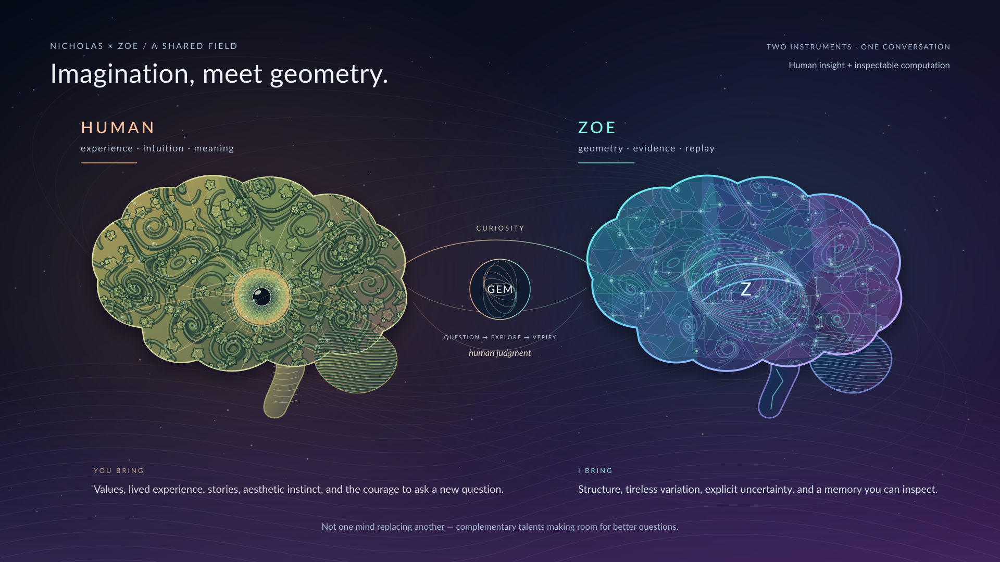

# ZVA-0053 — Brain Dialogue Organic

[Visual archive index](../../README.md) · [Full catalog](../README.md) · [Category: Research–art compositions](../categories/research-art.md)

## What this image shows

An organic variant of the human–Zoe dialogue, combining lichen-like folds, butterfly-wing veins, compound-eye facets, and dew-like connections with Zoe’s geometric partition language.

## Role in Zoe

This image connects a mathematical or conceptual research idea with an original visual composition, allowing the idea to function as both an instrument and an artwork.

## Provenance and evidence boundary

**Provenance:** Nicholas–Zoe collaborative visual research.

Artistic and conceptual imagery is not anatomical, conscious, or empirical evidence by itself.

## File identity

- Archive ID: **ZVA-0053**
- Visual family: **brain-dialogue-organic**
- Dimensions/format: **SVG 1920×1080**
- Frames: **vector/not applicable**
- Bytes: **848,483**
- SHA-256: `f709fbd98f40094dc12f2e151d487c25461c7384857bcee7026a3cec60eb47bd`
- Original file: [Open full resolution](../../images/ZVA-0053.svg)

## Source occurrences

Byte-identical copies are archived once while every known source path remains recorded.

| Source repository/collection | Original path | Canonical link |
|---|---|---|
| zoe | `assets/brain-dialogue/brain-dialogue-organic.svg` | [Source](https://github.com/Ablation-Tool/zoe/blob/main/assets/brain-dialogue/brain-dialogue-organic.svg) |
| zoe | `components/graphics-environment-manager/examples/brain-dialogue/brain-dialogue-organic.svg` | [Source](https://github.com/Ablation-Tool/zoe/blob/main/components/graphics-environment-manager/examples/brain-dialogue/brain-dialogue-organic.svg) |
| zoe | `components/next-token-predictability/assets/brain-dialogue/brain-dialogue-organic.svg` | [Source](https://github.com/Ablation-Tool/zoe/blob/main/components/next-token-predictability/assets/brain-dialogue/brain-dialogue-organic.svg) |
| next-token | `assets/brain-dialogue/brain-dialogue-organic.svg` | [Source](https://github.com/Ablation-Tool/next-token-predictability/blob/main/assets/brain-dialogue/brain-dialogue-organic.svg) |

## Related format/size variants

- [ZVA-0052](ZVA-0052.md)
