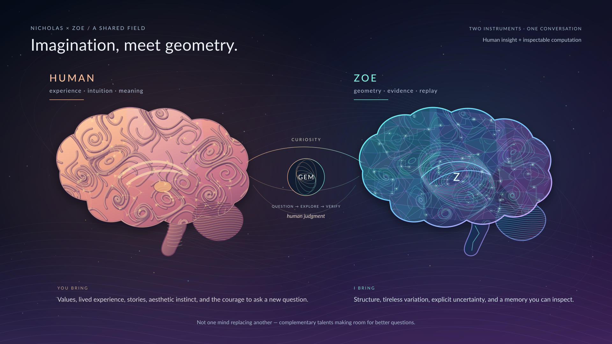

# ZVA-0055 — Brain Dialogue

[Visual archive index](../../README.md) · [Full catalog](../README.md) · [Category: Research–art compositions](../categories/research-art.md)

## What this image shows

A structured visual conversation between human and Zoe ways of working, pairing intuitive meaning with geometry, evidence, and replay. This image connects a mathematical or conceptual research idea with an original visual composition, allowing the idea to function as both an instrument and an artwork.

## Role in Zoe

This image connects a mathematical or conceptual research idea with an original visual composition, allowing the idea to function as both an instrument and an artwork.

## Provenance and evidence boundary

**Provenance:** Nicholas–Zoe collaborative visual research.

Artistic and conceptual imagery is not anatomical, conscious, or empirical evidence by itself.

## File identity

- Archive ID: **ZVA-0055**
- Visual family: **brain-dialogue**
- Dimensions/format: **SVG 1920×1080**
- Frames: **vector/not applicable**
- Bytes: **609,359**
- SHA-256: `2750ede6b3902ba62a9bc11107bb20fef1596876e94a82dd75c96728961fb394`
- Original file: [Open full resolution](../../images/ZVA-0055.svg)

## Source occurrences

Byte-identical copies are archived once while every known source path remains recorded.

| Source repository/collection | Original path | Canonical link |
|---|---|---|
| zoe | `assets/brain-dialogue/brain-dialogue.svg` | [Source](https://github.com/Ablation-Tool/zoe/blob/main/assets/brain-dialogue/brain-dialogue.svg) |
| zoe | `components/graphics-environment-manager/examples/brain-dialogue/brain-dialogue.svg` | [Source](https://github.com/Ablation-Tool/zoe/blob/main/components/graphics-environment-manager/examples/brain-dialogue/brain-dialogue.svg) |
| zoe | `components/next-token-predictability/assets/brain-dialogue/brain-dialogue.svg` | [Source](https://github.com/Ablation-Tool/zoe/blob/main/components/next-token-predictability/assets/brain-dialogue/brain-dialogue.svg) |
| next-token | `assets/brain-dialogue/brain-dialogue.svg` | [Source](https://github.com/Ablation-Tool/next-token-predictability/blob/main/assets/brain-dialogue/brain-dialogue.svg) |

## Related format/size variants

- [ZVA-0054](ZVA-0054.md)
