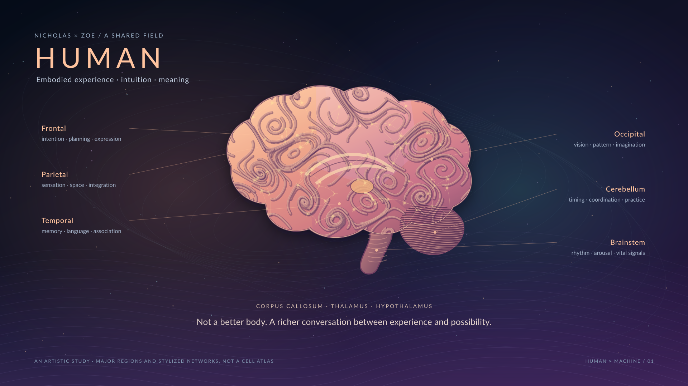

# ZVA-0058 — Human Brain

[Visual archive index](../../README.md) · [Full catalog](../README.md) · [Category: Research–art compositions](../categories/research-art.md)

## What this image shows

The human plate in the shared-field series, using an illustrative brain silhouette and organic visual structures to represent lived experience, values, intuition, and meaning. This image connects a mathematical or conceptual research idea with an original visual composition, allowing the idea to function as both an instrument and an artwork.

## Role in Zoe

This image connects a mathematical or conceptual research idea with an original visual composition, allowing the idea to function as both an instrument and an artwork.

## Provenance and evidence boundary

**Provenance:** Nicholas–Zoe collaborative visual research.

Artistic and conceptual imagery is not anatomical, conscious, or empirical evidence by itself.

## File identity

- Archive ID: **ZVA-0058**
- Visual family: **human-brain**
- Dimensions/format: **1920×1080 PNG**
- Frames: **1**
- Bytes: **877,463**
- SHA-256: `1b521638c025e79979380a37486476cd543267745f95232a4f6c9d651f1e2899`
- Original file: [Open full resolution](../../images/ZVA-0058.png)

## Source occurrences

Byte-identical copies are archived once while every known source path remains recorded.

| Source repository/collection | Original path | Canonical link |
|---|---|---|
| zoe | `assets/brain-dialogue/human-brain.png` | [Source](https://github.com/Ablation-Tool/zoe/blob/main/assets/brain-dialogue/human-brain.png) |
| zoe | `components/graphics-environment-manager/examples/brain-dialogue/human-brain.png` | [Source](https://github.com/Ablation-Tool/zoe/blob/main/components/graphics-environment-manager/examples/brain-dialogue/human-brain.png) |
| zoe | `components/next-token-predictability/assets/brain-dialogue/human-brain.png` | [Source](https://github.com/Ablation-Tool/zoe/blob/main/components/next-token-predictability/assets/brain-dialogue/human-brain.png) |
| next-token | `assets/brain-dialogue/human-brain.png` | [Source](https://github.com/Ablation-Tool/next-token-predictability/blob/main/assets/brain-dialogue/human-brain.png) |

## Related format/size variants

- [ZVA-0059](ZVA-0059.md)
