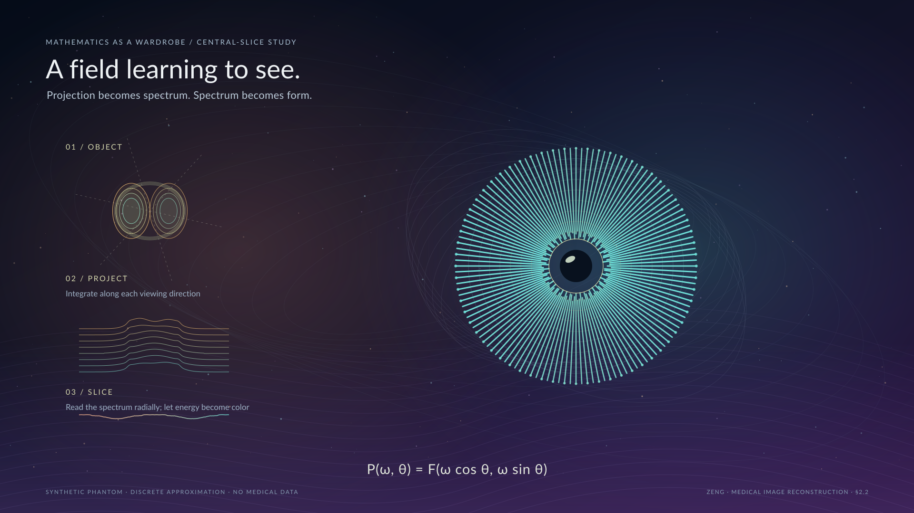

# ZVA-0061 — Projection Iris

[Visual archive index](../../README.md) · [Full catalog](../README.md) · [Category: Research–art compositions](../categories/research-art.md)

## What this image shows

A central-slice study titled “A field learning to see.” Projection becomes spectrum and spectrum becomes form; the work pairs a mathematical research instrument with original visual composition.

## Role in Zoe

This image connects a mathematical or conceptual research idea with an original visual composition, allowing the idea to function as both an instrument and an artwork.

## Provenance and evidence boundary

**Provenance:** Nicholas–Zoe collaborative visual research.

Artistic and conceptual imagery is not anatomical, conscious, or empirical evidence by itself.

## File identity

- Archive ID: **ZVA-0061**
- Visual family: **projection-iris**
- Dimensions/format: **SVG 1920×1080**
- Frames: **vector/not applicable**
- Bytes: **81,464**
- SHA-256: `24e5f37cb73131debc8a8659bdcf9f4660246c874f0e7655f50365274a9c580d`
- Original file: [Open full resolution](../../images/ZVA-0061.svg)

## Source occurrences

Byte-identical copies are archived once while every known source path remains recorded.

| Source repository/collection | Original path | Canonical link |
|---|---|---|
| zoe | `assets/brain-dialogue/projection-iris.svg` | [Source](https://github.com/Ablation-Tool/zoe/blob/main/assets/brain-dialogue/projection-iris.svg) |
| zoe | `components/graphics-environment-manager/examples/brain-dialogue/projection-iris.svg` | [Source](https://github.com/Ablation-Tool/zoe/blob/main/components/graphics-environment-manager/examples/brain-dialogue/projection-iris.svg) |
| zoe | `components/next-token-predictability/assets/brain-dialogue/projection-iris.svg` | [Source](https://github.com/Ablation-Tool/zoe/blob/main/components/next-token-predictability/assets/brain-dialogue/projection-iris.svg) |
| next-token | `assets/brain-dialogue/projection-iris.svg` | [Source](https://github.com/Ablation-Tool/next-token-predictability/blob/main/assets/brain-dialogue/projection-iris.svg) |

## Related format/size variants

- [ZVA-0060](ZVA-0060.md)
