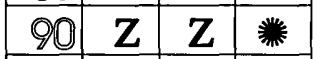

# ZVA-0077 — Symbol Z

[Visual archive index](../../README.md) · [Full catalog](../README.md) · [Category: Source references and derivative reading copies](../categories/reference.md)

## What this image shows

A supplied Z/z glyph-grid reference associated with the Zoe/GEM visual study. This asset preserves source context or a derivative reading view so that generated interpretations remain distinguishable from their references.

## Role in Zoe

This asset preserves source context or a derivative reading view so that generated interpretations remain distinguishable from their references.

## Provenance and evidence boundary

**Provenance:** User-supplied visual reference.

This is a supplied glyph/reference screenshot, not a Zoe-created scientific diagram.

## File identity

- Archive ID: **ZVA-0077**
- Visual family: **symbol-z**
- Dimensions/format: **320×59 PNG**
- Frames: **1**
- Bytes: **4,664**
- SHA-256: `17942ebe05b3c5030a3d9bf2590b5543264dd2cecbb0070dece08b9125f1b5aa`
- Original file: [Open full resolution](../../images/ZVA-0077.png)

## Source occurrences

Byte-identical copies are archived once while every known source path remains recorded.

| Source repository/collection | Original path | Canonical link |
|---|---|---|
| zoe | `assets/branding/references/symbol-z.png` | [Source](https://github.com/Ablation-Tool/zoe/blob/main/assets/branding/references/symbol-z.png) |
