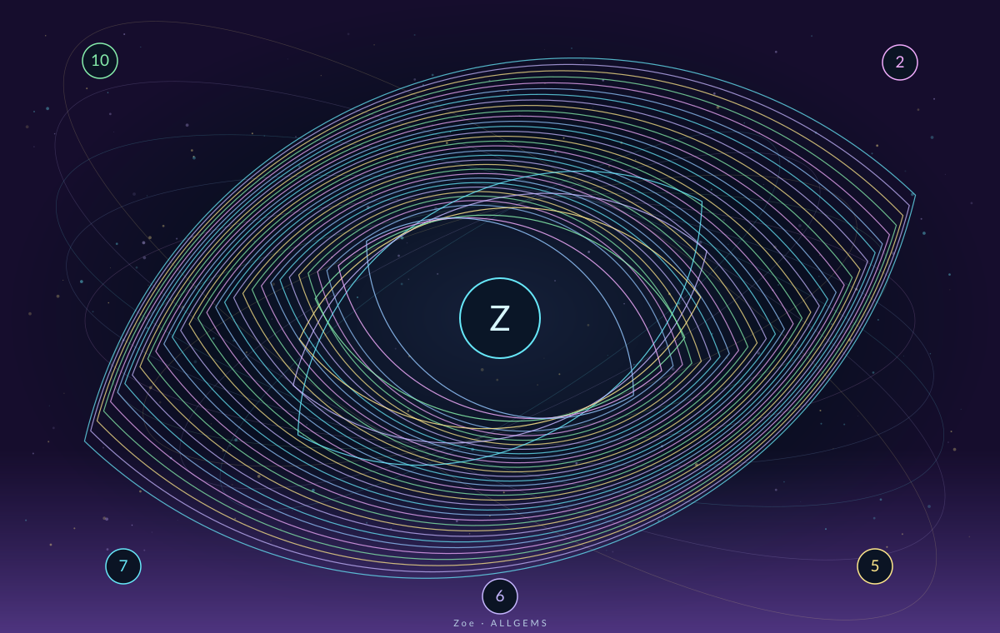

# ZVA-0078 — Zoe Eye

[Visual archive index](../../README.md) · [Full catalog](../README.md) · [Category: Identity, emblems, and interface icons](../categories/branding.md)

## What this image shows

The primary Zoe orbital emblem: a central Z, nested eye curves, stars, and numbered nodes generated from the user-supplied orbital reference. It is an original identity composition, not a scientific model.

## Role in Zoe

This visual supports recognition, navigation, application identity, or a cohesive visual language across Zoe and its components.

## Provenance and evidence boundary

**Provenance:** Project identity or interface asset.

Functional and identity artwork does not constitute research evidence.

## File identity

- Archive ID: **ZVA-0078**
- Visual family: **zoe-eye**
- Dimensions/format: **1200×760 PNG**
- Frames: **1**
- Bytes: **677,979**
- SHA-256: `bd214632e1f0b760d8c3bbcd2eb8bf9ff18f6f8b00156d85a9b4cbd0635305de`
- Original file: [Open full resolution](../../images/ZVA-0078.png)

## Source occurrences

Byte-identical copies are archived once while every known source path remains recorded.

| Source repository/collection | Original path | Canonical link |
|---|---|---|
| zoe | `assets/branding/zoe-eye.png` | [Source](https://github.com/Ablation-Tool/zoe/blob/main/assets/branding/zoe-eye.png) |
| zoe | `mobile/android/app/src/main/res/drawable/zoe_eye.png` | [Source](https://github.com/Ablation-Tool/zoe/blob/main/mobile/android/app/src/main/res/drawable/zoe_eye.png) |

## Documented context

### README.md

Source document: `zoe:README.md`

Zoe allgems orbital eye emblem

## Related format/size variants

- [ZVA-0079](ZVA-0079.md)
