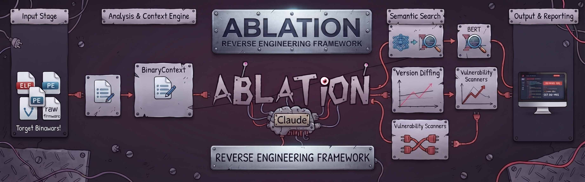

# ZVA-0082 — Ablation Framework Diagram

[Visual archive index](../../README.md) · [Full catalog](../README.md) · [Category: Mechanism and architecture diagrams](../categories/mechanism-diagram.md)

## What this image shows

A dense framework collage showing Ablation’s reverse-engineering workspace, analysis artifacts, and relationships among its tools; it is a documentary project interface rather than a Zoe emblem.

## Role in Zoe

This diagram explains relationships among components, evidence states, measurements, or decisions without requiring the reader to reconstruct the architecture from code.

## Provenance and evidence boundary

**Provenance:** Project identity or interface asset.

Functional and identity artwork does not constitute research evidence.

## File identity

- Archive ID: **ZVA-0082**
- Visual family: **ablation-framework-diagram**
- Dimensions/format: **3686×1152 JPEG**
- Frames: **1**
- Bytes: **2,227,164**
- SHA-256: `7d2245505ce8fb3581dc8f6281a5dae980a95c72e992859f7a440c38be4b3c87`
- Original file: [Open full resolution](../../images/ZVA-0082.jpeg)

## Source occurrences

Byte-identical copies are archived once while every known source path remains recorded.

| Source repository/collection | Original path | Canonical link |
|---|---|---|
| zoe | `components/ablation/assets/branding/ablation-framework-diagram.jpeg` | [Source](https://github.com/Ablation-Tool/zoe/blob/main/components/ablation/assets/branding/ablation-framework-diagram.jpeg) |
