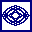

# ZVA-0087 — GEM Woven Diamond

[Visual archive index](../../README.md) · [Full catalog](../README.md) · [Category: Artwork and generative compositions](../categories/artwork.md)

## What this image shows

An original GEM woven-diamond geometric ornament, preserving the project’s interest in executable Spatial IR and decorative mathematical structure. This is part of Zoe’s creative geometry and generative-art practice, preserving the artistic side of the project alongside its scientific instruments.

## Role in Zoe

This is part of Zoe’s creative geometry and generative-art practice, preserving the artistic side of the project alongside its scientific instruments.

## Provenance and evidence boundary

**Provenance:** Project identity or interface asset.

Functional and identity artwork does not constitute research evidence.

## File identity

- Archive ID: **ZVA-0087**
- Visual family: **gem-woven-diamond**
- Dimensions/format: **32×32 PNG**
- Frames: **1**
- Bytes: **312**
- SHA-256: `37230e2b66fb698d7d209aacf3078af987011655e43500a1944b138f04880f81`
- Original file: [Open full resolution](../../images/ZVA-0087.png)

## Source occurrences

Byte-identical copies are archived once while every known source path remains recorded.

| Source repository/collection | Original path | Canonical link |
|---|---|---|
| zoe | `components/ablation/assets/branding/woven-diamond/linux/hicolor/32x32/apps/gem-woven-diamond.png` | [Source](https://github.com/Ablation-Tool/zoe/blob/main/components/ablation/assets/branding/woven-diamond/linux/hicolor/32x32/apps/gem-woven-diamond.png) |
| zoe | `components/ablation/assets/branding/woven-diamond/macos/gem-woven-diamond.iconset/icon_16x16@2x.png` | [Source](https://github.com/Ablation-Tool/zoe/blob/main/components/ablation/assets/branding/woven-diamond/macos/gem-woven-diamond.iconset/icon_16x16@2x.png) |
| zoe | `components/ablation/assets/branding/woven-diamond/macos/gem-woven-diamond.iconset/icon_32x32.png` | [Source](https://github.com/Ablation-Tool/zoe/blob/main/components/ablation/assets/branding/woven-diamond/macos/gem-woven-diamond.iconset/icon_32x32.png) |
| zoe | `components/ablation/assets/branding/woven-diamond/png/gem-woven-diamond-32x32.png` | [Source](https://github.com/Ablation-Tool/zoe/blob/main/components/ablation/assets/branding/woven-diamond/png/gem-woven-diamond-32x32.png) |
| zoe | `components/ablation/assets/branding/woven-diamond/web/favicon-32x32.png` | [Source](https://github.com/Ablation-Tool/zoe/blob/main/components/ablation/assets/branding/woven-diamond/web/favicon-32x32.png) |
| zoe | `components/ablation/gem-lab/gem/icons/gem-woven-diamond-32.png` | [Source](https://github.com/Ablation-Tool/zoe/blob/main/components/ablation/gem-lab/gem/icons/gem-woven-diamond-32.png) |

## Related format/size variants

- [ZVA-0083](ZVA-0083.md)
- [ZVA-0084](ZVA-0084.md)
- [ZVA-0085](ZVA-0085.md)
- [ZVA-0086](ZVA-0086.md)
- [ZVA-0088](ZVA-0088.md)
- [ZVA-0089](ZVA-0089.md)
- [ZVA-0090](ZVA-0090.md)
- [ZVA-0091](ZVA-0091.md)
- [ZVA-0165](ZVA-0165.md)
