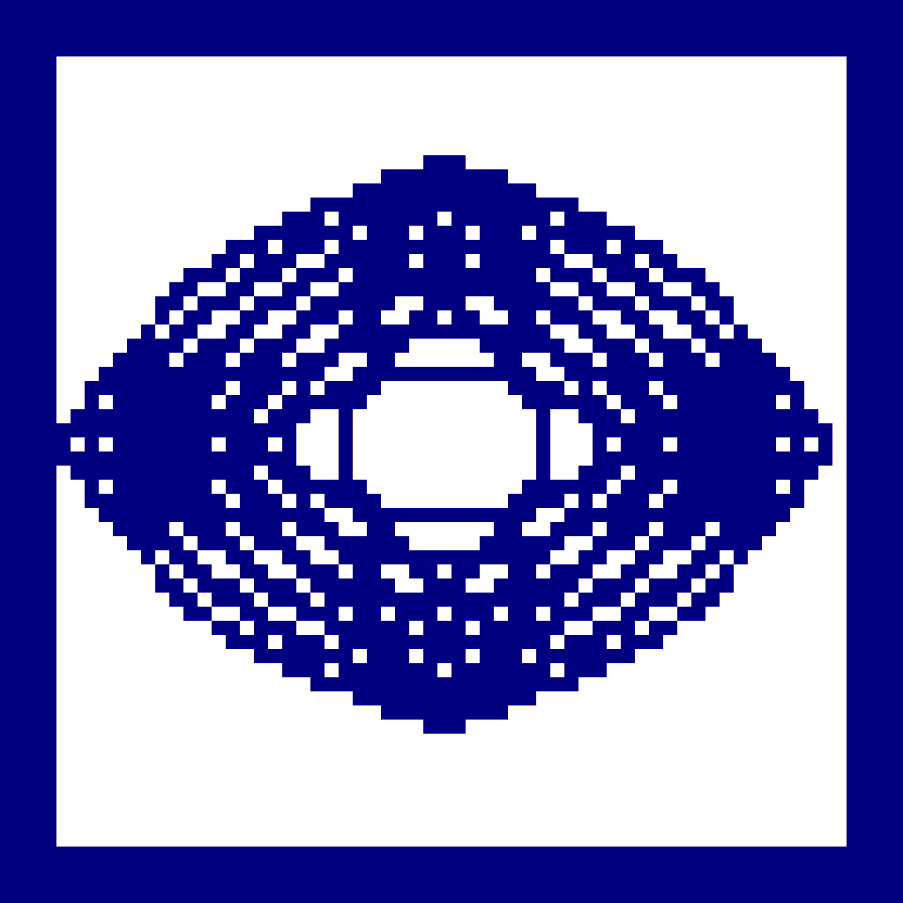

# ZVA-0092 — Icon 512x512@2x

[Visual archive index](../../README.md) · [Full catalog](../README.md) · [Category: Artwork and generative compositions](../categories/artwork.md)

## What this image shows

The woven-diamond project artwork exported as Icon 512x512@2x for application, web, repository, or operating-system use. This entry preserves that specific presentation size and purpose.

## Role in Zoe

This is part of Zoe’s creative geometry and generative-art practice, preserving the artistic side of the project alongside its scientific instruments.

## Provenance and evidence boundary

**Provenance:** Project identity or interface asset.

Functional and identity artwork does not constitute research evidence.

## File identity

- Archive ID: **ZVA-0092**
- Visual family: **icon-512x512@2x**
- Dimensions/format: **1024×1024 PNG**
- Frames: **1**
- Bytes: **5,779**
- SHA-256: `2030c9c6e7e201daf5180e635db5fb2523a97229a9c57ddf61e6643349b84fb3`
- Original file: [Open full resolution](../../images/ZVA-0092.png)

## Source occurrences

Byte-identical copies are archived once while every known source path remains recorded.

| Source repository/collection | Original path | Canonical link |
|---|---|---|
| zoe | `components/ablation/assets/branding/woven-diamond/macos/gem-woven-diamond.iconset/icon_512x512@2x.png` | [Source](https://github.com/Ablation-Tool/zoe/blob/main/components/ablation/assets/branding/woven-diamond/macos/gem-woven-diamond.iconset/icon_512x512@2x.png) |
| zoe | `components/ablation/assets/branding/woven-diamond/png/gem-woven-diamond-1024x1024.png` | [Source](https://github.com/Ablation-Tool/zoe/blob/main/components/ablation/assets/branding/woven-diamond/png/gem-woven-diamond-1024x1024.png) |
