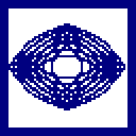

# ZVA-0094 — Android Chrome 192x192

[Visual archive index](../../README.md) · [Full catalog](../README.md) · [Category: Artwork and generative compositions](../categories/artwork.md)

## What this image shows

The woven-diamond project artwork exported as Android Chrome 192x192 for application, web, repository, or operating-system use. This entry preserves that specific presentation size and purpose.

## Role in Zoe

This is part of Zoe’s creative geometry and generative-art practice, preserving the artistic side of the project alongside its scientific instruments.

## Provenance and evidence boundary

**Provenance:** Project identity or interface asset.

Functional and identity artwork does not constitute research evidence.

## File identity

- Archive ID: **ZVA-0094**
- Visual family: **android-chrome-192x192**
- Dimensions/format: **192×192 PNG**
- Frames: **1**
- Bytes: **981**
- SHA-256: `936bcb79a112edef61de5b736cab4f1913c396286e180666710e4eca93a565e5`
- Original file: [Open full resolution](../../images/ZVA-0094.png)

## Source occurrences

Byte-identical copies are archived once while every known source path remains recorded.

| Source repository/collection | Original path | Canonical link |
|---|---|---|
| zoe | `components/ablation/assets/branding/woven-diamond/web/android-chrome-192x192.png` | [Source](https://github.com/Ablation-Tool/zoe/blob/main/components/ablation/assets/branding/woven-diamond/web/android-chrome-192x192.png) |
