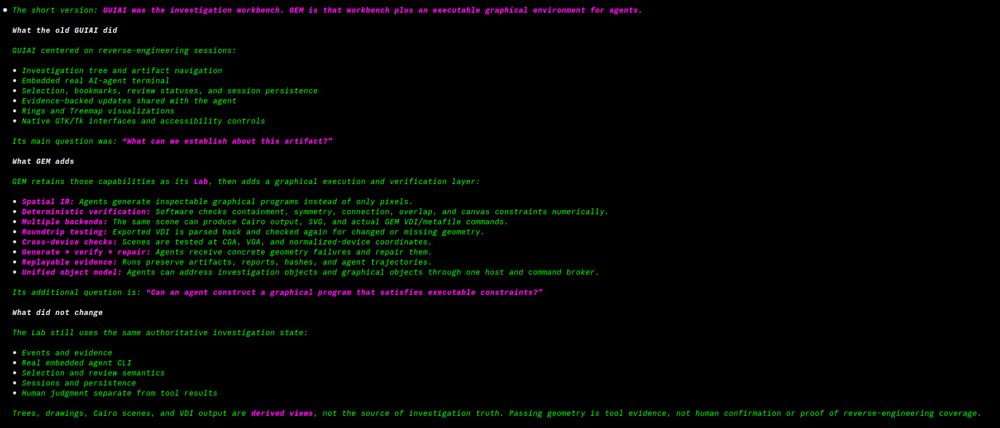

# ZVA-0101 — GEM Architecture 01

[Visual archive index](../../README.md) · [Full catalog](../README.md) · [Category: Mechanism and architecture diagrams](../categories/mechanism-diagram.md)

## What this image shows

Comparison of the former GUIAI workbench with GEM (Graphics Environment Manager) and its graphical verification capabilities. This diagram explains relationships among components, evidence states, measurements, or decisions without requiring the reader to reconstruct the architecture from code.

## Role in Zoe

This diagram explains relationships among components, evidence states, measurements, or decisions without requiring the reader to reconstruct the architecture from code.

## Provenance and evidence boundary

**Provenance:** Zoe/allgems project-generated visual.

The image is preserved with its source context; the visual alone does not prove a scientific or operational claim.

## File identity

- Archive ID: **ZVA-0101**
- Visual family: **gem-architecture-01**
- Dimensions/format: **1884×807 PNG**
- Frames: **1**
- Bytes: **142,822**
- SHA-256: `3d52b72779b8f0b5a0f6e69d58b131e61d117006099f72cee5389822e5c30c75`
- Original file: [Open full resolution](../../images/ZVA-0101.png)

## Source occurrences

Byte-identical copies are archived once while every known source path remains recorded.

| Source repository/collection | Original path | Canonical link |
|---|---|---|
| zoe | `components/ablation/assets/demos/gem-architecture-01.png` | [Source](https://github.com/Ablation-Tool/zoe/blob/main/components/ablation/assets/demos/gem-architecture-01.png) |

## Documented context

### Ablation + GEM (Graphics Environment Manager) architecture notes

Source document: `zoe:components/ablation/README.md`

Comparison of the former GUIAI workbench with GEM (Graphics Environment Manager) and its graphical verification capabilities

These visual notes explain the naming, framework relationship, shared Lab protocol, and single Ablation + GEM (Graphics Environment Manager) distribution.
