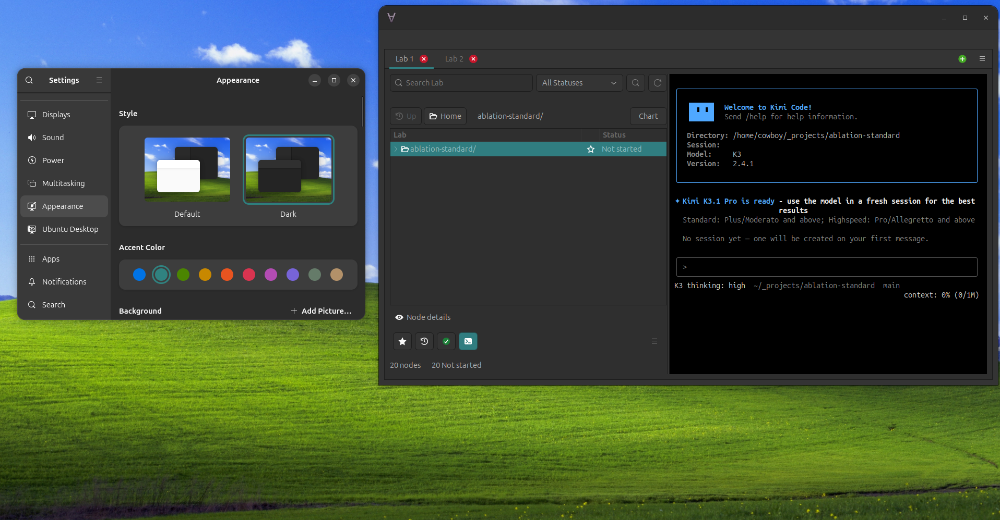

# ZVA-0125 — GEM Demo 20

[Visual archive index](../../README.md) · [Full catalog](../README.md) · [Category: Native interfaces and application scenes](../categories/interface.md)

## What this image shows

Teal OS accent color in GEM. This image documents a native, mobile, browser, or desktop interface and its available controls at a particular recorded state.

## Role in Zoe

This image documents a native, mobile, browser, or desktop interface and its available controls at a particular recorded state.

## Provenance and evidence boundary

**Provenance:** Zoe/allgems project-generated visual.

The image is preserved with its source context; the visual alone does not prove a scientific or operational claim.

## File identity

- Archive ID: **ZVA-0125**
- Visual family: **gem-demo-20**
- Dimensions/format: **1916×998 PNG**
- Frames: **1**
- Bytes: **1,479,692**
- SHA-256: `9c92d311f25c9552f0a28b3d9f87f50425c14df01b4b30733584b5bfb222217c`
- Original file: [Open full resolution](../../images/ZVA-0125.png)

## Source occurrences

Byte-identical copies are archived once while every known source path remains recorded.

| Source repository/collection | Original path | Canonical link |
|---|---|---|
| zoe | `components/ablation/assets/demos/gem-demo-20.png` | [Source](https://github.com/Ablation-Tool/zoe/blob/main/components/ablation/assets/demos/gem-demo-20.png) |

## Documented context

### GEM (Graphics Environment Manager) Workbench

Source document: `zoe:components/ablation/README.md`

Teal OS accent color in GEM
