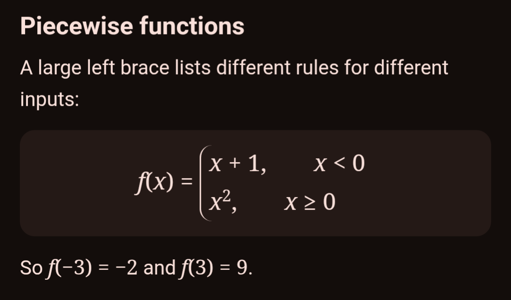

# ZVA-0135 — Screenshot 20261104 142622

[Visual archive index](../../README.md) · [Full catalog](../README.md) · [Category: Source references and derivative reading copies](../categories/reference.md)

## What this image shows

An immutable sacred-geometry source image (Screenshot 20261104 142622) containing mathematical notation or diagrams used for exact transcription, OCR comparison, pixel measurement, and replay.

## Role in Zoe

This asset preserves source context or a derivative reading view so that generated interpretations remain distinguishable from their references.

## Provenance and evidence boundary

**Provenance:** Immutable or derived sacred-geometry experiment source.

These images are source data for mathematical transcription, pixel measurement, and replay; they are not automatically original Zoe artwork.

## File identity

- Archive ID: **ZVA-0135**
- Visual family: **screenshot-20261104-142622**
- Dimensions/format: **1079×635 PNG**
- Frames: **1**
- Bytes: **95,009**
- SHA-256: `06a1b201dc85117748df1d0c8999f9b52a50a8503a82221d25f774e89c83544d`
- Original file: [Open full resolution](../../images/ZVA-0135.png)

## Source occurrences

Byte-identical copies are archived once while every known source path remains recorded.

| Source repository/collection | Original path | Canonical link |
|---|---|---|
| zoe | `components/ablation/experiments/sacred-geometry/source/Screenshot_20261104-142622.png` | [Source](https://github.com/Ablation-Tool/zoe/blob/main/components/ablation/experiments/sacred-geometry/source/Screenshot_20261104-142622.png) |
