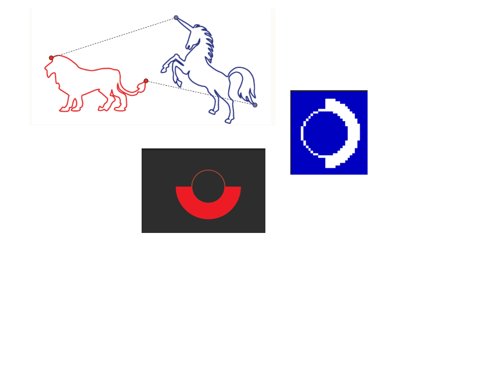

# ZVA-0141 — Untitled Drawing (1)

[Visual archive index](../../README.md) · [Full catalog](../README.md) · [Category: Source references and derivative reading copies](../categories/reference.md)

## What this image shows

The composite landmark-alignment source drawing used to define measured correspondences in the sacred-geometry experiment. This asset preserves source context or a derivative reading view so that generated interpretations remain distinguishable from their references.

## Role in Zoe

This asset preserves source context or a derivative reading view so that generated interpretations remain distinguishable from their references.

## Provenance and evidence boundary

**Provenance:** Immutable or derived sacred-geometry experiment source.

These images are source data for mathematical transcription, pixel measurement, and replay; they are not automatically original Zoe artwork.

## File identity

- Archive ID: **ZVA-0141**
- Visual family: **untitled drawing (1)**
- Dimensions/format: **960×720 PNG**
- Frames: **1**
- Bytes: **48,749**
- SHA-256: `69cce75c94980f67a378cec27304884146ef57fef54302e241fd5ca62339a46f`
- Original file: [Open full resolution](../../images/ZVA-0141.png)

## Source occurrences

Byte-identical copies are archived once while every known source path remains recorded.

| Source repository/collection | Original path | Canonical link |
|---|---|---|
| zoe | `components/ablation/experiments/sacred-geometry/source/Untitled drawing (1).png` | [Source](https://github.com/Ablation-Tool/zoe/blob/main/components/ablation/experiments/sacred-geometry/source/Untitled%20drawing%20%281%29.png) |
