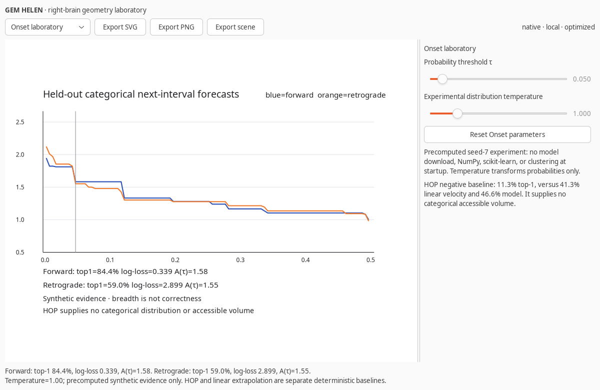

# ZVA-0169 — Helen Onset

[Visual archive index](../../README.md) · [Full catalog](../README.md) · [Category: Research figures and measurements](../categories/research-figure.md)

## What this image shows

GEM HELEN Onset laboratory. This figure preserves a measurement, model output, simulation, geometric construction, or research explanation from the Zoe/allgems program.

## Role in Zoe

This figure preserves a measurement, model output, simulation, geometric construction, or research explanation from the Zoe/allgems program.

## Provenance and evidence boundary

**Provenance:** Zoe/allgems project-generated visual.

The image is preserved with its source context; the visual alone does not prove a scientific or operational claim.

## File identity

- Archive ID: **ZVA-0169**
- Visual family: **helen-onset**
- Dimensions/format: **1200×780 PNG**
- Frames: **1**
- Bytes: **75,004**
- SHA-256: `3e5b7dc37e65f0602e5f5c8760315c8c583a47621858c35f2438c0225021fc9f`
- Original file: [Open full resolution](../../images/ZVA-0169.png)

## Source occurrences

Byte-identical copies are archived once while every known source path remains recorded.

| Source repository/collection | Original path | Canonical link |
|---|---|---|
| zoe | `components/gem-helen/docs/images/helen-onset.png` | [Source](https://github.com/Ablation-Tool/zoe/blob/main/components/gem-helen/docs/images/helen-onset.png) |

## Documented context

### Native views

Source document: `zoe:components/gem-helen/README.md`

GEM HELEN Onset laboratory
