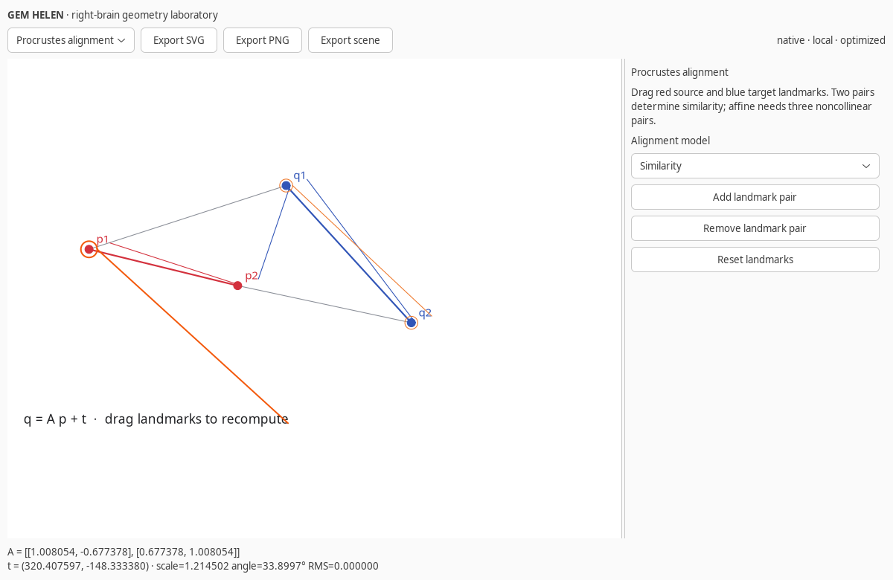

# ZVA-0170 — Helen Procrustes

[Visual archive index](../../README.md) · [Full catalog](../README.md) · [Category: Research figures and measurements](../categories/research-figure.md)

## What this image shows

GEM HELEN Procrustes playground. This figure preserves a measurement, model output, simulation, geometric construction, or research explanation from the Zoe/allgems program.

## Role in Zoe

This figure preserves a measurement, model output, simulation, geometric construction, or research explanation from the Zoe/allgems program.

## Provenance and evidence boundary

**Provenance:** Zoe/allgems project-generated visual.

The image is preserved with its source context; the visual alone does not prove a scientific or operational claim.

## File identity

- Archive ID: **ZVA-0170**
- Visual family: **helen-procrustes**
- Dimensions/format: **1200×780 PNG**
- Frames: **1**
- Bytes: **66,201**
- SHA-256: `2eb1ce43eea9ae589c26034599e60124f83f48c4e0302cc106aaa73b4fa62680`
- Original file: [Open full resolution](../../images/ZVA-0170.png)

## Source occurrences

Byte-identical copies are archived once while every known source path remains recorded.

| Source repository/collection | Original path | Canonical link |
|---|---|---|
| zoe | `components/gem-helen/docs/images/helen-procrustes.png` | [Source](https://github.com/Ablation-Tool/zoe/blob/main/components/gem-helen/docs/images/helen-procrustes.png) |

## Documented context

### Native views

Source document: `zoe:components/gem-helen/README.md`

GEM HELEN Procrustes playground

- GTK/Cairo imported only for native rendering or PNG output. - No server, browser, background agent, model runtime, or automatic action.
