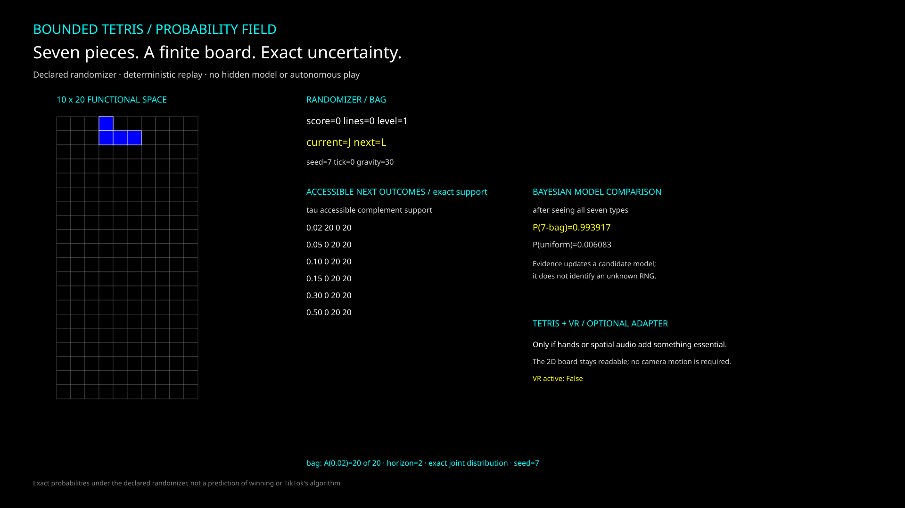

# ZVA-0172 — Bounded Tetris

[Visual archive index](../../README.md) · [Full catalog](../README.md) · [Category: Research figures and measurements](../categories/research-figure.md)

## What this image shows

The bounded Tetris probability-field scene, pairing the game board with exact randomizer and accessible-outcome measurements. This figure preserves a measurement, model output, simulation, geometric construction, or research explanation from the Zoe/allgems program.

## Role in Zoe

This figure preserves a measurement, model output, simulation, geometric construction, or research explanation from the Zoe/allgems program.

## Provenance and evidence boundary

**Provenance:** Zoe/allgems project-generated visual.

The image is preserved with its source context; the visual alone does not prove a scientific or operational claim.

## File identity

- Archive ID: **ZVA-0172**
- Visual family: **bounded-tetris**
- Dimensions/format: **SVG 1920×1080**
- Frames: **vector/not applicable**
- Bytes: **43,187**
- SHA-256: `d713a66a698af79ea498a07e5c07d8e719d7b8cc5bc60f5429d30e895960f9c5`
- Original file: [Open full resolution](../../images/ZVA-0172.svg)

## Source occurrences

Byte-identical copies are archived once while every known source path remains recorded.

| Source repository/collection | Original path | Canonical link |
|---|---|---|
| zoe | `components/graphics-environment-manager/docs/images/bounded-tetris.svg` | [Source](https://github.com/Ablation-Tool/zoe/blob/main/components/graphics-environment-manager/docs/images/bounded-tetris.svg) |

## Related format/size variants

- [ZVA-0171](ZVA-0171.md)
