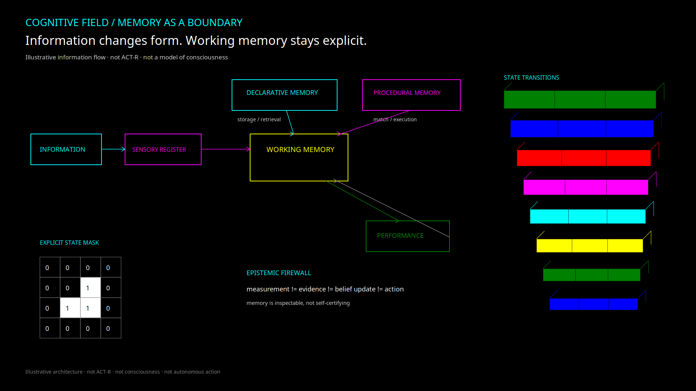

# ZVA-0173 — Cognitive Field

[Visual archive index](../../README.md) · [Full catalog](../README.md) · [Category: Research figures and measurements](../categories/research-figure.md)

## What this image shows

A Cognitive Field diagram showing sourced memory, revision checks, procedural matching, and explicit working-set boundaries. This figure preserves a measurement, model output, simulation, geometric construction, or research explanation from the Zoe/allgems program.

## Role in Zoe

This figure preserves a measurement, model output, simulation, geometric construction, or research explanation from the Zoe/allgems program.

## Provenance and evidence boundary

**Provenance:** Zoe/allgems project-generated visual.

The image is preserved with its source context; the visual alone does not prove a scientific or operational claim.

## File identity

- Archive ID: **ZVA-0173**
- Visual family: **cognitive-field**
- Dimensions/format: **1920×1080 PNG**
- Frames: **1**
- Bytes: **76,281**
- SHA-256: `8ddfe7f9a787fceba0303c728e8b5a1acdb58a70a80a80106584f247563834cf`
- Original file: [Open full resolution](../../images/ZVA-0173.png)

## Source occurrences

Byte-identical copies are archived once while every known source path remains recorded.

| Source repository/collection | Original path | Canonical link |
|---|---|---|
| zoe | `components/graphics-environment-manager/docs/images/cognitive-field.png` | [Source](https://github.com/Ablation-Tool/zoe/blob/main/components/graphics-environment-manager/docs/images/cognitive-field.png) |

## Related format/size variants

- [ZVA-0174](ZVA-0174.md)
