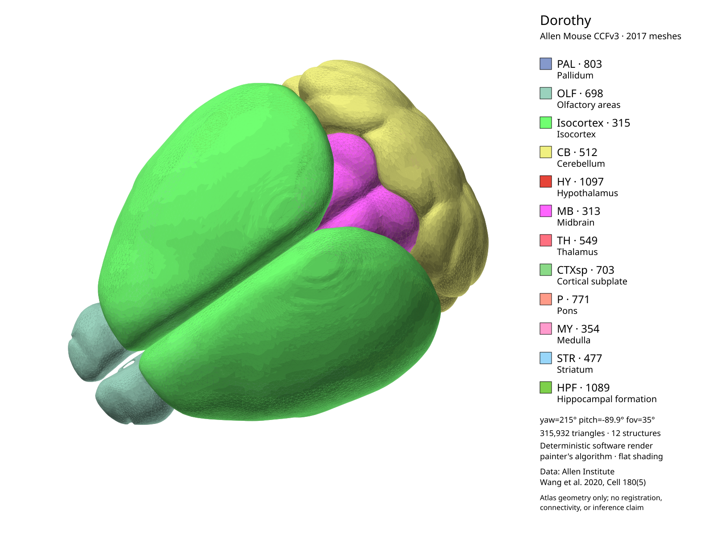

# ZVA-0176 — Dorothy Dorsal

[Visual archive index](../../README.md) · [Full catalog](../README.md) · [Category: Research figures and measurements](../categories/research-figure.md)

## What this image shows

A dorsal orientation of Dorothy’s Allen Mouse CCFv3 reference geometry, provided for spatial inspection rather than patient interpretation. This visual belongs to Dorothy’s inspectable spatial-research program, making reference geometry or a review instrument available for direct inspection.

## Role in Zoe

This visual belongs to Dorothy’s inspectable spatial-research program, making reference geometry or a review instrument available for direct inspection.

## Provenance and evidence boundary

**Provenance:** Zoe render using Allen Institute reference data.

Preclinical mouse-atlas geometry only; not patient anatomy, registration, diagnosis, or treatment evidence.

## File identity

- Archive ID: **ZVA-0176**
- Visual family: **dorothy-dorsal**
- Dimensions/format: **1600×1200 PNG**
- Frames: **1**
- Bytes: **911,386**
- SHA-256: `c3235636d97d6bd12e64867618efc02025e724810a234b7490433eeee256f50d`
- Original file: [Open full resolution](../../images/ZVA-0176.png)

## Source occurrences

Byte-identical copies are archived once while every known source path remains recorded.

| Source repository/collection | Original path | Canonical link |
|---|---|---|
| zoe | `components/graphics-environment-manager/docs/images/dorothy-dorsal.png` | [Source](https://github.com/Ablation-Tool/zoe/blob/main/components/graphics-environment-manager/docs/images/dorothy-dorsal.png) |
| zoe | `guiai-lab/docs/images/dorothy-dorsal.png` | [Source](https://github.com/Ablation-Tool/zoe/blob/main/guiai-lab/docs/images/dorothy-dorsal.png) |
