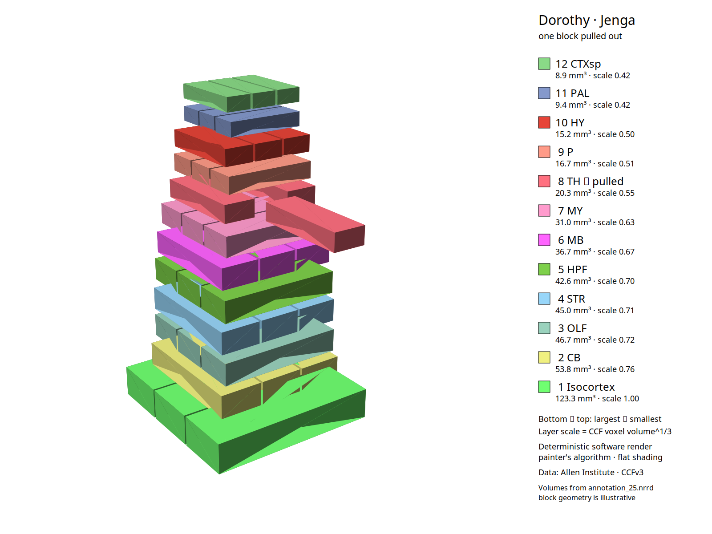

# ZVA-0178 — Dorothy Jenga Pull

[Visual archive index](../../README.md) · [Full catalog](../README.md) · [Category: Research figures and measurements](../categories/research-figure.md)

## What this image shows

Dorothy Jenga’s pull-out layout, separating selected atlas layers for inspection while retaining their volume-scaled context. This visual belongs to Dorothy’s inspectable spatial-research program, making reference geometry or a review instrument available for direct inspection.

## Role in Zoe

This visual belongs to Dorothy’s inspectable spatial-research program, making reference geometry or a review instrument available for direct inspection.

## Provenance and evidence boundary

**Provenance:** Zoe render using Allen Institute reference data.

Preclinical mouse-atlas geometry only; not patient anatomy, registration, diagnosis, or treatment evidence.

## File identity

- Archive ID: **ZVA-0178**
- Visual family: **dorothy-jenga-pull**
- Dimensions/format: **1600×1200 PNG**
- Frames: **1**
- Bytes: **226,237**
- SHA-256: `65f93163dfa0da135b7c621fb0efab79a295d3cd78817044c3e621fcbb9a6922`
- Original file: [Open full resolution](../../images/ZVA-0178.png)

## Source occurrences

Byte-identical copies are archived once while every known source path remains recorded.

| Source repository/collection | Original path | Canonical link |
|---|---|---|
| zoe | `components/graphics-environment-manager/docs/images/dorothy-jenga-pull.png` | [Source](https://github.com/Ablation-Tool/zoe/blob/main/components/graphics-environment-manager/docs/images/dorothy-jenga-pull.png) |

## Related format/size variants

- [ZVA-0179](ZVA-0179.md)
