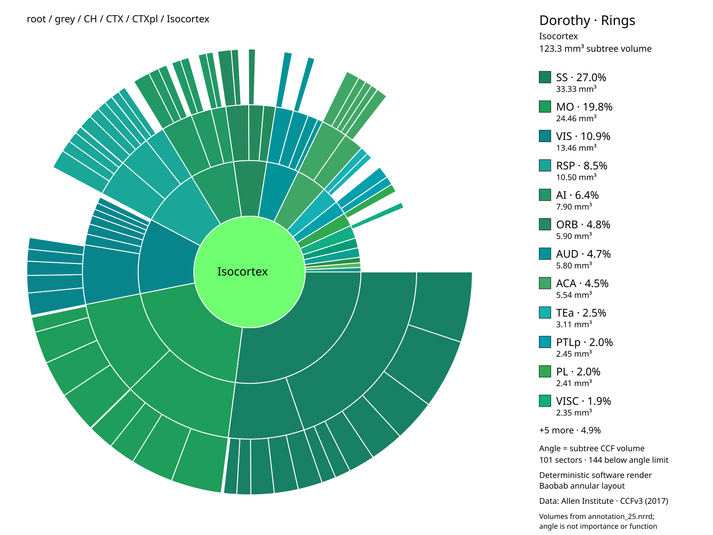

# ZVA-0180 — Dorothy Rings Isocortex

[Visual archive index](../../README.md) · [Full catalog](../README.md) · [Category: Research figures and measurements](../categories/research-figure.md)

## What this image shows

Dorothy Rings applied to isocortex ontology: exact subtree volumes are represented as a navigable radial partition, not as functional importance. This visual belongs to Dorothy’s inspectable spatial-research program, making reference geometry or a review instrument available for direct inspection.

## Role in Zoe

This visual belongs to Dorothy’s inspectable spatial-research program, making reference geometry or a review instrument available for direct inspection.

## Provenance and evidence boundary

**Provenance:** Zoe render using Allen Institute reference data.

Preclinical mouse-atlas geometry only; not patient anatomy, registration, diagnosis, or treatment evidence.

## File identity

- Archive ID: **ZVA-0180**
- Visual family: **dorothy-rings-isocortex**
- Dimensions/format: **1600×1200 PNG**
- Frames: **1**
- Bytes: **321,503**
- SHA-256: `cbbf65decf5cd42f4f291baf3fe528037c5daefb26e97eeeca73be313b189aae`
- Original file: [Open full resolution](../../images/ZVA-0180.png)

## Source occurrences

Byte-identical copies are archived once while every known source path remains recorded.

| Source repository/collection | Original path | Canonical link |
|---|---|---|
| zoe | `components/graphics-environment-manager/docs/images/dorothy-rings-isocortex.png` | [Source](https://github.com/Ablation-Tool/zoe/blob/main/components/graphics-environment-manager/docs/images/dorothy-rings-isocortex.png) |
| zoe | `guiai-lab/docs/images/dorothy-rings-isocortex.png` | [Source](https://github.com/Ablation-Tool/zoe/blob/main/guiai-lab/docs/images/dorothy-rings-isocortex.png) |
| zoe-autonomy | `paper/unified/figures/dorothy-rings-isocortex.png` | [Source](https://github.com/Ablation-Tool/Zoe-Autonomy/blob/main/paper/unified/figures/dorothy-rings-isocortex.png) |
| next-token | `paper/unified/figures/dorothy-rings-isocortex.png` | [Source](https://github.com/Ablation-Tool/next-token-predictability/blob/main/paper/unified/figures/dorothy-rings-isocortex.png) |
| paper-source-figures | `02-unified-autonomy/figures/dorothy-rings-isocortex.png` | [Source](https://github.com/Ablation-Tool/research-papers) |

## Documented context

### Dorothy and Neurogarden

Source document: `zoe:README.md`

Dorothy Rings Isocortex
